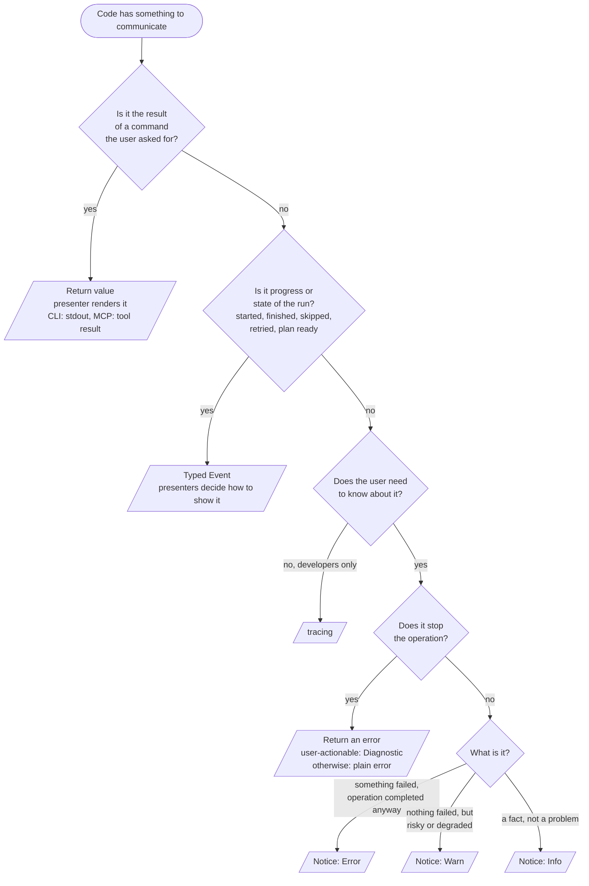

omni has one owner for each concern. Pick the channel by what the information
_is_, not by which crate you happen to have imported.

| Concern     | Question it answers                                        | Owner                                | Audience          |
| ----------- | ---------------------------------------------------------- | ------------------------------------ | ----------------- |
| Events      | What happened?                                             | Typed events in `omni_messages`      | Presenters        |
| Diagnostics | Why did the operation stop?                                | `omni_diagnostic`. Fatal errors only | The user or agent |
| Notices     | What should the user know, though the operation completed? | `omni_messages` + `omni_notice`      | The user or agent |
| Output      | Where and how is it shown?                                 | A presenter per surface              | The user or agent |
| Tracing     | Why did omni behave that way internally?                   | `tracing`                            | omni developers   |

## Where does it go?



## Rules

- **Libraries have no text sinks.** No `println!`, `eprintln!` or `log::*`.
  A lint (`clippy::disallowed_macros`, checked in CI with
  `cargo clippy --workspace --lib --bins`) enforces it. Presenter crates
  (`omni_cli_core`, `omni_mcp_core`, `omni_term_ui`) and binaries opt out with a
  crate-level `#![allow(clippy::disallowed_macros)]`.
- **Presenters hold no business logic.** They render what they are given.
- **Diagnostics are fatal; notices are not.** A diagnostic is never downgraded
  to a notice. If an option makes a condition tolerable, the run continues and a
  _different_ notice, with its own code, describes it
  (`meta.filter_failed` vs `meta.filter_excluded`).
- **`tracing` is never user output.** Use `tracing::{trace,debug,info,warn,error}!`
  and `#[tracing::instrument]` directly. The old `trace` wrapper crate and the
  `enable-tracing` features are gone.
- **An uncertain site defaults to `tracing`.** A notice is a public code that
  cannot be removed later.

## Writing a notice

A notice earns its place only if omitting it on one surface would mislead the
user, it is conditional on something about _this run_, no event or result
already carries it, and it is worth naming with a code.

```rust
use omni_notice::Notice;

omni_codes::prefixes!("cache"); // once per crate, in the module that owns the codes

/// Could not write a cache entry. The task result is unaffected.
#[derive(Notice)]
#[notice(code = "cache.write_skipped", level = error,
         message = "could not write cache entry for '{entry}'")]
struct CacheWriteSkipped { entry: String }

omni_messages::notice!(subscriber, CacheWriteSkipped { entry: id.clone() });
```

- The first doc line is the summary shown by `omni code explain`; the rest is the
  explanation. A missing summary is a compile error.
- The level is fixed by the type. `essential` notices (never hidden by `-q`,
  always sent over MCP) must be static: no fields, no placeholders.
- `notice!` builds the value only when the subscriber wants notices, redacts it
  once, mirrors it into `tracing`, then dispatches it.
- To attach a diagnostic's details and hints, use
  `diagnostic_notice!(sub, MyNotice { .. }, &diagnostic)`. The code, level and
  message always come from the notice.
- Codes are unique across the whole application and registered in `omni_codes`;
  the registry test in `omni_cli_core` validates prefixes, uniqueness and
  `related` links. A stable code is a contract and is never renamed or reused.

## Level meaning for tracing

`error`: an unexpected failure omni recovered from. `warn`: suspicious but
handled. `info`: major lifecycle points. `debug` and `trace` are detail. A user
is not expected to read any of them; if they should, it is a notice.
