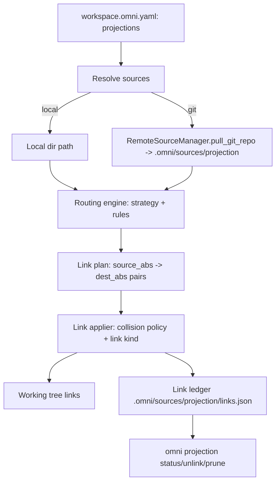

# RFC 0001: Workspace Projections (symlink routing from sources)

- **Status:** Draft <!-- Draft | Accepted | Implemented | Superseded -->
- **Owner:** TBD
- **Date:** 2026-08-26
- **Affected crates/files:** `omni_configurations`, `omni_remote_source`, `omni_lockfile`, `system_traits`, `omni_hasher`, a new `omni_projections` crate, `omni_api`, `omni_cli_core` (`commands/`), `omni_context` (`.omni` layout), `omni-oss/json-schemas` (`workspace.json`)
- **Prior art referenced:** GNU Stow, pnpm (`node_modules` linker), chezmoi, Bazel external repositories, Nx `nx sync`, Turborepo, Cargo (path/git deps)

## 1. Summary

This RFC proposes Workspace Projections, a declarative mechanism to take a
_source_ (a local directory or a pinned git repository) and materialize its
files into arbitrary destination directories in the workspace via symlinks (or
junctions, hardlinks, or copies where symlinks are unavailable), according to a
small set of routing strategies (mirror, explicit, pattern, flatten,
namespaced).

The key design decision is that omni already has the hard half of this feature.
`WorkspaceConfiguration` already carries `generators` and `tools` source lists
with `local`/`git` variants. `omni_remote_source::RemoteSourceManager` already
clones, pins (via `omni_lockfile`), materializes, and garbage-collects git
sources under `.omni/sources/<subsystem>/`. And `system_traits`'s sync facade
exposes cross-platform `BaseFsSymlinkFile` / `BaseFsSymlinkDir` /
`BaseFsCreateJunction` / `BaseFsHardLink`. Projections is therefore proposed as
a third source-consuming subsystem that reuses all of that plumbing and adds
three new pieces: a routing engine (source files to destination link pairs), a
link applier plus link ledger (apply, collide, track, teardown), and a small
async link-primitive layer in `system_traits`, because the async facade the
applier runs on does not yet have symlink, junction, or `read_link` methods
(§4.4).

## 2. Motivation / Problem

Developers need to place shared context files into _tool-specific_
destination directories (`.cursor/rules/`, `.claude/skills/`, `.git/hooks/`,
`./bin/`, `./assets/`) across many projects. These files include AI agent rules
and skills, prompt templates, tool definitions, linter and formatter configs,
git hooks, shared scripts, and design tokens. Today this is done by copy-paste
or ad-hoc scripts, which drift and are painful to update.

omni is well positioned for this. It is a workspace orchestrator that already
resolves remote and local sources for generators and tools. What it lacks is a
way to _project_ a source's files into destination paths and keep those links
in sync as the source changes. The outcome we want is small: a developer
declares one or more projection sources in `workspace.omni.yaml`, runs
`omni projection sync`, and the declared files appear as links in the right
places, tracked so they can be cleanly updated or removed.

## 3. Goals / Non-goals

### Goals

- Add a declarative `projections` source list to `WorkspaceConfiguration`, with
  the same `local`/`git` origin model as `generators`/`tools`.
- Unify the origin model into one generic `SourceConfig<E>` shared by the
  generator, tool, and projection subsystems, retiring the two existing
  duplicate enums (acting on the standing TODO in `tool_source_configuration.rs`)
  without changing the on-disk config shape.
- Support the five routing strategies from the source spec: mirror, explicit,
  pattern, flatten, namespaced.
- Materialize destinations as symlinks by default, with per-platform fallback
  (junction, hardlink, or copy) driven by the existing `system_traits`
  primitives.
- Track applied links in a link ledger so `omni projection sync` is idempotent
  and `omni projection unlink` / `omni projection prune` can tear down safely
  without deleting user-authored files.
- Provide collision policies (`skip`, `overwrite`, `backup`, `error`).
- Reuse `RemoteSourceManager` for git materialization, pinning, and GC.
- Confine the _untrusted_ half (a remote source's file tree) via realpath
  containment in the routing engine (source entries cannot escape the source
  root, and resolved destinations cannot escape the workspace or the declared
  target) plus a few built-in applier guardrails. This is not the code-sandbox
  capability subsystem, since projections execute no code (see §5.6).

### Non-goals

- **No imperative `add` command in v1.** Unlike the source spec's `ws-link add`,
  omni is config-first. The source of truth is `workspace.omni.yaml`, not
  CLI-mutated state. `add` may come later as a convenience that edits config.
- **No automatic sync on every task run in v1.** Projection is an explicit,
  side-effecting operation (`omni projection sync`). Auto-sync is rejected for v1
  (decision log #12) to avoid surprising working-tree mutation.
- **No content transformation / templating** of projected files (that is what
  the generator subsystem is for). Projections link or copy files verbatim.
- **No per-project (`project.omni.yaml`) projection declarations in v1.** Only
  workspace-level. Per-project scoping is a possible follow-up.
- **No cross-subsystem `install`/fetch command in v1.** Source materialization
  stays lazy (resolved on demand by `sync` for projections, and by
  `generator`/`tool` operations today). A future subsystem-agnostic `install`
  that warms `.omni/sources/<subsystem>` without touching the working tree is
  anticipated but out of scope here. `sync` is named so as not to collide with it
  (decision #27).

## 4. Background: current mechanisms

### 4.1 Sources are already a first-class, reused concept

`WorkspaceConfiguration` (`crates/omni_configurations/src/workspace_configuration.rs`)
already carries two source lists that are structurally identical:

```rust
#[serde(default, deserialize_with = "validate_generator_sources")]
pub generators: Vec<GeneratorSourceConfiguration>,

#[serde(default, deserialize_with = "validate_tool_sources")]
pub tools: Vec<ToolSourceConfiguration>,
```

Both `GeneratorSourceConfiguration` and `ToolSourceConfiguration` are the same
tagged enum shape (`generator_source_configuration.rs`,
`tool_source_configuration.rs`):

```rust
#[serde(tag = "source", rename_all = "kebab-case", deny_unknown_fields)]
pub enum GeneratorSourceConfiguration {
    Local(LocalGeneratorSourceConfiguration), // { path: SingleOrMany<String> }
    Git(GitGeneratorSourceConfiguration),     // { uri: Url, rev: String }
}
```

The `tool_source_configuration.rs` doc comment already states the intent to
unify these behind one shared type. This RFC acts on that. §5.1 replaces all
three copies (generator, tool, projection) with a single generic
`SourceConfig<E>`.

### 4.2 Remote source materialization, pinning, and GC already exist

`omni_remote_source::RemoteSourceManager` (`manager/default_impl.rs`) provides
exactly the "resolve a source to a local directory" behavior this feature needs:

- `pull_git_repo(uri, rev) -> PathBuf` clones (via `omni_git_utils::clone_repo`)
  into `source_dir_path/git/<url_to_safe_dir_name(uri)>/<rev>`, pinning the
  resolved commit in an `omni_lockfile::Lockfile`.
- `retain_git_sources(&[(uri, rev)])` garbage-collects source directories and
  lockfile entries no longer referenced by config.
- `lock()` persists the lockfile.

The generator subsystem wires this up in `omni_cli_core/src/commands/generator.rs`
(`get_generators`) and `omni_api/src/operations/generator.rs`:

```rust
let generator_sources_path = ctx.omni_dir().join("./sources/generator");
let lockfile_path = generator_sources_path.join("lock.json");
let remote_sources = RemoteSourceManager::new(
    RemoteSourceConfig::builder()
        .lockfile_path(lockfile_path)
        .soure_dir_path(generator_sources_path)
        .build(),
    sys.clone(),
).await?;
// ... per source: pull_git_repo(...) then discover under the returned dir
remote_sources.retain_git_sources(&git_sources).await?;
remote_sources.lock().await?;
```

The `.omni` layout is fixed in `omni_context::constants`: `OMNI_DIR = ".omni"`,
`CACHE_DIR = ".omni/cache"`. Generators use `.omni/sources/generator`. Projections
would use `.omni/sources/projection`.

### 4.3 The lockfile is versioned and git-commit-scoped

`omni_lockfile::data::LockfileData` is a `#[serde(tag = "version")]` enum with a
single `V1_0_0` variant holding `git: Map<Url, Map<String, GitRepoLockData>>`
(commit pins). It tracks _source pinning_ only, not applied links. Projections
need an additional link ledger (see §5.5); this is new state, distinct from
commit pinning.

### 4.4 Cross-platform link primitives exist, but only on the sync facade

`system_traits` exposes two parallel facades, and this distinction matters for
the applier.

The sync facade (`crates/system_traits/src/synch.rs`, re-exported from the
`sys_traits` crate) does carry the full linking set: `BaseFsSymlinkFile`,
`BaseFsSymlinkDir`, `BaseFsCreateJunction`, `BaseFsHardLink`, and
`BaseFsReadLink`.

The async facade (`crates/system_traits/src/asynch.rs`) is the one every omni
subsystem actually uses. `RemoteSourceManager`, `omni_collector`, and both
copies of `get_generators` are `async fn`, and the concrete impls are `RealSys`
(over tokio) and `InMemorySys`. It is a separate, hand-rolled set of traits, and
it currently implements only `BaseFsHardLinkAsync`, `BaseFsCopyAsync`,
`BaseFsMetadataAsync` (`fs_symlink_metadata_async` / `fs_is_symlink_async`),
`BaseFsRemoveFileAsync`, and `BaseFsRenameAsync`. There is no async
symlink-file, symlink-dir, junction, or `read_link` trait, and neither `RealSys`
nor `InMemorySys` implements one.

Consequence for this RFC: the link applier (§5.4) cannot merely "encode a
policy" over existing primitives. It first needs an async link layer that does
not exist yet: `BaseFsSymlinkFileAsync`, `BaseFsSymlinkDirAsync`,
`BaseFsCreateJunctionAsync`, and `BaseFsReadLinkAsync`, each with a `RealSys`
(tokio) and an `InMemorySys` impl, mirroring the existing `BaseFsHardLinkAsync` /
`BaseFsCopyAsync` pattern. This is small and mechanical, but it is new syscall
plumbing, so it is counted as a third new piece in §6.1 rather than folded into
"policy only". The source spec's §8.1 concern ("fall back to junction points on
Windows") is then a policy layered on top of those primitives, but the
primitives themselves must be added first. (Decision #17.)

### 4.5 Glob-based discovery already exists

`omni_configuration_discovery::ConfigurationDiscovery` (used by
`omni_tool::discover` and `omni_generator::discover`) globs a root for matching
files while honoring `.omniignore`. The projection routing engine needs the same
"glob a materialized source root" capability and can reuse this discovery/glob
infrastructure (or its underlying `dir_walker` + glob matcher) rather than
introducing a new globbing dependency.

### 4.6 Capabilities model (context; not directly reused for enforcement)

`omni_configurations::capabilities` defines `Subsystem { Generator, Tools }` and
a deny-dominant workspace `fs.write`/`net`/… floor, enforced by sandboxing the
syscalls of spawned generator/tool script processes via `bridge_rpc_runner`.
Projections spawn no process, so this enforcement path does not apply to them
(§5.6 explains why a `Subsystem::Projections` is deliberately not added).
Projections do not consult the capability system at all. Their safety comes
entirely from realpath containment and the built-in destination guardrails
(§5.6).

### 4.7 Input hashing follows symlinks (critical)

`omni_collector::Collector::collect` walks project files and, for a `Symlink`
entry, falls back to `fs_is_file_async` (a link-following stat) and hashes the
_target's_ content. Concretely, a projected symlink that lands inside a
project's hashed input set becomes a task input, and its resolved content is
hashed. This is central to the regression analysis (§6.5).



## 5. Proposed design

### 5.1 Unified generic source type (`SourceConfig<E>`)

Today `GeneratorSourceConfiguration` and `ToolSourceConfiguration` are two
byte-for-byte-identical `Local | Git` enums, and the `tool_source_configuration.rs`
doc comment already flags the intent to unify them. Rather than add a _third_
copy for projections, this RFC promotes them into one generic type owned by
`omni_configurations` (new module `source.rs`), expressing each subsystem's
per-source extras through a type parameter.

The shape follows an existing, well-used precedent in the repo.
`omni_input_schema::Input<E>` is an internally-tagged enum whose variant structs
`#[serde(flatten)]` a generic extras family and carry
`#[serde(deny_unknown_fields)]` and
`#[serde(bound(deserialize = "", serialize = ""))]`, deriving everything.
`omni_generator_configurations::ActionConfiguration` is an internally-tagged
enum (`#[serde(tag = "type")]`) with `#[serde(flatten)]` struct variants. So
`SourceConfig<E>` is an internally-tagged enum with per-variant generic structs
that flatten `E`:

```rust
/// A configured source: an internally-tagged `Local | Git` origin plus
/// subsystem-specific extras `E` flattened onto each variant, preserving the
/// flat wire shape `{ source: git, uri, rev, ...E }`. Shared by every
/// source-consuming subsystem (generators, tools, projections).
#[derive(Debug, Clone, PartialEq, Eq, Serialize, Deserialize, JsonSchema, Validate)]
#[serde(tag = "source", rename_all = "kebab-case", bound(deserialize = "", serialize = ""))]
#[schemars(bound(deserialize = "", serialize = ""))]
pub enum SourceConfig<E = NoExtra> {
    Local(LocalSource<E>),
    Git(GitSource<E>),
}

#[derive(Debug, Clone, PartialEq, Eq, Serialize, Deserialize, JsonSchema, Validate)]
#[serde(deny_unknown_fields, bound(deserialize = "", serialize = ""))]
#[schemars(bound(deserialize = "", serialize = ""))]
pub struct LocalSource<E = NoExtra> {
    pub path: SingleOrMany<String>,
    #[serde(flatten)]
    pub extra: E,
}

#[derive(Debug, Clone, PartialEq, Eq, Serialize, Deserialize, JsonSchema, Validate)]
#[serde(deny_unknown_fields, bound(deserialize = "", serialize = ""))]
#[schemars(bound(deserialize = "", serialize = ""))]
pub struct GitSource<E = NoExtra> {
    pub uri: Url,
    pub rev: String,
    #[serde(flatten)]
    pub extra: E,
}

/// The neutral extra for subsystems that attach nothing (generators, tools).
/// Flattens to zero fields, so `SourceConfig<NoExtra>` is byte-identical to the
/// current wire shape.
#[derive(Debug, Clone, PartialEq, Eq, Default, Serialize, Deserialize, JsonSchema, Validate)]
#[serde(deny_unknown_fields)]
pub struct NoExtra {}
```

Each subsystem is then a thin alias over the generic, so existing type names and
call sites keep working:

```rust
pub type GeneratorSourceConfiguration  = SourceConfig<NoExtra>;
pub type ToolSourceConfiguration       = SourceConfig<NoExtra>;
pub type ProjectionSourceConfiguration = SourceConfig<ProjectionExtra>;

/// Projections are the first subsystem to carry a non-trivial payload: a stable
/// id (used by the ledger's `source_id` and `omni projection unlink <id>`) plus
/// the routing rules that turn this source's files into destination links.
/// Kept **flat** (no nested `#[serde(flatten)]`) so it obeys serde's one-level
/// flatten-expansion rule (see the serde note below).
#[derive(Debug, Clone, PartialEq, Eq, Serialize, Deserialize, JsonSchema, Validate)]
#[serde(deny_unknown_fields)]
pub struct ProjectionExtra {
    pub id: String,
    pub projections: Vec<Projection>,
}
```

Per decision log #11 this is a clean break. `GeneratorSourceConfiguration` and
`ToolSourceConfiguration` remain as the `type` aliases above, so those names keep
resolving, but the old `Local*`/`Git*` newtype structs are deleted. No
`#[deprecated]` shims, since these are internal workspace crates with no external
SemVer consumer.

**Wire compatibility is preserved.** `SourceConfig<NoExtra>` serializes and
deserializes to exactly today's `{ source: local, path }` / `{ source: git, uri,
rev }` because `NoExtra` flattens to nothing. No existing `workspace.omni.yaml`
changes. Downstream `match` sites (e.g. `get_generators` in
`commands/generator.rs` and `operations/generator.rs`, the `retain_git_sources`
collection, and the validators) switch from matching the old newtype variants to
matching `SourceConfig::Local(l) => l.path` / `SourceConfig::Git(g) => (g.uri,
g.rev)`. This is a mechanical, compile-checked refactor.

**The three near-duplicate validators collapse into one generic validator.**
`validators.rs` currently has `GeneratorSourcesValidator` and
`ToolSourcesValidator` doing identical git-URI dedup. These become a single
`SourcesValidator<E, L>` where `L` is a compile-time label marker
(`Generator`/`Tool`/`Projection`) used only for the error message
("Duplicate {L} source git uri ..."), invoked per alias through the existing
`declare_static_validator!` macro to yield `validate_generator_sources`,
`validate_tool_sources`, and `validate_projection_sources`. The projection
instantiation also enforces that each source's `id` is unique across all
projection sources, which the git-uri dedup does not cover, because `id` is
projection-only and `local` sources have no uri. Since the ledger keys links by
`source_id` and `omni projection unlink <id>` targets it, a duplicate `id` would
silently corrupt teardown, so this is real validation, not cosmetic
(decision #18).

**Projection `id` must be a safe, relative, cross-platform path.** Because the
`namespaced` strategy uses `id` verbatim as the directory name under `target`
(decision #23) and `id` also keys the ledger and `unlink <id>`, a raw `id` could
otherwise carry an absolute path, a `..` traversal, a leading/trailing dot, or a
Windows-reserved name and steer or dangle the link. This is enforced with the
existing `serde_validate` pattern: a dedicated `ProjectionIdValidator` (a
`StaticValidator<String>` mirroring the current `SourceNameValidator`) is exposed
through `declare_static_validator!` as `validate_projection_id`, and
`ProjectionExtra.id` carries
`#[serde(deserialize_with = "validate_projection_id")]`.

`id` is a relative, forward-slash-delimited path (so `@myorg/pkg-a` is legal and
produces `target/@myorg/pkg-a`), validated as follows (decision #26):

- **`/` is the only delimiter.** A literal `\` is rejected, so the same config
  never produces a different tree shape on Windows vs. Unix. `/` is translated to
  the OS separator only when building filesystem paths; the value stored in the
  ledger and compared for uniqueness (decision #18) is always the canonical
  `/`-form.
- **Relative and non-escaping.** A leading `/` (absolute), any `.` or `..`
  segment (traversal), and empty segments (`//`, leading/trailing `/`) are all
  rejected, so `namespaced` can never express a containment escape at
  deserialize time.
- **Each segment is a safe path segment.** Every `/`-separated segment must match
  `^@?[A-Za-z0-9](?:[A-Za-z0-9._-]*[A-Za-z0-9])?$` (an optional leading `@` for
  npm-style scopes, otherwise start alphanumeric; end alphanumeric; only
  `[A-Za-z0-9._-]` between, so the Windows-reserved `<>:"|?*` set is impossible)
  and must not be, case-insensitively, a Windows reserved device name (`CON`,
  `PRN`, `AUX`, `NUL`, `COM1`-`COM9`, `LPT1`-`LPT9`).

Together this keeps `id` portable and containment-safe on every OS while allowing
scoped/nested namespaces such as `@myorg/pkg` (decision #26).

**Serde and schema derive cleanly, with no hand-written impls (decision #8).** An
earlier draft assumed `#[serde(flatten)]` disables `#[serde(deny_unknown_fields)]`
and therefore required a hand-written `Deserialize`. That is not true for this
repo's serde version, and the codebase already relies on the opposite:

- `omni_input_schema::Input<E>` flattens a generic extras family onto
  `deny_unknown_fields` variant structs and its `unit_profile_rejects_unknown_field`
  test passes.
- `omni_generator_configurations::ActionConfiguration` is an internally-tagged
  enum with `#[serde(flatten)]` struct variants under `deny_unknown_fields`; its
  `all_variants_reject_unknown_field` and `add_content_accepts_common_fields`
  tests pass.

So the derived `Deserialize` does reject unknown keys through the flatten
boundary. The one real rule, documented by the repo's own
`add_content_accepts_common_fields` regression, is that serde expands `flatten`
only one level when building the known-field set. This RFC respects it by keeping
`ProjectionExtra` flat (it never itself flattens another struct), so
`LocalSource<ProjectionExtra>`'s known set is exactly `{ path, id, projections }`
and any other key is rejected. `#[serde(bound(...))]` and `#[schemars(bound(...))]`
keep the generic clean, exactly as `Input<E>` does. Both `Deserialize` and
`JsonSchema` are therefore derived. No `serde_untagged` buffer, no manual schema
impl. A golden-schema test and the unknown-field tests (§6.3) guard the result.
(Decision #19.)

### 5.2 Configuration for projections

Add a `projections` list to `WorkspaceConfiguration`, mirroring `generators`:

```rust
#[serde(default, deserialize_with = "validate_projection_sources")]
pub projections: Vec<ProjectionSourceConfiguration>, // = Vec<SourceConfig<ProjectionExtra>>
```

Projection destination paths use `OmniPath` with a projection-local root
vocabulary, following the generator crate's precedent
(`omni_generator_configurations` defines `Root { Workspace, Output }` and
`pub type OmniPath = omni_types::OmniPath<Root>`). v1 has exactly one root:

```rust
#[derive(Debug, Clone, Copy, PartialEq, Eq, Hash, PartialOrd, Ord,
    enum_map::Enum, strum::Display, strum::VariantArray, strum::EnumString)]
#[strum(serialize_all = "kebab-case")]
pub enum Root { Workspace }

pub type OmniPath = omni_types::OmniPath<Root>;
```

`@workspace/...` and unrooted paths both resolve against the workspace root.
`@project`/`@home` are not variants, so they fail at deserialize time with
serde's "invalid root" error. There is no resolve-time special case, and the
`EnumMap<Root, &Path>` that `OmniPath::resolve` needs only carries a `Workspace`
entry (no dummy paths). Adding `@project` later (per-project projections) is a
purely additive `Root` variant.

`dest` uses its own single-variant root vocabulary, following the same
per-subsystem `Root` precedent (decision #29):

```rust
#[derive(Debug, Clone, Copy, PartialEq, Eq, Hash, PartialOrd, Ord,
    enum_map::Enum, strum::Display, strum::VariantArray, strum::EnumString)]
#[strum(serialize_all = "kebab-case")]
pub enum DestRoot { Target }

pub type DestPath = omni_types::OmniPath<DestRoot>;
```

`@target/...` resolves against the projection's already-resolved `target`, and an
unrooted `dest` is target-relative (the default). So `@target` is an explicit
spelling of the default anchor, and no other root is reachable. The
`EnumMap<DestRoot, &Path>` carries the single `Target` entry, built per projection
from the resolved `target`.

Because any leading `@` is otherwise parsed as a root token, a `dest` that must
begin with a literal `@` (npm scopes such as `@myorg/pkg`) is written `\@myorg/…`.
This needs a small, additive escape rule on the shared `omni_types::OmniPath`
(decision #29): a leading `\@` decodes to a literal leading `@`; a leading `\`
not followed by `@` is a literal `\`; nothing else is special. The rule is
symmetric in `Display` (an unrooted path whose first segment starts with `@` is
emitted as `\@…`) so values round-trip, applies to every `OmniPath` consumer
(strictly additive, since `\@` was previously unusable), and comes with a fix for
the pre-existing `from_str` panic on a bare `@root` with no `/`. `dest` templates
are expanded after the `OmniPath` root is parsed, so a source filename beginning
with `@` can never inject a root token; the expanded result is re-checked by dest
containment (§5.6).

The per-source `ProjectionExtra.projections` carries the routing rules:

```rust
pub struct Projection {
    pub strategy: ProjectionStrategy,      // mirror | explicit | pattern | flatten | namespaced
    #[serde(default)]
    pub target: OmniPath,                  // destination root (workspace-relative; `@workspace` or unrooted); defaults to the workspace root
    #[serde(default)]
    pub rules: Vec<ProjectionRule>,        // { match: String (glob), dest: DestPath (`@target` or unrooted; supports templates) }
    #[serde(default)]
    pub on_collision: CollisionPolicy,     // skip | overwrite | backup | error (default: backup)
    #[serde(default)]
    pub link: LinkKind,                    // auto | symlink | junction | hardlink | copy (default: auto)

    // Escape hatches for the §5.6 guardrails, both default false:
    #[serde(default)]
    pub allow_omni_config: bool,           // permit destinations another subsystem would load (decision #13)
    #[serde(default)]
    pub allow_git: bool,                   // permit destinations under `.git/**` (decision #13)
}
```

Each source also carries the `id` from `ProjectionExtra` (used by the ledger and
`unlink`). The two `allow_*` flags are the only way to defeat the built-in
safety refusals in §5.6; both default to `false`, so the safe behavior is the
default and every relaxation is explicit and visible in config.

Example `workspace.omni.yaml`:

```yaml
projections:
    - source: git
      id: team-ai-skills
      uri: https://github.com/org/ai-engineering-skills.git
      rev: main
      projections:
          - strategy: pattern
            target: "./"
            rules:
                - match: "prompts/**/*.md"
                  dest: ".cursor/rules/{name}.md"
                - match: "skills/**/*.json"
                  dest: ".claude/skills/{name}.json"
            on_collision: backup
    - source: local
      id: shared-scripts
      path: ./vendor/script-collection
      projections:
          - strategy: flatten
            target: "@workspace/bin"
            rules:
                - match: "scripts/**/*.sh"
            on_collision: overwrite
```

Scoped destinations (npm-style `@scope`) need the leading `@` escaped, since an
unescaped leading `@` parses as a `DestPath` root:

```yaml
projections:
    - source: git
      id: org-scoped
      uri: https://github.com/org/scoped-packages.git
      rev: main
      projections:
          - strategy: pattern
            target: "@workspace/node_modules"
            rules:
                - match: "packages/*"
                  dest: '\@myorg/{name}' # -> node_modules/@myorg/<pkg>
```

**`target` vs. `dest`.** The two operate at different levels and compose as
`final_dest = resolve(target) / expand(dest)`:

|                                    | `target`                                 | `dest`                                  |
| ---------------------------------- | ---------------------------------------- | --------------------------------------- |
| Level                              | per-projection (once per `Projection`)   | per-rule (once per `ProjectionRule`)    |
| Type                               | `OmniPath` (rooted / workspace-relative) | `DestPath` (rooted / target-relative)   |
| Root tokens                        | `@workspace`                             | `@target` (leading literal `@` is `\@`) |
| Templating (`{name}`, `{path}`, …) | no                                       | yes                                     |
| Containment rule                   | must stay within the workspace           | must stay within `target`               |
| Required?                          | optional, defaults to the workspace root | depends on strategy (below)             |

`target` selects the destination folder; `dest` selects a matched file's place
inside that folder. Only the routing strategies that actually route consult
`dest`:

- `pattern` requires `dest`.
- `flatten` allows an optional `dest`, defaulting to `{name}`.
- `explicit` requires `dest` (literal source path to literal `dest`; no implicit default).
- `mirror` does not use `dest`; entries map 1:1 preserving their source-relative path under `target` (an optional single `match` glob scopes the set).
- `namespaced` uses neither `dest` nor `rules`; the one link is always `target/<id>` (decision #22).

`target` is optional and defaults to the workspace root (equivalent to
`@workspace` / `./`); an explicit `target` always wins (decision #28). This makes
"route into the repo root" the zero-config case. When omitted, `dest` templates
and mirrored source paths resolve directly against the workspace root. A
`namespaced` projection with no `target` therefore links `./<id>` at the
workspace root, which is legitimate for root-level vendoring and overridable by
setting `target` explicitly.

**Path model.** A projection `target` is a workspace-relative `OmniPath`
(`@workspace/...` or unrooted, both resolving against the workspace root via the
single-variant `Root` above). Each `rules[].dest` is a `DestPath`
(`OmniPath<DestRoot>`): `@target/...` or unrooted, both resolving against the
projection's resolved `target`. A `local` source's `path` stays a
workspace-relative glob (`SingleOrMany<String>`, unchanged from generators/tools).
It is deliberately not an `OmniPath`, so the shared `SourceConfig::Local` variant
is untouched and no cache-sensitive change to generator/tool resolution is
introduced. There is no `~`/`$HOME` or out-of-workspace resolution in v1
(decisions #20 and #21). Local sources and targets are confined to the
workspace, which keeps projected links portable (relative) and CI-reproducible
and matches the §5.6 rule that a link whose target escapes the workspace is a
hard error. Cross-project fan-out and "external collection" use cases are handled
by `git` sources, which are pinned and portable on any machine.

Naming note: the name is settled as `projections` (config key) plus
`omni projection` (CLI), per decision log #9. The reasoning, for the record: two
clusters exist in prior art:

- `link`/`unlink` (npm `npm link`, Homebrew `brew link`, `ln`) and `stow` (GNU
  Stow's "symlink farm") are the most discoverable terms, but every one of them
  describes 1:1 placement. None perform the pattern, flatten, or namespace
  routing this feature does.
- "projection" is used by Kubernetes projected volumes and the Windows Projected
  File System (ProjFS) for exactly this case, routing and combining sources into
  a new shape. This matches the routing engine (§5.3), which is why it was chosen.

Two strikes against `link` for omni specifically: (1) it collides with omni's
existing project-graph dependency edges ("link" would read as "link projects
together"), and (2) it undersells the routing/transform. "Projection" avoids the
collision and captures the transform, at the cost of discoverability. CLI shape
follows the existing `omni <subsystem-noun> <action>` convention
(`omni tool run`, `omni generator list`), giving `omni projection sync`.
`sync`/`apply` were considered but are the reconciliation _verb_, not the name.
`sync` was chosen over `apply` as the reconcile action, and over `install`
because `install` connotes one-shot fetch-and-place and is instead reserved for a
possible future subsystem-agnostic source-materialization command (decision #27).

### 5.3 Routing engine (new crate `omni_projections`)

A pure, side-effect-free function per source:

```
plan(source_root: &Path, projection: &Projection, sys) -> Vec<LinkPair>
where LinkPair { source_abs: PathBuf, dest_abs: PathBuf }
```

Strategy semantics:

| Strategy     | Behavior                                                                                                                                                                                                                                                                                                                                                                                            |
| ------------ | --------------------------------------------------------------------------------------------------------------------------------------------------------------------------------------------------------------------------------------------------------------------------------------------------------------------------------------------------------------------------------------------------- |
| `mirror`     | Every entry under `source_root` maps 1:1 under `target` (optionally scoped by a single `match` glob).                                                                                                                                                                                                                                                                                               |
| `explicit`   | Each `rule.match` is a _literal relative path_; linked to `rule.dest` under `target`. Error if the source path is missing.                                                                                                                                                                                                                                                                          |
| `pattern`    | Each `rule.match` is a glob; each captured file routes to `rule.dest` after variable expansion.                                                                                                                                                                                                                                                                                                     |
| `flatten`    | Like `pattern`, but nested matches collapse into `target` (default `dest` = `{name}`); duplicate basenames trigger the collision policy.                                                                                                                                                                                                                                                            |
| `namespaced` | The whole `source_root` links as one directory-level link at `target/<namespace>`, where `<namespace>` is the source `id` (same for `local` and `git`). `id` may be a relative `/`-delimited path (e.g. `@myorg/pkg`), so the namespace can nest; the `/` is translated to the OS separator. Emits exactly one `LinkPair` (`target/<id>` → `source_root`) and does not consume `rules` (see below). |

`namespaced` is the only strategy that ignores `rules`; supplying `rules` on a
`namespaced` projection is a validation error (rejected at deserialize time),
not silently ignored, so the config cannot lie about what it links (decision #22).
The namespace is the source `id` rather than a slug derived from the git URI,
because every projection source already carries a unique `id` (decision #18) and
`local` sources have no URI to slugify (decision #23). When `id` is a nested,
`/`-delimited path (e.g. `@myorg/pkg`), the applier creates the intermediate
directories under `target`; teardown (`unlink <id>`) removes the leaf link and
then prunes now-empty ancestor directories it created, stopping at the first
non-empty directory or at `target`, so it never removes a directory still holding
user or other-projection content.

Destination templates support a small, fixed variable set (no arbitrary
expression engine): `{name}` (file stem), `{ext}`, `{basename}`, `{path}`
(match-relative dir), and `{parent}`. This is deliberately narrower than omni's
Tera/expression engines to keep routing predictable and cache-stable. Templates
expand in the `dest` tail after its `DestPath` root (`@target`) is parsed, so an
expanded value can never turn into a root token.

The engine first resolves each `target` through its `OmniPath` (`@workspace` or
unrooted → the workspace root), then resolves each `dest` through its `DestPath`
(`@target` or unrooted → the resolved `target`), then performs realpath
resolution and containment checks on both ends (source spec §8.2): the resolved
`source_abs` must stay within `source_root` (reject `..`/symlink escapes in the
source), and the resolved `dest_abs` must stay within the workspace root (and
within `target`). This prevents circular and escaping links before any write. The
same plan pass applies the §5.6 control-plane refusals (rejecting `dest`s another
subsystem would load, and `.git/**`) unless the relevant `allow_*` flag opts in,
so `--dry-run` reports every refusal without touching the tree.

### 5.4 Link applier

Given a `Vec<LinkPair>`, apply each with the configured collision policy and link
kind, using `system_traits`. Note (§4.4): the async primitives this section calls
(`fs_symlink_file` / `fs_symlink_dir` / `fs_create_junction` / `fs_read_link`) do
not exist on the async facade yet; adding them (base trait + `RealSys` +
`InMemorySys` impls) is part of this work.

- **Link kind resolution (`auto`):** try `fs_symlink_file`/`fs_symlink_dir`; on
  Windows permission failure, fall back to `fs_create_junction` for directories
  and `fs_hard_link` for files; final fallback is copy. `symlink`/`junction`/
  `hardlink`/`copy` force a specific kind (error if unsupported).
- **Relative symlinks** (source spec §6.3): because v1 confines both ends to the
  workspace (decisions #20/#21), `source_abs` and `dest_abs` always share the
  workspace root, so symlinks are written relative, and thus portable across
  clones and CI. Junctions/hardlinks are absolute by nature. There is no absolute
  / out-of-workspace symlink path in v1.
- **Collision policy**: inspect the existing dest via `fs_symlink_metadata_async`:
    - `skip` leaves the existing file and warns.
    - `overwrite` removes the existing file, then links.
    - `backup` renames it to `<name>.bak.<unix_ts>`, then links.
    - `error` aborts the whole sync.
    - **Ownership exception:** if the existing dest is a link the ledger already
      records for the same source with an unchanged `source_pin`, it is treated as
      up-to-date regardless of policy (re-point only if the pin changed). This is
      what makes `sync` idempotent.

### 5.5 Link ledger (state)

A new state file `.omni/sources/projection/links.json` records every applied
link. This is separate from the git-commit lockfile (`lock.json`) because it
tracks applied working-tree links, not source pins:

```jsonc
{
    "version": "1.0.0",
    "links": [
        {
            "source_id": "team-ai-skills", // the projection source's `id`
            "dest": ".cursor/rules/main.md", // workspace-relative
            "target": "...abs or rel...", // what the link points at
            "kind": "symlink", // symlink|junction|hardlink|copy
            "source_pin": "<git: locked commit | local: content hash of matched files>",
            "backup": ".cursor/rules/main.md.bak.1724650000", // if any
        },
    ],
}
```

The ledger enables:

- Idempotent `sync`: skip links already present whose recorded `source_pin` still
  matches (git commit unchanged, or `omni_hasher` content hash of the matched
  files unchanged, decision #15); re-point stale ones.
- Safe `unlink <id>`: remove only ledger-recorded links for that source; a
  `copy`-kind entry is only removed if its content hash is unchanged since
  projection (else warn), never blindly deleting user edits.
- `prune`: remove dangling symlinks whose target no longer resolves and which are
  recorded in the ledger (never touches unrecorded user files).
- `--clean-backups`: restore/remove `.bak.<ts>` files recorded per link.

The ledger is a dedicated file rather than a field in `omni_lockfile`
(decision #10). Source pins and applied links have different owners
(`RemoteSourceManager` vs. the projection applier) and lifecycles, so keeping
them separate avoids coupling a fetch-focused crate to placement state. The §5.7
`sync` ordering (ledger write before GC) keeps a crash recoverable.

**Committing and reconciliation (decision #30).** The ledger is derived,
machine-local state and is not committed. It falls under the existing
`.gitignore` rule `**/.omni/sources/*/**`; only `lock.json` is un-ignored
(`!**/.omni/sources/*/lock.json`), so no new ignore entry is added for
projections. Committing the ledger would create cross-platform churn and merge
conflicts. Link `kind` varies by OS under `auto` (symlink vs. junction/copy),
`backup` names carry timestamps, and a `local` `source_pin` is a content hash
that changes with local edits. None of that belongs in git.

The two committed files that guarantee reproducibility are `workspace.omni.yaml`
(the declared `projections`) and `lock.json` (the source pins). From those two
alone, `sync` reconstructs the entire desired link set: it re-materializes each
source at its pinned commit, re-plans from config, and re-applies. The ledger is
therefore an optimization (idempotency) and an ownership record (safe teardown),
never the source of truth. Consequences when state is missing:

- **Ledger absent (fresh clone):** `sync` regenerates every declared link and
  rebuilds the ledger. Full recovery.
- **A link deleted from the working tree:** re-applied from the plan.
- **Ledger present but a source was removed from config:** the link is an orphan;
  detecting and removing it (`prune`/`unlink`) is the only capability that
  genuinely needs the ledger, because omni's prior ownership cannot be inferred
  from the tree structure alone. Backup restoration (`--clean-backups`) and
  `copy`-kind safe teardown similarly degrade without a ledger; forward reconcile
  of declared links does not.

**Corrupt or unparseable ledger:** treat it as empty and warn. Config remains
authoritative, so forward reconcile still fully applies, but never delete
anything on the basis of an unreadable ledger (no ownership record means no
destructive teardown), so a damaged ledger can never cause data loss.

### 5.6 Safety model (containment, not capability enforcement)

Projections execute no code. They only create filesystem links. omni's
capability system, by contrast, exists to sandbox _spawned script processes_
(generators, tools) by mediating their syscalls through the bridge runner. There
is no process here to confine, so this feature deliberately does not register an
enforced `Subsystem::Projections`. The protection instead lives where the
untrusted input actually flows: the routing engine and the link applier.

The trust boundary: the workspace author writes `workspace.omni.yaml` (trusted);
a remote git source's file tree is untrusted. The defenses:

1. **Source-side realpath containment (the most important control).** Every
   candidate source entry is `realpath`-resolved and must remain within
   `source_root`. This rejects a malicious source shipping `secret -> /etc/passwd`
   or `x -> ../../../.ssh/id_rsa`. Without it, a mirrored link would resolve
   outside the workspace, and because `omni_collector` follows symlinks when
   hashing (§4.7), it could pull a secret's content into the cache and any remote
   cache upload.
2. **Dest-side realpath containment.** The resolved destination (after expanding
   `{name}`/`{path}`/… templates) must stay within the workspace root and within
   the projection's declared `target`. A malicious source _filename_
   (`../../etc/cron.d/evil`) therefore cannot steer a link outside the intended
   directory.
3. **Applier guardrails (cheap, built-in):**
    - **Refuse control-plane injection.** Reject at plan time any link whose
      resolved destination would be discovered/loaded by another omni subsystem,
      i.e. whose basename matches: `workspace.omni.*`, `project.omni.*`,
      `tool.omni.*`, the generator manifest name(s), `remote-cache.omni.*`,
      `.omniignore`, or any env file in the resolved `WorkspaceEnvConfiguration.files`
      set. These would inject a project/tool/generator, rewrite what gets hashed,
      redirect the remote cache to an attacker's server (`remote-cache.omni.*`),
      or inject env vars into task execution (`.env*`). Overridable only by an
      explicit per-projection opt-in (`allow_omni_config: true`). The env-file set
      is read from context, not hardcoded, so it tracks custom configs.
    - Refuse destinations under `**/.git/**` internals (the `.git/hooks`
      code-execution route) unless the projection sets `allow_git: true`.
    - **No out-of-workspace targets in v1.** Because `target` resolves only to
      `@workspace`/unrooted and local sources are workspace-confined (decisions
      #20/#21), there is no absolute-into-`~` link class to gate here; a
      source-content symlink that tries to escape is still caught by control #1
      above.
    - **Data-plane (ordinary files):** allow, but `status` flags a link that lands
      inside a project's hashed input set (its content joins that project's cache
      key, usually the intended effect). This escalates to a hard error only when
      the link target resolves outside the workspace (genuine non-determinism /
      exfiltration).

These are simple, testable path checks, not the full domain/strictness/floor-gap
machinery, which would be disproportionate for "which directories may I symlink
into." Projections deliberately do not consult the capability `fs.write` floor.
The built-in guardrails above are the complete safety floor, and pulling in
capability evaluation would add coupling and a second, confusing answer to "what
blocked this link."

### 5.7 CLI commands

Add an `omni projection` subsystem command mirroring `commands/tool.rs` and the
existing `omni <noun> <action>` convention (`omni tool run`,
`omni generator list`):

| Command                       | Flags                                               | Description                                                                                                                                                                                                                                                                                                                                                                                                                                                                                                                                     |
| ----------------------------- | --------------------------------------------------- | ----------------------------------------------------------------------------------------------------------------------------------------------------------------------------------------------------------------------------------------------------------------------------------------------------------------------------------------------------------------------------------------------------------------------------------------------------------------------------------------------------------------------------------------------- |
| `omni projection sync`        | `--dry-run`, `--force`, `--update`, `--source <id>` | Resolve sources (pull git), compute plans, apply links, update ledger + lockfile GC. `--force` re-applies every planned link even if the ledger records it as up-to-date (drift repair). `--update` re-resolves mutable git revs (branch/tag) to their current commit and re-pins the lockfile before applying; without it, existing pins are honored (offline/reproducible). `--dry-run` resolves + plans + reports collisions/containment refusals without applying (CI plan validation; exits non-zero on error, works on a fresh checkout). |
| `omni projection status`      | `--verbose`                                         | Audit active links; detect broken/dangling links and collisions; flag links under git-tracked paths not in `.gitignore` (advisory only, decision #14). v1 does not flag links that land inside a project's hashed input set (deferred, decision #25); the plan-time hard error when a link target resolves outside the workspace still applies (§5.6, containment, not advisory).                                                                                                                                                               |
| `omni projection unlink <id>` | `--clean-backups`                                   | Remove ledger links for the source with this `id`; optionally restore/remove backups.                                                                                                                                                                                                                                                                                                                                                                                                                                                           |
| `omni projection prune`       | `--dry-run`                                         | Remove dangling ledger-tracked links.                                                                                                                                                                                                                                                                                                                                                                                                                                                                                                           |

`sync` is the only mutating command and never runs implicitly (no auto-sync, no
drift exit-code, decision #12). `status` never mutates the tree or `.gitignore`.

`sync` is deliberately the reconcile verb (create/update/re-point links to the
declared state, complementing `unlink`/`prune` teardown), not `install`.
`install` connotes one-shot placement and covers neither re-pointing stale links
nor teardown. The name also reserves `install` for a possible future,
subsystem-agnostic source-materialization command (fetch + pin into
`.omni/sources/<subsystem>` without touching the working tree) shared by
generators/tools/projections (decision #27; see §3 Non-goals).

**`--force` vs. `--update`.** The two flags act on independent layers and combine
freely. Default `sync` (neither flag) honors existing lockfile pins (does not
advance a mutable `rev` like `main`) and skips links the ledger records as
up-to-date (idempotent), creating missing links and re-pointing stale ones.
`--update` acts on the source-pin layer: it re-resolves mutable git revs
(branch/tag) to their current remote commit and re-pins the lockfile before
applying (like `cargo update`); it has no effect on `local` sources (content-hash
pin, always recomputed) or on immutable commit-SHA pins. `--force` acts on the
working-tree layer: it re-applies every planned link even when the ledger reports
it up-to-date (drift repair, e.g. a user deleted, edited, moved, or changed the
kind of a projected link), without changing any git pin. In short: `--update`
changes which commit is projected; `--force` re-applies the links regardless of
whether the ledger thinks they are current.

| Scenario                                                         | Flag               |
| ---------------------------------------------------------------- | ------------------ |
| `rev: main` moved upstream; project the newer files              | `--update`         |
| A projected link was deleted/edited/moved and should be restored | `--force`          |
| Advance to latest **and** forcibly rewrite every link            | `--update --force` |
| Normal reconcile (create missing, re-point stale)                | neither            |

`sync` reuses the exact `RemoteSourceManager` pattern from `get_generators`
(with `soure_dir_path = .omni/sources/projection`), calling `pull_git_repo` per
git source, `retain_git_sources` + `lock()` for GC. The work lives in an
`omni_api` operation (`operations/projection.rs`) so the MCP server and CLI share
it, consistent with tools/generators.

## 6. Mandatory analysis

### 6.1 Existing mechanisms (reuse vs. extend vs. add)

- **Reuse unchanged:** `RemoteSourceManager` (materialize/pin/GC),
  `omni_git_utils` (clone, `url_to_safe_dir_name`), the async `system_traits`
  primitives that already exist (`fs_hard_link_async`, `fs_copy_async`,
  `fs_symlink_metadata_async`, `fs_rename_async`, `fs_remove_file_async`),
  `ConfigurationDiscovery`/`dir_walker`/glob for source walking, the
  `.omni/sources/<subsystem>` layout convention, the `omni_api` operation + CLI
  command pattern.
- **Unify:** the two existing `*SourceConfiguration` enums plus the new
  projection one collapse into one generic `SourceConfig<E>` (+ per-variant
  `LocalSource<E>`/`GitSource<E>`) and a single generic `SourcesValidator<E, L>`
  (§5.1). This is a reduction in code even as it adds a subsystem: three copies
  become one.
- **Extend:** `WorkspaceConfiguration` (+`projections`) and the JSON schema. (No
  new capability `Subsystem`; see §5.6.)
- **Add:** the `omni_projections` crate (routing engine + link applier + ledger).
  This is new behavior (routing plus working-tree linking) with no existing
  analog, so a new crate is justified rather than overloading `omni_remote_source`
  (which is about _fetching_, not _placing_). It also adds the async link layer in
  `system_traits` (`BaseFsSymlinkFileAsync` / `BaseFsSymlinkDirAsync` /
  `BaseFsCreateJunctionAsync` / `BaseFsReadLinkAsync` with `RealSys` and
  `InMemorySys` impls), which does not exist today (§4.4). The `SourceConfig<E>`
  type itself needs no hand-written serde or schema impls. It derives everything,
  following the `Input<E>` / `ActionConfiguration` flatten + `deny_unknown_fields`
    - `bound(...)` precedent (§5.1).

The source spec proposes an entirely standalone `ws-link` tool with its own
manifest and lockfile. That is rejected for omni: it would duplicate the source
model, the git materialization, the lockfile, and the cross-platform link
primitives that already exist. The RFC's core value is not re-implementing them.

### 6.2 Maintenance cost

- New config: `projections` plus strategy, rule, and collision enums. This is a
  permanent schema commitment (schema versioning, `deny_unknown_fields`, garde
  validators mirroring `validate_generator_sources`).
- A new crate to keep building and testing in CI and the omni project graph.
- A new state file format (`links.json`) with its own versioning obligation.
- Cross-platform link policy is the highest ongoing cost. The fallback matrix
  (symlink → junction → hardlink → copy) must stay correct on Windows, macOS, and
  Linux. The sync `sys_traits` primitives are already cross-platform and tested,
  but this feature adds their async counterparts (§4.4) with fresh
  `RealSys`/`InMemorySys` impls, so there is a small amount of new syscall code
  whose semantics must stay in lock-step with the sync side.
- Serde and schema are derived, not hand-written (§5.1), so there is no bespoke
  deserializer or schema impl to maintain. The one rule future contributors must
  respect is serde's one-level flatten expansion: any subsystem's extra `E` must
  stay flat, or `deny_unknown_fields` would wrongly reject its fields. A
  wire-compat and unknown-field guard test (§6.3) pins this.
- Projection `id` uniqueness and path-safety are extra validation obligations
  beyond the reused git-uri dedup (§5.1). A dedicated `ProjectionIdValidator`
  keeps `id` a portable, relative, `/`-delimited path (canonicalized for
  uniqueness and ledger storage).
- New contributors touching sources now have one origin type to learn instead of
  three. It derives serde/schema like every other config type; the only rule to
  remember is serde's one-level flatten expansion. A subsystem's extra `E` must
  stay flat (no nested `#[serde(flatten)]`) or its fields would be wrongly
  rejected under `deny_unknown_fields` (the `add_content_accepts_common_fields`
  regression in `action_configuration.rs` documents this). The result is lower
  drift risk (no more keeping three enums in sync) with no bespoke deserializer to
  maintain.
- Migration: every `match Config::Local(..)/Git(..)` call site (generator and
  tool `get_generators`, the `validators.rs` dedup loops, the `retain_git_sources`
  tuple collection) must switch to destructuring `SourceConfig.origin`.
  Mechanical and compiler-enforced, but it touches `omni_configurations`,
  `omni_cli_core`, and `omni_api` in one change. Note that the change reaches two
  copies of `get_generators`, one in `omni_api/src/operations/generator.rs` and
  one in `omni_cli_core/src/commands/generator.rs`, both of which match on the
  origin today. Both must be updated (and are candidates for consolidation into
  the shared `omni_api` operation while here).

### 6.3 Testability

- Routing engine: a pure function, unit-tested per strategy with an in-memory
  tree (`dir_walker::impls::memory_dir_walker` marks entries as symlinks via
  `InMemoryDirEntry`'s `is_symlink` flag), asserting the exact `LinkPair` set for
  the pure path-mapping strategies. No filesystem needed. One caveat: the
  in-memory walker records only that an entry is a symlink, not its target, so the
  source-side realpath-containment check (below) cannot be exercised in-memory.
- Link applier and collision policies: integration tests over a
  `tempfile::TempDir` with `RealSys`, asserting link kind, relative vs absolute
  target, backup file creation, and idempotent re-sync. Mirrors
  `omni_tool::discover` and `omni_remote_source` test style.
- Ledger: round-trip serde tests plus teardown tests (`unlink`/`prune` never
  delete unrecorded files).
- Git sources: reuse the `RemoteSourceManager` test seams (`RemoteSourceSys`) so
  no network is required.
- Hard to test: Windows junction/permission fallback and symlink-privilege edge
  cases. Plan: gate Windows-specific assertions behind `#[cfg(windows)]` and rely
  on `system_traits`' own cross-platform coverage for the primitives; add CI
  matrix coverage for at least `sync` and `status` on Windows.
- Unified source type: serde round-trip tests proving `SourceConfig<NoExtra>`
  parses/serializes byte-identically to the pre-unification `{source, path}` /
  `{source, uri, rev}` shapes (wire-compat guard), that `ProjectionExtra` fields
  sit as siblings, and that the derived impl still rejects unknown keys per
  variant, mirroring the existing `unit_profile_rejects_unknown_field`
  (`omni_input_schema`) and `all_variants_reject_unknown_field`
  (`action_configuration`) tests. Golden-file tests on the generated JSON schema
  catch accidental shape changes to the published `workspace.json`.
- Safety and containment: the source-side realpath-escape guard (the exfiltration
  control, §5.6 #1) resolves an actual link target, which the in-memory walker
  cannot represent, so it is tested with `RealSys` over a `tempfile::TempDir` that
  contains a real escaping symlink. Destination-side containment (escape of the
  workspace/`target` after template expansion) and the `**/.git/**` refusal
  without `allow_git` are pure path checks and can be unit-tested directly. No
  process sandbox is involved in any of these.

### 6.4 Integration points

- Config load and merge: `WorkspaceConfiguration` deserialization plus the
  generic `validate_projection_sources` (the `SourcesValidator<E, L>`
  instantiation that dedupes git uris, same as generators/tools).
- `.omni` layout: `.omni/sources/projection/{lock.json,links.json}` and the
  materialized `git/<slug>/<rev>` trees.
- Source resolution: `RemoteSourceManager` (unchanged API).
- CLI and API: new `omni_api::operations::projection` plus `commands/projection.rs`,
  wired into `CliSubcommands` and the MCP tool registry.
- Shared `omni_types::OmniPath`: `dest` is `OmniPath<DestRoot>`, which requires
  the additive `\@` literal-escape rule on the shared `from_str`/`Display`
  (decision #29) plus the bare-`@root` panic fix; this touches every `OmniPath`
  consumer (generators included), so its round-trip test is the guard.
- Safety: the main controls are realpath containment in the routing engine
  (source and dest) plus built-in applier guardrails; no capability `Subsystem`
  is added and the capability system is not consulted at all (§5.6).
- Ordering: `sync` order is resolve → plan → apply → ledger write → git GC
  (`retain_git_sources`) → `lock()`. Ledger write must precede GC so a crash
  leaves a recoverable ledger.

### 6.5 Potential regressions

- **Caching correctness (highest risk).** Per §4.7, `omni_collector` follows
  symlinks and hashes the target's content. A projection that lands inside a
  project's hashed input set silently changes that project's hash and couples it
  to the (possibly remote) source. Consequences:
    - Task cache invalidation on every source change, sometimes desired, often
      surprising.
    - Non-determinism if a link's target resolves outside the workspace, whose
      content is not part of the workspace hash universe. In v1 a projection
      destination can no longer be steered out of the workspace (decisions
      #20/#21 confine both ends), so this reduces to a source tree that itself
      ships an escaping symlink, which §5.6 source-side containment catches.
    - **Mitigation (decisions #13/#25):** a link whose target resolves outside the
      workspace is a hard error at plan time (its content is outside omni's hash
      universe). Flagging a link that lands inside a hashed project input set is
      deferred past v1 (decision #25). Computing exact input-set membership couples
      projections to the collector/hasher pipeline, so v1 ships without it. Docs
      recommend projecting into `.gitignore`d/`.omniignore`d locations where the
      coupling is unwanted. This is the single most important correctness
      interaction to get right.
- **Discovery and subsystem injection.** A projected file whose name matches an
  omni discovery pattern would hijack another subsystem: `project.omni.*`,
  `tool.omni.*`, generator manifests, `workspace.omni.*` (graph/config),
  `remote-cache.omni.*` (cache redirection → exfiltration), `.omniignore`
  (hash scope), or an env file (env-var injection into execution).
  Mitigation: the §5.6 control-plane refuse-list rejects these at plan time
  unless `allow_omni_config: true` is set on the projection.
- **Cache coupling from data-plane links.** An ordinary projected file inside a
  project's inputs joins that project's hash, usually intended, but it couples
  the key to (possibly remote) source content. Mitigation: a link whose target
  escapes the workspace is a hard error (§5.6), since its content is outside
  omni's hash universe; the `status` advisory for in-input-set links is deferred
  past v1 (decision #25).
- **Determinism of `sync`.** Backup filenames use timestamps, so they are
  non-reproducible. Mitigation: timestamps only appear in `bak` names recorded in
  the ledger, never in hashes; `--dry-run` output is deterministic (no timestamps
  in the plan).
- **Shared `OmniPath` grammar change.** Adding the `\@` literal-escape (decision
  #29) to `omni_types::OmniPath::from_str`/`Display` alters parsing/formatting for
  every consumer (generator `@workspace`/`@output`/`@project`, projection
  `target`/`dest`). It is strictly additive (`\@` was previously unusable and no
  existing config relies on a leading `\`), but a non-symmetric `Display` would
  silently break serialize→deserialize round-trips (a literal `@myorg` flipping
  into a root token). Mitigation: implement `from_str` and `Display` symmetrically,
  fix the bare-`@root` panic, and add a round-trip test covering rooted, unrooted,
  and `\@`-escaped values across all `Root` vocabularies.
- **Cross-platform path handling.** Windows path separators and case-insensitive
  collisions. Mitigation: resolve `OmniPath` targets and normalize via the
  existing path utils/`system_traits`; treat dest collisions case-insensitively
  on Windows.
- **Silent failure.** Partial application (some links created, then error).
  Mitigation: ledger records each link as it is applied; `sync` is resumable and
  `status` reports drift. `on_collision: error` aborts before mutating further.
- **`.git/hooks` hazard.** Linking executable hooks from a remote source is a way
  to run arbitrary code. Mitigation: the applier refuses destinations under
  `**/.git/**` unless the projection sets `allow_git: true` (§5.6); dest realpath
  containment prevents reaching git internals by traversal.
- **Origin-unification reach.** Collapsing three types into `SourceConfig<E>`
  touches every source `match` site; a missed site could fail to compile (caught)
  or a subtle serde difference could change parsing. Mitigations: the refactor is
  compiler-enforced (types change), the wire-compat and unknown-field tests above
  are the guard, and the change is landed atomically in one commit.
- **`deny_unknown_fields` through flatten.** Strict unknown-key rejection must
  survive the `#[serde(flatten)]` boundary. This is not a new risk in this repo.
  `Input<E>` and `ActionConfiguration` already derive exactly this and their
  reject-tests pass. The single real constraint is serde's one-level flatten
  expansion, so `ProjectionExtra` (and any future `E`) must stay flat.
  Mitigation: keep `E` flat by construction; a regression test asserts
  `{source: git, uri, rev, typo: 1}` is rejected.
- **Published-schema restructuring.** The generated `workspace.json` changes from
  three standalone definitions to a generic `SourceConfig_for_*` with `allOf`
  merges from the flatten. It stays semantically equivalent but consumers pinning
  exact `$ref` names could notice. Mitigation: it is a generated artifact;
  regenerate and eyeball the diff, and keep the golden schema test. The schema is
  derived (with `#[schemars(bound(...))]`, like `Input<E>`'s variant structs), so
  there is no manual schema impl to drift.
- **New async FS primitives (correctness + cross-platform).** Adding
  `BaseFsSymlinkFileAsync` / `SymlinkDirAsync` / `CreateJunctionAsync` /
  `ReadLinkAsync` is new syscall code (§4.4). Its semantics must match the
  existing sync `sys_traits` primitives, and `InMemorySys` must model created
  symlinks (currently its async impls cover only hardlink/copy), or applier
  tests that read links back will silently diverge from real-FS behavior.
  Mitigation: mirror the existing `BaseFsHardLinkAsync`/`BaseFsCopyAsync` impls
  exactly, and add a `RealSys`-backed round-trip test (create link → read link)
  alongside the `InMemorySys` one.

### 6.6 Pros and cons

| Option                                                                                                                                                      | Pros                                                                                                                                                                                                                                                                                                                   | Cons                                                                                                                                               | Verdict |
| ----------------------------------------------------------------------------------------------------------------------------------------------------------- | ---------------------------------------------------------------------------------------------------------------------------------------------------------------------------------------------------------------------------------------------------------------------------------------------------------------------- | -------------------------------------------------------------------------------------------------------------------------------------------------- | ------- |
| **A. New `omni_projections` subsystem reusing sources + RemoteSourceManager + system_traits, with the origin unified into `SourceConfig<E>` (recommended)** | Maximal reuse; consistent with generators/tools; cross-platform link _semantics_ reuse the tested sync `sys_traits` primitives; `SourceConfig<E>` derives serde/schema via the existing `Input<E>` flatten precedent (no bespoke impls); safety via engine containment; _reduces_ the source-config code (3 types → 1) | Must add async link primitives to `system_traits` (§4.4); unification touches several crates in one change; caching interaction must be documented | ✅      |
| B. Standalone `ws-link`-style tool with its own manifest + lockfile (as in source spec)                                                                     | Self-contained; closest to the original spec                                                                                                                                                                                                                                                                           | Duplicates source model, git fetch, lockfile, and cross-platform link primitives; parallel config; higher long-term cost                           | ❌      |
| C. Implement projections as a built-in **generator** (scaffold links via generator actions)                                                                 | Reuses generator confinement + scripting                                                                                                                                                                                                                                                                               | Generators are for content templating, not symlink lifecycle; no ledger/teardown; no idempotent re-point; wrong mental model                       | ❌      |
| D. Extend `RemoteSourceManager` itself to also place links                                                                                                  | Fewer crates                                                                                                                                                                                                                                                                                                           | Conflates fetching with placement; bloats a focused crate; harder to test routing in isolation                                                     | ❌      |

### 6.7 Prior art and how omni improves on it

| Tool                        | Their approach                                                            | What to adopt                                                  | What to change for omni                                                                                                                           |
| --------------------------- | ------------------------------------------------------------------------- | -------------------------------------------------------------- | ------------------------------------------------------------------------------------------------------------------------------------------------- |
| GNU Stow                    | Symlinks a package dir into a target tree (mirror), conflict detection    | The `mirror` strategy and 1:1 overlay mental model             | Add explicit/pattern/flatten/namespaced strategies; track links in a ledger instead of inferring from the tree; realpath containment on both ends |
| chezmoi / dotfile managers  | Source-of-truth repo applied to `$HOME`, with state tracking              | State ledger enabling clean teardown; git source               | Generalize beyond `$HOME` to arbitrary workspace/tool targets; declarative in `workspace.omni.yaml` rather than a separate tool                   |
| pnpm node_modules linker    | High-perf symlink/junction/hardlink with OS fallback                      | The link-kind fallback matrix (symlink→junction→hardlink→copy) | Reuse `system_traits` primitives; expose the kind as config (`link:`)                                                                             |
| Bazel external repositories | Pinned external repos materialized into an output base; content-addressed | Pinning via lockfile (already have it via `omni_lockfile`)     | Keep it lightweight/zero-build; no repository rules language                                                                                      |
| Nx `nx sync`                | Generators keep workspace files in sync, with a sync-check in CI          | The idea of a `status`/check that flags drift                  | Projections are link-based (not file writes) and have explicit teardown                                                                           |
| Cargo path/git deps         | `git` + `rev`/`branch` source pinning                                     | The `{ uri, rev }` origin shape (already omni's shape)         | Reuse verbatim; projections add routing on top                                                                                                    |

The concrete improvement over the source spec: rather than a new standalone tool,
projections _compose_ with omni's existing source/pinning machinery, so they
inherit git pinning, GC, and cross-platform linking for free, and stay
consistent with `generators`/`tools`. Safety comes from realpath containment in
the routing engine (right-sized for a pure-filesystem operation) rather than the
code-sandbox capability model, which targets executing scripts.

## 7. Decision log

> All questions raised during design review have been resolved; the resolutions
> and their rationale live here.

| #   | Decision                                                                                                                                                                                                                                                                                                                                                                                                                                                                                                                                                                                                                                                                                | Rationale                                                                                                                                                                                                                                                                                                                                                                                                                                                                                                                                                                                                                                                                                                                                                                                          |
| --- | --------------------------------------------------------------------------------------------------------------------------------------------------------------------------------------------------------------------------------------------------------------------------------------------------------------------------------------------------------------------------------------------------------------------------------------------------------------------------------------------------------------------------------------------------------------------------------------------------------------------------------------------------------------------------------------- | -------------------------------------------------------------------------------------------------------------------------------------------------------------------------------------------------------------------------------------------------------------------------------------------------------------------------------------------------------------------------------------------------------------------------------------------------------------------------------------------------------------------------------------------------------------------------------------------------------------------------------------------------------------------------------------------------------------------------------------------------------------------------------------------------- |
| 1   | Model projections as a third source-consuming subsystem, reusing `RemoteSourceManager`, `system_traits`, and the `.omni/sources/<subsystem>` layout                                                                                                                                                                                                                                                                                                                                                                                                                                                                                                                                     | Avoids duplicating source resolution, pinning, GC, and cross-platform link primitives that already exist                                                                                                                                                                                                                                                                                                                                                                                                                                                                                                                                                                                                                                                                                           |
| 2   | Reject the standalone `ws-link` tool design from the source spec                                                                                                                                                                                                                                                                                                                                                                                                                                                                                                                                                                                                                        | It would create a parallel config/lockfile/link stack; omni already has all the machinery                                                                                                                                                                                                                                                                                                                                                                                                                                                                                                                                                                                                                                                                                                          |
| 3   | Split the feature into a pure routing engine + a stateful link applier with a ledger                                                                                                                                                                                                                                                                                                                                                                                                                                                                                                                                                                                                    | Keeps routing unit-testable in isolation and makes teardown/idempotency safe                                                                                                                                                                                                                                                                                                                                                                                                                                                                                                                                                                                                                                                                                                                       |
| 4   | Do not add an enforced `Subsystem::Projections`; put safety in routing-engine realpath containment (source + dest) + built-in applier guardrails                                                                                                                                                                                                                                                                                                                                                                                                                                                                                                                                        | Projections execute no code, so the syscall-sandbox capability model does not fit; the real risks (symlink-target exfiltration via hashing, dest traversal, `.git`/PATH injection) are path-containment problems, not process-confinement ones                                                                                                                                                                                                                                                                                                                                                                                                                                                                                                                                                     |
| 5   | v1 is config-first and explicit-sync (no `add`, no auto-sync)                                                                                                                                                                                                                                                                                                                                                                                                                                                                                                                                                                                                                           | Consistent with omni being declarative; avoids surprising working-tree mutation; keeps scope bounded                                                                                                                                                                                                                                                                                                                                                                                                                                                                                                                                                                                                                                                                                               |
| 6   | Flag symlink-follows-hashing interaction as a first-class regression risk                                                                                                                                                                                                                                                                                                                                                                                                                                                                                                                                                                                                               | `omni_collector` hashes symlink targets; projections can silently change project hashes and couple them to remote content                                                                                                                                                                                                                                                                                                                                                                                                                                                                                                                                                                                                                                                                          |
| 7   | Unify the generator/tool/projection source configs into one generic `SourceConfig<E>` (internally-tagged enum with per-variant structs flattening `E`, defaulting to `NoExtra`) as part of this change, not later                                                                                                                                                                                                                                                                                                                                                                                                                                                                       | Acts on the standing `tool_source_configuration.rs` TODO; a third copy is the moment the duplication becomes untenable; `E` cleanly carries projection routing while keeping generators/tools at `NoExtra`; the shape mirrors the proven `Input<E>` / `ActionConfiguration` flatten-generic precedent                                                                                                                                                                                                                                                                                                                                                                                                                                                                                              |
| 8   | Preserve the flat wire format and strict unknown-field rejection with the derived serde impl (no hand-written `Deserialize`) by structuring `SourceConfig<E>` like `Input<E>` (`deny_unknown_fields` variant structs flattening a flat `E`, `bound(deserialize = "", serialize = "")`)                                                                                                                                                                                                                                                                                                                                                                                                  | Verified against the repo: `omni_input_schema`/`action_configuration` derive exactly this and their unknown-field-reject tests pass, so `deny_unknown_fields` is honored through flatten here; the only rule is serde's one-level flatten expansion, satisfied by keeping `E` flat                                                                                                                                                                                                                                                                                                                                                                                                                                                                                                                 |
| 9   | Name it `projections` (config key) + `omni projection` (CLI)                                                                                                                                                                                                                                                                                                                                                                                                                                                                                                                                                                                                                            | "Links" collides with omni's project-graph dependency edges; the routing engine makes this more than 1:1 linking; `stow`/`overlays` are obscure or misleading                                                                                                                                                                                                                                                                                                                                                                                                                                                                                                                                                                                                                                      |
| 10  | Track applied links in a dedicated `links.json` ledger, separate from the `lock.json` source pins                                                                                                                                                                                                                                                                                                                                                                                                                                                                                                                                                                                       | Pins and applied links have different owners and lifecycles; folding links into `omni_lockfile` would couple a fetch-focused crate to placement state and force a lockfile version bump affecting generators/tools                                                                                                                                                                                                                                                                                                                                                                                                                                                                                                                                                                                 |
| 11  | Clean break on the old source-config type names (no `#[deprecated]` shims)                                                                                                                                                                                                                                                                                                                                                                                                                                                                                                                                                                                                              | Internal workspace crates with no external SemVer consumer; the atomic, compiler-enforced refactor catches every call site; shims would just be a second spelling inviting drift                                                                                                                                                                                                                                                                                                                                                                                                                                                                                                                                                                                                                   |
| 12  | No auto-sync and no drift exit-code in v1; ship `status` (human audit) + `sync --dry-run` (CI plan validation)                                                                                                                                                                                                                                                                                                                                                                                                                                                                                                                                                                          | Auto-sync addresses a rare (per-config-change) need by taxing the frequently-run `run` path, breaking determinism/caching/offline/speed; the only drift-check consumer (a post-merge hook) re-creates the rejected implicit sync and needs the `.git` escape hatch                                                                                                                                                                                                                                                                                                                                                                                                                                                                                                                                 |
| 13  | Refuse (opt-in override) any link whose destination another omni subsystem would discover/load; allow data-plane files (warn, error only if target escapes the workspace)                                                                                                                                                                                                                                                                                                                                                                                                                                                                                                               | Control-plane files (project/tool/generator/workspace/remote-cache/ignore/env manifests) inject behavior, redirect the cache, or inject env vars; data-plane hashing is the feature's intended effect, so refusing it would gut the core use case. Note: the data-plane `status` advisory that flags links landing inside a hashed input set is deferred past v1 (decision #25); the hard error for targets escaping the workspace is unaffected.                                                                                                                                                                                                                                                                                                                                                  |
| 14  | Never modify `.gitignore`; leave it to the user (`status` gives a non-mutating advisory only)                                                                                                                                                                                                                                                                                                                                                                                                                                                                                                                                                                                           | `.gitignore` is a user-owned, git-tracked file; auto-editing it violates the same "don't touch files you don't own" principle behind rejecting auto-sync and refusing control-plane writes                                                                                                                                                                                                                                                                                                                                                                                                                                                                                                                                                                                                         |
| 15  | `local` source `source_pin` = content hash (via `omni_hasher`) over matched files only                                                                                                                                                                                                                                                                                                                                                                                                                                                                                                                                                                                                  | mtime is a silent-staleness hazard in a hash-correctness-critical tool; storing nothing leaves `copy`-kind teardown unable to tell user edits from staleness; hashing only matched files reuses the routing engine's enumeration                                                                                                                                                                                                                                                                                                                                                                                                                                                                                                                                                                   |
| 16  | Projections do not consult the capability `fs.write` floor at all                                                                                                                                                                                                                                                                                                                                                                                                                                                                                                                                                                                                                       | The built-in §5.6 guardrails are the complete safety floor; reusing capability evaluation adds a dependency and a second, confusing block-reason for marginal coverage of custom deny rules                                                                                                                                                                                                                                                                                                                                                                                                                                                                                                                                                                                                        |
| 17  | Add an async link-primitive layer to `system_traits` (`BaseFsSymlinkFileAsync` / `SymlinkDirAsync` / `CreateJunctionAsync` / `ReadLinkAsync` + `RealSys`/`InMemorySys` impls) rather than calling the sync primitives via `spawn_blocking`                                                                                                                                                                                                                                                                                                                                                                                                                                              | The async facade genuinely lacks these (only hardlink/copy/metadata exist) while the sync facade has all of them; adding them is trivial and mirrors the existing `BaseFsHardLinkAsync`/`CopyAsync` impls. `RealSys` maps symlink/read_link to `tokio::fs` (junction wraps the sync impl in `spawn_blocking`), and `InMemorySys` delegates to the sync `sys_traits` methods it already has. Keeps the applier uniformly async and testable against `InMemorySys`                                                                                                                                                                                                                                                                                                                                   |
| 18  | Projection `id` must be unique across all projection sources, enforced in the projection validator instantiation                                                                                                                                                                                                                                                                                                                                                                                                                                                                                                                                                                        | The ledger keys links by `source_id` and `unlink <id>` targets it; the reused git-uri dedup does not cover `id` (it is projection-only and `local` sources have no uri), so a duplicate would silently corrupt teardown                                                                                                                                                                                                                                                                                                                                                                                                                                                                                                                                                                            |
| 19  | **Derive** both `Deserialize` and `JsonSchema` for `SourceConfig<E>` (with `#[serde(bound(...))]` / `#[schemars(bound(...))]`), following the `Input<E>` precedent; keep each subsystem's extra `E` flat                                                                                                                                                                                                                                                                                                                                                                                                                                                                                | An earlier draft wrongly assumed flatten breaks `deny_unknown_fields` and the derived schema; the repo proves otherwise (`Input<E>` derives both and its reject-test passes). No `serde_untagged` buffer, no manual schema impl, no new dep; a golden-schema test plus unknown-field tests guard it                                                                                                                                                                                                                                                                                                                                                                                                                                                                                                |
| 20  | Projection `target`/`dest` are workspace-relative `OmniPath`s using a projection-local single-variant `Root { Workspace }` enum (mirroring `omni_generator_configurations::Root { Workspace, Output }`); the shared `LocalSource.path` stays `SingleOrMany<String>`                                                                                                                                                                                                                                                                                                                                                                                                                     | `@workspace`/unrooted resolve to the workspace root and `@project`/`@home` fail at deserialize as invalid roots (no resolve-time special case, no `EnumMap` dummy entries); keeping source `path` a plain glob leaves the `SourceConfig<E>` unification clean and avoids a cache-sensitive change to generator/tool resolution; a `Project` variant can be added additively if per-project projections land                                                                                                                                                                                                                                                                                                                                                                                        |
| 21  | Cut out-of-workspace `local` sources and targets, along with the `allow_out_of_workspace_target` flag and the absolute-symlink path, from v1; support `git` + in-workspace `local` sources only                                                                                                                                                                                                                                                                                                                                                                                                                                                                                         | `@home`/absolute targets produce machine-specific links that dangle on other machines and in CI, make `omni_collector` hash machine-local content (non-determinism / cache poisoning), and contradict §5.6's own "target escapes the workspace = hard error" rule; `git` sources already cover portable cross-project fan-out                                                                                                                                                                                                                                                                                                                                                                                                                                                                      |
| 22  | `namespaced` emits exactly one directory-level link (`target/<namespace>` → `source_root`) and consumes no `rules`; supplying `rules` on a `namespaced` projection is a validation error, not silently ignored                                                                                                                                                                                                                                                                                                                                                                                                                                                                          | A single dir link is the whole point of the strategy (fan a source in under a stable prefix); accepting `rules` that can never take effect would let config lie about what it links, so rejecting them keeps `--dry-run` and `status` truthful                                                                                                                                                                                                                                                                                                                                                                                                                                                                                                                                                     |
| 23  | The `namespaced` namespace is the source `id` (identical for `local` and `git`), not a slug derived from the git URI                                                                                                                                                                                                                                                                                                                                                                                                                                                                                                                                                                    | Every projection source already carries a unique `id` (decision #18) and `local` sources have no URI to slugify; reusing `id` keeps namespaces unique, stable, and uniform across source kinds                                                                                                                                                                                                                                                                                                                                                                                                                                                                                                                                                                                                     |
| 24  | Implement the RFC in four independently-compilable milestones, landed and reviewed in sequence: (M1) `SourceConfig<E>` unification, (M2) async link primitives, (M3) `omni_projections` config, routing, applier, ledger, and safety, (M4) CLI/API/MCP plus e2e                                                                                                                                                                                                                                                                                                                                                                                                                         | M1 is independently valuable and wire-compatible; M2 is a self-contained `system_traits` addition; sequencing keeps each change reviewable and the build green at every step, per the plan-before-code discipline                                                                                                                                                                                                                                                                                                                                                                                                                                                                                                                                                                                  |
| 25  | Defer the `status` advisory that flags a link landing inside a project's hashed input set past v1; v1 `status` still reports broken/dangling links, collisions, and git-tracked-not-in-`.gitignore`, and `sync`/plan still hard-errors on targets escaping the workspace                                                                                                                                                                                                                                                                                                                                                                                                                | Reproducing a project's exact hashed input set couples projections to the collector/hasher pipeline (a heavy integration) for an advisory-only signal; the correctness control that matters (a hard error on out-of-workspace targets) is containment, not this advisory, so deferring the advisory does not weaken safety                                                                                                                                                                                                                                                                                                                                                                                                                                                                         |
| 26  | Validate projection `id` as a safe, relative, `/`-delimited cross-platform path: `/` is the only delimiter (literal `\` rejected) and is translated to the OS separator, the canonical `/`-form is what the ledger stores and uniqueness compares, absolute/`.`/`..`/empty segments are rejected, and each segment must match `^@?[A-Za-z0-9](?:[A-Za-z0-9._-]*[A-Za-z0-9])?$` (optional leading `@` for npm-style scopes) and not be a Windows reserved device name (CON/PRN/AUX/NUL/COM1-9/LPT1-9, case-insensitive), enforced via a dedicated `ProjectionIdValidator` exposed through `declare_static_validator!`, applied to `ProjectionExtra.id` with `#[serde(deserialize_with)]` | `id` is used verbatim as the `namespaced` directory name (decision #23) and keys the ledger / `unlink <id>`, so a raw value could smuggle an absolute path, `..`, a leading/trailing dot, a Windows-reserved char, or a reserved device name and steer or dangle the link. Accepting a `/`-delimited path (rather than a single segment) unblocks scoped/nested namespaces (`@myorg/pkg` → `node_modules/@myorg/pkg`); restricting the delimiter to `/` (never `\`) with a stored canonical form removes the cross-platform tree-shape divergence and the path-equivalent-duplicate hole, while per-segment validation and the reject-`..`/absolute rules keep the deserialize-time containment guarantee. Reuses the existing `SourceNameValidator` serde_validate pattern with no new dependency |
| 27  | Keep `omni projection sync` as the reconcile verb; reserve `install` for a possible future subsystem-agnostic source-materialization (fetch + pin) command. Add `--update` (advance mutable git pins) alongside `--force` (re-apply/repair)                                                                                                                                                                                                                                                                                                                                                                                                                                             | `sync` is bidirectional reconciliation to declared state (create/update/re-point, drift-aware, complementing `unlink`/`prune`), which `install` does not convey; a future `install` warms the source cache across generators/tools/projections without touching the working tree, so the two verbs are complementary, not competing. `--force` re-applies known links (drift repair) while `--update` re-resolves branch/tag revs and re-pins, which are distinct operations, so both flags exist                                                                                                                                                                                                                                                                                                  |
| 28  | `Projection.target` is optional and defaults to the workspace root (`@workspace` / `./`), via `#[serde(default)]`; an explicit `target` always wins                                                                                                                                                                                                                                                                                                                                                                                                                                                                                                                                     | Every "route into the repo root" projection otherwise repeats `target: "./"` as pure boilerplate; defaulting to the workspace root makes that the zero-config case and stays coherent with the path model (`dest` is target-relative, so it becomes workspace-relative when `target` is omitted). One uniform rule ("defaults to workspace root, always") beats a per-strategy exception; `namespaced` with no `target` linking `./<id>` at the root is legitimate root-level vendoring and overridable                                                                                                                                                                                                                                                                                            |
| 29  | Model `rules[].dest` as `DestPath = OmniPath<DestRoot>` with its own single-variant `DestRoot { Target }` (mirroring the per-subsystem `Root` precedent) instead of a plain target-relative `String`; add a `\@` literal-escape rule to the shared `omni_types::OmniPath` (`from_str` + symmetric `Display` + schema description) and fix the pre-existing bare-`@root` `from_str` panic                                                                                                                                                                                                                                                                                                | Makes `dest` consistent with `target` (both `OmniPath`s, both containment-checked), lets `@target` name the anchor explicitly, and keeps a single resolution path; the only real cost is that a leading literal `@` (npm scopes like `@myorg/pkg`) must be escaped as `\@myorg/…`, which needs an additive escape on the shared `OmniPath` (previously `\@` was unusable, so no existing config changes meaning) with symmetric `Display` for round-trip; templates expand only after the root is parsed, so a source filename cannot inject a root token. Supersedes the interim "`dest` is a plain string, `@` is literal" note                                                                                                                                                                  |
| 30  | The `links.json` ledger is derived, machine-local state and is not committed (it stays under the existing `**/.omni/sources/*/**` ignore; only `lock.json` is un-ignored); the committed sources of truth are `workspace.omni.yaml` + `lock.json`, and `sync` reconstructs the full desired link set from those alone. A corrupt/unparseable ledger is treated as empty (config stays authoritative) and never triggers destructive teardown                                                                                                                                                                                                                                            | Link `kind` (per-OS under `auto`), timestamped `backup` names, and `local` content-hash pins make the ledger non-deterministic and platform-specific, so committing it causes merge churn for zero reproducibility gain, since the desired links are already derivable from committed config plus pins. Keeping the ledger derived means a fresh clone fully recovers via `sync`; only orphan cleanup, backup restoration, and `copy`-kind teardown (which need a record of omni's prior ownership) degrade without it. The fail-safe on a damaged ledger (treat as empty, never delete) ensures a corrupt state file can never cause data loss                                                                                                                                                    |

## 8. Open questions

None outstanding. The last item, how `SourceConfig<E>` handles `deny_unknown_fields`
across the `#[serde(flatten)]` boundary, was resolved by verifying the repo's
existing `Input<E>` / `ActionConfiguration` precedent. The derived impl already
rejects unknown fields through flatten (their tests pass), so no hand-written
serde or schema is needed (decision #19), provided each extra `E` stays flat
(serde's one-level flatten-expansion rule).
