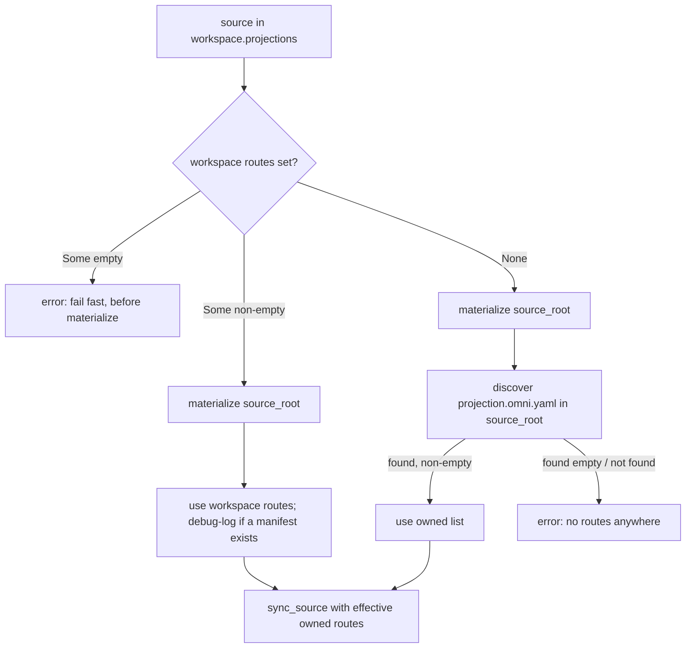

# RFC 0002: Workspace Projection Enhancements (directory routing + owned projections)

- **Status:** Accepted <!-- Draft | Accepted | Implemented | Superseded -->
- **Owner:** TBD
- **Date:** 2026-08-27
- **Affected crates/files:** omni_projection_configurations, omni_configurations, omni_projections (routing.rs, engine.rs, guardrails.rs), omni_api (operations/projection.rs), omni_configuration_discovery (reuse), omni-oss/json-schemas
- **Prior art referenced:** GNU Stow, pnpm, Cargo/`cargo-generate`, Nx project inference, EditorConfig/`.gitattributes` discovery, Dependabot/Renovate shared presets
- **Supersedes / extends:** RFC 0001 (Workspace Projections). This RFC does not change any decision in 0001; it adds two capabilities on top of the shipped design.

## 1. Summary

This RFC proposes two additive enhancements to the workspace-projections subsystem shipped in RFC 0001:

1. **Directory-aware routing.** Let the `pattern` and `flatten` strategies match and link **directories** as well as files, behind an explicit per-rule opt-in. This closes the gap between `namespaced` (link the _whole_ source as one directory) and the file routers (link individual files), so a rule like "link each folder under `skills/engineering/*` as its own link" becomes expressible in a single rule. It also fixes a latent bug where an `explicit` directory match against a `local` source panics the local content-pin computation.
2. **Owned projections.** Allow a _source repository_ to ship its own `projection.omni.yaml` describing how it wants to be projected, discovered after materialization exactly as generators discover `generator.omni.yaml`. A workspace consuming such a source may omit its own `projections` block and inherit the source-declared one, or override it wholesale.

Both reuse existing machinery (the routing engine, the ledger, `ConfigurationDiscovery`) and add no new runtime dependencies.

## 2. Motivation / Problem

**Directory routing.** RFC 0001's routing strategies split cleanly into "link the whole source" (`namespaced`) and "route individual files" (`pattern`/`flatten`/`mirror`). Nothing sits in between. Real installs frequently want _selective directory_ linking: a skills repo laid out as `skills/<category>/<skill>/SKILL.md` should install each `<skill>` folder as `.agents/skills/<skill>` (a live directory link that reflects later additions and keeps sidecar files together). Today that is only achievable by enumerating every folder with `explicit` rules, because `pattern`/`flatten` skip directory entries (`if entry.is_dir { continue; }` in `routing.rs`). This is verbose, drifts as the source grows, and for `local` sources the `explicit` directory workaround hits the pin bug below.

**Latent bug (in scope to fix here).** `engine.rs::matched_files` pushes a matched entry's relative path and `ledger.rs::local_source_pin` reads it with `fs_read_async`. For a _directory_ match that read fails, so a `local`-source `explicit` rule naming a directory errors during sync. Directory-aware routing needs a subtree-hashing pin anyway, so this RFC fixes both at once.

**Owned projections.** A projection source today is inert data: the _consuming_ workspace must describe every routing rule. That forces every consumer of, say, a shared skills or scripts repository to copy the same `projections` block, and it means the repository author, who best knows its layout, cannot express "when you project me, put my skills in `.agents/skills`". Generators already solve the analogous problem: a generator source ships `generator.omni.yaml` and omni discovers it. Projections should be able to do the same, while keeping the workspace in ultimate control and without letting an untrusted source escalate its own filesystem privileges.

## 3. Goals / Non-goals

### Goals

- Add an explicit, per-rule opt-in that makes `pattern`/`flatten` match **directory** entries and emit one directory link per match, with well-defined overlap resolution.
- Fix `local`-source content pinning so a matched directory hashes its recursive contents (repairing the existing `explicit`+`local`+directory failure as a side effect).
- Keep the routing engine pure and the change confined to `omni_projections` + the projection config crate.
- Let a source repository declare its own projections in a discovered `projection.omni.yaml`, reusing `ConfigurationDiscovery` and the existing `Projection` type.
- Define precise precedence: an explicit workspace `projections` block overrides the source-declared one; omitting it inherits the source's; an explicitly empty block and a source with no projections at all are errors.
- Preserve RFC 0001's safety floor for owned projections and **prevent trust escalation**: a source-declared projection cannot grant itself the control-plane / `.git` escape hatches.
- Remove the `projections[].projections` nesting redundancy by renaming the per-source inner list to `routes`.

### Non-goals

- **No new strategy.** Directory routing is an opt-in on the existing `pattern`/`flatten`, not a sixth strategy (see §6.6).
- **No content transformation.** Unchanged from RFC 0001. Projections still link/copy verbatim.
- **No per-project (`project.omni.yaml`) projections.** Still a separate follow-up (RFC 0001 non-goal). Owned projections live in the _source_, not in the consuming workspace's projects.
- **No new `Root` vocabulary.** Owned projections still resolve `@workspace`/`@target` against the _consuming_ workspace, exactly as workspace-declared projections do.
- **No imperative `install`/`add`.** Unchanged from RFC 0001.

## 4. Background: current mechanisms

Verified against the current source:

- **Routing (`crates/omni_projections/src/routing.rs`).** `plan(&PlanInput) -> Vec<LinkPair>` dispatches per `ProjectionStrategy`. `plan_pattern` (shared by `pattern` and `flatten`) iterates entries and does `if entry.is_dir { continue; }`, so only files produce pairs; `flatten` defaults a missing `dest` to `{name}` (the file **stem**). `plan_explicit` matches a _literal_ relative path against all scanned entries, files **or** directories, and therefore already emits directory pairs. Globs compile with `literal_separator(true)`, so `*` stays within one path segment and `**` crosses `/`.
- **Applier (`apply.rs`).** `materialize` already branches on `src_is_dir`: `auto` tries `symlink_dir` → `create_junction` → recursive `copy`; explicit `junction`/`copy` handle directories. **Directory links are already fully supported at apply time**; the only gap is the planner refusing to emit them from a glob.
- **Scanner (`scan.rs`).** `scan_source` records directory entries (`is_dir: true`) and does not descend into symlinked directories (loop/escape safety). The raw directory entries the planner needs already exist.
- **Containment / guardrails.** `routing.rs::plan` enforces, per pair, dest-within-workspace, dest-within-target, and lexical source-within-root; `engine.rs::sync_source` adds `source_realpath_contained`. `guardrails.rs::check_dest` refuses control-plane destinations (manifests, remote-cache, `.omniignore`, env files) unless `allow_omni_config`, and `.git/**` unless `allow_git`. **These checks inspect only the link's own path**, not the contents of a linked directory.
- **Pin (`engine.rs::sync_source`, `ledger.rs`).** Git sources pin to the locked commit; `local` sources pin via `matched_files` + `local_source_pin`. `matched_files` has exactly two cases: the whole-source (`namespaced`, empty rel) case hashes every file in the tree; every other case pushes the entry rel as if it were a file. **A matched directory rel therefore reaches `fs_read_async` and errors.**
- **Owned-config precedent (`crates/omni_generator/src/discover.rs`).** Generators discover `generator.omni.yaml`/`.yml`/`.json`/`.toml` inside a materialized source via `omni_configuration_discovery::ConfigurationDiscovery`, honoring `.omniignore`. `discover_one_in_dir` loads a single config at a directory root. This is the exact pattern owned projections reuse.
- **Projection resolve loop (`crates/omni_api/src/operations/projection.rs`).** `handle_projection_sync` iterates `ctx.workspace_configuration().projections`, materializes each source root (git pull or local path, unconditionally, so `--dry-run` also materializes), extracts `(id, &[Projection])` via `source_id_and_projections`, and calls `sync_source`. This is where owned-projection fallback plugs in.
- **Config shape (`crates/omni_projection_configurations/src/projection.rs`).** `ProjectionExtra { id: String (validated), projections: Vec<Projection> }`, `deny_unknown_fields`; `projections` is currently required and non-nullable. `ProjectionRule { match: String, dest: Option<DestPath> }`, `deny_unknown_fields`.

## 5. Proposed design

### Naming cleanup (spans both parts)

The shipped config nests `projections[].projections`, which is redundant. This RFC keeps the **top-level `projections`** key (a list of projection _sources_; unchanged, and consistent with the `omni projection` CLI noun per RFC 0001 decision #9) and renames the **per-source inner list** of `Projection` values from `projections` to **`routes`**. Each entry is a strategy + target + rules, a _route_ from the source into the workspace, so `routes` reads naturally and, unlike `project`, does not collide with omni's first-class `projects`/`Project` vocabulary (`workspace.omni.yaml` already has a top-level `projects:` key). The Rust type stays `Projection`; only the field is renamed (`routes: Vec<Projection>` / `Option<Vec<Projection>>`). Every YAML example and type sketch below uses the new spelling. This is a breaking config change (see §6.5) that rides along with the `Option` change in Part B.

### Config modeling: strategy-tagged, strongly-typed projections

RFC 0001 modeled a projection as one struct, `Projection { strategy: ProjectionStrategy, rules: Vec<ProjectionRule>, … }` with a single `ProjectionRule { match, dest: Option<DestPath> }` shared across all strategies, and enforced the strategy/rule relationship with **runtime validators** (`dest` required for `explicit`/`pattern`, optional for `flatten`; `rules` rejected on `namespaced`; `mirror` capped at one match). Adding `match-kind` (Part A), meaningful only for `pattern`/`flatten`, would widen that one shared rule further and add yet another runtime check. A single catch-all rule config validated at runtime is strictly worse than several strategy-specific, strongly-typed configs, so this RFC makes the relationship **type-level**.

The shape follows two shipped precedents. The closest is `crates/omni_input_schema/src/input.rs`: an internally-tagged enum (`#[serde(tag = "type")]`) whose per-variant structs each carry `deny_unknown_fields`, flatten a **multi-field** common struct (`BaseInput` via `#[serde(flatten)] base`), _and_ carry non-flatten sibling fields (`default`, `allowed`), exactly the shape proposed here. Its `unit_profile_rejects_unknown_field` test proves an unknown key is rejected through that whole flatten chain at the pinned serde version. (The simpler `SourceConfig` precedent, `crates/omni_configurations/src/source.rs`, RFC 0001 #8/#19, only exercises a _zero-field_ flatten target, `NoExtra`, so `input.rs` is the load-bearing precedent for a multi-field common struct.) `Projection` becomes an internally-tagged enum keyed on `strategy`, with a strongly-typed variant per strategy, and a strongly-typed rule type where applicable:

```rust
#[serde(tag = "strategy", rename_all = "kebab-case", deny_unknown_fields)]
pub enum Projection {
    Mirror(MirrorProjection),
    Explicit(ExplicitProjection),
    Pattern(PatternProjection),
    Flatten(FlattenProjection),
    Namespaced(NamespacedProjection),
}

// Fields common to every strategy, flattened into each variant (kept flat so the
// one-level flatten + deny_unknown_fields rule from RFC 0001 #8 holds).
pub struct ProjectionCommon {
    #[serde(default)] pub target: OmniPath,
    #[serde(default)] pub on_collision: CollisionPolicy,
    #[serde(default)] pub link: LinkKind,
    #[serde(default)] pub allow_omni_config: bool,   // workspace-only (§B.4)
    #[serde(default)] pub allow_git: bool,           // workspace-only (§B.4)
}

pub struct NamespacedProjection { #[serde(flatten)] pub common: ProjectionCommon }                                   // no `rules` field at all
pub struct MirrorProjection    { #[serde(flatten)] pub common: ProjectionCommon, #[serde(default)] pub scope: Option<String> }  // one optional glob
pub struct ExplicitProjection  { #[serde(flatten)] pub common: ProjectionCommon, pub rules: Vec<ExplicitRule> }
pub struct PatternProjection   { #[serde(flatten)] pub common: ProjectionCommon, pub rules: Vec<PatternRule> }
pub struct FlattenProjection   { #[serde(flatten)] pub common: ProjectionCommon, #[serde(default)] pub rules: Vec<FlattenRule> }

pub struct ExplicitRule { pub r#match: String, pub dest: DestPath }                                        // dest required
pub struct PatternRule  { pub r#match: String, pub dest: DestPath, #[serde(default)] pub match_kind: MatchKind }  // dest required
pub struct FlattenRule  { pub r#match: String, #[serde(default)] pub dest: Option<DestPath>, #[serde(default)] pub match_kind: MatchKind }  // dest optional (defaults)
```

Constraints RFC 0001 caught at runtime are now unrepresentable:

| RFC 0001 runtime validator                              | Now enforced by                                          |
| ------------------------------------------------------- | -------------------------------------------------------- |
| `namespaced` must not carry `rules` (#22)               | `NamespacedProjection` has no `rules` field              |
| `explicit`/`pattern` require `dest` on every rule       | `ExplicitRule`/`PatternRule` carry a non-`Option` `dest` |
| `flatten` may omit `dest` (defaults)                    | `FlattenRule.dest` is `Option`                           |
| `mirror` accepts at most one scope match                | `MirrorProjection.scope` is a single `Option<String>`    |
| `match-kind` is meaningful only for `pattern`/`flatten` | `match_kind` exists only on `PatternRule`/`FlattenRule`  |

**Deserialize-rejection requirement (load-bearing).** serde disables `deny_unknown_fields` on a struct that itself _has_ a `flatten` field; unknown keys instead fall through the flatten into the flattened target and are rejected only by _that target's_ own `deny_unknown_fields`. For the invariants above to be hard errors rather than silently-dropped keys, `ProjectionCommon` and every rule struct (`ExplicitRule`/`PatternRule`/`FlattenRule`) **must** carry `#[serde(deny_unknown_fields)]` and contain no nested `flatten`. This is exactly how `input.rs` makes `BaseInput` reject stray keys. **This is verified test-first:** before adopting the restructure, a deserialize-rejection test (`{"strategy":"namespaced","rules":[…]}` must error, `match-kind` on `explicit` must error) confirms the behavior holds at the pinned serde version. Only if that test passes does the restructure land; if it does not, the invariants fall back to a thin runtime check for the cross-strategy fields.

**JsonSchema is hand-written, not derived.** `input.rs` could not `#[derive(JsonSchema)]` on this shape. An internally-tagged enum combined with `flatten` and `additionalProperties: false` is a known schemars conflict, so it hand-writes `impl JsonSchema` in `json_schema.rs`. `Projection` inherits this: its `JsonSchema` is written manually as a `oneOf` of five arms, each an `allOf` of `{ strategy: <const> }` + `generator.subschema_for::<ProjectionCommon>()` + the variant's own fields (rule arrays whose items are `subschema_for::<{Explicit,Pattern,Flatten}Rule>()`). Composing from _derived component subschemas_ keeps maintenance low. Adding a field to `ProjectionCommon` or a rule type flows through automatically; the impl is touched only when a _strategy_ is added or removed. The generated schema becomes a **maintained snapshot artifact**, not an auto-derived one (see §6.2).

**Wire compatibility.** The internally-tagged enum deserializes the YAML valid configs already use (`strategy: <name>` + the fields that strategy actually reads), so valid configurations and their tests parse unchanged, _with one deliberate exception_: `mirror`'s scope moves from a one-element `rules: [{ match }]` list to a single `scope:` glob, so a config that spelled mirror scoping as the list form now fails to parse. Because projections are unreleased (see §6.5), this is a pre-release shape refinement, not a break to any real consumer. The only affected config is the single `mirror_scopes_by_single_match_rule` unit test, which is updated. Configs that were previously accepted and only later failed a runtime validator now fail at deserialize instead, earlier and clearer.

### Part A: Directory-aware `pattern` / `flatten`

#### A.1 Config surface: a per-rule opt-in

Directory selection is a per-rule opt-in carried only by the `pattern`/`flatten` rule types (`PatternRule`/`FlattenRule` above), defaulting to the current file-only behavior:

```rust
#[derive(Serialize, Deserialize, JsonSchema, Debug, Clone, Copy, Default, PartialEq, Eq)]
#[serde(rename_all = "kebab-case")]
pub enum MatchKind {
    #[default]
    File,   // current behavior: the glob selects files
    Dir,    // the glob selects directories; each match becomes one directory link
}
```

`match_kind` exists only on `PatternRule`/`FlattenRule`; `explicit`/`mirror`/`namespaced` have no such field (`explicit` already links directories via a literal path, and the other two operate on the whole source/tree). A `match-kind: dir` rule is a _directory-selecting_ rule: it matches only directory entries and emits one directory link per match; it never emits file links. Mixing file rules and dir rules within one projection is allowed (they are independent rules). The motivating case, in one rule:

```yaml
projections:
    - id: mattpocock-skills
      source: git
      uri: https://github.com/mattpocock/skills.git
      rev: main
      routes:
          - strategy: pattern
            target: "@workspace/.agents/skills"
            on_collision: skip
            rules:
                - match: "skills/engineering/*" # `*` = one segment → each skill folder
                  match-kind: dir
                  dest: "@target/{basename}" # .agents/skills/<skill>
```

#### A.2 Planner semantics

`plan_pattern` is extended so that, for a `match-kind: dir` rule:

- it matches **directory** entries (`entry.is_dir`) instead of files;
- each match emits one `LinkPair` (`source_root/<rel>` → `target/<expanded dest>`), a _directory_ link the existing applier already materializes;
- template expansion runs against the directory's path components. `{basename}` is the directory name, `{parent}`/`{path}` behave as today, and `{name}`/`{ext}` split the directory name on its last dot (documented caveat for dotted directory names).
- For `flatten`, a `match-kind: dir` rule with no `dest` defaults to `{basename}` (not `{name}`), so a directory named `my.plugin` is not truncated to `my`.

**Overlap resolution (shallowest-wins pruning).** Because a directory link points _into_ the source, any link whose destination would fall _inside_ a directory-linked destination is incoherent (it would write through the link back into the source tree). After all rules produce candidate pairs, the planner drops any pair `P` whose `dest_abs` is a strict descendant of some directory-link pair `Q`'s `dest_abs`. Two candidates with the _same_ `dest_abs` remain a collision handled by the existing `on_collision` policy. This makes `**` + `match-kind: dir` well-defined (it links the shallowest matching directories and prunes everything nested beneath them) rather than surprising.

The prune operates on a **single projection's** candidate set (one `plan()` call). Overlaps _across_ projections or _across_ sources are not pruned here; they resolve through the existing `on_collision` policy and the ledger, exactly as in RFC 0001.

The dest-side and source-side containment checks and `check_dest` already run per pair and require no change for directory pairs.

#### A.3 Pin fix: hash the subtree of a matched directory

`matched_files` gains a third case: when a pair's source is a _directory_ under the source root (non-empty rel, `is_dir`), expand it to every file beneath it (from the already-scanned `entries`, which include the full recursive tree) and contribute those to `local_source_pin`. This makes a `local` directory link's pin reflect its recursive content, and, because it removes the "read a directory as a file" path, repairs the pre-existing `explicit`+`local`+directory failure. Git sources are unaffected (they pin to the commit).

#### A.4 Guardrails over directory contents

The threat a directory link poses to omni's control plane depends entirely on the **link kind**, and the two cases are asymmetric:

- **`copy`-kind directory links** materialize the source's contents as **real files** in the workspace tree. omni's configuration discovery (`ConfigurationDiscovery` → `IgnoreRealDirWalker`) then walks those files like any others and will **load** a `project.omni.yaml`/`generator.omni.yaml`/etc. found among them. This is a genuine way to inject control-plane files.
- **`symlink`/`junction`-kind directory links** (the `auto` default) are **not traversed by configuration discovery at all**: the discovery walker runs with `follow_links` disabled (it is not even exposed on `IgnoreRealDirWalkerConfig`, so it cannot be flipped through the config interface), so it lists a symlinked directory but never descends into it. A manifest inside such a link is therefore never discovered or loaded, so there is no injection risk to close.

Accordingly, when the planner emits a directory link it runs the control-plane refusal (`check_dest`'s basename rules and the `.git` rule) over the **non-symlinked entries beneath the linked directory** (reusing the scan), refusing unless the corresponding `allow_*` flag is set. This is load-bearing for the `copy` case and a cheap extra check for the others. Because `scan.rs` deliberately does not descend symlinked subdirectories, the contents check sees the non-symlinked subtree only, which is precisely the subtree discovery could reach, so the guardrail covers exactly what the threat can reach.

The assumption that discovery does not follow symlinks is load-bearing, so it is pinned by a regression test: a `project.omni.yaml` planted inside a symlinked directory in the workspace must **not** be discovered. If discovery is ever changed to follow symlinks, that test fails and this guardrail must be revisited.

### Part B: Owned projections

Projections support two configuration modes, not a hierarchy. **Owned** routes are authored by the source repository and optimize for ease of use: the owner knows the best routes into a consuming workspace, so adding the source and running `sync` just works. **Workspace-authored** routes (RFC 0001's model) assume the consumer knows the source's layout and wants explicit control. Omitting `routes` on a source selects the owned mode; providing them selects the workspace mode and overrides.

#### B.1 A discovered `projection.omni.yaml` in the source

Introduce a source-local projection manifest, discovered at the materialized source root using `omni_configuration_discovery::ConfigurationDiscovery` with names `projection.omni.{yaml,yml,json,toml}` and honoring `.omniignore`, mirroring `omni_generator::discover_one_in_dir`. Its shape is a thin wrapper carrying only routing (no `id`, no source, since the source _is_ the repo):

```rust
#[derive(Serialize, Deserialize, JsonSchema, Debug, Clone, PartialEq, Eq)]
#[serde(deny_unknown_fields)]
pub struct OwnedProjectionConfiguration {
    pub routes: Vec<Projection>,
}
```

`Projection` is reused verbatim, so directory routing (Part A) and all strategies work identically in an owned manifest. `@workspace`/`@target` still resolve against the **consuming** workspace, letting the repo author say "put my skills in `.agents/skills`" and have it land in whichever workspace installs the source.

#### B.2 Nullable workspace `projections` and precedence

`ProjectionExtra.projections` becomes optional:

```rust
pub struct ProjectionExtra {
    #[serde(deserialize_with = "validate_projection_id")]
    pub id: String,
    #[serde(default)]
    pub routes: Option<Vec<Projection>>,   // was `projections: Vec<Projection>`
}
```

Precedence, per source:

| Workspace `routes`                                 | Meaning       | Behavior                                                                                                                                                                                    |
| -------------------------------------------------- | ------------- | ------------------------------------------------------------------------------------------------------------------------------------------------------------------------------------------- |
| absent / `null` → `None`                           | inherit       | Load the source's `projection.omni.yaml`; use its `routes`.                                                                                                                                 |
| non-empty `Some([...])`                            | override      | Use the workspace list wholesale; ignore the source manifest. If a manifest exists it is being shadowed, so emit a `log::debug!` note (see §B.3).                                           |
| empty `Some([])`                                   | contradiction | **Error.** A projection source that projects nothing is a misconfiguration. This is pure workspace config, so it fails fast at the top of the sync loop, before the source is materialized. |
| `None` **and** source ships no (or empty) manifest | nothing to do | **Error after materialization** (the manifest may live in a git source): `projection source '<id>' declares no routes and its source ships no projection.omni.yaml`.                        |

Override is wholesale replacement (not element-wise merge), matching the user-facing "the workspace completely overrides" intent and avoiding a new set of merge-precedence rules. Workspace precedence is the expected default, so the override is **silent on normal `sync`**; the only signal is a `log::debug!` line naming the shadowed manifest, discoverable with `-vv`/`RUST_LOG=debug` when a user is debugging why a source's declared routes did not apply.

Both empty cases are a single **sync-time** error (there is no deserialize-time rejection of `routes`, so `routes` stays a plain `#[serde(default)] Option<Vec<Projection>>`). They differ only in _when_ within the sync they can be known: `Some([])` is pure config and is caught before any I/O; the "nothing anywhere" case needs the source materialized first. Both are surfaced by `--dry-run`. The `None`-vs-`Some([])` distinction (inherit vs. explicit-empty error) is preserved by the `Option` itself.

#### B.3 Resolve flow

The fallback lives in `omni_api` (keeping the engine pure), as a new **async** resolution step, not the existing synchronous `source_id_and_projections`, which runs _before_ materialization and returns a borrow. Because the owned manifest yields an owned `Vec<Projection>`, the effective routes cannot be a borrow of the config; the resolver returns an **owned** `Vec<Projection>` and `ResolvedSource` holds it (owned or `Cow`) rather than the `&'a [Projection]` it borrows today. In `handle_projection_sync`'s per-source loop:



`sync_source` then receives an effective owned `Vec<Projection>`; its per-projection logic is otherwise unchanged. `status`/`unlink`/`prune` are ledger-only and need no owned-config awareness.

#### B.4 Trust model: no privilege escalation from a source

Owned projections come from a potentially untrusted source (a git repo). RFC 0001's containment and control-plane refusals continue to apply unchanged, so the scope of impact is already bounded to non-control-plane, in-workspace destinations. The one new rule:

> **The `allow_omni_config` and `allow_git` escape hatches are honored only when set in the _workspace_ configuration. A source-declared (owned) projection that sets either is rejected.**

Rationale: those flags are the only way to defeat the safety floor; letting a remote source set them would let the source grant itself the right to write `.git/**` or clobber control-plane files. If an owned projection genuinely needs a relaxation, the workspace must take ownership by declaring the projection itself. Adding a projection source is already an act of trust, but this rule keeps that trust bounded to "place files in non-control-plane locations in my tree," not "reconfigure omni or touch git."

## 6. Mandatory analysis

### 6.1 Existing mechanisms (reuse vs. extend vs. add)

- **Applier, scanner, containment, ledger, `status`/`unlink`/`prune`.** Reused unchanged; they already handle directory links (via `namespaced`/`explicit`) and are agnostic to how a `LinkPair` was produced.
- **`plan_pattern`.** _Extended_ with a directory branch and a shared shallowest-wins prune pass; no parallel planner.
- **`matched_files`/`local_source_pin`.** _Extended_ with a subtree case; reuses the existing scan and `omni_hasher`.
- **`ConfigurationDiscovery`.** _Reused_ verbatim for owned-manifest discovery, matching the generator precedent; no new discovery mechanism.
- **`Projection`.** _Restructured_ into a `strategy`-tagged enum with per-strategy variants and rule types (following the shipped `SourceConfig` shape), and _reused_ verbatim in the owned manifest; the runtime strategy/rule validators are retired in favor of type-level invariants.

### 6.2 Maintenance cost

- Restructuring `Projection` from one struct + runtime validators into a `strategy`-tagged enum with per-strategy variant and rule types (`MirrorProjection`/`ExplicitProjection`/`PatternProjection`/`FlattenProjection`/`NamespacedProjection`, `ExplicitRule`/`PatternRule`/`FlattenRule`, shared `ProjectionCommon`) adds several small types but **retires** the strategy/rule runtime validators, a net wash that trades imperative checks for compiler-enforced invariants. `MatchKind` is a new enum carried only by `PatternRule`/`FlattenRule`, `#[serde(default)]`, so valid configs stay wire-compatible.
- One new config type (`OwnedProjectionConfiguration`) with its own JSON Schema entry (`projection.omni` schema), added alongside the existing generator/workspace schemas. It reuses the shared `Projection`, whose `JsonSchema` is **hand-written** (see §5), composed from `subschema_for` of `ProjectionCommon` and the rule types, so the generated schema is a **maintained snapshot artifact**, not auto-derived. The manual impl is touched only when a strategy is added/removed; field additions to `ProjectionCommon`/rule types flow through the composed subschemas. Contributors re-snapshot the schema when `Projection`'s shape changes.
- `ProjectionExtra.projections` becoming `Option` **and** renaming to `routes` ripples to the effective-routes resolver (the retired `source_id_and_projections`) and the schema; small, compiler-enforced edits. Because projections are unreleased, the only in-repo config touched is `workspace.omni.yaml`.
- One new error path: a single **sync-time** "no routes" error (fail-fast for `Some([])`, post-materialization for nothing-anywhere), with fixed messages. No deserialize-time `routes` validator is added.
- No new runtime dependency.

### 6.3 Testability

The change is easy to test: the routing engine is pure, the applier/ledger already have fixture-based tests, and `omni_api` has an integration harness with a network-free `RemoteSourceSys` seam. Strong typing (§5) moves most invalid-config coverage from runtime-validator tests to serde deserialize tests. Because the work is additive, the existing suites stay green except for the `routes` rename and the single `mirror` scope test. §9 specifies the full test matrix: unit, integration, e2e, schema, cross-platform, and the existing-test regression set.

### 6.4 Integration points

- `omni_projection_configurations`: the `strategy`-tagged `Projection` enum + per-strategy variant/rule types (`ProjectionCommon`, `ExplicitRule`/`PatternRule`/`FlattenRule`), `MatchKind` (on `PatternRule`/`FlattenRule`), `ProjectionExtra.routes: Option<…>`, `OwnedProjectionConfiguration`, and the hand-written `JsonSchema` for `Projection`; retire the old `ProjectionStrategy`/`ProjectionRule` and the strategy/rule runtime validators.
- `omni_projections`: `routing.rs` (match on the `Projection` variant; directory branch + shallowest-wins prune), `engine.rs` (`matched_files` subtree case), `guardrails.rs` (contents check).
- `omni_api::operations::projection`: a new **async** effective-routes resolver that runs _after_ materialization and returns an **owned** `Vec<Projection>` (replacing the synchronous, borrow-returning `source_id_and_projections`); owned-manifest discovery + precedence + the single sync-time "no routes" error; `ResolvedSource` holds owned/`Cow` routes.
- `omni_configurations`: schema wiring; `WorkspaceConfiguration.projections` schema reflects the nullable inner `routes` field.
- Ordering constraint: owned-manifest discovery must run **after** materialization and **before** `plan`; it fits between `source_root` resolution and `sync_source`. The `Some([])` fail-fast runs **before** materialization.

### 6.5 Potential regressions

- **Determinism / caching (directory links are _not_ hashed, correcting RFC 0001).** RFC 0001 §4.7 / decision #6 stated a directory link "exposes the entire linked subtree to any project that hashes it (a broader input surface)." That is **backwards**: `omni_collector` walks with `IgnoreRealDirWalker`, whose `follow_links` is off and not exposed, and it skips symlinked directories outright (`collector.rs:423-435`, where a symlinked dir is `is_file == false` → `continue`, and the walker never descends it). So the files _inside_ a `symlink`/`junction` directory link are **invisible** to a consuming project's input hash. The real risk is therefore **stale cache, not over-hashing**: if projected directory content sits in a project's input scope and changes behind the link (e.g. `--update` pulls a new git rev, or a local source is edited), that project's hash does not move and it serves stale output. Symlinked _files_ are unaffected (their content is read through the link and hashed). This is a **pre-existing RFC 0001 property** (it applies to `namespaced`/`explicit` dir links today); Part A only makes directory links common. Decision #7a does not cover it. An ignore file can _exclude_ content, not force the walker to descend a symlink. **Interim remedy:** use `link: copy` for any projection whose content must participate in a project's cache key. `copy` materializes real files the collector walks and hashes correctly. A general fix (the hash collector following symlinks, bounded and split from config discovery) is **deferred to RFC 0003**; RFC 0002 does not depend on it.
- **`**` behavior.** Only affects rules that opt into `match-kind: dir`; existing `**` file rules are byte-for-byte unchanged because the default is `File`.
- **Owned-manifest as a hidden input.** With workspace `routes` omitted, the plan now depends on a file inside the source. For git sources this is pinned (deterministic); for local sources it is read live (already the local model). `--dry-run` surfaces the effective plan. Risk: a source silently changing its manifest across a mutable `rev` changes the plan on `--update`, which is expected and consistent with how source _content_ already behaves.
- **Trust escalation.** Addressed by §B.4; without that rule, owned projections would be a real way to escalate privilege. Called out loudly.
- **Shadowing confusion.** A workspace list overriding a source manifest could confuse, but workspace precedence is the expected default, so the override is **silent on normal `sync`**; a `log::debug!` note naming the shadowed manifest keeps it discoverable under `-vv` without noise on the hot path.
- **Silent-failure risk.** The "no routes anywhere" case must be a hard error, not a no-op sync, or a misconfigured source would quietly project nothing. Enforced at sync time (`Some([])` fails fast before materialization; nothing-anywhere fails after).
- **Config rename and restructure are pre-release changes, not breaking changes.** Projections shipped in RFC 0001 are **unreleased** (that work is unmerged and its RFC is still `Draft`), so there are no external consumers and no migration burden. Renaming the per-source inner list `projections` → `routes`, making it `Option`, and moving `Projection` to a `strategy`-tagged enum are pre-release shape refinements. The only config in existence that uses any of this is the repo's own `workspace.omni.yaml`, updated in the same change. The top-level `projections` key and the `omni projection` CLI are unchanged. Previously-invalid combinations (rules on `namespaced`, a missing `dest`, more than one `mirror` match) now fail at deserialize instead of a later runtime validator, earlier and clearer. The lone shape refinement to a _valid_ config is `mirror`'s scope (`rules: [{ match }]` → `scope:`), which is hard-broken (no shim) and updates exactly one unit test.

### 6.6 Pros and cons

| Option                                                                                                                                              | Pros                                                                                                                                             | Cons                                                                                                                                                                | Verdict |
| --------------------------------------------------------------------------------------------------------------------------------------------------- | ------------------------------------------------------------------------------------------------------------------------------------------------ | ------------------------------------------------------------------------------------------------------------------------------------------------------------------- | ------- |
| **A. Per-rule `match-kind` opt-in on `pattern`/`flatten` + subtree pin + contents guardrail (recommended)**                                         | Reuses the applier/scanner/ledger; one defaulted field; mixes file and dir rules freely; fixes the local-dir pin bug; overlap made deterministic | Adds a prune pass and a subtree-hash case; directory links are not reflected in consuming hashes (pre-existing; `link: copy` remedy; deep fix deferred to RFC 0003) | ✅      |
| B. New dedicated strategy (e.g. `link-dirs`)                                                                                                        | Keeps `pattern`/`flatten` untouched                                                                                                              | Sixth strategy to document/validate; can't mix file+dir routing in one projection; duplicates pattern's glob/template logic                                         | ❌      |
| C. Always match directories in `pattern`/`flatten` (no opt-in)                                                                                      | No new field                                                                                                                                     | Silent behavior change for every existing `**` rule; massive overlap by default                                                                                     | ❌      |
| **B1. Owned `projection.omni.yaml` discovered like `generator.omni.yaml`, nullable workspace override, no source-set escape hatches (recommended)** | Mirrors the proven generator precedent; repo authors own their layout; workspace stays in control; trust bounded                                 | New manifest + schema; a hidden (but pinned) plan input; one sync-time error surface                                                                                | ✅      |
| B2. Owned projections merged element-wise with workspace                                                                                            | Fine-grained                                                                                                                                     | New merge-precedence rules; ambiguous conflict rules; contradicts "workspace completely overrides"                                                                  | ❌      |
| B3. No owned projections (status quo)                                                                                                               | Nothing to build                                                                                                                                 | Every consumer copies the same block; repo authors can't express intent                                                                                             | ❌      |

### 6.7 Prior art and how omni improves on it

| Tool                               | Their approach                                                         | What to adopt                                       | What to change for omni                                                                                                                       |
| ---------------------------------- | ---------------------------------------------------------------------- | --------------------------------------------------- | --------------------------------------------------------------------------------------------------------------------------------------------- |
| GNU Stow                           | Symlinks whole package directories into a target tree                  | Directory-granular linking as a first-class outcome | Make it _selective_ via globbed `match-kind: dir` with containment + a ledger, not a whole-tree overlay                                       |
| pnpm                               | Directory (package) links with symlink/junction/hardlink/copy fallback | The directory-link kind matrix (already reused)     | Drive it from a routing rule rather than a package graph                                                                                      |
| Cargo / `cargo-generate` templates | A source repo carries a manifest describing how it is consumed         | A source shipping its own consumption manifest      | Discover `projection.omni.yaml` like `generator.omni.yaml`; keep the consumer able to override; forbid privilege-granting flags in the source |
| Nx project inference / plugins     | Plugins infer targets from files present in a repo                     | Source-authored declarations of intent              | Keep it declarative and pinned; no executing plugin code                                                                                      |
| Dependabot/Renovate shared presets | A repo publishes a config others extend/override                       | Publish-and-inherit with consumer override          | Wholesale override (no deep-merge surprises); safety flags stay consumer-only                                                                 |
| EditorConfig / `.gitattributes`    | Config discovered by walking to a root                                 | Root-anchored discovery honoring ignore files       | Reuse `ConfigurationDiscovery` + `.omniignore`; single manifest at the source root                                                            |

The improvement over Stow/pnpm is selective, contained, ledger-tracked directory routing that composes with the file strategies; the improvement over template/preset ecosystems is that the source can declare intent **without** being able to reconfigure omni or touch git in the consuming workspace.

## 7. Open questions

None outstanding. All four questions raised during design have been resolved; the resolutions and their rationale are recorded in the decision log (see #3a, #8a, #7a, #15).

One implementation-time contingency (not a design question) is worth flagging: the `strategy`-tagged `Projection` restructure (#16) is **gated on a deserialize-rejection test** that confirms `deny_unknown_fields` rejects cross-strategy fields through the flatten chain at the pinned serde version (as proven by `input.rs`). Both outcomes are specified: if it passes, the restructure lands as designed; if it fails, the type-level invariants fall back to a thin runtime check for the cross-strategy fields. The design does not otherwise depend on which branch is taken.

## 8. Decision log

| #   | Decision                                                                                                                                                                                                                                                                                                                                                                                                                           | Rationale                                                                                                                                                                                                                                                                                                                                                                                                                                                                                                                                                                                                                                                             |
| --- | ---------------------------------------------------------------------------------------------------------------------------------------------------------------------------------------------------------------------------------------------------------------------------------------------------------------------------------------------------------------------------------------------------------------------------------- | --------------------------------------------------------------------------------------------------------------------------------------------------------------------------------------------------------------------------------------------------------------------------------------------------------------------------------------------------------------------------------------------------------------------------------------------------------------------------------------------------------------------------------------------------------------------------------------------------------------------------------------------------------------------- |
| 1   | Directory routing is a per-rule `match-kind: dir` opt-in on `pattern`/`flatten`, not a new strategy                                                                                                                                                                                                                                                                                                                                | Reuses the applier/scanner/ledger and pattern's glob/template logic; lets one projection mix file and directory rules; avoids taxonomy bloat                                                                                                                                                                                                                                                                                                                                                                                                                                                                                                                          |
| 2   | Default `match-kind` is `File`                                                                                                                                                                                                                                                                                                                                                                                                     | Preserves byte-for-byte behavior of every existing `pattern`/`flatten` rule; the enhancement is strictly additive                                                                                                                                                                                                                                                                                                                                                                                                                                                                                                                                                     |
| 3   | A `match-kind: dir` rule matches directories only and emits one directory link per match; it never emits file links                                                                                                                                                                                                                                                                                                                | A rule with a single, predictable output shape keeps `--dry-run`/`status` truthful; file selection is a separate rule                                                                                                                                                                                                                                                                                                                                                                                                                                                                                                                                                 |
| 3a  | The rule field is spelled `match-kind`, an enum with values `file` (default) / `dir`                                                                                                                                                                                                                                                                                                                                               | Enum (not a boolean) leaves room for future modes and avoids the "also files vs only files" ambiguity; singular values match the `link`/`strategy`/`on-collision` convention; sits naturally beside `match`                                                                                                                                                                                                                                                                                                                                                                                                                                                           |
| 4   | Overlap is resolved by shallowest-wins pruning (drop any pair whose dest is a strict descendant of a directory-link dest)                                                                                                                                                                                                                                                                                                          | A link nested inside a directory link would write through the link into the source; pruning makes `**`+`dir` well-defined instead of surprising                                                                                                                                                                                                                                                                                                                                                                                                                                                                                                                       |
| 5   | `flatten` + `match-kind: dir` defaults a missing `dest` to `{basename}`, not `{name}`                                                                                                                                                                                                                                                                                                                                              | `{name}` would truncate a dotted directory name (`my.plugin` → `my`); `{basename}` preserves it                                                                                                                                                                                                                                                                                                                                                                                                                                                                                                                                                                       |
| 6   | Fix `matched_files`/`local_source_pin` to hash a matched directory's recursive contents                                                                                                                                                                                                                                                                                                                                            | Removes the "read a directory as a file" panic (repairing today's `explicit`+`local`+dir failure) and gives directory links a correct, mtime-free content pin (consistent with decision #15 of RFC 0001)                                                                                                                                                                                                                                                                                                                                                                                                                                                              |
| 7   | When the planner emits a directory link, run the control-plane / `.git` refusals over the non-symlinked entries beneath it; a pinning test asserts config discovery does not enumerate a manifest inside a symlinked directory                                                                                                                                                                                                     | This is load-bearing for `copy`-kind links (their contents become real files config discovery loads). `symlink`/`junction` links are not traversed by discovery (`follow_links` is off and not exposed), so they carry no injection risk; the scan's no-symlink-descent thus matches the reachable subtree. The load-bearing assumption is pinned by a regression test                                                                                                                                                                                                                                                                                                |
| 7a  | Do not add a hashing advisory for directory links; excluding content from what gets hashed is the user's responsibility via `.gitignore`/`.omniignore`. This covers _exclusion_ only. It does **not** address that `symlink`/`junction` directory links are skipped by the collector entirely (a stale-cache hazard); that is a separate concern deferred to RFC 0003 (see #19)                                                    | The collector already honors ignore files (`standard_filters(true)` + `.omniignore`), so a linked directory is excluded from hashing the same way anything else is; consistent with RFC 0001 #14 (`.gitignore` is user-owned) and #25 (advisory deferred); the load-bearing control (hard error on out-of-workspace target) is unaffected                                                                                                                                                                                                                                                                                                                             |
| 8   | Source repositories may ship a discovered `projection.omni.yaml`; discovery reuses `ConfigurationDiscovery` and honors `.omniignore`                                                                                                                                                                                                                                                                                               | Mirrors the proven generator precedent (`generator.omni.yaml`); no new discovery mechanism; the repo author is best placed to describe its own layout                                                                                                                                                                                                                                                                                                                                                                                                                                                                                                                 |
| 8a  | The manifest is `projection.omni.{yaml,yml,json,toml}` (singular), a single file discovered at the source root only, not globbed across the tree                                                                                                                                                                                                                                                                                   | Keeps the singular `<subsystem-noun>.omni.<ext>` convention and the `omni projection` CLI-noun symmetry; one root manifest is unambiguous about which file governs the source                                                                                                                                                                                                                                                                                                                                                                                                                                                                                         |
| 9   | The owned manifest carries only `routes: Vec<Projection>`, with no `id` and no source                                                                                                                                                                                                                                                                                                                                              | The `id` is the workspace's ledger key and must stay workspace-assigned and unique (RFC 0001 decision #18); the source _is_ the source root                                                                                                                                                                                                                                                                                                                                                                                                                                                                                                                           |
| 10  | `ProjectionExtra.projections` becomes `Option<Vec<Projection>>`: `None`/absent inherits the owned manifest, non-empty overrides wholesale, `Some([])` is a sync-time error (fail-fast, before materialization)                                                                                                                                                                                                                     | Matches the requested "workspace completely overrides / null inherits / empty is meaningless" semantics with a single `Option` and no new merge rules                                                                                                                                                                                                                                                                                                                                                                                                                                                                                                                 |
| 11  | A projection source with no projections from either side is a hard error at sync time                                                                                                                                                                                                                                                                                                                                              | Only knowable after materialization (the manifest may be in a git source); erroring prevents a misconfigured source from silently projecting nothing; `--dry-run` surfaces it                                                                                                                                                                                                                                                                                                                                                                                                                                                                                         |
| 12  | `allow_omni_config`/`allow_git` are honored only from the workspace config; a source-declared projection setting either is rejected                                                                                                                                                                                                                                                                                                | The escape hatches are the only way to defeat the safety floor; letting an untrusted source set them is privilege escalation. The workspace must take ownership to relax a guardrail                                                                                                                                                                                                                                                                                                                                                                                                                                                                                  |
| 13  | Overriding a source manifest with a workspace list emits a `log::debug!` note (no warning)                                                                                                                                                                                                                                                                                                                                         | Silent override is confusing, but workspace precedence is the expected default; a warning on every `sync` would be noise, so a debug log keeps the shadowed manifest discoverable under `-vv` at zero hot-path cost                                                                                                                                                                                                                                                                                                                                                                                                                                                   |
| 14  | Rename the per-source inner list `projections[].projections` → `projections[].routes`; keep the top-level `projections` key and the `Projection` type name                                                                                                                                                                                                                                                                         | Removes the confusing self-nesting; `routes` reads as "routes from this source into the workspace" and avoids collision with omni's first-class `projects`/`Project` (the workspace already has a top-level `projects:` key), which the suggested `project` would clash with; keeping the top-level key preserves the RFC 0001 #9 CLI-noun symmetry; a pre-release shape change (projections are unreleased), folded into the `Option` change (decision #10)                                                                                                                                                                                                          |
| 15  | Inheriting a source's owned `routes` (by omitting them in the workspace) is implicit, with no per-source opt-in flag                                                                                                                                                                                                                                                                                                               | Projections are not strictly config-first; that is one mode. Owned routes optimize for ease of use (the owner knows the best routes), while workspace-authored routes assume the consumer knows the layout and wants control, two legitimate modes, not a hierarchy. A gate would tax the exact ease-of-use the feature exists for; trust is already bounded by containment + the neutered escape hatches (#12), and `--dry-run`/`status` always surface the effective plan                                                                                                                                                                                           |
| 16  | Model `Projection` as a `strategy`-tagged enum with per-strategy strongly-typed variants and rule types (`ExplicitRule`/`PatternRule`/`FlattenRule`, shared flattened `ProjectionCommon`), following the `input.rs` precedent (a multi-field flatten target under an internally-tagged enum, proven to reject unknown keys), verified test-first with a hand-written `JsonSchema`, and retire the strategy/rule runtime validators | A single catch-all `ProjectionRule` validated at runtime is worse than several strongly-typed, strategy-specific configs; the enum makes illegal states (rules on `namespaced`, missing `dest`, multi-match `mirror`, `match-kind` on the wrong strategy) unrepresentable at deserialize; wire-compatible for valid configs (`input.rs` proved `deny_unknown_fields` holds through a multi-field flatten target under an internally-tagged enum; verified test-first, and `Projection`'s `JsonSchema` is hand-written since the derive cannot handle this shape). The engine matches per variant and may normalize the variants into one internal planner input later |
| 17  | The change is additive except two pre-release deltas (the `routes` rename and the `mirror`-scope shape); existing unit/integration/e2e suites stay green apart from the fixtures those two touch                                                                                                                                                                                                                                   | Bounds the scope of impact and lets §9 assert "existing tests still pass" as an acceptance criterion; the only intentional non-additive deltas are the rename and the `mirror` scope shape refinement; because projections are unreleased, these are pre-release refinements, not breaking changes                                                                                                                                                                                                                                                                                                                                                                    |
| 18  | Effective-route resolution is a new **async** step that runs after materialization and returns an **owned** `Vec<Projection>`; `ResolvedSource` holds it (owned/`Cow`), replacing the synchronous, borrow-returning `source_id_and_projections`                                                                                                                                                                                    | Owned-manifest discovery is async I/O and can only run once `source_root` exists; a discovered manifest yields an owned list that cannot be a borrow of the config, so the resolver returns an owned `Vec` and the engine consumes it                                                                                                                                                                                                                                                                                                                                                                                                                                 |
| 19  | Directory links (`symlink`/`junction`) are not reflected in a consuming project's input hash, a **known, pre-existing** limitation, not caused by this RFC. Interim remedy: `link: copy` for hash-tracked content. A general fix (the hash collector following symlinks, bounded and split from config discovery) is **deferred to RFC 0003**; this RFC does not depend on it                                                      | The collector skips symlinked directories (`collector.rs:423-435`, `follow_links` off), so their contents are invisible to hashing, a stale-cache hazard #7a does not cover. `copy` materializes real, walkable files as a correct workaround today; the proper fix has workspace-wide impact (mass cache invalidation, determinism, loop safety) and belongs in its own RFC                                                                                                                                                                                                                                                                                          |

## 9. Testing plan

### 9.1 Principles

- **Additive / behavior-preserving.** Every RFC 0001 projection test (config, routing, applier, ledger, `omni_api` integration, projection e2e, MCP protocol) must stay green. The only intentional edits are mechanical: config fixtures renamed `projections:` → `routes:`, and the one `mirror`-scope routing test moved from `rules: [{ match }]` to `scope:`.
- **Strong typing shifts coverage earlier.** Cases RFC 0001 verified via runtime-validator tests are re-expressed as serde deserialize-rejection tests (the invariant now fails at parse time).
- **Error paths first-class.** Every new rejection (empty `routes`, no-routes-anywhere, source-set escape hatch, dir-contents guardrail, containment escape) has an explicit negative test.

### 9.2 Unit tests

**Config / serde (`omni_projection_configurations`)**

- Round-trip serialize↔deserialize for each strategy variant (`mirror`/`explicit`/`pattern`/`flatten`/`namespaced`) and each rule type.
- `deny_unknown_fields`: an unknown key on each variant and each rule type is rejected (including the tag interaction, per the `input.rs` precedent).
- **Load-bearing gating test (§5).** The type-level invariants below must be _hard deserialize errors_, not silently-dropped keys. This is the test that gates adopting the strategy-tagged restructure. If it does not hold at the pinned serde version, fall back to a thin runtime check.
- Type-level invariants now rejected at deserialize: `rules` on `namespaced`; missing `dest` on `explicit`/`pattern`; a second `mirror` scope no longer expressible; `match-kind` on `explicit`/`mirror`/`namespaced` rejected as an unknown field.
- `MatchKind` default is `file`; kebab values `file`/`dir` parse; anything else rejected.
- `OwnedProjectionConfiguration` round-trips; unknown key rejected.
- `ProjectionExtra.routes`: absent → `None`, `null` → `None`, `[x]` → `Some([x])`, `[]` → `Some([])` (parses; the empty-list _error_ is a sync-time check, tested in §9.3, not a deserialize rejection).
- Existing `id` validator tests pass unchanged.

**Routing (`omni_projections/routing.rs`, pure, `ScannedEntry` fixtures)**

- `pattern` + `match-kind: dir` links each matched directory (one `LinkPair` per dir); `{basename}`/`{parent}`/`{path}` expand against the directory path.
- `flatten` + `match-kind: dir` with no `dest` defaults to `{basename}` (not `{name}`); a dotted directory name is preserved.
- Shallowest-wins prune: `**` + `dir` collapses to the shallowest matching directories; a file/dir pair nested under a directory-link dest is dropped; two identical dir dests remain a collision (not a prune).
- `mirror` single `scope` glob (ported from `mirror_scopes_by_single_match_rule`).
- Existing file-mode `pattern`/`flatten`/`explicit`/`namespaced` tests unchanged (default `file`).
- Containment: a directory dest escaping `target`/workspace is rejected; source escape rejected.

**Pin (`engine.rs` / `ledger.rs`)**

- `local_source_pin` over a matched directory hashes its recursive files (sorted, path-sensitive); editing, adding, or removing a file under the directory changes the pin.
- Regression: `explicit` + `local` + directory no longer errors (previously failed in the pin path).
- A `git` directory link uses `git_pin` (no directory read).

**Guardrails (`guardrails.rs`)**

- A **copy**-kind directory link whose contents include `workspace.omni.yaml` / `project.omni.yaml` / a `.git` dir / an env file is refused; `allow_omni_config` / `allow_git` (workspace-only) override the respective refusals.
- **Pinning test:** a `project.omni.yaml` planted inside a **symlinked** directory in the workspace is **not** enumerated by config discovery (asserts the load-bearing `follow_links`-off assumption; if discovery ever follows symlinks this test fails and §A.4 must be revisited).
- File-level guardrail tests unchanged.

**Applier / ledger.** Existing tests unchanged; add an idempotent re-sync of a directory link (unchanged pin → `Skipped`).

### 9.3 Integration tests (`omni_api`, network-free `RemoteSourceSys` seam)

- **Owned inherit:** `local` source ships `projection.omni.yaml`, workspace omits `routes` → links come from the owned manifest.
- **Override + shadow debug log:** workspace defines `routes` and the source ships a manifest → workspace wins (assert effective links); a `log::debug!` shadow note is emitted (no warning, no failure).
- **Empty `routes`:** `routes: []` → sync-time error, failing fast before the source is materialized; surfaced under `--dry-run`.
- **No routes anywhere:** workspace omits and the source ships no manifest → non-zero sync error after materialization, also under `--dry-run`.
- **Trust:** an owned manifest setting `allow_git`/`allow_omni_config` is rejected.
- **Directory routing end-to-end:** `pattern` + `match-kind: dir` → ledger records the directory link; a second sync reports up-to-date.
- **Git precedence:** owned manifest from a pinned `git` source via the test seam.

### 9.4 E2E (`tests/omni-tests`)

- `pattern` + `match-kind: dir` local source: `omni projection sync` materializes each folder as a directory link; read-through works; ledger recorded; second sync is up-to-date; `unlink` removes the links.
- Owned-projection local source: workspace omits `routes`, source ships `projection.omni.yaml` → sync links per the owned routes.
- Error e2e: no-routes-anywhere sync exits non-zero with a clear message; `routes: []` exits non-zero (fail-fast).
- `--dry-run` prints planned directory-link destinations without writing.
- Any new test tag is registered in both `vitest.config.e2e.ts` and `src/vitest.shims.d.ts` (the `projection` tag already exists).

### 9.5 Schema snapshots

- New `projection.omni` schema snapshotted.
- Workspace schema diff reviewed and re-snapshotted: `routes` (renamed, nullable), the `strategy`-tagged `Projection` variants, and `match-kind` on `pattern`/`flatten` rules only.

### 9.6 Cross-platform

- Directory-link kind selection (symlink vs junction) behind `#[cfg(windows)]`-gated assertions; Windows coverage via CI, as in RFC 0001.

### 9.7 Existing-test regression set

Run the full suites for `omni_projections`, `omni_projection_configurations`, `omni_configurations`, `omni_api` (integration), and the projection e2e; all must pass with only the two mechanical updates from §9.1. The MCP protocol e2e is unaffected (no new tools are added).
