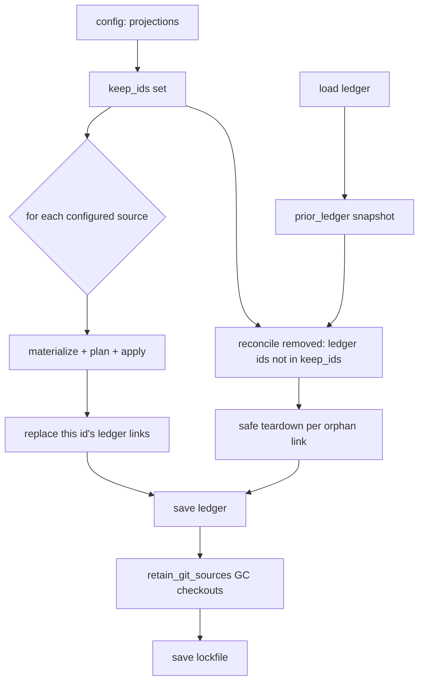

# RFC 0004: Ledger reconciliation of removed projection sources (+ `unlink` backup handling)

- **Status:** Draft <!-- Draft | Accepted | Implemented | Superseded -->
- **Owner:** TBD
- **Date:** 2026-08-29
- **Affected crates/files:** `omni_projections` (`ledger.rs`, `engine.rs`), `omni_api` (`operations/projection.rs`), `omni_cli_core` (`commands/projection.rs`), `omni_mcp_core` (`model/projection.rs`, `tools/projection.rs`), `omni_remote_source` (reference only)
- **Prior art referenced:** Cargo (lockfile pruning), pnpm (`node_modules` reconciliation), GNU Stow (`--restow`/`--delete`), Terraform (state reconciliation)
- **Release classification:** Fix. This closes a missed requirement in `omni_projections` v0.1.0, released 2026-08-28. When a source is removed from config, its checkout and pin get garbage-collected, but its ledger links and working-tree files are never reconciled. It ships as a fix release, not a feature.

## 1. Summary

`omni projection sync` already garbage-collects one half of a projection source's footprint when that source leaves the config. `retain_git_sources` (`crates/omni_remote_source/src/manager/default_impl.rs:78`) deletes the lockfile entries and on-disk git checkouts for any source no longer declared, and it runs at the end of every non-dry-run sync (`operations/projection.rs:246-252`). The link ledger has no such reconciliation. `handle_projection_sync` iterates only the configured sources (`projection.rs:159`), so a source removed from `workspace.omni.yaml` is never visited, and its ledger entries and materialized links live on forever.

This RFC makes the ledger reconcile removed sources during `sync`, the same way the lockfile already does, and it keeps the ledger's non-destructive guarantee: an edited `copy` link is kept and warned on, never deleted. It also replaces `unlink`'s `clean_backups` boolean with a three-way choice, leave, clean, or restore, which finally delivers the backup restoration RFC 0001 §5.5 described but never shipped. The two CLI flags are mutually exclusive (§5.5).

## 2. Motivation / Problem

The lockfile and the ledger are the two persisted pieces of projection state, and they have opposite lifecycles when a source is deleted from config:

| Removed source's footprint                              | Cleaned automatically on `sync`? | By what                        |
| ------------------------------------------------------- | -------------------------------- | ------------------------------ |
| Git checkout under `.omni/sources/projection/git/...`   | yes                              | `retain_git_sources`           |
| Lockfile pin entry                                      | yes                              | `retain_git_sources`           |
| Ledger link records                                     | no                               | nothing (manual `unlink <id>`) |
| Materialized working-tree links (symlink/junction/copy) | no                               | nothing (manual `unlink <id>`) |

RFC 0001 §5.5 made orphan removal a manual capability:

> **Ledger present but a source was removed from config:** the link is an orphan;
> detecting and removing it (`prune`/`unlink`) is the _only_ capability that
> genuinely needs the ledger …

Two concrete problems follow.

1. Dangling symlinks for git sources. When a git projection source is removed, `retain_git_sources` deletes its checkout, but the symlinks that pointed into it stay in the working tree. They now dangle, and the ledger still records them. The user is left with broken links and has to remember to run `omni projection prune`, which only catches dangling symlinks, as a second manual step.
2. Silent orphans for local sources. When a local projection source is removed, its links stay healthy, because the source dir still exists, but they are orphaned. `prune` will not catch them, since they are not dangling. Only `omni projection unlink <id>` will, and only if the user still remembers the removed `id`.

The outcome we want: after `omni projection sync`, the working tree and the ledger reflect only the currently declared sources, the same invariant `retain_git_sources` already enforces for checkouts and pins, and no file the user edited is ever deleted.

## 3. Goals / Non-goals

### Goals

- On a non-dry-run `omni projection sync`, tear down and de-record the ledger links of every source present in the ledger but absent from the current config.
- Reuse the existing safe-teardown semantics. A `copy`-kind link is removed only when its content still matches the source, otherwise it is kept and a warning is surfaced. This matches `unlink` and `reconcile_stale`.
- Persist the ledger before the git GC runs, as RFC 0001 §5.7 requires.
- Report removed orphan destinations in the `sync` response, and on `--dry-run` report what would be removed without touching disk.
- Give `omni projection unlink` a non-destructive three-way backup choice, leave (default), clean, or restore the recorded `.bak.<ts>`, replacing today's `clean_backups` boolean, with the two CLI flags mutually exclusive.
- Leave `prune` unchanged, and keep `unlink` backward-compatible at the CLI. `--clean-backups` still means what it means today.

### Non-goals

- No backup restoration during automatic reconciliation. The new `unlink` backup handling (§5.5) is a manual capability. Sync-time reconciliation (§5.2) always uses `Leave`. It removes the orphan link but never deletes or restores a `.bak.<ts>`. Restoring during a non-interactive pass would surprise people, so it stays off. The shared enum makes turning it on later a one-line change.
- No change to `prune`. It still means "remove ledger links whose destination is a dangling symlink."
- No change to lockfile behavior. `retain_git_sources` is the reference model, not a subject of change.
- No auto-sync from other commands. `omni run` and friends do not trigger a projection sync. Auto-clean fires only on an explicit `omni projection sync`, or its MCP/API equivalents, exactly where `retain_git_sources` already fires.

## 4. Background: current mechanisms

### 4.1 The sync pass (`operations/projection.rs:123-255`)

`handle_projection_sync`:

1. Reads the configured sources, `ctx.workspace_configuration().projections` (`:133`).
2. Collects `all_git`, every configured git `(uri, rev)`, regardless of any `--source` filter (`:143-149`). This set is what the git GC retains.
3. Loads the ledger and snapshots it as `prior_ledger` (`:138-139`).
4. Iterates the configured sources (`:159`). A `--source` filter `continue`s past non-matching ids (`:162-166`). For each visited source it materializes, plans, applies, and, for the touched id only, replaces that id's ledger entries with the freshly computed set:
    ```rust
    ledger.links_mut().retain(|l| l.source_id != *id);
    ledger.links_mut().extend(outcome.links);
    ```
    (`:241-242`).
5. Persists the ledger, then GCs git sources, then saves the lockfile (`:246-252`):
    ```rust
    omni_projections::save(&sys, &ledger_path, &ledger).await?;
    let refs = all_git.iter().map(|(u, r)| (u, r.as_str())).collect();
    remote.retain_git_sources(&refs).await?;
    remote.lock().await?;
    ```

The gap is in step 4. It visits only configured ids. A ledger entry whose `source_id` is no longer configured never enters the loop, so line 241 never runs for it, and its links are neither torn down nor de-recorded.

### 4.2 The lockfile reconciliation this mirrors (`omni_remote_source/src/manager/default_impl.rs:78-153`)

`retain_git_sources(&[(uri, rev)])` builds a `url → {rev}` keep-set from its argument, then `retain`s the lockfile's `git` map against it, collecting the dropped `(uri, rev)` pairs and deleting their on-disk checkout directories. This is the "de-declare a source and its footprint disappears on the next sync" mechanism. The proposed ledger reconciliation is the direct analogue for links.

### 4.3 The ledger's existing safe-teardown primitives (`omni_projections/src/ledger.rs`)

- `unlink(sys, workspace_root, ledger, source_id, clean_backups)` removes only the recorded links for one `source_id`. It removes a `copy` link only when `copy_was_modified` is false, otherwise it keeps the link and records a warning. It also runs `prune_empty_ancestors` for `namespaced` nested-id directories.
- `prune(sys, workspace_root, ledger)` removes links whose destination is a dangling symlink.
- `reconcile_stale` in `engine.rs:194-234` is the within-source analogue. For a source still configured, it removes dests it no longer wants, with the same `copy`-safety warning.

All three share one teardown shape. The proposed feature is a fourth caller of that shape. It differs only in which links it selects, the ones whose `source_id` is no longer configured.

### 4.4 Reproducibility and safety invariants (RFC 0001 §5.5)

- The ledger is derived, machine-local, and not committed. `workspace.omni.yaml` and `lock.json` are the reproducibility anchors.
- A corrupt or absent ledger is treated as empty and never triggers a destructive teardown. No ownership record means no deletion. Auto-clean inherits this. With an empty ledger there is nothing to reconcile, so the safety property holds for free.



## 5. Proposed design

Add one ledger operation and call it from `handle_projection_sync`, next to `retain_git_sources`.

### 5.1 New ledger operation: `retain_sources`

In `omni_projections/src/ledger.rs`, add:

```rust
/// Tear down and de-record every ledger link whose `source_id` is not in
/// `keep_ids`. A `copy`-kind link is removed only when its destination still
/// matches the source (else it is kept and a warning is recorded), so user
/// edits are never silently lost. Empty-ancestor pruning matches `unlink` so
/// nested `namespaced` ids leave no empty dirs.
pub async fn retain_sources<S>(
    sys: &S,
    workspace_root: &Path,
    ledger: &mut Ledger,
    keep_ids: &std::collections::HashSet<&str>,
) -> Result<TeardownReport>
where
    S: ApplierSys + FsReadAsync,
```

The body is the `unlink` loop generalized from "matches this one id" to "not in the keep-set". To avoid two near-identical loops, `unlink` and `retain_sources` delegate to a shared private helper that takes a predicate `should_teardown: impl Fn(&LedgerLink) -> bool` and a `BackupHandling` (§5.5):

- `unlink(id, handling)` uses the predicate `|l| l.source_id == id` with a caller-chosen `handling`.
- `retain_sources(keep)` uses `|l| !keep.contains(l.source_id.as_str())` with a fixed `handling = BackupHandling::Leave`, since auto-clean never touches backups.

The teardown body (copy-modified check, `remove_path`, `prune_empty_ancestors`, backup handling) is written once. This keeps the safety semantics identical across both entry points and is a straight refactor of existing, tested code. `retain_sources` therefore needs no handling parameter. It hard-codes `Leave`, which keeps the sync call site trivial.

### 5.2 Wiring into `handle_projection_sync`

Compute the keep-set from configured source ids and reconcile before saving the ledger and running the git GC:

```rust
// after the per-source loop (non-dry-run only)
if !req.dry_run {
    // Orphan reconciliation runs ONLY on a full sync. A filtered
    // `--source=X` run is a targeted, idempotent operation and must not
    // touch any other source's footprint: neither its ledger links nor
    // its git checkout.
    let full_sync = req.source.is_none();

    if full_sync {
        let keep_ids: HashSet<&str> =
            sources.iter().map(|s| source_id(s)).collect();
        let report = omni_projections::retain_sources(
            &sys, &workspace_root, &mut ledger, &keep_ids,
        ).await?;
        response.removed.extend(
            report.removed.iter().map(|p| p.to_string_lossy().into_owned()),
        );
        response.warnings.extend(report.warnings);
    }

    // Persist the touched source(s)' updated links on every non-dry-run.
    omni_projections::save(&sys, &ledger_path, &ledger).await?;

    // Checkout GC is gated identically to the ledger reconcile, keeping the
    // two in lockstep so a git source's links are never orphaned into a
    // dangling state (see 2.1).
    if full_sync {
        let refs = all_git.iter().map(|(u, r)| (u, r.as_str())).collect();
        remote.retain_git_sources(&refs).await?;
    }
    remote.lock().await?; // persist any new pins produced by this sync
}
```

Both reconcilers, the ledger `retain_sources` and the checkout `retain_git_sources`, run only on a full unfiltered sync (`req.source.is_none()`), and they are gated identically so they stay in lockstep. A git source's links get torn down before its checkout, or under a filter neither is touched, so the §2.1 dangling-link state cannot happen. A filtered `sync --source=X` becomes purely targeted for `X`. It materializes `X`, persists `X`'s ledger links and any new pin, and touches nothing else. This is a deliberate change from v0.1.0, where `retain_git_sources` ran even under a filter and GC'd removed sources' checkouts on a targeted run (see decision #3 and §6.5). The ledger `save` and `remote.lock()` still run on every non-dry-run, so the freshly synced source's links and pins are always persisted.

### 5.3 Dry-run reporting

On `--dry-run`, nothing on disk changes and the ledger is not written, which matches current behavior. To keep dry-run honest about orphans, a full dry-run (`req.source.is_none()`) computes the orphan destinations from `prior_ledger` and the keep-set and adds them to `response.removed`, the same way the existing dry-run path reports planned links. A `copy` link that would be kept because it was modified is reported as a warning, not a removal, so the preview matches the real run. A filtered dry-run reports only `X`'s planned links and no orphan removals, mirroring the real filtered run.

### 5.4 Ordering and crash-safety

The reconcile mutates `ledger` in memory, then the existing `save` persists it before `retain_git_sources`. This preserves RFC 0001 §5.7's invariant, ledger write before GC. If the process crashes between the ledger save and the checkout GC, the next sync re-derives the same keep-set and converges. Removing working-tree links happens inside `retain_sources`, before the save, which is safe because those links are being deleted regardless. A crash mid-teardown leaves a subset removed and the ledger unwritten, and the next sync finishes the job. The still-recorded orphan links get reconciled again, and already-removed dests are no-ops thanks to `remove_path`'s existence check.

### 5.5 Backup handling on `unlink` (three-way, non-destructive)

Today `unlink` takes `clean_backups: bool` and, when true, only deletes the recorded `.bak.<ts>`. There is no way to get the original file back. RFC 0001 §5.5's "restore" wording was never implemented. This RFC replaces the boolean with an explicit three-way choice that also enables restoration:

```rust
// omni_projections (ledger crate): the canonical model
#[derive(Debug, Clone, Copy, PartialEq, Eq, Default,
         serde::Serialize, serde::Deserialize)]
#[serde(rename_all = "kebab-case")]
pub enum BackupHandling {
    /// Remove the link; leave any `.bak.<ts>` in place (today's default).
    #[default]
    Leave,
    /// Remove the link and delete the recorded `.bak.<ts>` (today's
    /// `clean_backups: true`).
    Clean,
    /// Remove the link and rename the recorded `.bak.<ts>` back to the
    /// original destination.
    Restore,
}
```

The caller-facing `ProjectionUnlinkRequest` carries `backup_handling: Option<BackupHandling>`, where `None` means `Leave`. This matches the requested `Option<Restore | Clean>` shape and keeps `Leave` the zero-config default.

The restore algorithm lives inside the shared teardown helper. For each link being torn down, after the existing copy-modified safety check and the link removal:

1. Modified `copy` kept, so the dest is still occupied. The safety branch keeps the edited copy and warns. Under `Restore` the destination is still occupied, so the backup is not restored and a second warning is recorded, "backup `<bak>` not restored: destination holds an edited copy". The user's edit and their backup both survive.
2. Link removed, `Restore` requested, backup recorded. Restore runs before `prune_empty_ancestors`. The backup lives in the dest's parent, so restoring first keeps that directory non-empty and the ancestor prune becomes a no-op.
    - If the recorded `.bak.<ts>` is missing on disk, warn and skip.
    - If the destination is still occupied, which is unexpected since it was just removed, or another projection re-created it, warn and skip. Never clobber.
    - Otherwise `fs_rename` the backup back to the destination. On error, warn and skip. On success, record it in `TeardownReport.restored`.
3. `Clean` deletes the recorded backup, today's behavior.
4. `Leave` does nothing.

Every failure mode degrades to keep-and-warn. Restore never overwrites existing content and never errors the whole teardown. `TeardownReport` gains a `restored: Vec<PathBuf>` field alongside `removed` and `warnings`, surfaced on `ProjectionUnlinkResponse`.

Surface changes across layers:

| Layer                                  | Today                 | Proposed                                                                                        |
| -------------------------------------- | --------------------- | ----------------------------------------------------------------------------------------------- |
| `ledger::unlink` / shared helper       | `clean_backups: bool` | `handling: BackupHandling`                                                                      |
| `ProjectionUnlinkRequest` (`omni_api`) | `clean_backups: bool` | `backup_handling: Option<BackupHandling>`                                                       |
| `ProjectionUnlinkParams` (MCP)         | `clean_backups: bool` | `backup_handling: Option<BackupHandling>`, one optional enum field, no mutex to express in JSON |
| CLI (`ProjectionUnlinkArgs`)           | `--clean-backups`     | `--clean-backups` and `--restore-backups`, mutually exclusive                                   |

CLI mutual exclusion. The two flags share a non-required clap `ArgGroup` (`multiple = false`), or equivalently `--restore-backups` carries `conflicts_with = "clean_backups"`, so passing both is a parse-time error. The mapping to the enum:

| `--clean-backups` | `--restore-backups` | `backup_handling`  |
| ----------------- | ------------------- | ------------------ |
| absent            | absent              | `None` (`Leave`)   |
| set               | absent              | `Some(Clean)`      |
| absent            | set                 | `Some(Restore)`    |
| set               | set                 | clap error (mutex) |

`--clean-backups` keeps its exact name and meaning, so CLI users are unaffected. `--restore-backups` is purely additive.

Backward compatibility on the API/MCP wire shape. Replacing the `clean_backups: bool` field with `backup_handling` is a wire change on the days-old v0.1.0 surface. Because this ships as a fix (patch), the recommended mitigation keeps `clean_backups` for one release as a deprecated, defaulted alias. When `backup_handling` is absent and `clean_backups == true`, treat it as `Some(Clean)`. A later minor release drops it. This keeps existing MCP clients working. Decision #10 records the alternative, a clean break, for when strict surface minimalism is preferred over one release of compatibility.

## 6. Mandatory analysis

### 6.1 Existing mechanisms (reuse vs. extend vs. add)

- Reuse. The whole safe-teardown body (`copy_was_modified`, `remove_path`, `prune_empty_ancestors`, `TeardownReport`) is reused via the shared helper. No new deletion logic is written.
- Extend. `unlink` is refactored to share its loop with `retain_sources`, and its `clean_backups: bool` becomes the `BackupHandling` three-way (§5.5). The `Restore` arm is the one new filesystem action, an `fs_rename` guarded by the same non-clobber checks the applier already relies on.
- Add. One public function (`retain_sources`), the `BackupHandling` enum, a `TeardownReport.restored` field, and about ten lines of wiring in `handle_projection_sync`. This is the smallest change that closes the asymmetry, and it mirrors `retain_git_sources` one-to-one.

Rejected alternative: have `sync` call `unlink` per orphan id. That works, but it re-borrows the ledger repeatedly and reloads and saves awkwardly. A single keep-set pass is cleaner and matches the lockfile's single-`retain` model.

### 6.2 Maintenance cost

- No new dependencies. `HashSet` is already used by `retain_git_sources`, and `fs_rename` is already in `ApplierSys`, since the applier uses it for `backup` collisions.
- A new enum on the wire. `BackupHandling` adds a small serde enum threaded through four layers, ledger to `omni_api` request to MCP params to CLI flags, plus the MCP JSON-schema snapshot for `ProjectionUnlinkParams`. The `clean_backups` to `backup_handling` migration, and the one-release deprecated alias from §5.5, is compiler-enforced at every call site.
- No ledger schema change. `Ledger` stays `V1_0_0`, and only entries are removed. The recorded `backup` field already exists and is now also read for restore, not only for delete.
- Future contributors must keep two reconciliation steps consistent, the ledger `retain_sources` and the lockfile `retain_git_sources`. The same `full_sync` flag guards both, and they sit next to each other in the code, so the pairing is hard to break by accident. An inline comment next to the existing GC call makes it discoverable.

### 6.3 Testability

- Unit (`ledger.rs`). `retain_sources` removes orphan-id links, keeps configured-id links, preserves a modified `copy` while asserting the warning and the retained ledger entry, and prunes empty ancestor dirs for a nested `namespaced` id. These mirror the existing `unlink_*` tests and reuse `RealSys` with `tempfile`. New `unlink` backup cases: `Clean` deletes the `.bak.<ts>`, the existing behavior re-expressed on the enum; `Restore` renames it back to the dest and reports it in `restored`; `Restore` with a modified `copy` kept leaves the edit and the backup untouched and warns; `Restore` with a missing or dest-occupied backup warns and skips, never clobbering; `Leave` is a no-op on the backup. A CLI unit test asserts that `--clean-backups` and `--restore-backups` together are a parse error, and that each alone maps to the right `backup_handling`.
- Integration (`omni_api/tests/integration.rs`). Extend the existing projection harness. Sync a two-source workspace, rewrite `workspace.omni.yaml` to drop one source, sync again, and assert the dropped source's dest is gone, its ledger entry is gone, and the surviving source is untouched. A second case drops a git source and asserts no dangling symlink remains, closing the problem in §2.1. A third case pins decision #3: drop source `Y`, run `sync --source=X`, and assert `Y`'s links and ledger entry survive, since a filtered run must not reconcile orphans, then assert a later full `sync` removes them. The harness already has a network-free `RemoteSourceSys` seam.
- End-to-end (`tests/omni-tests`). A `projection sync` scenario that removes a source between two syncs and asserts the working tree and `projection status` are clean, plus a `--dry-run` case asserting the orphan is reported but not removed.
- Hard to test. The crash-between-save-and-GC window (§5.4) is argued by construction, idempotent re-convergence, rather than tested, the same way RFC 0001 §5.7 treats the same window for the existing ordering.

### 6.4 Integration points

- Inputs. The configured source list (`sources`, already read at `:133`) and the `prior_ledger` and `ledger` (already loaded at `:138`).
- Outputs. Extra entries in the sync response (`removed`, `warnings`), with no sync-response schema change since both fields already exist. `unlink`'s response gains a `restored` list, a new field on `ProjectionUnlinkResponse`.
- Ordering. On a full sync, `retain_sources` runs after the per-source loop, so freshly re-declared ids are in the ledger, and before `save` and `retain_git_sources`, so git orphan links are removed before their checkout is GC'd and the persisted ledger already excludes orphans. Both reconcilers are skipped on a filtered run.

### 6.5 Potential regressions

- Filtered runs no longer GC, a behavior change from v0.1.0. In v0.1.0 a filtered `sync --source=X` still ran `retain_git_sources` over the full configured set (`all_git`), so it GC'd a removed source Y's checkout while leaving Y's ledger links behind and dangling, the §2.1 bug on the filtered path. This RFC gates both reconcilers to full syncs, so a filtered run now touches only `X`. The change is less destructive, since a filtered run deletes nothing it did not create for `X`. The only residual is a removed source's checkout and links lingering until the next full sync, which is cheap and self-heals on the first unfiltered `sync`. It trades a small delay in cleanup for removing the surprise of workspace-wide deletion from a targeted flag, the right default for a fix. Any tooling that relied on `sync --source=X` also GCing unrelated checkouts, and none is known since the flag shipped days ago in v0.1.0, would use a full `sync` instead.
- Data loss on a temporarily removed source. A user who comments out a source and runs `sync` now loses its links immediately, rather than on a later explicit `unlink`. What limits the damage: sync is always explicit, never implicit (§3); `symlink` and `junction` links are re-materialized by re-declaring the source; and an edited `copy` link is preserved and warned on by the reused safety check. The only destructive case is an unmodified copy or a symlink, both cheap to regenerate.
- Clobber risk on `unlink --restore-backups`. Restore renames a `.bak.<ts>` back to its original destination. The guard chain keeps it non-destructive. Restore runs only after the link is removed, skips with a warning if the destination is still occupied or the backup is gone, and never aborts the teardown. The worst case is a warned no-op that leaves the `.bak` in place, no data loss. A modified `copy` link, kept by the safety check, is never restored over, since its dest stays occupied.
- Wire-shape break on `clean_backups` (API/MCP). Callers sending `clean_backups: true` over MCP or the API break unless the one-release deprecated alias from §5.5 is kept. The CLI `--clean-backups` flag is unchanged. The mitigation and the clean-break alternative are in decisions #9 and #10.
- Corrupt or absent ledger. Treated as empty, the existing behavior, so the keep-comparison is empty and nothing is removed. No new data-loss path.
- Determinism and caching. Removing an orphan `symlink` or `junction` directory link does not affect any consuming project's input hash, since per RFC 0002 #19 those links are invisible to the collector. Removing an orphan `copy` does change hashed inputs for a consuming project, and that is the correct result: the content no longer belongs to the workspace, and leaving it would be a stale-input bug. No new non-determinism appears. The removal is a deterministic function of config plus prior ledger.
- Cross-platform paths. Dest strings are already the canonical `/`-form ledger values (RFC 0001 §5.1). `retain_sources` compares `source_id` strings and reuses the same `workspace_root.join(dest)` path building as `unlink`, so no new path-normalization work appears.

### 6.6 Pros and cons

| Option                                                                                                                          | Pros                                                                                                                                                                    | Cons                                                                                                                                                         | Verdict     |
| ------------------------------------------------------------------------------------------------------------------------------- | ----------------------------------------------------------------------------------------------------------------------------------------------------------------------- | ------------------------------------------------------------------------------------------------------------------------------------------------------------ | ----------- |
| A. Auto-reconcile orphan sources via `retain_sources`, gated to full syncs, in lockstep with `retain_git_sources` (recommended) | Closes the ledger/lockfile asymmetry; makes dangling git links impossible; reuses proven safe-teardown; no schema change; `--source` stays targeted and non-destructive | A removed source's footprint lingers until the next full sync; changes v0.1.0's filtered-run GC behavior, though less destructively                          | recommended |
| B. Auto-reconcile on every sync using the full configured set, ignoring the filter                                              | Removed sources cleaned even during a targeted run; symmetric with v0.1.0's `all_git` GC                                                                                | A targeted `--source=X` run silently deletes unrelated source Y's links, surprising for a scoped flag; keeps the split-brain if only one reconciler is gated |             |
| C. Status quo plus a hint                                                                                                       | Zero risk of surprise deletion                                                                                                                                          | Does nothing about dangling links or orphans; forces a manual two-step, `sync` then `prune` or `unlink`                                                      |             |
| D. Auto-run `prune` at end of sync                                                                                              | Trivial                                                                                                                                                                 | Catches only dangling links (git orphans), never healthy local orphans; fires after the checkout GC already dangled them, a band-aid, not the fix            |             |

### 6.7 Prior art and how omni improves on it

| Tool      | Their approach                                                                                                    | What to adopt                                                                   | What to change for omni                                                                                                                                                                                             |
| --------- | ----------------------------------------------------------------------------------------------------------------- | ------------------------------------------------------------------------------- | ------------------------------------------------------------------------------------------------------------------------------------------------------------------------------------------------------------------- |
| Cargo     | `Cargo.lock` is pruned to the current dependency graph on every resolve; nothing declares "keep this removed dep" | Reconcile persisted state to declared config on every run                       | omni reconciles materialized links, not just a pin table, and has to protect user-edited `copy` files, which Cargo never faces                                                                                      |
| pnpm      | On install, `node_modules` is reconciled to the lockfile; extraneous packages are removed                         | Reconcile the on-disk footprint, not just metadata                              | omni's footprint is symlinks into a user's working tree, so it must never delete edited content, hence the `copy`-safety keep-and-warn                                                                              |
| GNU Stow  | `stow -D` and `--restow` delete or relink a package's symlink farm; removal is a separate invocation              | The clean symlink-farm teardown model, and the explicit delete-vs-restore split | Make reconciliation automatic on `sync` and ledger-tracked, so only omni-owned links are removed; model manual `unlink` teardown as an explicit `leave`/`clean`/`restore` choice rather than Stow's implicit relink |
| Terraform | `apply` destroys resources absent from config after a plan diff                                                   | Config-as-desired-state reconciliation with a diff                              | Keep it non-interactive for regenerable links, but degrade to keep-and-warn for the one irreversible case, edited copies, rather than a blanket destroy                                                             |

Where omni improves on all four: it reconciles a desired-state footprint automatically, and it is the only one that tells regenerable artifacts (symlinks, unmodified copies, safe to delete) apart from user edits (modified copies, kept and warned) using the ledger's per-link content pin.

## 7. Open questions

None outstanding. Items resolved during design, see the decision log:

- Backup handling on `unlink`, a three-way `BackupHandling` (`Leave`/`Clean`/`Restore`) with mutually exclusive CLI flags. Restoration is specified in §5.5, so RFC 0001 §5.5's never-implemented "restore" is delivered here (decisions #5, #9).
- Backup handling during automatic sync reconciliation, fixed at `Leave` (decision #5).
- The `--source` filter interaction, gate both reconcilers to full syncs (decision #3).
- Opt-out flag for auto-reconcile, none (decision #8).
- The `clean_backups` wire-shape migration, a one-release deprecated alias (decision #10).

## 8. Decision log

| #   | Decision                                                                                                                                                                                          | Rationale                                                                                                                                                                                                                                                                                                      |
| --- | ------------------------------------------------------------------------------------------------------------------------------------------------------------------------------------------------- | -------------------------------------------------------------------------------------------------------------------------------------------------------------------------------------------------------------------------------------------------------------------------------------------------------------- |
| 1   | Auto-reconcile removed sources' ledger links during `sync`, mirroring `retain_git_sources`                                                                                                        | Closes the ledger/lockfile lifecycle asymmetry and stops the dangling git-source links the checkout GC currently creates                                                                                                                                                                                       |
| 2   | Reuse the existing safe-teardown body (keep-and-warn on modified `copy`) via a shared helper factored out of `unlink`                                                                             | Guarantees identical, already-tested non-destructive semantics with no parallel deletion path                                                                                                                                                                                                                  |
| 3   | Both reconcilers (ledger `retain_sources` and checkout `retain_git_sources`) run only on a full unfiltered `sync`; a `--source`-filtered run is targeted and touches only that source             | Keeps the two reconcilers in lockstep so a git source's links can never dangle, and makes `--source=X` targeted and non-destructive. Less destructive than v0.1.0's filtered-run GC. Reverses the earlier full-set-always draft after weighing the surprise of workspace-wide deletion from a scoped flag      |
| 4   | Reconcile before ledger save and before the git GC                                                                                                                                                | Preserves RFC 0001 §5.7 crash-safety ordering and removes git orphan links before their checkout disappears                                                                                                                                                                                                    |
| 5   | Automatic sync reconciliation always uses `BackupHandling::Leave`; it never deletes or restores a `.bak.<ts>`                                                                                     | An automatic, non-interactive pass should be minimally surprising; backup disposition stays a deliberate, manual `unlink` choice. The shared enum makes opting the sync path into `Restore` or `Clean` later a one-line change                                                                                 |
| 6   | Corrupt or absent ledger yields an empty keep-comparison and no removals                                                                                                                          | Inherits RFC 0001's "never delete on an unreadable ledger" invariant for free                                                                                                                                                                                                                                  |
| 7   | `prune` is unchanged; `unlink` is extended with three-way backup handling                                                                                                                         | `prune` (dangling-symlink teardown) needs no change; `unlink` gains the restore capability RFC 0001 promised but never shipped                                                                                                                                                                                 |
| 8   | No opt-out flag; auto-reconcile is on by default with no new config or CLI surface                                                                                                                | This is a fix restoring the expected desired-state invariant, not an opt-in feature; a flag is speculative and can be added later if real demand appears                                                                                                                                                       |
| 9   | Replace `unlink`'s `clean_backups: bool` with `backup_handling: Option<BackupHandling>` (`Leave`/`Clean`/`Restore`); the CLI exposes mutually exclusive `--clean-backups` and `--restore-backups` | Delivers the never-implemented "restore" as an explicit, non-destructive three-way; `None` meaning `Leave` keeps the zero-config default; a boolean could not express three outcomes and hid the restore capability. Restore is guarded, skip-and-warn on an occupied dest or missing backup, never clobbering |
| 10  | Keep `clean_backups` for one release as a deprecated, defaulted alias mapping to `Some(Clean)` when `backup_handling` is absent                                                                   | The MCP/API field shipped in v0.1.0 days ago, and a fix (patch) release should not silently break existing clients. A later minor release drops the alias. The clean-break alternative is noted for when surface minimalism is preferred                                                                       |
