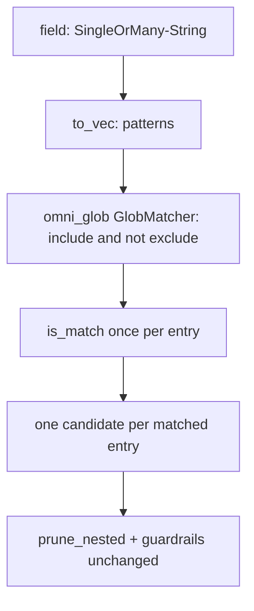

# RFC 0005: List-valued `match`/`scope` with `!` negation, plus projection field-name cleanup

- **Status:** Accepted <!-- Draft | Accepted | Implemented | Superseded -->
- **Owner:** TBD
- **Date:** 2026-08-29
- **Affected crates/files:** omni_projection_configurations (projection.rs, json_schema.rs, match_validator.rs), omni_projections (routing.rs), omni_glob (consumed, defined in RFC 0007), omni_config_types (reuse of `SingleOrMany`), omni_api (operations/config_schema.rs, generated schema)
- **Prior art referenced:** ESLint `overrides[].files`, Prettier `overrides[].files`, tsconfig `include`/`exclude`, ripgrep overrides, omni's own task-glob `!` convention
- **Depends on:** RFC 0007 (shared `omni_glob` matcher), now **Implemented**. This RFC uses `omni_glob::GlobMatcher` for both the OR-union and the `!` negation, and `omni_glob::is_include` for the parity classifier. `omni_glob` re-exports `GlobOptions` from `omni_utils::glob`, so consumers pick it up through `omni_glob` with no direct `omni_utils` dependency.
- **Supersedes / extends:** RFC 0002 (Projection Enhancements). No decision in 0002 changes; this widens two glob field types and gives them omni's `!` negation.

## 1. Summary

Let the glob fields on projection routing accept either a single glob string (as today) or a list of glob strings: `match` on `pattern` and `flatten` rules, and `scope` on `mirror`. A list is an OR union, and a leading `!` on an entry marks it as an exclusion, following the exact convention omni already uses for task input/output globs. So `scope: ["docs/**", "!docs/drafts/**"]` mirrors everything under `docs/` except the drafts. The change reuses `SingleOrMany<String>` for the scalar-or-list shape and the shared `omni_glob::GlobMatcher` (RFC 0007) for both the union and the negation, so there is no bespoke matching or a parallel `exclude` field.

`match` and `scope` share this matching engine but keep their separate names, because they play different config roles (see §3.2). In the same spirit, this RFC cleans up two field names on projection rules: `explicit`'s `match` becomes `source` (it is a literal path compared with `==`, never a glob), and `pattern`/`flatten`'s `match-kind` becomes `match_kind` (the lone kebab-case key in an otherwise snake_case config surface). Both are hard renames with no alias, so configs using the old keys must be updated.

## 2. Motivation / Problem

Selecting a handful of named directories under a source today forces a single brace-expansion glob:

```yaml
rules:
    - match: "skills/productivity/{grill-me,grilling,teach,to-questionnaire,wait-what,writing-for-agents,handoff}"
      dest: "@target/{basename}"
      match-kind: dir
```

That line is hard to read, hard to diff, and hard to review. Adding or removing one skill means editing inside a brace group on a long line, and a stray comma or brace silently changes what matches. The brace syntax also hides the intent: this is a list of independent paths, not a pattern.

The desired form expresses the alternatives as a YAML list, which reads as an OR:

```yaml
rules:
    - match:
          - skills/productivity/grill-me
          - skills/productivity/teach
          - skills/productivity/writing-for-agents
      dest: "@target/{basename}"
      match-kind: dir
```

The `mirror` strategy has the opposite pain. It mirrors the whole source, and the only way to hold a few files back is a `scope` glob that has to positively describe everything you want. "Mirror everything under `docs/` except the drafts" is not directly expressible. omni already solves exactly this elsewhere: task globs let you write `["src/**", "!src/gen/**"]`. Projections should use the same `!` convention:

```yaml
routes:
    - strategy: mirror
      target: "./vendored-docs"
      scope:
          - "docs/**"
          - "!docs/drafts/**"
          - "!**/*.tmp"
```

Each entry is a glob; entries without a `!` are includes (unioned), entries with a leading `!` are excludes, and an entry matches when it is included and not excluded.

## 3. Goals / Non-goals

### Goals

- Accept `match` (on `pattern`/`flatten`) and `scope` (on `mirror`) as a string **or** a list of strings.
- Support omni's `!`-prefix negation in those lists, delegating the include/exclude split and matching to `omni_glob` (RFC 0007), so projections behave like task globs.
- Keep the scalar form byte-for-byte backward compatible, including existing brace-expansion globs.
- Reuse `SingleOrMany<String>` for the field shape and `omni_glob::GlobMatcher` for matching; add no bespoke matcher and no parallel `exclude` field.
- Guarantee an entry selected by several includes still produces exactly one candidate link (no self-collision).
- Update the generated JSON schema so editors accept both forms.
- Keep the field names as they are (`match` on rules, `scope` on mirror) and document why they stay distinct (see §3.2).
- Rename `explicit`'s literal-path field from `match` to `source`, so `match` never denotes a literal path once it means a negation-aware glob list on `pattern`/`flatten`.
- Normalize `pattern`/`flatten`'s `match-kind` config key to `match_kind`, matching the snake_case convention of the rest of the projection config (`on_collision`, `allow_omni_config`, `allow_git`).

### Non-goals

- Making `explicit` accept a list or `!` negation. Its field is a literal source path paired 1:1 with a required `dest`; a list has no coherent per-alternative destination. This RFC renames that field to `source` (see §5.2) but keeps it a scalar literal path with no glob or negation semantics.
- Keeping the old `match` / `match-kind` keys working. Both are hard renames; there is no compatibility alias.
- Defining or changing the negation semantics themselves. Those live in RFC 0007 (parity-based, order-independent, exclude-wins). This RFC only exposes them on projection fields.
- Per-alternative `dest` or `match-kind`. All alternatives in a rule share the rule's `dest` template and `match-kind`.
- Any change to collision handling or the existing-file policy. That is a separate concern, tracked in RFC 0006, which renames `on_collision` to `on_existing` and flips its default.

### 3.1 Which strategies this applies to

A survey of all five strategies for a glob field that means "which source entries does this select":

| Strategy     | Field                                       | List + `!` applies?                                                                 |
| ------------ | ------------------------------------------- | ----------------------------------------------------------------------------------- |
| `namespaced` | none                                        | No selecting glob                                                                   |
| `mirror`     | `scope: Option<String>`                     | Yes                                                                                 |
| `explicit`   | `source: String` (literal path, 1:1 `dest`) | No, no coherent per-alternative `dest`, and the field is a literal path, not a glob |
| `pattern`    | `match: String` (glob)                      | Yes                                                                                 |
| `flatten`    | `match: String` (glob)                      | Yes                                                                                 |

`mirror.scope` and a `match` glob share `omni_glob`'s matching: both build an include/exclude `GlobMatcher` from a pattern list and test source entries by slash-normalized relative path. That shared engine is why the same `SingleOrMany` + `omni_glob` change covers both, and does **not** make them the same config concept, which is why the names stay different (§3.2). `namespaced` has no selecting field. `explicit` is excluded from the list/negation change because its field is a literal path, and this RFC renames it to `source` (§5.2) precisely so no reader mistakes it for the glob-valued `match` on the other strategies.

### 3.2 Why `match` and `scope` keep different names

At the implementation layer these fields are interchangeable: the same matcher, the same relative-path test. At the config layer they are not, and the names track that. Keeping them distinct is a deliberate decision of this RFC.

|             | `match` (`pattern` / `flatten`)                                        | `scope` (`mirror`)                                                  |
| ----------- | ---------------------------------------------------------------------- | ------------------------------------------------------------------- |
| Role        | Positive selector paired with a `dest`: "match these, send them there" | Optional narrowing of a mirror-everything default: "limit to these" |
| Destination | Required `dest` (templated) per rule                                   | None; mirror always reproduces the source path as-is                |
| Cardinality | One per rule, and a strategy has a `rules: [...]` list                 | A single field on the strategy                                      |
| Optionality | Mandatory; a rule without a `match` is invalid                         | Optional; absence means "mirror everything"                         |
| Location    | Rule level, inside `rules`                                             | Strategy level, flattened onto `MirrorProjection`                   |

Naming mirror's field `match` would imply a `match → dest` mapping that does not exist, since mirror never routes to a different destination. `scope` carries the established "narrow an otherwise-everything operation" meaning (tsconfig, rsync). The `!` negation reads naturally on both: a `scope` list that includes `**` and excludes drafts, or a `match` list that includes a few paths.

## 4. Background: current mechanisms

A projection source carries `routes`, each a `Projection` strategy. `pattern` and `flatten` hold a `Vec` of rules. Both rule structs today declare `match` as a plain `String` (`crates/omni_projection_configurations/src/projection.rs`):

```rust
pub struct PatternRule {
    #[serde(rename = "match")]
    pub r#match: String,
    pub dest: DestPath,
    #[serde(default, rename = "match-kind")]
    pub match_kind: MatchKind,
}
```

`FlattenRule` is the same shape with an optional `dest`. `MirrorProjection` carries `scope: Option<String>`. `ExplicitRule` carries `match: String` (renamed by `#[serde(rename = "match")]`) plus a required `dest`, and `plan_explicit` resolves it by exact path equality (`entries.iter().find(|e| e.rel == PathBuf::from(&rule.r#match))`), never by glob. All derive `Deserialize`/`JsonSchema` and set `deny_unknown_fields`.

Neither `PatternRule` nor `FlattenRule` sets `rename_all`, so their fields serialize by their raw names: `dest`, plus `match_kind` renamed to the kebab `match-kind` by `#[serde(rename = "match-kind")]`. That kebab key is the only one in the projection config that is not snake_case; the shared `ProjectionCommon` uses `on_collision`, `allow_omni_config`, and `allow_git`.

Routing is pure (`crates/omni_projections/src/routing.rs`). `plan_pattern`/`plan_flatten` compile one glob per rule with the local `build_glob` helper (`GlobBuilder::new(pattern).literal_separator(true).build().compile_matcher()`, yielding a `globset::GlobMatcher`) and filter entries via `matching_entries`, which also applies the file-vs-directory `match_kind` filter; `plan_mirror` compiles the optional `scope` the same way but skips directories outright. There is no negation, and each rule's glob is a single `globset::GlobMatcher`.

Key facts the design relies on, verified in source:

- Brace expansion (`{a,b}`) is handled inside a single `globset` glob today, so one entry matches once per rule. There is no candidate de-duplication step; the pipeline assumes at most one candidate per (rule, entry).
- omni already has the `!` convention in `omni_glob` (RFC 0007, extracted from `omni_discovery_utils::glob`): a flat pattern list split by leading-`!` parity into include/exclude sets, matched as `include && !exclude`, order-independent, exclude-wins, with an exclude-only list matching nothing.
- `SingleOrMany<T>` (`crates/omni_config_types/src/single_or_many.rs`) is `#[serde(untagged)]` with `Single(T)` first, derives `JsonSchema` with `schemars(untagged)`, and offers `iter`/`into_vec`.
- The projection JSON schema is partly hand-written (`json_schema.rs` builds the `Projection` `oneOf` and the `mirror` arm's `scope_property()`, currently `{ "type": "string" }`); the rule structs are schemars-derived and referenced by `$ref`. The schema is generated on demand; no generated file is committed. Derived rules pick up the widened field automatically; `scope_property()` is widened by hand.
- `plan_mirror` skips directory entries (`if entry.is_dir { continue; }`), so mirror only links files and negation there operates purely on file paths.

## 5. Proposed design

Change the field type on the two templated rule kinds from `String` to `SingleOrMany<String>`:

```rust
use omni_config_types::SingleOrMany;

pub struct PatternRule {
    #[serde(rename = "match", deserialize_with = "validate_match_patterns")]
    pub r#match: SingleOrMany<String>,
    pub dest: DestPath,
    #[serde(default)]
    pub match_kind: MatchKind,
}
```

`FlattenRule` gets the same treatment. `MirrorProjection.scope` becomes `Option<SingleOrMany<String>>` (`None` still means "mirror everything"). `ExplicitRule` stays a scalar `String` but its field is renamed from `match` to `source` (see §5.2):

```rust
pub struct ExplicitRule {
    pub source: String,
    pub dest: DestPath,
}
```

The `match_kind` field drops its `#[serde(rename = "match-kind")]` so it serializes as the snake_case `match_kind`. Both renames are hard: under `deny_unknown_fields`, the old `match` (on `explicit`) and `match-kind` keys become unknown-field errors, so configs must switch to the new names.

Because `SingleOrMany` is untagged with `Single` first, a scalar `match: "**/*.md"` still deserializes to `Single`, and a YAML list to `Many`. No existing config changes meaning.

### 5.1 Matching via `omni_glob`

Replace the hand-rolled `build_glob`/`matching_entries` glue in `routing.rs` with `omni_glob::GlobMatcher` (RFC 0007), built in relative mode with `literal_separator(true)`:

```rust
use omni_glob::{GlobMatcher, GlobOptions};

let patterns = rule.r#match.to_vec(); // SingleOrMany<String> -> Vec<String>
let matcher = GlobMatcher::new(&patterns, GlobOptions { literal_separator: true })?;

for entry in entries {
    if entry.is_dir != want_dir { continue; }          // match-kind, pattern/flatten only
    if matcher.is_match(to_slash(&entry.rel)) {
        // build one candidate
    }
}
```

The file-vs-directory `match_kind` filter that `matching_entries` performs today is preserved: either inline as shown, or by keeping `matching_entries` and retyping its parameter to `&omni_glob::GlobMatcher`. `GlobMatcher` does the `!`-parity split and returns a single `is_match` bool per entry, so:

- An OR union works: any include glob selects an entry.
- Negation works: `!`-prefixed entries subtract, exclude-wins, order-independent.
- The de-dup guarantee holds: one bool per entry means one candidate even when several includes match.

`plan_mirror` uses the same matcher on `scope` when it is `Some`, matching files by relative path; absence of `scope` still means "no matcher, mirror everything." The projection matcher choice (`literal_separator(true)`, relative anchoring) is exactly the seam RFC 0007 adds options for.



### 5.2 Validation

Reject two shapes at load time, reusing the `id_validator.rs` pattern (a `StaticValidator` via `declare_static_validator!`, attached with `#[serde(deserialize_with = ...)]`). The macro requires the validated value to be `Borrow<SingleOrMany<String>>`, so the impl is generic over `T` exactly as `ProjectionIdValidator` is:

```rust
use std::borrow::Borrow;
use serde_validate::{StaticValidator, declare_static_validator};

impl<T: Borrow<SingleOrMany<String>>> StaticValidator<T> for MatchPatternsValidator {
    fn validate_static(value: &T) -> Result<(), String> {
        let value = value.borrow();
        let patterns: Vec<&String> = value.iter().collect();
        if patterns.is_empty() {
            return Err("must list at least one pattern".into());
        }
        if patterns.iter().any(|p| p.trim().is_empty()) {
            return Err("patterns must not be empty".into());
        }
        // Reject exclude-only lists: with no include, nothing ever matches.
        if !patterns.iter().any(|p| omni_glob::is_include(p)) {
            return Err("must include at least one non-`!` pattern".into());
        }
        Ok(())
    }
}

declare_static_validator!(
    MatchPatternsValidator,
    SingleOrMany<String>,
    validate_match_patterns,
    option_validate_match_patterns,
);
```

`match` (`pattern`/`flatten`) uses the value variant `validate_match_patterns`; `mirror.scope`, being `Option<SingleOrMany<String>>`, uses the generated `option_validate_match_patterns`, so an omitted/null `scope` stays valid. `omni_glob::is_include` (the parity classifier exposed by RFC 0007) keeps the "what counts as an exclude" rule in one place. The exclude-only check matters because omni's convention makes an all-`!` list match nothing, which for `mirror` would silently produce an empty projection.

This is a load-time check, not a schema constraint: the generated schema still describes the field as "string or array of strings" with no `minItems`, because it comes from `SingleOrMany`'s derived `JsonSchema`. That is consistent with how id/path vocabularies are validated. Glob syntax stays a plan-time error from `omni_glob`.

Why `explicit` renames instead of widening: an `explicit` rule maps one literal source path to one required `dest`. A list of matches would need a shared `dest` (then it is just `pattern`) or a parallel list of dests (worse than adding rules), so the field stays a scalar. It is renamed `match` → `source` because it is a literal path resolved by `==`, never a glob; once `match` on `pattern`/`flatten` means "negation-aware glob list," leaving the literal-path field named `match` would give one name two behaviors across sibling strategies. In `routing.rs`, `plan_explicit` reads `rule.source` (`source` is not a keyword, so no `r#` raw identifier).

## 6. Mandatory analysis

### 6.1 Existing mechanisms (reuse vs. extend vs. add)

Reuse throughout. `SingleOrMany<String>` is omni's established scalar-or-list shape (already used by `generator`/`tool` `path`). `omni_glob` (RFC 0007) is omni's established negation matcher. This RFC adds no matcher and no new field; it widens field types and points routing at the shared matcher. The bespoke `exclude` field from an earlier draft is dropped in favor of the `!` convention already used across omni.

### 6.2 Maintenance cost

- Dependencies: `omni_projection_configurations` gains `omni_config_types` (for `SingleOrMany`) and `omni_glob` (for the `is_include` classifier); `omni_projections` gains `omni_glob` and drops its hand-rolled globbing. Once `build_glob` is gone, `omni_projections`' direct `globset` dependency can be dropped if nothing else in the crate uses it.
- Call sites: `plan_pattern`/`plan_flatten`/`plan_mirror` in `routing.rs`; the local `build_glob` helper is deleted in favor of `GlobMatcher`, and `matching_entries` is either inlined or retyped to `&omni_glob::GlobMatcher` while keeping its `match_kind` filter.
- Contributors learn one negation rule for projections, and it is the same one they already know from task globs. Net reduction in concepts.

### 6.3 Testability

- Parsing: assert `match: "x"` parses to `Single`, `match: ["a","b"]` to `Many`, and that `match: []`, an empty-string entry, and an exclude-only list (`["!x"]`) are all rejected. Add `mirror` `scope` cases (string, list, exclude-only rejected).
- Routing: with hand-built `ScannedEntry` slices, assert a multi-include list links entries matched by any include; an entry matched by two includes yields exactly one `LinkPair`; a `!` entry drops matching files; a file matched by both an include and an exclude is dropped (exclude wins); `scope: ["**", "!drafts/**"]` mirrors everything but drafts.
- Schema: assert `match`/`scope` are an `anyOf` of `{type: string}` and `{type: array, items: string}` (schemars 1.2 emits `anyOf` for `#[schemars(untagged)]`).
- Guard neighbours: `workspace_configuration.rs` asserts `Projection` is a five-arm `oneOf`; confirm it still passes.
- `omni_glob`'s own negation semantics are tested in RFC 0007, so these tests only cover the projection wiring.

### 6.4 Integration points

- `omni_projection_configurations::projection` — the two rule fields, `MirrorProjection.scope`, the `deserialize_with` validator attributes, and the `ExplicitRule` field rename (`match` → `source`).
- `omni_projection_configurations` — new `match_validator.rs` (mirroring `id_validator.rs`); deps on `omni_config_types` and `omni_glob`.
- `omni_projection_configurations::json_schema` — the `mirror` arm's `scope` widened to the string-or-array union; the `explicit` arm's required key becomes `source`, and the `pattern`/`flatten` rule key becomes `match_kind`. Derived rules pick up `match` automatically. Since the renames are hard, the schema and the loader agree on the new names only.
- `omni_projections::routing` — `plan_pattern`/`plan_flatten`/`plan_mirror` build an `omni_glob::GlobMatcher` (relative, `literal_separator(true)`); the local `build_glob` helper is removed and `matching_entries` keeps its `match_kind` filter over the new matcher; `plan_explicit` reads `rule.source`.
- `omni_api::operations::config_schema` — regenerates on demand; the emitted shape changes to accept the union.

Ordering: this RFC's implementation follows RFC 0007's crate extraction. The matcher is built once per rule (or once for mirror `scope`) before scanning entries.

### 6.5 Potential regressions

- **Self-collision.** A per-alternative loop would emit duplicate candidates for an entry matched by several includes. `GlobMatcher::is_match` returns one bool per entry, so one candidate. Tests lock this in.
- **Schema consumers.** Editors on the old `string`-only shape would reject a list; after regeneration both are accepted. Additive for authors (scalar still valid).
- **Negation behavior parity.** Projection `!` must behave exactly like task-glob `!`. It does, because it is literally the same `omni_glob` matcher; there is no second implementation to drift.
- **Exclude-only footgun.** An all-`!` `scope` matches nothing, which for mirror is a silent empty projection. The §5.2 validator rejects it up front.
- **Separator semantics.** Projections require `literal_separator(true)`; this is passed explicitly to `GlobMatcher::new`, and RFC 0007's cache keys on the option so it never aliases a default-option set.
- **Merge precedence.** None. The projection config crate has no `Merge` impl; a consuming workspace overrides a source-declared `projections` block wholesale (RFC 0002). `SingleOrMany`'s own `Merge` is replace, moot here.
- **Cross-platform paths.** Matching still runs on slash-normalized relative paths via `to_slash`.
- **Field renames (breaking).** `explicit`'s `match` → `source` and `pattern`/`flatten`'s `match-kind` → `match_kind` are hard renames. Under `deny_unknown_fields` the old keys become unknown-field parse errors, so any config using them must be updated. The in-repo `workspace.omni.yaml` uses `match-kind` (no `explicit` usage exists), and the `match_kind_defaults_to_file_and_parses_variants` test sends `match-kind`; both must be updated to `match_kind` in the same change. Blast radius is otherwise small because projections are a new subsystem.

### 6.6 Pros and cons

| Option                                                     | Pros                                                                                                    | Cons                                                                                        | Verdict             |
| ---------------------------------------------------------- | ------------------------------------------------------------------------------------------------------- | ------------------------------------------------------------------------------------------- | ------------------- |
| A. `SingleOrMany` + `omni_glob` `!` negation (recommended) | Reuses omni's list shape and negation convention; one matcher, no new field; consistent with task globs | Depends on RFC 0007 landing first                                                           | Yes                 |
| B. Separate `exclude` field on `mirror`                    | No dependency on the shared matcher                                                                     | A parallel exclusion mechanism inconsistent with the rest of omni; duplicates matcher logic | No, superseded by A |
| C. Always `Vec<String>` (require a list)                   | Uniform type                                                                                            | Breaks every scalar `match`; noisy for the single-glob case                                 | No                  |
| D. Keep single `String`, no negation                       | Smallest change                                                                                         | Does not solve the brace-glob or mirror-exclude problems                                    | No, misses the goal |

### 6.7 Prior art and how omni improves on it

| Tool                                  | Their approach                              | What to adopt                      | What to change for omni                                                                        |
| ------------------------------------- | ------------------------------------------- | ---------------------------------- | ---------------------------------------------------------------------------------------------- |
| ESLint / Prettier `overrides[].files` | String or array of globs, OR                | The scalar-or-array ergonomics     | Back it with `SingleOrMany` so it is consistent across omni config                             |
| tsconfig `include`/`exclude`          | Two array fields                            | Include-then-subtract mental model | Express it in one `!`-aware list, consistent with omni's task globs, instead of a second field |
| ripgrep / gitignore                   | `!` marker for negation                     | The `!` prefix                     | omni's parity model is order-independent (exclude wins), not positional; defined in RFC 0007   |
| omni task input/output globs          | `["src/**", "!src/gen/**"]` via `omni_glob` | The exact convention and matcher   | Reuse it verbatim so projections behave identically to task globs                              |

## 7. Open questions

None. The one remaining question (whether to document an "everything except a few" idiom for `pattern`/`flatten`) is resolved in decision 8 below.

## 8. Implementation plan

Sequenced after RFC 0007 lands `omni_glob`:

1. Add `omni_config_types` and `omni_glob` to `omni_projection_configurations/Cargo.toml`; `omni_glob` to `omni_projections`.
2. Add `match_validator.rs` (non-empty, no empty entries, at least one include via `omni_glob::is_include`); register the `mod`.
3. Change `PatternRule.r#match` / `FlattenRule.r#match` to `SingleOrMany<String>` and `MirrorProjection.scope` to `Option<SingleOrMany<String>>`; add the `deserialize_with` attributes. Rename `ExplicitRule.r#match` to `source` (drop the `#[serde(rename)]`) and update `plan_explicit` to read `rule.source`. On `PatternRule`/`FlattenRule`, drop `#[serde(rename = "match-kind")]` so the field serializes as `match_kind`.
4. Widen the `mirror` arm's `scope` schema to the string-or-array union; update the `explicit` arm's required key to `source` and the rule schema key to `match_kind`; update schema assertions to expect `anyOf` and the new key names.
5. In `routing.rs`, build `omni_glob::GlobMatcher` (relative, `literal_separator(true)`) in `plan_pattern`/`plan_flatten`/`plan_mirror`; delete the local `build_glob` helper and preserve the `match_kind` filter (inline or via a retyped `matching_entries`).
6. Extend parsing, routing, and schema tests per §6.3, including negation and exclude-wins; update the `explicit` and `match_kind` fixtures/schema assertions to the new key names (including the `match_kind_defaults_to_file_and_parses_variants` test, which currently sends `match-kind`); confirm the untouched `Projection` `oneOf` tests still pass.
7. Migrate the in-repo `workspace.omni.yaml` `match-kind` keys to `match_kind` (required, since the old key no longer parses).

## 9. Decision log

| #   | Decision                                                                                                                                                                                                                                                                           | Rationale                                                                                                                                                                                                                                                                   |
| --- | ---------------------------------------------------------------------------------------------------------------------------------------------------------------------------------------------------------------------------------------------------------------------------------- | --------------------------------------------------------------------------------------------------------------------------------------------------------------------------------------------------------------------------------------------------------------------------- |
| 1   | Widen `match` (`pattern`/`flatten`) and `scope` (`mirror`) to `SingleOrMany<String>`                                                                                                                                                                                               | Reuses omni's scalar-or-list shape; keeps scalar backward compatible; covers every strategy with a selecting glob                                                                                                                                                           |
| 2   | Support exclusion via omni's `!`-prefix convention, not a separate `exclude` field                                                                                                                                                                                                 | Consistency: authors already write `!` in task globs; one matcher, no parallel mechanism                                                                                                                                                                                    |
| 3   | Delegate all matching to `omni_glob` (RFC 0007); delete the hand-rolled glob glue in `routing.rs`                                                                                                                                                                                  | One negation implementation, no drift; projection `!` behaves exactly like task-glob `!`                                                                                                                                                                                    |
| 4   | Reject empty, empty-entry, and exclude-only lists at load time via `match_validator.rs`                                                                                                                                                                                            | An empty or all-`!` list matches nothing; failing loudly beats a silent empty projection                                                                                                                                                                                    |
| 5   | Keep the distinct names `match` (rules) and `scope` (mirror)                                                                                                                                                                                                                       | They share only the matching engine, not the config role; `match` pairs with a `dest`, `scope` is an optional whole-strategy narrowing                                                                                                                                      |
| 6   | Depend on RFC 0007 rather than inlining a matcher here                                                                                                                                                                                                                             | The negation matcher is a shared concern; extracting it once serves discovery, generator, and projections                                                                                                                                                                   |
| 7   | Verify the design against the now-implemented `omni_glob`; `GlobOptions` comes through `omni_glob`'s re-export, the validator impl is generic over `Borrow<SingleOrMany<String>>`, and only `build_glob`/`matching_entries` (not `build_glob_set`) are the routing glue to replace | RFC 0007 shipped; the design must cite the real API surface, not the 0007 draft's sketch                                                                                                                                                                                    |
| 8   | Add a short note to the projection docs showing the `["**", "!x"]` "everything except a few" idiom                                                                                                                                                                                 | Cheap, removes the only open question, and mirrors how task-glob docs already explain `!`                                                                                                                                                                                   |
| 9   | Rename `explicit`'s literal-path field `match` → `source` as a hard rename with no `serde` alias                                                                                                                                                                                   | Once `match` means a negation-aware glob list on `pattern`/`flatten`, keeping the literal-path field named `match` overloads one name with two behaviors; no in-repo config uses `explicit` and projections are new, so a clean rename beats carrying a compatibility alias |
| 10  | Normalize `pattern`/`flatten`'s `match-kind` key to `match_kind` as a hard rename with no `serde` alias                                                                                                                                                                            | `match-kind` was the only kebab-case key in an otherwise snake_case projection config (`on_collision`, `allow_omni_config`, `allow_git`); a clean rename keeps the surface consistent, and the only affected config (`workspace.omni.yaml`) is migrated in the same change  |
