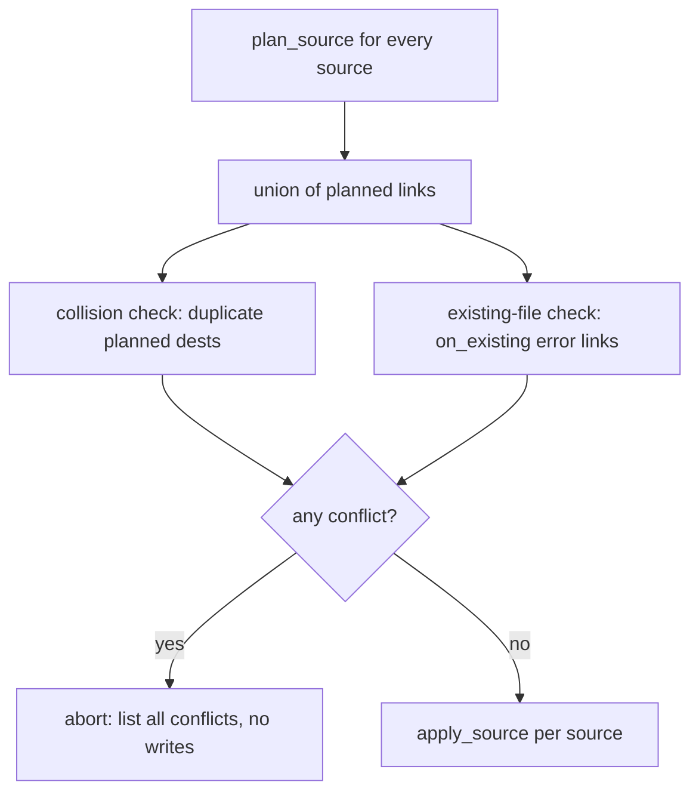

# RFC 0006: Projection `on_existing` policy, fatal collisions, and a pre-apply check

- **Status:** Implemented <!-- Draft | Accepted | Implemented | Superseded -->
- **Date:** 2026-08-29
- **Affected crates/files:** omni_projection_configurations (projection.rs, json_schema.rs), omni_projections (apply.rs, engine.rs), omni_api (operations/projection.rs)
- **Prior art referenced:** GNU Stow (conflict abort), Nix home-manager (collision errors), Terraform plan/apply, git checkout overwrite refusal
- **Supersedes / extends:** RFC 0001 / RFC 0002 (Projections). Amends RFC 0001: the `Projection.on_collision: CollisionPolicy` field and its `default: backup` (§5.2), the collision-policy goal (§3), and the applier's collision-policy behavior (§5.4) are renamed to `on_existing`/`ExistingPolicy` with a `default: error`; the `on_collision:` keys in RFC 0001's YAML examples (§5.2) read as `on_existing:`. RFC 0001 is left unedited as a historical record; this RFC is the current source of truth for the option. Supersedes REQ-20 and REQ-21 of RFC 0002: two planned links that resolve to one destination, or one nested strictly inside another projected directory link, are now always a fatal collision, not a policy-resolved one. No routing/matching change (that is RFC 0005).

## 1. Summary

Three changes to how a projection handles a destination.

1. Rename `on_collision` to `on_existing`. The option only ever governed one thing: what to do when a file already sits at the destination. The old name implied it also covered two links fighting over one path. It never did.
2. Flip the default of `on_existing` from `backup` to `error`, so a projection never silently backs up or rewrites a foreign file unless the author opts in.
3. Separate "a file is already there" from "two of my links fight over one location." The first is prior filesystem state and stays configurable through `on_existing`. The second is a collision: two links resolving to the same destination, or one destination nested inside another planned directory link. That is a config bug no `on_existing` value can express intent about, so a collision is always fatal.

A read-only pre-apply pass enforces both before the first write. It aborts the whole run, lists every conflict, and leaves the filesystem untouched.

## 2. Motivation / Problem

Three problems share one root cause: the old `on_collision` bundled two unrelated situations under one word.

**The name and the concept conflate two things.** "Collision" covered both "a foreign file is already at the destination" and "two of my rules resolve to the same destination." Those are different. The first is the state of the disk before the run, and configuring it is reasonable. The second is the plan contradicting itself, which the author never wants and only ever does by mistake. One knob for both muddles the model and hides the bug.

**The default is too eager.** `on_collision` defaults to `backup`: when a destination exists and omni does not own it, omni renames the existing file aside and takes its place. A projection is a filesystem mutation the author may not be watching. The `backup` default moves a foreign file silently, and the author finds out later by spotting a `.bak` sibling. The safer posture is to refuse by default and make the author choose `backup`, `overwrite`, or `skip`.

**`error` is not atomic, and collisions surface too late.** Today `error` is enforced per link inside `apply_link` (`crates/omni_projections/src/apply.rs`), while `engine.rs::sync_source` mutates the filesystem in a loop. A failure on link 50 leaves links 1 through 49 written, with no rollback. Worse, two links to one destination slip past the disk check on a first run, because neither exists yet. Link A materializes, link B fails, and the run is again half-applied. A check whose whole job is "stop if something is wrong" should stop before it writes anything.

Desired outcome: the default protects the user, a self-contradictory plan is rejected before any write, and choosing `error` for existing files gives all-or-nothing behavior.

## 3. Goals / Non-goals

### Goals

- Rename `on_collision` to `on_existing`, and the enum `CollisionPolicy` to `ExistingPolicy`. Hard rename, no alias, since omni is pre-release.
- Flip the default of `on_existing` from `backup` to `error`.
- Treat a plan collision as always fatal, independent of `on_existing`: two links resolving to the same destination, or one destination nested inside another planned directory link.
- Add a whole-run pre-apply pass that detects collisions (always) and existing-file conflicts (under `on_existing: error`) across every source, and aborts before the first write.
- Reproduce the ledger ownership exception in the existing-file check so a routine re-sync of omni-owned links is never flagged.
- Aggregate every conflict into a single error so the author sees the complete list in one pass.
- Report the same conflicts in `--dry-run` without mutating anything.

### Non-goals

- A full transactional / rollback sync. The pre-apply pass prevents partial writes for collisions and for the `error` existing-file case. It does not undo a failure that surfaces mid-write (a permission error, or a file appearing after the check). That stays best-effort, as today.
- Changing what `skip` / `overwrite` / `backup` do for an existing file. Their meaning is unchanged; only the default and the option name change.
- An intentional override mechanism. Making collisions fatal removes the trick of pointing two rules at one destination and letting `overwrite` keep the last. See §6.5. If overrides are wanted, they need their own design.
- Any routing/matching change. Tracked in RFC 0005.

## 4. Background: current mechanisms

`CollisionPolicy` (`crates/omni_projection_configurations/src/projection.rs`) is `{ Skip, Overwrite, Backup, Error }` with `#[default] Backup`. `ProjectionCommon.on_collision` carries it. `json_schema.rs` inlines the field into every strategy arm, and a test lists `on_collision` among the shared fields. The engine reads it once per projection (`engine.rs`: `collision: projection.common().on_collision`) and passes it to `apply_link`.

`apply_link` runs per link. It first honors the ownership exception: if the ledger records that omni created this destination for this same source, an unchanged pin leaves the link as-is (`Skipped`), and a changed pin re-points it with no backup. Only then does it consult the policy, and only when the destination already exists:

```rust
match opts.collision {
    CollisionPolicy::Skip => return Ok(ApplyOutcome::Skipped),
    CollisionPolicy::Error => return Err(/* destination already exists */),
    CollisionPolicy::Overwrite => remove_existing(...),
    CollisionPolicy::Backup => { rename dest aside; }
}
```

How duplicate destinations are handled today (RFC 0002 requirements):

- REQ-19: within one projection, a candidate whose destination falls strictly inside another candidate directory's destination is pruned, shallowest wins (`routing.rs::prune_nested`).
- REQ-20: two candidates that resolve to the _identical_ destination are not pruned; the `on_collision` policy resolves them at apply time.
- REQ-21: overlaps across projections or sources are not pruned and resolve through the policy and ledger.

This RFC keeps REQ-19 (nested pruning within a projection) and supersedes REQ-20 and REQ-21: across projections or sources, an identical or nested destination becomes a fatal collision instead of a policy-resolved overlap.

Facts the design relies on, verified in source:

- `Error` aborts inside the per-link loop in `engine.rs::sync_source`, which mutates as it goes. A failure on the Nth link leaves the first N-1 written. There is no rollback.
- The ownership exception makes a normal re-sync a no-op: omni-owned destinations with an unchanged pin are `Skipped`. The existing-file check must reproduce this, or every second sync would flag every owned link.
- The pure planner `plan()` does no filesystem access. Existence checks live in the apply layer, which holds an `ApplierSys` and the prior ledger.
- No test asserts `CollisionPolicy::default()`. No `*.omni.yaml` in the repo sets `on_collision`, and no in-repo schema snapshot pins the default, so the default flip is a `#[default]` move plus the rename. The `apply.rs` collision tests pass the policy explicitly.

## 5. Proposed design

**Rename.** `on_collision` becomes `on_existing`; `CollisionPolicy` becomes `ExistingPolicy`. The variants and the field's job for an existing file are unchanged. Hard rename with no serde alias: a config using `on_collision` fails to parse, which is fine pre-release and surfaces the change loudly. Update `json_schema.rs` and its test.

**Default flip.** Move `#[default]` from `Backup` to `Error` on `ExistingPolicy`. An author who wants the old behavior writes `on_existing: backup`.

**Two distinct checks, both before any write.** The design splits the two situations the old option ran together:

- A **collision** is two or more planned links, anywhere in the run, resolving to the same destination. It is always fatal, whatever `on_existing` says. This is a plan-versus-plan check with no filesystem access. It runs on the plan after routing's nested pruning (REQ-19), so only genuinely identical survivors count.
- An **existing-file conflict** is a non-owned file already at a destination. It is governed by `on_existing`. Under `error` (the new default) it is fatal. Under `skip` / `overwrite` / `backup` the apply resolves it as before.

**Whole-run pre-apply pass.** Both checks need the whole plan before the first write, so gather every source's plan first. Today's `sync_source` plans and applies one source in a single pass, which cannot do that. Split it:

- `plan_source` — scan the source, plan every projection, resolve the pin, and return the planned links. Each carries the resolved `LinkPair`, the destination rel path, whether it is a directory link (`is_dir_link`, for the nested check), the `on_existing` value, and the prior-ledger lookup (`PriorLink` with its `pin_unchanged` flag). No mutation.
- `apply_source` — run `apply_link` per planned link, then `reconcile_stale`. The existing mutation loop, unchanged.

`handle_projection_sync` (`crates/omni_api/src/operations/projection.rs`) drives the two phases:

1. For every configured source, materialize/resolve as today, then `plan_source`. Accumulate all planned links into one collection.
2. Run the read-only pass over the union:
    - **Collision check (always).** Group planned links by destination across all sources and projections, and first collapse identical links (same destination, source, and link kind) so overlapping rules that produce the same `LinkPair` do not trip it. Then two shapes are collisions. A destination claimed by more than one distinct link. And a destination that sits strictly inside another planned directory-link destination. `prune_nested` drops the second within one projection but not across projections or sources. Left alone, the inner link writes through the outer directory at apply time, and if the outer link is a symlink that write lands in a source.
    - **Existing-file check (only for `on_existing: error` links).** Stat the destination (reusing `symlink_meta` from `apply.rs`). Apply the ownership exception through the shared predicate: skip destinations the ledger records as omni-owned for this source (changed pin or not, since a changed pin is a re-point). If a non-owned file exists, record a conflict.
3. If either check finds anything, return one error listing every collision and every existing-file conflict, before a single link is written. The error is a dedicated aggregated variant (see §6.4), not a one-line `custom` message.
4. Only when the pass is clean does the driver run `apply_source` per source.

Factor the "is this a foreign existing file?" test into a shared helper used by both the existing-file check and `apply_link`, so the two cannot drift. `apply_link` keeps its per-link `Error` arm as defense in depth for a file that appears between the check and the write (a TOCTOU race). The collision check needs no apply-time counterpart: a collision is a property of the plan, so it cannot appear mid-run.

In `--dry-run`, the phases run through both checks and report the planned links and any conflicts without mutating anything.



## 6. Mandatory analysis

### 6.1 Existing mechanisms (reuse vs. extend vs. add)

Reuse and rename. The default flip is one attribute. The rename touches the enum, the field, `ApplyOptions`, and `json_schema.rs`. The existing-file check reuses `symlink_meta`, the prior ledger, and the ownership logic in `apply_link`. The collision check is new but small: a grouping over the accumulated destinations, no filesystem access.

**No logic duplication.** Avoiding duplication is part of why the split wins. `plan_source` produces the plan once, and both checks and `apply_source` consume that same plan, so there is no re-planning and no second pin computation. The "is this a foreign existing file?" test lives in one shared predicate that the existing-file check and `apply_link` both call. `apply_link` keeps its extra re-point branch for a changed pin (`apply.rs`), which the check does not need. The collision check shares nothing with apply, because apply has no collision arm. `desired_dests` and the planned-link list also come from `plan_source`, feeding the checks, the dry-run report, and `reconcile_stale` from one place. The only redundancy is a double stat. The existing-file check stats each `error` destination, and `apply_link` stats it again, so that is one extra `lstat` per link of filesystem work, not repeated logic. The double-plan alternative (§6.6, option E) is the one that would duplicate: it re-runs `plan()` for detection and again inside the sync loop.

### 6.2 Maintenance cost

- The default flip is one `#[default]` move.
- The rename is mechanical but wide. It touches the field, the enum, `ApplyOptions`, `json_schema.rs` and its test, and the examples in RFC 0001/0002. A hard rename is one clean sweep with no alias to carry forward.
- The existing-file check adds a read-only pass plus a shared "foreign existing file?" helper. Drift between it and `apply_link` is the main risk; the shared helper is the mitigation.
- The collision check adds a grouping over planned destinations. Self-contained, nothing to keep in sync.
- Splitting `sync_source` into `plan_source` + `apply_source` is a refactor of one function into two, plus the driver-level accumulation of plans across sources in `handle_projection_sync`. The per-source outcome/ledger bookkeeping moves into `apply_source` unchanged.
- Test churn. `sync_source` is public and called by six engine tests plus the driver. Keep it as a thin wrapper (`plan_source` then `apply_source`, no cross-source pass) so the per-source tests stay as-is, and have the driver call the two phases directly. The wrapper omits the aggregated pass on purpose; note this in code so a future caller does not assume it is atomic.
- Docs and requirements. RFC 0001/0002 examples, and REQ-20/21 in `docs/requirements/0002-projection-enhancements.md`, need updating to record the supersession. The changelog must call out both the rename and the default flip.

### 6.3 Testability

- Rename: a config with `on_collision` fails to parse; the same config with `on_existing` parses.
- Default: assert `ExistingPolicy::default() == Error`.
- Existing-file check (the applier tests already fake a `Sys`):
    - A non-owned dest under `error` aborts with **zero** writes.
    - An omni-owned unchanged dest does not trip the check (re-sync stays a no-op).
    - A pin-changed owned dest re-points rather than erroring.
    - `--dry-run` reports the conflict and mutates nothing.
- Collision check:
    - Two distinct planned links to one destination abort with **zero** writes, under every `on_existing` value, including `overwrite`.
    - Two links to one destination from different sources abort together in a single aggregated error.
    - Two links from different sources where one destination nests inside the other's directory link abort before any write.
    - A nested overlap within a single projection is still pruned (shallowest wins), not errored.
    - Two overlapping rules that match one entry and produce the identical link (same source, same dest, same link kind) collapse to one and apply without error.
    - A config with no duplicate destinations applies normally.
- Hard to test: a true TOCTOU race (a file appears between check and write). Not covered by design; the per-link `Error` fallback handles it, accepting a partial apply.

### 6.4 Integration points

- `omni_projection_configurations::projection` — rename `CollisionPolicy` to `ExistingPolicy` and `on_collision` to `on_existing`; move `#[default]` to `Error`.
- `omni_projection_configurations::json_schema` — update the inlined field name and the test that lists it.
- `omni_projections::apply` — rename `ApplyOptions.collision`; extract the shared "foreign existing file?" predicate from `apply_link`; keep the per-link `Error` arm as a fallback.
- `omni_projections::routing` — `plan()` returns `LinkPair` (source and dest only). The nested check needs each planned link's `is_dir_link` flag, which `Candidate` already holds and `plan()` currently drops. Thread it out so `plan_source` can carry it.
- `omni_projections::engine` — split `sync_source` into `plan_source` (scan/plan/pin, no writes) and `apply_source` (the mutation loop plus `reconcile_stale`).
- `omni_projections::error` — add a `ProjectionErrorInner::Conflicts` variant carrying the structured lists (collisions, nested, existing-file), with a `#[error(...)]` that renders them multi-line, plus a `ProjectionError::conflicts(...)` constructor beside `custom`. `EnumDiscriminants` is already derived, so tests assert on the discriminant and the counts.
- `omni_api::operations::projection` — `handle_projection_sync` runs `plan_source` for every source, accumulates the plans, runs the collision and existing-file checks, aborts with the full conflict list, then runs `apply_source` per source and threads results into the dry-run report.

Ordering: the collision check runs after routing's nested pruning (REQ-19) and after every source's `plan_source`. Both checks run before the first `apply_source`.

Downstream: no in-repo schema snapshot pins the default or the field name. If the published `omni-oss/json-schemas` are generated from this crate, regenerate them after the rename and the flip.

### 6.5 Potential regressions

- **Config break: the option is renamed.** Any config with `on_collision` fails to parse after this change. Loud and immediate, which is the point pre-release. The fix is to rename it to `on_existing`. Changelog line required.
- **Behavioral break: the default is now `error`.** A workspace that relied on the implicit `backup` and has a foreign file at a destination now gets a hard error instead of a silent backup-and-replace. This is the intended effect. The fix is to add `on_existing: backup` (or `overwrite`/`skip`). Normal re-syncs are unaffected, because owned destinations go through the ownership exception, not the policy.
- **Behavioral break: collisions are fatal under every policy.** Two rules pointed at one destination work today under `overwrite` or `backup` in a last-write-wins sense. That is the override trick REQ-20 allowed. It is now a hard error regardless of `on_existing`. Almost always this is a config bug, so erroring is right, but a config that used it as a deliberate override breaks and has no drop-in replacement. This supersedes REQ-20/21 and needs its own changelog line.
- **Cross-source nesting fails instead of writing through.** Two links from different projections or sources, where one destination sits inside the other's directory link, are now a collision. Before, they reached apply, and the inner link wrote through the outer directory. When the outer link was a symlink, that write landed in a source and dirtied the checkout, silently. That silent source mutation becomes a hard error. Within one projection, `prune_nested` still resolves nesting by dropping the inner link, unchanged.
- **No more partial applies across sources.** Today an `error` conflict on the second source aborts after the first source already applied, since the driver extends the ledger per iteration. The whole-run pass means nothing applies if any source conflicts. That is the goal, but it changes observable behavior. A run that used to leave the first source materialized now leaves the workspace untouched.
- **Earlier guardrail failure.** The `source_realpath_contained` check moves from mid-apply into `plan_source`, so a containment violation now aborts before any write instead of after earlier links are materialized. Strictly better, but an ordering change worth noting.
- **Check / apply divergence (TOCTOU).** If the existing-file check and `apply_link` disagree about what counts as a conflict, `error` could pass the check and then fail mid-apply, defeating atomicity. Mitigated by the shared predicate. A genuine race still falls back to the per-link `Error` and a partial apply; documented as a non-goal.
- **Unaffected paths.** `prior_ledger` is an immutable snapshot taken once, so the checks and the deferred apply read the same ownership view. Orphan reconciliation (`retain_sources`, `plan_retain_sources`) already runs after the source loop gated on `full_sync`, so it is untouched. `--source=X` still skips non-matching sources before planning, so a targeted run scans and applies only that source. `reconcile_stale` stays inside `apply_source`, running per source right after that source's links, so its behavior holds as long as apply stays sequential per source. `status` / `unlink` / `prune` never touch the sync path. The `sync_source` split only moves bookkeeping into `apply_source`; the existing engine tests plus the new tests cover it.
- **Performance.** The collision check is a grouping over planned destinations. The existing-file check adds one stat per `error`-policy planned link. Both are negligible next to the link materialization they precede.

### 6.6 Pros and cons

| Option                                                                                                        | Pros                                                                                                                                     | Cons                                                                                                                                          | Verdict                |
| ------------------------------------------------------------------------------------------------------------- | ---------------------------------------------------------------------------------------------------------------------------------------- | --------------------------------------------------------------------------------------------------------------------------------------------- | ---------------------- |
| A. Rename to `on_existing`, default `error`, collisions always fatal, whole-run pre-apply check (recommended) | Clear model: prior disk state is configurable, a self-contradictory plan is not; never silently touches foreign files; `error` is atomic | Breaking rename; loses the overwrite-override trick; new `plan_source`/`apply_source` split                                                   | ✅                     |
| B. Keep `on_collision`, only flip the default to `error`                                                      | Small change                                                                                                                             | Keeps the overloaded name; `error` still half-applies; collisions still caught late                                                           | ✗ misses the model fix |
| C. Rename and flip, but keep collisions policy-resolved (REQ-20)                                              | No override break                                                                                                                        | Keeps a knob for a case that is always a bug; `overwrite` can silently pick a winner between the author's own rules                           | ✗ keeps the muddle     |
| D. Default `skip`                                                                                             | Never errors, never destroys                                                                                                             | Silent no-op on a real conflict; the author thinks the projection applied when it did not                                                     | ✗ silent no-op         |
| E. Whole-run pass via double-planning (no split)                                                              | Smaller diff; no `sync_source` refactor                                                                                                  | Re-runs `plan()` for detection then again in the sync loop, duplicating per-source pin reads; reopens the drift the shared predicate prevents | ✗ duplicates work      |

### 6.7 Prior art and how omni improves on it

| Tool                        | Their approach                                                                       | What to adopt                                              | What to change for omni                                                                                                              |
| --------------------------- | ------------------------------------------------------------------------------------ | ---------------------------------------------------------- | ------------------------------------------------------------------------------------------------------------------------------------ |
| GNU Stow                    | Refuses to overwrite an existing non-owned file; aborts with a conflict list         | Refuse-by-default posture and up-front conflict reporting  | omni tracks ownership in the ledger, so it distinguishes its own links from foreign files and refuses only on a genuine foreign file |
| Nix home-manager            | Two modules writing the same target file is a hard build error, not a policy choice  | Treat a self-contradictory plan as fatal, not configurable | omni separates that collision from the existing-file case, so the author still configures what happens to a foreign file             |
| Terraform (plan then apply) | Computes the full change set first; apply is a separate, reviewable step             | Check the whole plan before mutating                       | omni's `--dry-run` already prints the plan; the pre-apply pass makes the run honor that plan atomically instead of failing halfway   |
| git checkout                | Refuses to overwrite untracked local files that would be clobbered, listing them all | List every conflict and abort before any change            | Same all-or-nothing reporting, scoped to projection destinations and keyed off the ledger rather than the index                      |

The sharpened idea is the split between "a file is already there" and "two of my links collide." Stow and home-manager both treat a genuine collision as fatal, and omni's ledger lets it keep routine re-syncs quiet while still refusing a config that contradicts itself.

## 7. Open questions

None blocking. Recorded for later:

- Whether to add an explicit override mechanism (rule precedence, or a `priority` field) now that the overwrite-override trick is gone. Out of scope for this RFC; raise it if a real config needs it. Failing on a collision is the conservative default: it can be relaxed into a real precedence feature later, but a silent winner cannot be tightened without breaking configs that came to depend on it.

## 8. Decision log

| #   | Decision                                                                                                                                                                                       | Rationale                                                                                                                                                                                                                                                                                                                                                                                                                                            |
| --- | ---------------------------------------------------------------------------------------------------------------------------------------------------------------------------------------------- | ---------------------------------------------------------------------------------------------------------------------------------------------------------------------------------------------------------------------------------------------------------------------------------------------------------------------------------------------------------------------------------------------------------------------------------------------------- |
| 1   | Rename `on_collision` to `on_existing` (`CollisionPolicy` to `ExistingPolicy`), hard rename with no alias                                                                                      | The option only ever meant "a file already exists"; the old name implied it also governed two links fighting for one path, which it never did. Pre-release, so a clean rename beats carrying an alias                                                                                                                                                                                                                                                |
| 2   | Flip the default of `on_existing` from `backup` to `error`                                                                                                                                     | A projection should never silently move a foreign file aside; make the author opt in to `backup`/`overwrite`/`skip`. Loud failure over silent mutation                                                                                                                                                                                                                                                                                               |
| 3   | Treat two planned links resolving to one destination as a collision that is always fatal, independent of `on_existing`; supersede REQ-20/21                                                    | A self-contradictory plan is a bug no `on_existing` value expresses intent about. `overwrite` silently picking a winner between the author's own rules is surprising, and the config then does not behave the way the author expects. Fail loud now to prevent that confusion; this can be relaxed into an explicit precedence feature later, whereas a silent winner cannot be tightened without breaking dependents. Matches Stow and home-manager |
| 4   | Add a whole-run pre-apply pass (collision check always, existing-file check under `error`) that aborts before any write, splitting `sync_source` into `plan_source`/`apply_source`             | Makes `error` atomic, catches collisions the disk check misses on a first run, and gives the author every conflict in one pass                                                                                                                                                                                                                                                                                                                       |
| 5   | Factor the "foreign existing file?" test into a shared helper used by the existing-file check and `apply_link`                                                                                 | Prevents the two paths from drifting; keeps `apply_link`'s per-link `Error` as defense in depth                                                                                                                                                                                                                                                                                                                                                      |
| 6   | No deprecation warning for the rename or the default flip; clean break with a changelog note                                                                                                   | omni is pre-release, so a warn cycle is unwarranted overhead                                                                                                                                                                                                                                                                                                                                                                                         |
| 7   | Keep `sync_source` as a thin `plan_source` + `apply_source` wrapper without the cross-source pass                                                                                              | Caps test churn on the six engine tests; the aggregated pass is a whole-run concern only the driver enforces. Note in code so no caller assumes the wrapper is atomic                                                                                                                                                                                                                                                                                |
| 8   | Extend the collision check run-wide: a destination nested inside another planned directory-link destination is a fatal collision, reusing `prune_nested`'s rule across projections and sources | Cross-source nesting otherwise reaches apply, where the inner link writes through the outer directory and corrupts a source when that link is a symlink. Within one projection `prune_nested` still drops the inner link; across the run, fail loud instead                                                                                                                                                                                          |
| 9   | Report aggregated conflicts through a dedicated `ProjectionErrorInner::Conflicts` variant, not a multi-line `custom` string                                                                    | Structured lists let the CLI format them and let tests assert on the discriminant and counts; a formatted string would be untestable and lossy                                                                                                                                                                                                                                                                                                       |
