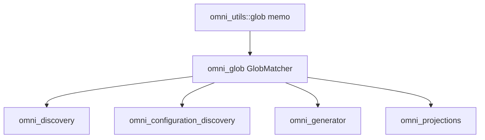

# RFC 0007: Shared glob matcher crate with include/exclude negation

- **Status:** Implemented <!-- Draft | Accepted | Implemented | Superseded -->
- **Owner:** TBD
- **Date:** 2026-08-29
- **Affected crates/files:** new `omni_glob` crate; `omni_discovery_utils` (removed/renamed); `omni_utils` (glob memo); `omni_discovery`, `omni_configuration_discovery`, `omni_generator` (migrated); `omni_projections` (migrated, per RFC 0005)
- **Prior art referenced:** gitignore/`ignore` crate, rsync `--include`/`--exclude`, ripgrep overrides, tsconfig `include`/`exclude`
- **Depended on by:** RFC 0005 (list-valued `match`/`scope`), and RFC 0008 (ready the glob subsystem for negation), which adds the literal-`!` escape to this crate's matcher and routes the remaining raw `build_glob_set` callers through an include-only `omni_glob` entry point.

## 1. Summary

Promote the include/exclude glob matcher that already lives in `omni_discovery_utils::glob` into a small standalone crate, `omni_glob`, and generalize it so every file-selection subsystem can share one matcher with one negation convention. The matcher keeps the existing `!`-prefix parity rule (odd number of leading `!` means exclude, even means include) and adds two knobs it does not have today: separator semantics (`literal_separator`) and whether patterns are matched relative or anchored to a root. Then migrate the current consumers (`omni_discovery`, `omni_configuration_discovery`, `omni_generator`) and `omni_projections` onto it.

## 2. Motivation / Problem

omni already has a negation convention, but only some subsystems get it. `omni_discovery_utils::glob::GlobMatcher` splits a flat pattern list into include and exclude sets by leading-`!` parity and matches as `include.is_match(p) && !exclude.is_match(p)`. Task discovery, configuration discovery, and the generator all use it, so an author writes `["src/**", "!src/gen/**"]` and it works.

Projections do not. `omni_projections::routing` compiles single globs directly with `globset::GlobBuilder`, has no negation, and RFC 0005 was about to add a bespoke `exclude` field to `mirror` to fill the gap. That would be a second, parallel way to express exclusion, inconsistent with the rest of omni. The right fix is to reuse the existing convention, which means the matcher has to be reachable from projections and flexible enough for its needs.

Two things block direct reuse:

1. **Separator semantics.** Projections compile with `literal_separator(true)` so `*` does not cross `/`. The shared matcher builds sets through `omni_utils::glob::build_glob_set`, which uses `globset::Glob::new` defaults (`literal_separator(false)`). Same patterns, different results.
2. **Anchoring.** `GlobMatcher::new(root_dir, patterns)` prefixes every pattern with the root and matches absolute paths. Projections match paths relative to the source root (slash-normalized). The matcher hard-codes the rooted-absolute mode.

The matcher also lives in a crate named for discovery (`omni_discovery_utils`), whose entire contents are this one module. That name is already wrong for a shared utility.

## 3. Goals / Non-goals

### Goals

- Extract the matcher into a new `omni_glob` crate with a stable, documented API.
- Preserve the existing `!`-parity include/exclude semantics exactly (order-independent, exclude-wins, `!!` cancels).
- Add `literal_separator` and relative-vs-rooted anchoring as explicit options.
- Reuse `omni_utils`'s compiled-`GlobSet` memoization, extending its cache key to include the options so different option sets do not collide or thrash.
- Migrate `omni_discovery`, `omni_configuration_discovery`, and `omni_generator` with identical behavior, and make the matcher usable by `omni_projections` (RFC 0005).
- Remove `omni_discovery_utils` (or leave it as a thin re-export for one release), since it only holds this module.

### Non-goals

- Moving the raw `build_glob_set` callers (`omni_collector`, `omni_context::project_hasher`, `omni_execution_plan::filter`, `omni_cache`) onto `omni_glob`. That is a larger consolidation with hashing/caching determinism risk, deferred to a future RFC that depends on this one.
- Folding in `omni_capabilities::matching`. That is policy matching over `@root`-rooted `OmniPath`s with fail-closed semantics, a different job.
- Any change to the config surface of the migrated subsystems. Discovery keeps its exact pattern behavior; projections' config changes live in RFC 0005.
- gitignore-style ordered, first-match-wins precedence. omni's parity model stays.

## 4. Background: current mechanisms

`omni_discovery_utils::glob::GlobMatcher` (`crates/omni_discovery_utils/src/glob.rs`):

```rust
pub struct GlobMatcher {
    include_matcher: Arc<GlobSet>,
    exclude_matcher: Arc<GlobSet>,
}

impl GlobMatcher {
    pub fn new<P, S>(root_dir: P, glob_patterns: &[S]) -> Result<Self, globset::Error> {
        // include = even count of leading '!', exclude = odd; each pattern is
        // root-prefixed as `{root}/{stripped}` and compiled via build_glob_set.
    }
    pub fn is_match<P: AsRef<Path>>(&self, path: P) -> bool {
        self.include_matcher.is_match(&path) && !self.exclude_matcher.is_match(&path)
    }
}
```

Facts, verified in source:

- The split is by `count_starts_with(p, "!")` parity, and each pattern is stripped of all leading `!` before compilation. `!!keep` is an include; `!drop` is an exclude. Matching is `include && !exclude`, so it is order-independent and exclude always wins.
- With no include pattern the include set is empty and matches nothing, so an exclude-only list matches nothing. "Everything except X" must be written `["**", "!X"]`.
- Patterns are compiled through `omni_utils::glob::build_glob_set` (`crates/omni_utils/src/glob.rs`), a process-wide memoized `GlobSet` cache keyed on the exact ordered pattern strings, using `Glob::new` defaults (`literal_separator(false)`).
- Consumers call `GlobMatcher::new(self.root_dir, self.glob_patterns)` then `matcher.is_match(f.path())` against absolute paths: `omni_discovery/src/discovery.rs:102`, `omni_configuration_discovery/src/configuration_discovery.rs:73`, `omni_generator/src/sys_impl/transaction_sys.rs:779`.
- `omni_discovery_utils/src/lib.rs` is exactly `pub mod glob;`. The crate is the matcher.
- `omni_projections/src/routing.rs` uses `GlobBuilder::new(p).literal_separator(true)` on single globs, matching slash-normalized relative paths. No negation, no memoization.

## 5. Proposed design

### 5.1 The `omni_glob` crate

New crate `omni_glob`, depending on `globset` and `omni_utils`. It hosts the moved `GlobMatcher`, generalized with an options struct:

```rust
#[derive(Debug, Clone, Copy, PartialEq, Eq, Hash, Default)]
pub struct GlobOptions {
    /// When true, `*` and `?` do not cross `/` (globset `literal_separator`).
    pub literal_separator: bool,
}

pub struct GlobMatcher {
    include: Arc<GlobSet>,
    exclude: Arc<GlobSet>,
}

impl GlobMatcher {
    /// Patterns matched as written, against the path handed to `is_match`
    /// (callers pass whatever anchoring they want, e.g. a relative slash path).
    pub fn new<S: AsRef<str>>(patterns: &[S], opts: GlobOptions)
        -> Result<Self, globset::Error>;

    /// Current discovery behavior: each pattern is prefixed with `root` and
    /// matched against absolute paths.
    pub fn rooted<P: AsRef<Path>, S: AsRef<str>>(
        root: P, patterns: &[S], opts: GlobOptions,
    ) -> Result<Self, globset::Error>;

    pub fn is_match<P: AsRef<Path>>(&self, path: P) -> bool {
        self.include.is_match(&path) && !self.exclude.is_match(&path)
    }
}
```

The `!`-parity split, stripping, and `include && !exclude` matching move verbatim. `rooted` is the existing `new` renamed; `new` is the new relative-mode constructor projections use.

The crate also exposes the parity classifier it uses internally, so config validators can reason about a raw pattern without rebuilding a matcher:

```rust
/// True when `pattern` is an include (even count of leading `!`), false when
/// it is an exclude. The single source of truth for "what counts as a `!`".
pub fn is_include(pattern: &str) -> bool;
```

RFC 0005's `match`/`scope` validator uses `is_include` to reject exclude-only lists (which match nothing) without duplicating the parity rule.

### 5.2 Options-aware memoization

`build_glob_set` in `omni_utils` today keys the cache on the ordered pattern strings alone and always uses `Glob::new`. Add an options-aware builder without breaking the existing one:

```rust
pub fn build_glob_set_with(
    patterns: &[impl AsRef<str>], opts: GlobBuildOptions,
) -> Result<Arc<GlobSet>, globset::Error>;

// unchanged signature, delegates with default options
pub fn build_glob_set(patterns: &[impl AsRef<str>])
    -> Result<Arc<GlobSet>, globset::Error>;
```

The cache key becomes `(Vec<String>, GlobBuildOptions)`, so a `literal_separator(true)` set and a default set built from the same patterns are distinct entries and never alias. Existing callers keep the old function and the old key shape (default options), so their cache entries are unchanged. `omni_glob` calls `build_glob_set_with`.

(`GlobOptions` in `omni_glob` and `GlobBuildOptions` in `omni_utils` may be the same type re-exported; kept separate in the sketch only to show the seam.)

### 5.3 Migration

- **Discovery, config-discovery, generator:** replace `GlobMatcher::new(root, patterns)` with `GlobMatcher::rooted(root, patterns, GlobOptions::default())`. Default options are `literal_separator(false)`, identical to today. Behavior preserved; this is a mechanical rename plus a dependency swap from `omni_discovery_utils` to `omni_glob`.
- **Projections (RFC 0005):** build the matcher with `GlobMatcher::new(patterns, GlobOptions { literal_separator: true })` and match slash-normalized relative paths, replacing the hand-rolled `build_glob`/`build_glob_set` in `routing.rs`. This gives projections the `!` convention for free and is the mechanism RFC 0005 now depends on.
- **`omni_discovery_utils`:** delete once the three consumers move (decision #8: immediate delete, no re-export shim, since it is internal with no external consumers).



## 6. Mandatory analysis

### 6.1 Existing mechanisms (reuse vs. extend vs. add)

Pure reuse and relocation. The matcher, its parity logic, and the memo cache all exist. This crate moves the matcher to an honestly named home and adds two options it was missing. Nothing new is invented; the `add` is a single crate boundary and one memo function overload.

### 6.2 Maintenance cost

- One new crate, but a net simplification: `omni_discovery_utils` (a misnamed one-module crate) goes away.
- `build_glob_set` gains a sibling `build_glob_set_with` and a richer cache key. Existing callers are untouched.
- Contributors get one matcher and one negation rule to learn instead of a discovery-only matcher plus projection's ad-hoc globbing.

### 6.3 Testability

- The existing `glob.rs` tests (parity split, double-negation, exclude-only-matches-nothing, root-relative matching) move with the code and must keep passing unchanged.
- Add tests for the new axes: `literal_separator(true)` stops `*` at `/`; `new` (relative) vs `rooted` (absolute) anchoring; the memo cache returns distinct `Arc`s for the same patterns under different options and the same `Arc` for identical patterns+options.
- Migration is guarded by each consumer's existing discovery/generator tests; they must pass without edits, proving behavior preservation.

### 6.4 Integration points

- `omni_glob` — new crate, workspace member, added to the root `Cargo.toml` members and each consumer's dependencies.
- `omni_utils::glob` — `build_glob_set_with` + options-keyed cache.
- `omni_discovery`, `omni_configuration_discovery`, `omni_generator` — dependency swap and `new` to `rooted` rename.
- `omni_projections` — consumes `omni_glob` (the actual routing change is specified in RFC 0005).

### 6.5 Potential regressions

- **Silent separator drift (highest risk).** If a migrated consumer is accidentally built with the wrong `literal_separator`, its glob results change silently, which corrupts discovery and, downstream, hashing/caching. Mitigation: discovery keeps `GlobOptions::default()` (false), asserted by unchanged tests; projections explicitly set `true`, asserted by RFC 0005's routing tests.
- **Cache key change.** Widening the memo key must not let a default-option lookup hit an options-bearing entry or vice versa. The key includes the options struct, and the existing `build_glob_set` keeps the default-options key shape, so current entries are stable.
- **Determinism.** Matching stays a pure function of patterns + options + path; memoization is transparent. No ordering or nondeterminism introduced.
- **Dependency graph.** `omni_glob` depends only on `globset` + `omni_utils`; consumers depend on `omni_glob`. No cycle.

### 6.6 Pros and cons

| Option                                                                                           | Pros                                                                                | Cons                                                                                        | Verdict                |
| ------------------------------------------------------------------------------------------------ | ----------------------------------------------------------------------------------- | ------------------------------------------------------------------------------------------- | ---------------------- |
| A. New `omni_glob` crate, migrate file-selection consumers (recommended)                         | One matcher, one negation rule; removes a misnamed crate; unblocks RFC 0005 cleanly | A crate move plus a small memo change and three mechanical migrations                       | Yes                    |
| B. Leave the matcher in `omni_discovery_utils`, add options there, depend on it from projections | Smaller diff                                                                        | Projections depending on a crate named "discovery utils" is confusing; the name stays wrong | No                     |
| C. Give projections their own include/exclude matcher                                            | No shared-crate work                                                                | A second negation implementation to keep in sync; exactly the duplication this RFC removes  | No                     |
| D. Consolidate every glob caller (incl. hashing/caching) now                                     | One crate to rule them all                                                          | Large blast radius on hashing/caching determinism; not needed to unblock RFC 0005           | Deferred to future RFC |

### 6.7 Prior art and how omni improves on it

| Tool                          | Their approach                                                  | What to adopt                             | What to change for omni                                                                                                            |
| ----------------------------- | --------------------------------------------------------------- | ----------------------------------------- | ---------------------------------------------------------------------------------------------------------------------------------- |
| gitignore / `ignore` crate    | Ordered, first-match-wins include/exclude with `!` re-inclusion | The `!` prefix as the exclude marker      | Keep omni's order-independent parity model (exclude wins) instead of positional precedence, which is easier to reason about        |
| rsync `--include`/`--exclude` | Separate ordered filter rules                                   | The include/exclude concept               | One unordered list with `!`, not two ordered rule streams                                                                          |
| ripgrep overrides             | globset-based include/exclude with `!`                          | globset as the engine, `!` marker         | Expose `literal_separator` and anchoring as options so one matcher serves both absolute discovery and relative projection matching |
| tsconfig `include`/`exclude`  | Two array fields                                                | The mental model of include then subtract | Express it in one `!`-aware list, consistent with omni's existing task-glob convention                                             |

## 7. Open questions

None. The three prior questions (crate name, shim vs. immediate delete, `GlobOptions` scope) are resolved in the decision log (#7, #8, #9).

## 8. Implementation plan

1. Scaffold `omni_glob` with the workspace `crate` generator (`crate_type: lib`, `use_tracing: false`, `add_error_type: false`). The constructor returns `Result<Self, globset::Error>`, so the crate reuses `globset`'s error and needs no error type of its own. The generator creates `crates/omni_glob/{Cargo.toml, project.omni.yaml, src/lib.rs}` and edits root `Cargo.toml` members plus `cog.toml`, so step 4's manifest edits shrink to a dependency swap. Then move `glob.rs` and its tests in, add `GlobOptions`, split `new` (relative) and `rooted` (absolute), and thread options through.
2. Add `build_glob_set_with` + options-keyed cache to `omni_utils`; make `build_glob_set` delegate with defaults.
3. Migrate `omni_discovery`, `omni_configuration_discovery`, `omni_generator` to `omni_glob::GlobMatcher::rooted(.., default)`; run their suites unchanged.
4. Delete `omni_discovery_utils` and update `Cargo.toml` members/deps.
5. Hand off to RFC 0005 for the projection routing migration and config changes.

## 9. Decision log

| #   | Decision                                                                                          | Rationale                                                                                                                                                                 |
| --- | ------------------------------------------------------------------------------------------------- | ------------------------------------------------------------------------------------------------------------------------------------------------------------------------- |
| 1   | Extract the matcher into a new `omni_glob` crate                                                  | It is a shared utility wrongly living in a discovery-named, single-module crate; projections and others need it                                                           |
| 2   | Preserve the `!`-parity, order-independent, exclude-wins semantics verbatim                       | It is the established omni convention; changing it would break discovery and surprise authors                                                                             |
| 3   | Add `literal_separator` and relative-vs-rooted anchoring as options                               | The two concrete gaps blocking projection reuse; keep everything else identical                                                                                           |
| 3a  | Expose a public `is_include(pattern)` parity classifier                                           | Lets config validators (RFC 0005) reject exclude-only lists without re-implementing the `!` rule                                                                          |
| 4   | Extend `omni_utils` memoization with an options-aware key; keep `build_glob_set` unchanged        | Lets option sets share the cache without colliding, and leaves current callers (and the deferred consolidation) untouched                                                 |
| 5   | Defer the hashing/caching/collector/filter consolidation to a future RFC that depends on this one | Larger determinism risk; not needed to unblock RFC 0005                                                                                                                   |
| 6   | Keep `omni_capabilities::matching` out of scope                                                   | Policy matching over rooted `OmniPath`s with fail-closed semantics is a different concern                                                                                 |
| 7   | Name the crate `omni_glob`                                                                        | Matches the `omni_*` convention and names the thing plainly; `omni_globset` leaks the backing library, and a utils umbrella would rebury a shared matcher                 |
| 8   | Delete `omni_discovery_utils` immediately, no re-export shim                                      | It is internal with no external consumers, and the three call sites move in this same change, so a compatibility window buys nothing                                      |
| 9   | Keep `GlobOptions` minimal (`literal_separator` only) for now                                     | Only two anchoring/separator gaps block reuse today; case-insensitivity and dotfile handling can be added when a caller actually needs them, without churning the API now |
