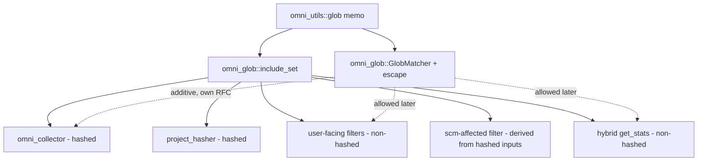

# RFC 0008: Ready the glob subsystem for negation

- **Status:** Implemented <!-- Draft | Accepted | Implemented | Superseded -->
- **Owner:** TBD
- **Date:** 2026-08-29
- **Affected crates/files:** omni_glob (literal-`!` escape + include-only entry point), omni_utils (glob memo, behavior unchanged), and the four raw `build_glob_set` callers migrated as cleanup: omni_collector, omni_context (project_hasher), omni_execution_plan (filter), omni_cache (hybrid). The escape also reaches 0007's existing `GlobMatcher` consumers (omni_discovery, omni_configuration_discovery, omni_generator, omni_projections) without code changes; see Sections 5.1 and 6.5.
- **Depends on:** RFC 0007 (shared `omni_glob` matcher), now **Implemented**. Its consumers (discovery, config-discovery, generator, projections) are on `omni_glob`.
- **Note on scope:** this RFC was originally scoped as "consolidate the remaining glob callers." Investigation reframed it; see Section 1.
- **Amended by:** RFC 0011 (standardize glob configuration on a structured include/exclude type). RFC 0011 removes the leading-`!` convention and the `\!` escape that this RFC shipped, replacing `!`-in-a-list negation with an explicit `include`/`exclude` structure. The `include_set` entry point and the memoized builder introduced here stay; `scan_markers`, `is_include`, and the `\!` escape are removed by 0011. This RFC remains Implemented as a record of what shipped; 0011 tracks the reversal.

## 1. Summary

This work began as "move the four remaining raw `build_glob_set` callers onto `omni_glob`." Investigation (Section 4) deflated that framing: all four are include-only, use default options, and none interpret `!`, so migrating them is byte-identical cleanup with no behavioral payoff on its own. The same investigation found the part that matters. omni's negation convention has no portable way to match a name beginning with a literal `!` (Section 4.6). That gap is a latent bug in the one matcher the workspace is meant to share, and it blocks every future attempt to turn negation on anywhere.

So the RFC is reframed around the fix.

- **Primary deliverable:** a cross-platform `\!` escape in `omni_glob` (Section 5.1).
- **Secondary deliverable:** the cheap, provably-safe consolidation that gives the workspace one public glob entry point (Section 5.2).
- **Lasting deliverable:** a recorded map of where negation may and may not be added later (Section 7), so the feature RFCs that follow inherit the constraints instead of rediscovering the hazards.

Turning negation on for any caller is explicitly out of scope and deferred.

## 2. Motivation / Problem

Two problems, found together.

**The convention cannot express a literal leading `!`.** omni's negation is a string pre-pass in `omni_glob` above `globset`: leading `!` are counted for parity and then stripped, so `!!foo` means "include `foo`", not "match the name `!foo`". There is no escape, so the moment negation is on for a caller, any name beginning with `!` is unmatchable. A backslash escape works by accident on Unix and silently fails on Windows (Section 4.6). This is a defect in the shared matcher, and it is the thing that has to be fixed before negation can be offered anywhere with a straight face.

**Four callers bypass `omni_glob`.** `omni_collector`, `omni_context::project_hasher`, `omni_execution_plan::filter`, and `omni_cache::hybrid` build sets straight from `omni_utils::glob::build_glob_set`. They agree on semantics today (all include-only, no `!`), so this is a layering wart, not a correctness bug. But it means no single reviewed place owns "how a glob is built," which is exactly where the next contributor would bolt negation on inconsistently.

The escape justifies an RFC on its own. The consolidation rides along because it is cheap and it gives the escape, and any future negation, one clean home.

## 3. Goals / Non-goals

### Goals

- Define and implement a portable `\!` escape in `omni_glob` so the negation convention can match a name beginning with a literal `!`, identically on every platform. This is the primary deliverable.
- Give the workspace one public entry point for building glob sets: add an include-only `omni_glob::include_set` and move the four raw callers onto it, byte-identically.
- Record the negation-boundary policy: which callers may adopt negation later and which must not, with the reasoning, so future feature RFCs inherit the constraints.
- Document the `!` parity convention and the `\!` escape on the config fields that actually honor them (the negation-aware `GlobMatcher` consumers), so users learn the behavior from the schema. This explicitly excludes `cache.key.files` / `cache.output.files`, which stay include-only until RFC 0009.

### Non-goals

- Turning negation on for any of the four callers. That is deferred to feature RFCs; this one only makes it safe and cheap to do.
- Changing what the four migrated callers match. Their migration is byte-identical, verified against a golden hash.
- Changing backslash handling anywhere other than a leading `!`. Backslash behavior in the rest of a pattern (globset's platform-dependent `backslash_escape`) is out of scope; the escape is resolved in `omni_glob`'s own pre-pass so it does not depend on it.
- Folding in `omni_capabilities::matching` (policy matching over rooted `OmniPath`s).

## 4. Background: current mechanisms

All four callers use `omni_utils::glob::build_glob_set` (default options, `literal_separator(false)`) and treat the result as a plain include set: `set.is_match(x)`, never split on `!`, never anchored beyond what the caller already did to the patterns. Verified in source:

### 4.1 `omni_collector::collector` (feeds the hash)

`collect` (`crates/omni_collector/src/collector.rs:359`, `:376`) builds one `GlobSet` per project from the task's `input_files` and `output_files`. `populate_includes_and_patterns` (`:650`) resolves each `OmniPath` against the project/workspace roots, makes it absolute (`std::path::absolute(project_dir.join(p))`), and pushes `path.to_string_lossy()` as a pattern verbatim. No `!` stripping, no parity split. The compiled set is matched with `is_match_candidate(&candidate)` against walked files (`:568`, `:582`), the `globset::Candidate` fast path, not `GlobMatcher::is_match`.

This is the load-bearing caller: the resolved input files it produces feed `omni_hasher`, so any change to what these globs match changes the project hash and therefore the cache key.

Practical note on `!`: because patterns are absolute paths (they start with `/` or a drive letter), a leading `!` cannot occur here in practice. An author cannot smuggle negation through an `input_files` entry today, and would not gain it from a migration either.

### 4.2 `omni_context::project_hasher` (feeds the hash)

`hash` (`crates/omni_context/src/project_hasher.rs:196`) builds `build_glob_set(task_names)` and uses it to pick which task-result digests to fold into the project hash: `task_matcher.is_match(&d.task_name)` against bare task-name strings, with an empty-set short-circuit that matches everything (`:202`). Include-only, default options, no `!`.

This also feeds the hash: `task_names` selects the set of digests combined into the result, so its glob semantics are part of the hash's definition.

### 4.3 `omni_execution_plan::filter` (does not feed the hash)

Four include-only sets, all default options, none interpreting `!`:

- `DefaultProjectFilter::new` (`:29`) builds a project-name glob, matched against `project.name`.
- `DefaultTaskFilter::new` builds a task-name set (`:88`), a project-name set (`:102`), and a dir set (`:131`) whose patterns are root-prefixed (`{workspace_root}/{filter}`) before building.
- `DefaultTaskScmAffectedFilter::should_include_task` (`:304`) builds a set from the task's resolved (absolute, slash-normalized) cache input file paths and tests each changed file against it.

These select what runs. They do not contribute to any hash, so a semantics change here changes selection, not cache keys.

### 4.4 `omni_cache::hybrid` (does not feed the hash)

`get_stats` (`crates/omni_cache/src/cache/impls/hybrid.rs:899`, `:907`) builds project-name and task-name sets (defaulting to `["*"]` when empty) to filter which cache entries appear in reported statistics. Include-only, default options, no `!`. Read-only reporting; not on any hashed path.

### 4.5 Summary of the four

| Caller             | Patterns                                       | Options | `!` today            | Match API            | Feeds hash? |
| ------------------ | ---------------------------------------------- | ------- | -------------------- | -------------------- | ----------- |
| collector          | absolute input/output file paths               | default | no (can't: absolute) | `is_match_candidate` | **yes**     |
| project_hasher     | task-name globs                                | default | no                   | `is_match`           | **yes**     |
| filter (4 sets)    | project/task names, dirs, resolved input paths | default | no                   | `is_match`           | no          |
| hybrid `get_stats` | project/task names                             | default | no                   | `is_match`           | no          |

The memoization is already sufficient: `build_glob_set` is process-wide, options-aware (post-0007), and returns a shared `Arc<GlobSet>`. No caller needs a different caching shape.

### 4.6 The negation convention has no escape for a literal leading `!`

This surfaced while checking whether negation could be turned on for any caller. omni's negation is not glob syntax; it is a string pre-pass in `omni_glob` above `globset`. `count_leading_bangs` counts the leading `!` run and `strip_bang` removes every leading `!`, so parity decides include vs exclude and the stripped body is what reaches `globset`:

```rust
fn strip_bang(mut s: &str) -> &str {
    while let Some(stripped) = s.strip_prefix('!') {
        s = stripped; // removes ALL leading '!'
    }
    s
}
```

Two consequences, verified in `crates/omni_glob/src/lib.rs`:

- Doubling is parity, not escaping. `!!foo` means "include `foo`", not "match the name `!foo`". No sequence of leading `!` yields a pattern that matches a literal leading `!`, because `strip_bang` removes them all regardless of parity.
- `globset` itself does not negate on a bare leading `!` (that is the `ignore`/`Gitignore` crate, not `globset::Glob`), so the only thing consuming the `!` is omni's pre-pass. Once negation is on for a caller, a name beginning with `!` becomes unmatchable through `GlobMatcher`.

There is an accidental backslash escape, but it is a trap. `compile_glob` (`crates/omni_utils/src/glob.rs:95`) never sets `backslash_escape`, so it inherits globset's platform default (enabled on Unix, disabled on Windows). omni's pre-pass keys on `!`, not `\`, so `\!foo` slips through with zero counted bangs and, on Unix only, globset unescapes it to a literal `!foo`. On Windows `\` is a path separator and the escape does not exist. So today a literal leading `!` is expressible only on Unix, only by accident, undocumented and untested.

## 5. Proposed design

Ordered around the reframing. The escape is the main deliverable, the consolidation is cleanup, and the last piece connects both to the deferred negation work.

### 5.1 The portable `\!` escape (primary deliverable)

The negation convention needs a defined way to say "this name starts with a literal `!`", and it must behave identically on every platform. The convention follows gitignore, which already solves the same problem with a leading `\`: a backslash before the first `!` makes that `!` literal.

The escape is resolved inside `omni_glob`'s pre-pass and the backslash is consumed there, so the body handed to `globset` is already a clean literal. That is what makes it portable: it never relies on globset's platform-dependent `backslash_escape`.

The scan is a single left-to-right pass over the start of the pattern. At each position:

- if the current character is an unescaped `!`, count one bang and advance one character;
- otherwise if the current pair is `\!`, append a literal `!` to the body and advance two characters (the `\` is dropped);
- otherwise stop.

Everything from the stop point onward is appended to the body verbatim. The pattern is an exclude when the bang count is odd, an include when it is even (zero counts as even). One pass returns both the include/exclude bit and the body, and is the single source of truth for the classifier (`is_include`) and the set builder; it replaces `count_leading_bangs` and `strip_bang`.

Only the exact two-character sequence `\!` is special. A `\` that is not immediately followed by `!` is handed to `globset` verbatim, and `\\` is not an escape for a literal backslash. Holding the escape to a two-character lookahead, rather than a general unescaping pass, is what keeps it inside the non-goal of leaving backslash handling elsewhere in the pattern alone.

| Pattern    | Bangs | Include/exclude | Body to globset | Note                                     |
| ---------- | ----- | --------------- | --------------- | ---------------------------------------- |
| `foo`      | 0     | include         | `foo`           |                                          |
| `!foo`     | 1     | exclude         | `foo`           |                                          |
| `!!foo`    | 2     | include         | `foo`           |                                          |
| `\!foo`    | 0     | include         | `!foo`          | escape a literal leading `!`             |
| `!\!foo`   | 1     | exclude         | `!foo`          |                                          |
| `\!\!foo`  | 0     | include         | `!!foo`         |                                          |
| `\!!foo`   | 1     | exclude         | `!foo`          | an escaped bang, then a real negation    |
| `\foo`     | 0     | include         | `\foo`          | lone `\` not before `!`: left untouched  |
| `foo\!bar` | 0     | include         | `foo\!bar`      | mid-pattern `\!` is not a leading marker |
| `\!`       | 0     | include         | `!`             | match a file named exactly `!`           |
| `!`        | 1     | exclude         | (empty)         | unchanged from today                     |
| `\\!foo`   | 0     | include         | `\\!foo`        | `\\` is not a backslash escape           |

So `\!foo` includes a name beginning with a literal `!`, and `!\!foo` excludes one.

The behavior change is deliberately narrow. A pattern's result moves only when it has a `\!` inside its leading marker run; a pattern with no `\!` in that run is byte-identical everywhere. For the patterns that do move, the result is unchanged on Unix (globset's accidental unescape becomes a defined one) and goes from broken to correct on Windows. This covers `\!foo` and also `!\!foo`, whose body shifts from `\!foo` under the old `strip_bang` to `!foo` under the scan. The migrated four never emit a `\!` (Section 4) and the 0007 consumers match relative slash paths where a leading `\!` is not idiomatic, so both are unaffected in practice. Analyzed in Section 6.5.

The escape stands alone: it lives entirely in `omni_glob` and depends on nothing in Section 5.2. It could ship as its own PR.

### 5.2 One public entry point (cleanup)

`omni_glob` gains a thin, negation-free builder that is exactly today's `build_glob_set_with`, surfaced so callers depend on `omni_glob` alone:

```rust
// omni_glob
pub use omni_utils::glob::GlobOptions;

/// Build a memoized, include-only compiled set. Patterns are matched as
/// written; `!` is NOT interpreted (a leading `!` is a literal character).
/// This is the path for callers that intentionally do not want negation,
/// notably the hashed paths.
pub fn include_set<S: AsRef<str>>(
    patterns: &[S],
    opts: GlobOptions,
) -> Result<Arc<GlobSet>, globset::Error> {
    omni_utils::glob::build_glob_set_with(patterns, opts)
}
```

The memoized cache stays in `omni_utils::glob`, a low-level primitive with no notion of negation, and `omni_glob` is the public door. `include_set` and `build_glob_set_with` share the one cache, so a set built through either is the same `Arc`. That shared identity is what makes the migration byte-identical (Section 6.3). Returning a raw `Arc<GlobSet>` also matters: the collector needs `is_match_candidate`, which `GlobMatcher` does not expose, so keeping `include_set` at the `GlobSet` level preserves that fast path with zero change.

The migration is one substitution, no semantic change:

```text
omni_utils::glob::build_glob_set(x)  ->  omni_glob::include_set(x, GlobOptions::default())
```

applied at `omni_collector/src/collector.rs:359`, `:376`; `omni_context/src/project_hasher.rs:196`; `omni_execution_plan/src/filter.rs:29`, `:88`, `:102`, `:131`, `:304`; and `omni_cache/src/cache/impls/hybrid.rs:899`, `:907`.

After this, `omni_utils::glob::build_glob_set` has no callers outside `omni_glob` and can be documented as an internal primitive. The dependency direction is unchanged (`omni_glob -> omni_utils`).

Migrating all four is feasible with no behavior change: every site consumes the result as a plain `Arc<GlobSet>` (`is_match`, `is_match_candidate`, or `is_empty`), which is exactly what `include_set` returns, so the swap is a drop-in everywhere, including the collector's candidate fast path. For the two callers slated to gain negation (the user-facing filters and `get_stats`, decision 10), this migration is a deliberate stepping stone: they land on `include_set` now and flip to `GlobMatcher` in the negation RFC. The one extra hop is worth the uniform single door; only `collector`, `project_hasher`, and the SCM-affected filter settle on `include_set` for good.

### 5.3 What this leaves in place for negation

With both pieces in place, every glob-building caller either goes through `omni_glob::include_set` (include-only) or `omni_glob::GlobMatcher` (negation-aware, now with a working escape). Adopting negation for a caller becomes a one-line switch from the first to the second, reviewed on its own merits. Which callers are allowed to make that switch, and which are not, is the policy in Section 7.



## 6. Mandatory analysis

### 6.1 Existing mechanisms (reuse vs. extend vs. add)

Reuse, plus one correction. The `\!` escape (5.1) extends `GlobMatcher`'s existing pre-pass rather than adding a parallel mechanism; it replaces `count_leading_bangs`/`strip_bang` with one scan in the same module. The consolidation (5.2) adds no matcher and no cache: `include_set` is a thin re-surfacing of the existing `build_glob_set_with`, and the memo is unchanged from 0007.

### 6.2 Maintenance cost

Net reduction. The negation convention gains a defined, documented, tested escape in place of undocumented, platform-dependent behavior, so a contributor changing it has one place to look and a table to check against. The consolidation leaves one public entry point and demotes `omni_utils::glob::build_glob_set*` to an internal primitive with a single wrapper caller. Cost added: one small function (`include_set`) and an escape branch in the pre-pass.

### 6.3 Testability (the acceptance bar)

The change is additive except for one intended delta, the meaning of a leading `\!`. So the bar is mostly proving the current mechanism is untouched, and these tests are prerequisites for merging, not follow-ups.

- **No-regression corpus (the main prerequisite):** a table of representative real patterns drawn from the four callers and the 0007 consumers (discovery, generator, projections), none with a `\!` in their leading marker run, asserting identical classification and match results before and after the pre-pass rewrite. This is the direct proof that the escape is additive for every pattern whose leading run holds no `\!`.
- **Escape table (5.1):** a table-driven `omni_glob` test asserting the classification and matched body for every row of the 5.1 table. Because CI runs Windows, this test enforces the `\!foo` and `!\!foo` cases on both platforms rather than only asserting them; that is the whole point of resolving the escape in the pre-pass.
- **Aliasing (consolidation):** `Arc::ptr_eq(include_set(p, default), omni_utils::glob::build_glob_set(p))` for representative pattern lists, including one whose first pattern begins with `!`, asserting the `!` is treated literally (include-only), not as an exclude. The direct regression guard for the hashed paths.
- **Golden hash, as a snapshot test (consolidation):** an e2e test in `tests/omni-tests` runs `omni hash -r workspace` on a fixture workspace (input/output globs, several tasks) and matches the printed hash against a committed snapshot. The snapshot is the golden value: it is recorded once against the current code, and any later change to the hash fails the test. The property under test is same-platform before-versus-after, so the snapshot is captured on the platform that runs it (CI runs both Windows and Unix). omni-tests has no snapshot support today, so wiring `vitest` snapshots into the suite is part of the preparation (Section 9).
- **Filter/stats behavior:** existing filter and `get_stats` tests must pass unchanged; add one asserting a `!`-leading filter is still matched literally, proving negation was not silently introduced.
- **e2e coverage gap (prerequisite):** `tests/omni-tests` has solid include-only filter coverage (`cache stats/prune -p/-t/--dir`, `run-filters`) but no negation or `\!` case anywhere. Add a `\!` end-to-end test against a negation-aware consumer (the `add-many` generator `files` block, sketched in 9.2) so Windows CI validates the escape end to end, not just in the Rust unit test.

Hard-to-test: the collector's `is_match_candidate` path is exercised through collection integration tests rather than a direct unit assert; the golden hash covers it end to end.

### 6.4 Integration points

`omni_glob` gains `include_set` and the rewritten negation pre-pass. The four caller crates (`omni_collector`, `omni_context`, `omni_execution_plan`, `omni_cache`) gain a dependency on `omni_glob` and drop the direct `omni_utils::glob::build_glob_set` import. `omni_utils::glob` is otherwise untouched.

The scan stays internal to `omni_glob`. Only the existing public `is_include` is kept; the body-returning form is not exposed until a caller needs it (RFC 0009), per decision 17.

Documentation here means editing schema descriptions, not touching code. The JSON schemas are generated by `schema_for!` (`omni_api/src/operations/config_schema.rs`) from schemars doc comments on the config structs, so documenting the `!`/`\!` behavior means editing the doc comments on the negation-aware glob fields: the generator `files` block (`omni_generator_configurations`), the projection match/scope/filter globs (`omni_projection_configurations`), and the workspace discovery globs (`omni_configurations`). The `cache.key.files` / `cache.output.files` descriptions in `omni_configurations` are deliberately left alone here: those fields treat `!` as a literal until RFC 0009, and documenting negation on them now would be wrong.

The pre-pass rewrite is the one change that reaches the existing 0007 consumers (discovery, config-discovery, generator, projections): they call `GlobMatcher` and so inherit the `\!` escape without code changes. That is intended, and its effect is bounded in 5.1 and 6.5.

### 6.5 Potential regressions (highest stakes in the workspace)

- **`\!` escape reaching 0007 consumers (bounded, the main one).** The pre-pass rewrite changes results only for patterns beginning with `\!`: unchanged on Unix, fixed on Windows, everything else byte-identical (5.1). The residual risk is a discovery, generator, or projection config that today contains a leading `\!` and relies on the old behavior. On Unix that behavior is preserved; on Windows it was already broken, so there is nothing correct to regress. The escape-table test pins this on both platforms, and these subsystems match relative slash paths where a leading `\!` is not idiomatic. None are hashed inputs, so even an unexpected shift changes selection, not a cache key.
- **Stale or thrashed cache from the consolidation (severe, guarded).** Any drift in glob semantics on the collector or project_hasher paths would change the hash: spurious misses, or stale hits if two previously distinct inputs collapse. These paths use `include_set` (no `!`, default options) and are pinned by the golden-hash test; the aliasing test proves the compiled set is literally the same object as before.
- **Lost `Candidate` fast path (performance).** If the collector were pushed through `GlobMatcher::is_match`, it would lose `is_match_candidate` and regress on large monorepos. The design avoids this: `include_set` returns a raw `Arc<GlobSet>`.
- **Cross-platform paths.** No path-normalization logic changes. The callers keep their existing slash-normalization, and `include_set` does not touch paths.

### 6.6 Pros and cons

The escape mechanism (primary):

| Option                                                    | Pros                                                                                                | Cons                                                                                                           |
| --------------------------------------------------------- | --------------------------------------------------------------------------------------------------- | -------------------------------------------------------------------------------------------------------------- |
| **Resolve `\!` in `omni_glob`'s pre-pass (chosen)**       | Cross-platform by construction; matches the gitignore convention users know; independent of globset | The negation scan gets slightly more logic than a bang count                                                   |
| Lean on globset's `backslash_escape`                      | No omni-side code                                                                                   | Unix-only; silently absent on Windows; the exact trap 4.6 documents                                            |
| A non-backslash quoting convention (e.g. a doubling rule) | Avoids backslash-vs-separator confusion entirely                                                    | Diverges from usual glob syntax; another bespoke rule to learn; collides with the existing `!!` parity meaning |

The consolidation (secondary):

| Option                                                   | Pros                                                                                                                       | Cons                                                                                                                              |
| -------------------------------------------------------- | -------------------------------------------------------------------------------------------------------------------------- | --------------------------------------------------------------------------------------------------------------------------------- |
| **`include_set` façade + mechanical migration (chosen)** | Provably byte-identical (shared Arc); keeps candidate fast path; one public door; negation stays an explicit future choice | Adds a small wrapper; `omni_glob` now has two entry points (include-only vs matcher) a contributor must choose between            |
| Route all four through `GlobMatcher`                     | "One matcher" literally                                                                                                    | Silently adds `!` semantics to hashed paths, a stale-cache bug; loses `is_match_candidate`; violates the behavior-preserving goal |
| Defer the consolidation until a caller needs negation    | Strict YAGNI; less churn now                                                                                               | The escape and policy have no shared home; the two-layer API persists in the meantime                                             |

### 6.7 Prior art

As in RFC 0007 (gitignore/`ignore`, rsync include/exclude, ripgrep overrides, tsconfig include/exclude). This RFC leans on two observations from those tools. First, gitignore already solved the literal-leading-marker problem by escaping a leading `!` with `\`; the 5.1 escape adopts exactly that, so an author who knows gitignore already knows how to match a name beginning with `!`. Second, they all keep a distinct "literal list of includes" primitive beneath the negation-aware matcher (ripgrep's `GlobSet` vs its `Override`/`Gitignore` layers); `include_set` mirrors that split rather than forcing every caller through the negation layer.

## 7. Negation-boundary policy and open questions

The escape (5.1) makes negation expressible. This section records where it may be turned on, which is the durable output of the investigation, then the resolved direction and the one question that stays open.

### 7.1 Where negation may live (decided)

| Caller                                                          | Feeds hash?                              | May adopt negation later?               | Notes                                                                                                                                                                                                                    |
| --------------------------------------------------------------- | ---------------------------------------- | --------------------------------------- | ------------------------------------------------------------------------------------------------------------------------------------------------------------------------------------------------------------------------ |
| User-facing project/task/dir filters (`DefaultTaskFilter` etc.) | no                                       | yes                                     | Safe: changes only selection. `\!x` keeps a literal name reachable. Implemented once at the filter layer, so every interface (CLI, MCP, future APIs) inherits it.                                                        |
| `get_stats` globs                                               | no                                       | yes                                     | Same rationale as the filters.                                                                                                                                                                                           |
| `DefaultTaskScmAffectedFilter`                                  | no, but reads the hashed input-glob list | **only in lockstep with the collector** | It reads the same `key_input_files` globs the collector hashes, so its `!` interpretation must always equal the collector's: include-only today, negation-aware in the same change if the collector ever gains it (7.2). |
| `project_hasher` task-name selection                            | yes                                      | no                                      | Low value ("fold every digest except X") and on a hashed path. Declined.                                                                                                                                                 |
| `collector` `input_files`/`output_files`                        | yes                                      | yes, additive                           | Real value (exclude a generated subtree). Additive in practice (see 7.2): no config in the repo has a `!` input/output entry, so hashes do not move. Its own feature RFC, mainly for the collector rework.               |

The line is: non-hashed, user-facing selection is fair game; anything that reads a hashed pattern list (`DefaultTaskScmAffectedFilter`) must move in lockstep with the path that hashes it, so one list never means two things; hashed paths themselves are allowed only when the change is provably additive.

Negation is implemented in exactly one place, `omni_glob::GlobMatcher`. Adopting it for a caller is a one-line switch from `include_set`, so "which interface" never enters into it: the filter layer is shared by the CLI, the MCP tools, and any future API alike.

### 7.2 Resolved direction and the one remaining question

**Filter negation: wanted, and interface-agnostic.** It is worth doing. Because it lives at the filter layer, it is not a per-interface feature; the one `GlobMatcher` switch gives `!` to every interface that already accepts project/task/dir filters (CLI, MCP, and beyond). The remaining work is a follow-up implementation RFC covering docs and the shell/JSON escaping story for `!` and `\!`, not any new machinery.

**`input_files`/`output_files` negation: additive, not a cache migration.** The earlier "cache-invalidation cost" framing was overstated. With the negation pre-pass, a pattern that does not begin with `!` classifies as an include against an empty exclude set, so `include && !exclude` collapses to `include`: byte-identical, hashes unchanged. The cost only appears for a config that already has a leading-`!` input/output entry, and today that is a dead no-op (the collector absolutizes to `/proj/!gen/**`, a literal matching nothing unless a directory named `!gen` exists). A grep of every `*.omni.yaml` confirms zero such entries in the repo; the only `!` list items are generator `files` blocks, which already negate via 0007. So enabling it is provably additive here.

Two caveats remain, neither a migration:

- **The real cost is a careful collector rework.** The collector buries the leading `!` during absolutization, so negation cannot be a drop-in `GlobMatcher::rooted` on the absolutized strings. Concretely, the change has to: classify each raw `OmniPath` as include or exclude _before_ resolution (`populate_includes_and_patterns`, `collector.rs:650`); keep excludes out of the walk-seeding, because `match_bases`, `forced_includes`, and `topmost_dirs` (`collector.rs:439-483`) drive which directories the walker enumerates and an exclude must not force a directory to be walked or force-included; build a second exclude `GlobSet` on the `Holder`; and change the match loop (`collector.rs:566-592`) from a single `is_match_candidate` to `include.is_match_candidate(c) && !exclude.is_match_candidate(c)`. That is a hot-path change, and the reason it is its own RFC. It is now specified as RFC 0009.
- **The SCM-affected filter must change in lockstep.** `DefaultTaskScmAffectedFilter` (`filter.rs:304`) reads the same `key_input_files` globs (`cache_info.rs:6`) the collector hashes. If the collector starts reading `!gen/**` as an exclude while the filter still reads it as a literal, one glob list means two different things, which is the exact hazard we are avoiding. So the same RFC that teaches the collector negation must teach the filter the same include/exclude split (its version is simpler: `changed_file` matches include and not exclude). This corrects the earlier "never" call: the filter is not permanently include-only, it is permanently _equal to the collector_.
- **Downstream configs cannot be audited.** The one breakage vector is a real path beginning with `!` flipping from include to exclude. Absent in this repo, but omni ships elsewhere, so the enabling RFC carries a changelog note, not a versioned migration.

Open questions to settle before that RFC:

- **Is the collector hot-loop rework worth the feature**, given the value is limited to excluding churning generated subtrees from a task's input hash? This is the go/no-go question for RFC 0009 and should be answered against at least one concrete workspace that wants it.

One earlier open question is now closed: the precise escape-scan algorithm, previously parked here, is specified in §5.1 (decision 15), and its edge-case table becomes the escape-table test in Step 1 (§9).

## 8. Decision log

| #   | Decision                                                                                                    | Rationale                                                                                                                                                                                                                                                                                                                                                                    |
| --- | ----------------------------------------------------------------------------------------------------------- | ---------------------------------------------------------------------------------------------------------------------------------------------------------------------------------------------------------------------------------------------------------------------------------------------------------------------------------------------------------------------------- |
| 1   | Separate this from RFC 0007 and gate it on 0007 landing                                                     | These callers feed hashing/caching; the determinism risk warrants its own RFC and its own review                                                                                                                                                                                                                                                                             |
| 2   | Reframe the RFC around the escape once investigation deflated the consolidation                             | §4 showed the caller migration is byte-identical cleanup with no behavioral payoff; the real, non-deferred work is the `\!` escape, so it becomes the primary deliverable                                                                                                                                                                                                    |
| 3   | Treat the caller migration as behavior-preserving                                                           | A silent glob-semantics change on a hashed path is a stale-cache bug, the worst class in omni                                                                                                                                                                                                                                                                                |
| 4   | Consolidate at an include-only entry point (`include_set`), not `GlobMatcher`                               | §4 shows none of the four interpret `!` today, so a `GlobMatcher` migration would _add_ negation; include-only keeps it a pure refactor                                                                                                                                                                                                                                      |
| 5   | Keep the memo in `omni_utils`; `omni_glob` is the public façade                                             | Avoids a risky physical move of a hot, hashed-path cache; consistent with RFC 0007 §5.2. Same cache means same `Arc`, which is what makes the migration byte-identical                                                                                                                                                                                                       |
| 6   | Collector keeps a raw `Arc<GlobSet>` and `is_match_candidate`                                               | `GlobMatcher` does not expose the `Candidate` fast path; forcing it through would regress large-monorepo collection performance                                                                                                                                                                                                                                              |
| 7   | The literal-`!` escape is the primary deliverable and a requirement, not a later feature                    | It is a defect in the shared negation convention, blocks every negation opt-in, and is worth an RFC on its own; closing it once beats each future opt-in rediscovering it                                                                                                                                                                                                    |
| 8   | Resolve the `\!` escape in `omni_glob`'s pre-pass, following gitignore                                      | Consuming the backslash before globset makes the escape cross-platform and independent of globset's platform-dependent `backslash_escape`; `\!` matches the convention users already know                                                                                                                                                                                    |
| 9   | Acceptance bar is the cross-platform escape table, plus a golden hash and Arc-aliasing test                 | The escape table pins the one real behavior change on both platforms; the hash and aliasing tests prove the consolidation moved nothing                                                                                                                                                                                                                                      |
| 10  | User-facing selection filters and `get_stats` should adopt negation, at the filter layer                    | Non-hashed; changes only selection; `\!` keeps literal names reachable. Implemented once in `GlobMatcher`, so every interface (CLI, MCP, future APIs) inherits it; follow-up RFC covers docs and escaping only                                                                                                                                                               |
| 11  | `DefaultTaskScmAffectedFilter` tracks the collector in lockstep, not "never"                                | It reads the same `key_input_files` globs the collector hashes, so its `!` interpretation must always equal the collector's: include-only today, negation-aware in the same change if decision 13 lands. A one-sided change would make one list mean two things                                                                                                              |
| 12  | `project_hasher` task-name selection stays include-only                                                     | Negation is low-value and on a hashed path                                                                                                                                                                                                                                                                                                                                   |
| 13  | `input_files`/`output_files` negation is additive, not a cache migration; own RFC for the rework            | Byte-identical when no `!` entry exists (empty exclude collapses `include && !exclude` to `include`); repo grep confirms zero such entries. Real cost is the collector hot-loop change, so it stays its own feature RFC (now RFC 0009) with a changelog note, not a versioned migration                                                                                      |
| 14  | Migrate all four callers to `include_set`, including the filters                                            | Every site consumes `Arc<GlobSet>` (`is_match`/`is_match_candidate`/`is_empty`), so the swap is byte-identical everywhere. The filter/`get_stats` migration is a deliberate stepping stone toward their later `GlobMatcher` flip (decision 10)                                                                                                                               |
| 15  | The escape-scan algorithm and its edge-case table are specified in §5.1                                     | A single left-to-right pass (count unescaped leading `!`, treat `\!` as a literal bang, stop at the first other character) is deterministic for every edge case (lone `\`, `\` before a non-`!`, `\!!foo`, trailing `\`, mid-pattern `\!`, `\\!foo`), where the earlier prose was ambiguous for `\!\!foo`. It is the single source of truth for `is_include` and the builder |
| 16  | Write the characterization tests first (Step 0), before any behavior change                                 | An additive change is only safe when the net that proves "nothing else moved" already exists and is green; the golden-hash uses snapshot testing so the baseline is committed once and re-checked on every run                                                                                                                                                               |
| 17  | Keep the negation scan internal to `omni_glob`; expose only the existing `is_include`                       | The body-returning form has no caller within this RFC. Exposing it on speculation widens the public API for nothing; RFC 0009 (which needs the body) exports it as part of its own work, so there is one implementation and nothing public until a caller exists                                                                                                             |
| 18  | Document `!`/`\!` only on the negation-aware fields; leave `cache.key.files`/`cache.output.files` untouched | Those two fields treat `!` as a literal until RFC 0009, so documenting negation on them now would misinform users. The schema is generated from schemars doc comments, so the note lands on the generator `files`, projection, and discovery glob fields only                                                                                                                |

## 9. Implementation sequencing (preparation first)

The change is additive except for escaped `\!`, so the safety net is written and passing against the current code before any behavior changes. The order:

**Step 0, preparation (no behavior change).** Land the characterization tests first, so they pin today's behavior and stay green through every later step:

- the no-regression corpus in `omni_glob` (6.3),
- the aliasing test in `omni_glob` (6.3),
- the golden-hash snapshot test in `tests/omni-tests`, including wiring `vitest` snapshot support into the suite and capturing the first `omni hash -r workspace` snapshot on the current code (6.3),
- the filter and `get_stats` literal-`!` test (6.3).

The escape-scan algorithm is fixed in §5.1 (decision 15), so no design work is deferred into implementation; Step 0 only lands the characterization tests above.

**Step 1, the escape (primary).** Rewrite the `omni_glob` pre-pass to the 5.1 rule. Add the escape-table test and the `\!` e2e test (sketched in 9.2). Update the schema doc comments for the negation-aware glob fields (6.4) so the `!`/`\!` behavior is documented where it now applies, and only there. The Step 0 net then proves that nothing except `\!` moved.

**Step 2, the consolidation (cleanup).** Add `include_set` and migrate all four callers (decision 14). The golden-hash snapshot from Step 0 must still match, and the aliasing test must still hold.

Steps 1 and 2 are independent and can ship as separate PRs (the escape stands alone, 5.1). Step 0 gates both.

### 9.1 Golden-hash fixture sketch

The snapshot fixture exercises the collector's include-only path across the shapes that matter for hashing: project-rooted and workspace-rooted globs, nested `**`, non-matching files that must stay out, output globs, and more than one project folded into the workspace hash. It contains no `!` entry, so it stays on the exact path this RFC preserves.

```ts
const ws = makeWorkspace({
    workspace: { projects: ["**"] },
    projects: {
        "libs/alpha": {
            name: "alpha",
            tasks: {
                build: {
                    exec: "echo build",
                    cache: {
                        key: {
                            files: [
                                "src/**/*.rs",
                                "@workspace/shared/**/*.toml",
                            ],
                        },
                        output: { files: ["dist/**"] },
                    },
                },
            },
        },
        "apps/beta": {
            name: "beta",
            tasks: {
                build: {
                    exec: "echo build",
                    cache: {
                        key: { files: ["src/**/*.ts"] },
                        output: { files: ["dist/**/*.js"] },
                    },
                },
            },
        },
    },
    files: {
        "shared/config.toml": "k = 1\n", // workspace-rooted include
        "libs/alpha/src/lib.rs": "pub fn a() {}\n",
        "libs/alpha/src/inner/mod.rs": "pub fn b() {}\n", // nested **
        "libs/alpha/src/notes.txt": "skip\n", // must NOT match *.rs
        "apps/beta/src/index.ts": "export const x = 1;\n",
        "apps/beta/src/util/helper.ts": "export const y = 2;\n",
        "apps/beta/src/README.md": "skip\n", // must NOT match *.ts
    },
});

// Determinism precondition: two consecutive hashes must agree before the
// snapshot is trusted as a golden value.
const first = await runOmni(["hash", "-r", "workspace"], { cwd: ws.cwd });
const second = await runOmni(["hash", "-r", "workspace"], { cwd: ws.cwd });
expect(first.stdout).toEqual(second.stdout);

// Golden value, committed once against the current code.
expect(first.stdout).toMatchSnapshot();
```

Invariants that keep the snapshot stable: fixed file contents, an `echo` command (no timestamps or paths in output), no env or args variance. The workspace hash may differ per operating system (path handling), so the snapshot is captured on each platform CI runs; the property under test is same-platform before-versus-after, not cross-OS equality. The `\!` end-to-end test (Step 1) is separate and targets a negation-aware consumer, sketched next; the collector fixture deliberately has no negation to exercise.

### 9.2 The `\!` end-to-end fixture sketch

The escape has to pass on Windows CI, not just in the Rust unit test, because the whole reason to resolve it in the pre-pass is that globset's own `\`-escape is off on Windows (4.6). The `add-many` generator is the smallest negation-aware consumer to drive it through: its `files` block is compiled by `GlobMatcher::rooted` (via `Discovery`, `omni_generator/src/action_handlers/add_many.rs:22`), and `is_include`/`strip_bang` run on each raw `files` entry before the root prefix is applied. So a `files` entry whose first character is `!` is exactly the negation case the escape targets.

The fixture keeps a template file whose name begins with a literal `!` beside an ordinary one, and lists only literal includes. No `*`/`**` catch-all: a catch-all already matches a leading `!`, which would make the escape untested. With only the escaped literal as an include, copying `!keep.txt` is proof the escape fired.

```ts
function escapeGeneratorSpec(): WorkspaceSpec {
    return {
        workspace: {
            projects: ["**"],
            generators: [{ source: "local", path: "generators/**" }],
        },
        projects: {
            "generators/escaper/generator.omni.yaml": {
                name: "escaper",
                description: "exercises the \\! escape in a files block",
                actions: [
                    {
                        type: "add-many",
                        files: [
                            "\\!keep.txt", // escaped: include the literal name !keep.txt
                            "normal.txt", // plain include, no bang
                        ],
                    },
                ],
            },
        },
        files: {
            ".omni/sources/generator/.keep": "",
            "generators/escaper/!keep.txt": "kept\n", // name starts with a literal !
            "generators/escaper/normal.txt": "normal\n",
            "generators/escaper/other.txt": "other\n", // listed by neither pattern
        },
    };
}

it("a \\!-escaped files entry includes a name beginning with a literal !", async () => {
    const ws = makeWorkspace(escapeGeneratorSpec());

    const result = await runOmni(
        ["generator", "run", "-n", "escaper", "-o", "out"],
        { cwd: ws.cwd },
    );

    expect(result).toHaveSucceeded();
    // The escape fired identically on every platform: on Unix it was an
    // accidental match before, on Windows it was broken. Both copy it now.
    expect(ws.read("out/!keep.txt")).toBe("kept\n");
    expect(ws.exists("out/normal.txt")).toBe(true);
    // Neither pattern is a catch-all, so the unlisted file stays out. This is
    // what makes the escape load-bearing: nothing but \!keep.txt could match it.
    expect(ws.exists("out/other.txt")).toBe(false);
});
```

A second case guards the parity rule the escape must not disturb: with `files: ["*.txt", "!other.txt"]` and the same templates, `*.txt` includes everything and the unescaped `!other.txt` excludes `other.txt`, so `out/other.txt` is absent while `out/normal.txt` and `out/!keep.txt` are present. That proves an unescaped leading `!` still means exclude, so 5.1 only added the `\!` case and moved nothing else.

Two notes on the pattern string. The `files` value must reach omni as `\!keep.txt` with a single backslash: in YAML a backslash inside a plain or single-quoted scalar is a literal character (only double-quoted scalars process escapes), and the `"\\!keep.txt"` JavaScript literal above is that same one-backslash string. And unlike the 9.1 golden hash, generator output is not a hashed input, so this is a pure behavior test with no bearing on cache keys.
