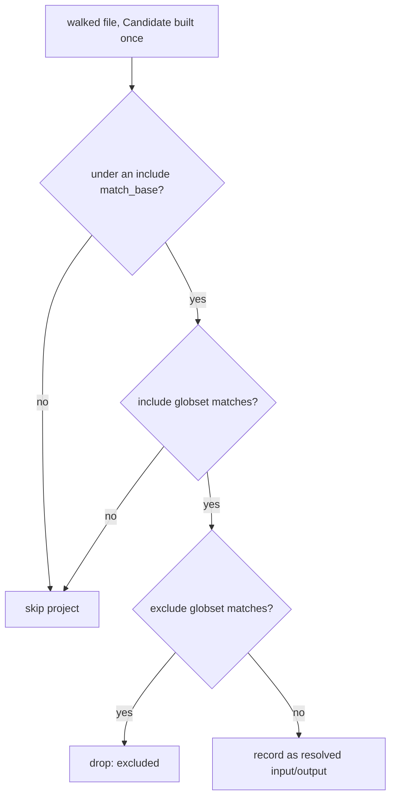

# RFC 0009: Negation in task `input_files` and `output_files`

- **Status:** Superseded (by RFC 0011) <!-- Draft | Accepted | Implemented | Superseded -->
- **Owner:** TBD
- **Date:** 2026-09-03
- **Superseded by:** RFC 0011 (standardize glob configuration on a structured include/exclude type). This RFC added exclusion to `cache.key.files` / `cache.output.files` through a leading `!` in the existing flat list. RFC 0011 concludes that the flat-list-with-`!` shape is the wrong model for omni (it implies gitignore ordering omni does not honor) and replaces it workspace-wide with a structured `GlobConfig<T>`, where exclusion is expressed by an explicit `exclude` list rather than a `!` prefix. The collector and SCM-filter changes described below still happen under 0011, but they read a pre-separated include/exclude structure instead of classifying a leading `!`, so the `classify` promotion this RFC proposed is dropped. Kept for the investigation and the prior-art survey that led to 0011.
- **Affected crates/files:** omni_collector (collector hot loop), omni_execution_plan (`DefaultTaskScmAffectedFilter`), omni_glob (add a public `classify` wrapping RFC 0008's internal `scan_markers`), the `cache.key.files` / `cache.output.files` schema descriptions. Reads but does not change omni_types (`OmniPath::unresolved_path()` and its root parsing).
- **Prior art referenced:** gitignore/`ignore`, Bazel `glob(exclude=...)`, Nx `namedInputs` negation, Turborepo `inputs` `!` globs
- **Depends on:** RFC 0008 (the portable `\!` escape and the single negation scan in `omni_glob`). 0008 keeps that scan internal by design (its decision 17); this RFC is the first caller that needs the body it produces, so promoting it to a public `classify` is part of this RFC's work, not a change to 0008. This RFC does not start until 0008 has landed. It is the deferred "collector rework" that 0008 §7.2 parked as its own feature.

## 1. Summary

Let a task exclude files from its cache inputs (and outputs) with the same `!` convention the rest of omni already uses. Writing `cache.key.files: ["src/**", "!src/generated/**"]` should drop the generated subtree from the task's input hash, so churn in generated code no longer busts the cache. Today the collector treats every entry as an include and a leading `!` is a dead literal (RFC 0008 §4.1). This RFC teaches the collector, and the SCM-affected filter that shares the same glob list, to split includes from excludes.

The change is provably additive for every config that has no leading-`!` entry (RFC 0008 §7.2 and §6.5 below), so it does not move existing cache keys. The cost is real but contained: the split has to reach into the collector's per-file match loop and its walk-seeding, and the SCM-affected filter has to move in lockstep so one glob list never means two different things.

## 2. Motivation / Problem

A task's input hash is the set of files matched by `cache.key.files`. When a task legitimately depends on a directory that also holds generated or vendored output, the author has no way to say "hash `src`, but not `src/generated`." The only options today are to narrow the include globs by hand (brittle, and impossible when the excluded files are interleaved with wanted ones) or to accept that every regeneration busts the cache.

Every other file-selection subsystem in omni already speaks `!`: discovery, the generator `files` block, and projections all run through `omni_glob::GlobMatcher`, which honors leading-`!` parity (RFC 0007). The collector is the odd one out because it feeds hashing, so RFC 0007 deliberately left it alone and RFC 0008 kept it on the include-only `include_set`. That was the safe call. This RFC is the follow-up that closes the gap now that the `\!` escape (RFC 0008 §5.1) makes it safe to give `!` meaning without stranding any file literally named `!something`.

Desired outcome: `!` in `cache.key.files` and `cache.output.files` excludes, `\!` matches a literal leading `!`, and no existing hash changes unless a config actually uses the new syntax.

## 3. Goals / Non-goals

### Goals

- Interpret `!` in `cache.key.files` and `cache.output.files` as exclude, using the one negation convention and the `\!` escape from RFC 0008. No bespoke second convention.
- Keep the change additive: a config with no leading-`!` entry produces byte-identical hashes, proven by the golden-hash snapshot from RFC 0008 §9.1.
- Preserve the collector's performance characteristics: the `Candidate` fast path, the `match_bases` cheap-rejection gate, and the global single-walk stay intact.
- Move `DefaultTaskScmAffectedFilter` to the same include/exclude split in the same change, so the SCM affected-set never diverges from what the collector hashes.

### Non-goals

- User-facing project/task/dir filter negation and `get_stats` negation. Those are non-hashed and tracked separately (RFC 0008 §7.1, decision 10).
- `project_hasher` task-name negation. Declined as low value on a hashed path (RFC 0008 decision 12).
- Pruning excluded directories from the walk as an optimization. The walk is global across projects; an exclude in one project must not shrink another's walk. Excludes are applied per-project during matching only (§5.4).
- Changing the `\!` escape or the classifier. Those are RFC 0008's; this RFC consumes them.

## 4. Background: current mechanisms

The collector is the load-bearing caller because its resolved input files feed `omni_hasher` and therefore the cache key (RFC 0008 §4.1). The relevant flow, verified in `crates/omni_collector/src/collector.rs`:

1. For each project task, `populate_includes_and_patterns` (`:654`) walks `input_files` / `output_files`. For each `OmniPath` it calls `p.resolve(roots)`, makes the result absolute (`std::path::absolute(project_dir.join(p))`), then pushes that absolute string into three include-only structures:
    - `patterns`, later compiled by `omni_glob::include_set` into the project's `output_files_globset` / `input_files_globset` (`:359`, `:379`);
    - `match_bases`, the glob-free literal prefix (`remove_globs`), used as a cheap rejection filter;
    - `includes`, a single vector shared across all projects.
2. `includes` seeds one global walk. `forced_includes` (`:414-439`) is every include plus its glob-free prefix plus each ancestor up to (not into) the workspace root, so the walker descends into otherwise-ignored directories. `topmost_dirs(&includes, ...)` (`:443`) picks the walk roots, filtered to those inside the workspace root.
3. The walk runs once (`:492`). For each walked file the collector builds one `globset::Candidate` (`:531`), then for each project first applies the `match_bases` gate (`:540-544`), then a single `input_files_globset.is_match_candidate(&candidate)` / `output_files_globset.is_match_candidate(&candidate)` (`:572`, `:586`), pushing hits into `resolved_input_files` / `resolved_output_files`.
4. `resolved_input_files` becomes `input_files` on the `CollectResult`, hashed by `get_digest` via `dir_hasher.hash_tree(..., input_files)` (`:197-203`). So which files match directly defines the hash.

Key facts the design relies on, verified in source:

- **`OmniPath` already has a leading-marker escape.** `OmniPath::from_str` (`omni_types/src/omni_path.rs:194`) parses `@workspace/x` into `{ root: Workspace, path: "x" }` and escapes a literal leading `@` as `\@`. A leading `!` is not special to `OmniPath`; for `@workspace/!gen/**` the `!` lands at the front of the inner `path` field (`unresolved_path()` returns `!gen/**`), with the root preserved. This is exactly the place to classify negation (§5.2).
- **The negation convention lives in one place.** After RFC 0008, `omni_glob` owns the single scan (`scan_markers`) that both classifies (`is_include`) and produces the escaped body, with the portable `\!` escape. Only `is_include` is public today; the body form is internal (RFC 0008 decision 17). This RFC calls the scan; it does not reimplement parity.
- **The walk is global, matching is per-project.** `includes` / `forced_includes` / `topmost` are shared; `is_match_candidate` runs per project. So an exclude has to be a per-project filter, never a walk-seeding input (§5.4).
- **`DefaultTaskScmAffectedFilter` reads the same list.** `should_include_task` (`filter.rs:277-316`) builds an `include_set` from the task's resolved `key_input_files` (`:307`) and tests each changed file against it. That is the same `key_input_files` the collector hashes (`cache_info.rs:6`, `project_data_extractor.rs:214`). If the collector reads `!gen/**` as an exclude while the filter reads it as a literal, the affected-set and the hashed-set disagree.

## 5. Proposed design

### 5.1 Classification reuses RFC 0008's scan

RFC 0008 replaced `count_leading_bangs` / `strip_bang` with one prefix scan, `scan_markers`, that is the single source of truth for the classifier and the builder, and it added the portable `\!` escape. `scan_markers` returns a `Marker { bangs: usize, body: String }`: the count of unescaped leading `!`, and the pattern with its leading marker run resolved (markers dropped, each `\!` reduced to a literal `!`). Its only public form today is `is_include`, defined as `scan_markers(p).bangs.is_multiple_of(2)`. 0008 kept the body form internal (its decision 17: no public body form until a caller needs one).

This RFC is that caller. Its first step adds a public `classify` that returns both the include bit and the resolved body, wrapping the same `scan_markers`:

```rust
// omni_glob: added here, wrapping RFC 0008's internal scan_markers.
pub struct Classified {
    pub include: bool, // even bang parity: scan_markers(p).bangs.is_multiple_of(2)
    pub body: String,  // leading `!` run consumed, each `\!` reduced to `!`
}

pub fn classify(pattern: &str) -> Classified;
```

`classify` is the only negation logic this RFC touches. The collector never counts bangs itself. It is a thin wrapper over the existing `scan_markers`, not a second implementation (§8 decision 11).

### 5.2 Classify on the `OmniPath` path component, before resolution

The leading `!` must be read off the raw entry before `resolve` absolutizes it. It is classified against `OmniPath::unresolved_path()`, the inner `path` field, so the root is preserved:

| Config entry          | `unresolved_path()` | root      | classified as                  | resolves against |
| --------------------- | ------------------- | --------- | ------------------------------ | ---------------- |
| `src/**`              | `src/**`            | none      | include                        | project dir      |
| `!src/generated/**`   | `!src/generated/**` | none      | exclude                        | project dir      |
| `@workspace/!dist/**` | `!dist/**`          | workspace | exclude                        | workspace root   |
| `\!weird/**`          | `\!weird/**`        | none      | include of literal `!weird/**` | project dir      |

Classifying the path component (not the whole string) is what makes `!` compose with `@workspace/` rooting. `@workspace/!dist/**` reads as "exclude `dist` under the workspace root," and the root survives because `from_str` already split it off. Writing `!@workspace/dist/**` is a different, unrooted thing (`OmniPath::from_str` sees a literal path beginning with `!@workspace`) and is not the negation form; the design documents `@workspace/!dist/**` as the way to negate a rooted glob.

`populate_includes_and_patterns` gains an exclude output and only feeds includes into the walk-seeding structures:

```rust
fn populate_includes_and_patterns(
    files: &[OmniPath],
    project_dir: &Path,
    includes: &mut Vec<PathBuf>,       // walk-seeding: includes only
    match_bases: &mut Vec<PathBuf>,    // cheap-rejection: includes only
    roots: &RootMap,
    include_patterns: &mut Vec<String>,
    exclude_patterns: &mut Vec<String>, // new
) -> Result<(), Error> {
    for p in files {
        let raw = p.unresolved_path().to_string_lossy();
        let c = omni_glob::classify(&raw);

        // Rebuild with the classified body, preserving the root, then resolve.
        let entry = match p.root() {
            Some(root) => OmniPath::new_rooted(c.body.as_str(), root),
            None => OmniPath::new(c.body.as_str()),
        };
        let resolved = entry.resolve(roots);
        let path = if resolved.is_relative() {
            std::path::absolute(project_dir.join(resolved))?
        } else {
            resolved.to_path_buf()
        };

        let pattern = path.to_string_lossy().into_owned();
        if c.include {
            include_patterns.push(pattern);
            match_bases.push(remove_globs(&path).to_path_buf());
            includes.push(path);
        } else {
            exclude_patterns.push(pattern);
            // Deliberately NOT pushed to includes/match_bases: an exclude
            // must never seed the walk or force a directory to be walked.
        }
    }
    Ok(())
}
```

### 5.3 A second, include-only exclude set per project

`Holder` gains an exclude globset beside each include globset, both built with `omni_glob::include_set` (RFC 0008 §5.2), both raw `Arc<GlobSet>` so the `Candidate` fast path survives:

```rust
struct Holder<'a> {
    input_files_globset: Option<Arc<GlobSet>>,          // includes
    input_files_exclude_globset: Option<Arc<GlobSet>>,  // new
    output_files_globset: Option<Arc<GlobSet>>,         // includes
    output_files_exclude_globset: Option<Arc<GlobSet>>, // new
    // ... unchanged
}
```

Both sets are include-only compiled sets. The negation is expressed by the split, not by feeding `!` to globset. An empty exclude set matches nothing, so `include && !exclude` collapses to `include`, which is what keeps the no-`!` case byte-identical (§6.5).

### 5.4 The match-loop change

The only inner-loop change is one added conjunct per file kind:

```rust
if let Some(inc) = project.input_files_globset.as_ref()
    && inc.is_match_candidate(&candidate)
    && project
        .input_files_exclude_globset
        .as_ref()
        .is_none_or(|ex| !ex.is_match_candidate(&candidate))
    && let Some(resolved) = project.resolved_input_files.as_mut()
{
    resolved.push(rooted_path.clone());
}
```

The exclude check runs only after the include matches, so the common no-exclude project pays one `is_none_or` on a `None`. The `match_bases` gate (§4 step 3) is untouched: it gates on includes, and a file the includes cannot reach never gets as far as the exclude check.



### 5.5 The SCM-affected filter, in lockstep

`DefaultTaskScmAffectedFilter::should_include_task` (`filter.rs:277-316`) changes in the same PR to the same split. Today it builds one `include_set` from the resolved patterns (`:307`). After this change it classifies each entry with `omni_glob::classify`, builds an include set and an exclude set with `include_set`, and includes a task when a changed file matches an include and no exclude:

```rust
let changed_hit = include.is_match(file) && !exclude.is_match(file);
```

This is decision 11 of RFC 0008 made concrete: the filter is not permanently include-only, it is permanently equal to the collector. Shipping the two together is the invariant, not a nicety. A test asserts they agree on a fixture containing a `!` entry (§6.3).

### 5.6 Config and schema

No new keys. `cache.key.files` and `cache.output.files` already accept a list of path strings; this RFC gives a leading `!` in those strings the exclude meaning and documents `\!` for a literal. The JSON schema descriptions for both fields are updated to state the convention and the escape. No serialization change: `OmniPath` already round-trips these strings (`from_str` / `Display`), and a leading `!` is an ordinary path character to `OmniPath` today, so no `OmniPath` parsing changes are required. Classification is the collector's and the filter's job, on the value `OmniPath` already produces.

## 6. Mandatory analysis

### 6.1 Existing mechanisms (reuse vs. extend vs. add)

Reuse throughout. The negation convention and `\!` escape are RFC 0008's `omni_glob::classify`. The compiled sets are RFC 0008's `include_set` (already the collector's post-0008 builder). `OmniPath` root parsing and its `\@` escape are reused as the model for where a leading marker sits. The only additions are one exclude field per file kind on `Holder`, an exclude output on `populate_includes_and_patterns`, and one conjunct in the match loop. No new matcher, no new cache, no new config key.

### 6.2 Maintenance cost

Modest and mostly one-time. The lasting obligation is the lockstep invariant: any future change to how the collector reads `cache.key.files` must be mirrored in `DefaultTaskScmAffectedFilter`, and vice versa. A shared classification helper (both call `omni_glob::classify` on the same list) plus the agreement test (§6.3) is the guard. The schema docs for two fields gain a sentence each. No new dependencies.

### 6.3 Testability

- **Additive proof (the acceptance bar).** RFC 0008's golden-hash snapshot test (`tests/omni-tests/src/hash-golden.e2e.spec.ts`, snapshot at `__snapshots__/hash-golden.e2e.spec.ts.<platform>.snap`) must stay byte-identical before and after this change, because that fixture has no `!` entry. It is the direct proof that hashes did not move for existing configs.
- **Exclude changes the hash, deterministically.** A collector unit/integration fixture with `cache.key.files: ["src/**", "!src/generated/**"]` asserts the resolved input set omits the excluded subtree and includes everything else, and that two runs agree. A sibling fixture without the exclude has a different, stable hash, proving the exclude actually subtracts.
- **`\!` keeps a literal reachable.** A fixture with a file literally named `!keep.txt` and `cache.key.files: ["\\!keep.txt"]` asserts the file is hashed on Windows and Unix. The escape itself is already pinned on both platforms by RFC 0008's `scan_markers_resolves_the_escape_table` unit test and `tests/omni-tests/src/glob-escape.e2e.spec.ts`; this fixture proves it reaches the collector's hash.
- **Collector and SCM filter agree.** A table-driven test feeds the same `key_input_files` (including `!` and `\!` rows) to both the collector's classification and `DefaultTaskScmAffectedFilter`, asserting the include/exclude split is identical. This is the lockstep guard.
- **Walk-seeding excludes nothing.** A fixture where an excluded directory is the only reason a walk root would exist asserts the directory is still walked (excludes do not prune the global walk) but its files are dropped from the result. This pins the §5.4 non-goal.
- **e2e.** A `tests/omni-tests` case runs a real task whose `cache.key.files` excludes a generated subtree, mutates a file under the exclude, and asserts the task still hits the cache (the exclude worked end to end). Windows CI covers the `\!` path.

Hard to test directly: the `is_match_candidate` fast path is exercised through collection, not a unit assert; the golden hash and the exclude fixtures cover it end to end.

Note on RFC 0008's characterization guards. RFC 0008 added two unit tests that assert a leading `!` is a literal, not a negation marker: `test_default_task_filter_leading_bang_is_literal` on `DefaultTaskFilter` (`omni_execution_plan`) and `test_get_stats_leading_bang_is_literal` on `get_stats` (`omni_cache`). They guard against negation leaking in during 0008's `include_set` migration. Both subsystems are non-goals here (they gain negation in the separate decision-10 follow-up, not this RFC), so neither test is removed by this work. The `DefaultTaskScmAffectedFilter` that this RFC does change has no such guard, so nothing in 0008 blocks §5.5. An implementer editing `filter.rs` for the SCM filter should leave `test_default_task_filter_leading_bang_is_literal` alone; it belongs to the filter-negation follow-up, which removes or inverts it then.

### 6.4 Integration points

- `omni_collector::collector`: `Holder` (two new fields), `populate_includes_and_patterns` (exclude output, include-only walk-seeding), the two `include_set` call sites (`:359`, `:379`) each become one include set plus one exclude set, and the match loop gains one conjunct per file kind.
- `omni_execution_plan::filter`: `DefaultTaskScmAffectedFilter::should_include_task` gains the split.
- `omni_glob`: add a public `classify` wrapping the internal `scan_markers` (0008 decision 17 keeps the body form internal; this RFC is the caller that needs it).
- Schema: descriptions for `cache.key.files` and `cache.output.files`.
- No change to `omni_types::OmniPath`, `project_hasher`, `workspace_hasher`, or the cache store.

`omni_collector` and `omni_execution_plan` already depend on `omni_glob` (RFC 0008 added the edge in both `Cargo.toml` and `project.omni.yaml`, the latter so an `omni_glob` change invalidates their content hashes), so this RFC adds no new dependency edges.

### 6.5 Potential regressions (highest stakes in the workspace)

- **Stale or thrashed cache from a wrong split (severe, guarded).** If classification misfired, files would silently drop from or reappear in the input hash. Guarded three ways: the no-`!` golden hash is byte-identical; classification is the single shared `omni_glob::classify`, not a reimplementation; and the collector/filter agreement test proves both read the list the same way.
- **A real path beginning with `!` flips from include to exclude (the one breaking vector).** Before this RFC, `!gen/**` is a dead literal (it only matches a directory literally named `!gen`, absolutized to `/proj/!gen/**`; RFC 0008 §7.2). A repo grep confirms zero such entries in this workspace, and the only `!` list items anywhere are generator `files` blocks, which already negate. So the change is additive here. omni ships elsewhere, so the enabling change carries a changelog note and points at `\!` as the escape hatch for anyone who genuinely had a literal `!` path. This is a documented behavior change, not a versioned cache migration.
- **Lost `Candidate` fast path (performance).** Avoided: both sets are raw `Arc<GlobSet>` via `include_set`, and the exclude check is `is_match_candidate` on the same pre-built `Candidate`, gated behind the include match. Large-monorepo cost is one extra candidate match only for files that already matched an include in a project that declares excludes.
- **Walk-seeding pollution.** If an exclude leaked into `includes` / `forced_includes` / `topmost`, it could force a directory to be walked or, worse, differ per project on a shared global walk. Prevented structurally: excludes are never pushed to those vectors (§5.2), and the walk-seeding non-goal has its own test (§6.3).
- **Cross-platform paths.** No path-normalization change. Classification runs on `unresolved_path()` before absolutization; the `\!` escape is resolved in `omni_glob` independent of globset's platform-dependent backslash handling (RFC 0008 §5.1).

### 6.6 Pros and cons

| Option                                                                                             | Pros                                                                                                                                                                       | Cons                                                                                                                                    | Verdict |
| -------------------------------------------------------------------------------------------------- | -------------------------------------------------------------------------------------------------------------------------------------------------------------------------- | --------------------------------------------------------------------------------------------------------------------------------------- | ------- |
| **Split include/exclude in the collector + SCM filter, reuse `omni_glob::classify` (recommended)** | Additive when no `!` exists; one negation convention workspace-wide; keeps the `Candidate` fast path and global single walk; lockstep guard is a shared helper plus a test | Touches the hot loop and a second crate in one change; a genuine leading-`!` path elsewhere is a documented behavior change             | ✅      |
| Route the collector through `GlobMatcher`                                                          | "One matcher" literally                                                                                                                                                    | Loses `is_match_candidate`; cannot expose the include set for walk-seeding; silently adds `!` even where unwanted (RFC 0008 decision 6) |         |
| A bespoke exclude list config key (`cache.key.exclude`)                                            | No `!` parsing; explicit                                                                                                                                                   | A second convention that diverges from discovery/generator/projections; still needs the same collector rework; more schema to maintain  |         |
| Prune excluded directories from the walk                                                           | Fewer files walked                                                                                                                                                         | Unsound on a global walk shared across projects; an exclude in one project would starve another's includes                              |         |

### 6.7 Prior art and how omni improves on it

| Tool                                 | Their approach                                                                                                                                                                                   | What to adopt                                                   | What to change for omni                                                                                                                                                                                     |
| ------------------------------------ | ------------------------------------------------------------------------------------------------------------------------------------------------------------------------------------------------ | --------------------------------------------------------------- | ----------------------------------------------------------------------------------------------------------------------------------------------------------------------------------------------------------- |
| gitignore / `ignore`                 | Leading `!` re-includes; `\!` escapes a literal                                                                                                                                                  | The escape and the parity feel authors know                     | omni's `!` is exclude-from-a-hash-input, not re-include; the escape is resolved in `omni_glob` so it is portable, not left to the platform                                                                  |
| Bazel `glob(exclude=[...])`          | Separate `exclude` argument                                                                                                                                                                      | The clean include/exclude separation internally                 | Keep it in one list with `!` rather than a second field, matching omni's existing convention                                                                                                                |
| Nx `namedInputs`, Turborepo `inputs` | `!`-prefixed globs subtract from a task's input set                                                                                                                                              | The exact use case: exclude generated files from the input hash | Prove additivity against a golden hash and enforce the SCM-filter lockstep, which those tools do not guarantee                                                                                              |
| Biome (`biome_glob`)                 | Leading `!` negates, `!!` force-negates, `\!` escapes a literal `!` via globset's `backslash_escape`; the glob list is evaluated last-match-wins (`matches_with_exceptions` walks it in reverse) | The `\!` literal escape and the include/exclude split           | omni resolves `\!` in its own pre-pass rather than globset's per-platform flag; keeps negation unordered to match its own `GlobMatcher`; and reads `!!` as an even-parity include, not Biome's force-negate |

The improvement over the JS-tool versions is the determinism discipline: omni treats a change to a hashed glob's meaning as a cache-correctness event, pins the no-op case with a byte-identical hash, and refuses to let the affected-set filter drift from the hashed-set.

## 7. Open questions

- **Ordering semantics (leaning unordered, pending confirmation).** gitignore and Biome both let a later glob re-include a subset of an earlier exclude: each evaluates the list last-match-wins. Biome's `matches_with_exceptions` walks the glob list in reverse and returns on the first raw match, so `["*", "!a*", "a"]` includes `a` again. This RFC instead proposes unordered include-set minus exclude-set with no re-inclusion, matching omni's existing `GlobMatcher` (also unordered) and keeping the collector's two-globset `is_match_candidate` fast path. Last-match-wins would force per-file sequential glob evaluation on the hashed hot loop and introduce a second negation semantic that diverges from discovery, generators, and projections. Recommendation: stay unordered. Confirm no consumer needs re-inclusion before locking decision 10.

## 8. Decision log

| #   | Decision                                                                                                            | Rationale                                                                                                                                                                                                                                |
| --- | ------------------------------------------------------------------------------------------------------------------- | ---------------------------------------------------------------------------------------------------------------------------------------------------------------------------------------------------------------------------------------- |
| 1   | Split include/exclude in the collector rather than route it through `GlobMatcher`                                   | Preserves `is_match_candidate` and the ability to seed the walk from includes only; `GlobMatcher` exposes neither (RFC 0008 decision 6)                                                                                                  |
| 2   | Classify on `OmniPath::unresolved_path()`, before resolution                                                        | The leading `!` must be read before absolutization buries it; classifying the path component preserves `@workspace/` rooting                                                                                                             |
| 3   | Reuse `omni_glob::classify`; never reimplement parity                                                               | One negation convention workspace-wide; the `\!` escape and parity stay in a single place (RFC 0008)                                                                                                                                     |
| 4   | Excludes never enter walk-seeding (`includes`/`match_bases`/`forced_includes`/`topmost`)                            | The walk is global across projects; an exclude that seeded the walk could starve another project's includes or force unwanted descent                                                                                                    |
| 5   | Both include and exclude sets are include-only `include_set` results                                                | An empty exclude collapses `include && !exclude` to `include`, which is what makes the no-`!` case byte-identical                                                                                                                        |
| 6   | `DefaultTaskScmAffectedFilter` ships the same split in the same PR                                                  | It reads the same `key_input_files`; a one-sided change makes one glob list mean two things (RFC 0008 decision 11)                                                                                                                       |
| 7   | No new config key; `!` in existing `cache.key.files`/`cache.output.files` means exclude, `\!` is the literal escape | Matches discovery/generator/projection convention; avoids a second bespoke exclude field                                                                                                                                                 |
| 8   | Treat a genuine leading-`!` path flipping meaning as a documented behavior change, not a versioned migration        | Zero such entries in this repo (RFC 0008 §7.2); `\!` is the escape hatch; a changelog note covers downstream repos                                                                                                                       |
| 9   | Acceptance bar is the byte-identical no-`!` golden hash plus a collector/filter agreement test                      | The golden hash proves additivity; the agreement test proves lockstep; together they cover the two severe regressions                                                                                                                    |
| 10  | Unordered include-minus-exclude, no gitignore-style re-inclusion                                                    | Matches omni's existing `GlobMatcher` semantics and is simpler to reason about on a hashed path (open question pending confirmation)                                                                                                     |
| 11  | This RFC adds a public `classify` wrapping `omni_glob`'s internal `scan_markers`                                    | 0008 keeps the body form internal (its decision 17); this RFC is the first caller needing the escaped body, so exposing it belongs here. `classify` is a thin wrapper over `scan_markers`, so there is still one implementation          |
| 12  | Ship `cache.output.files` negation alongside `cache.key.files`, not gated behind demand                             | Same split, same code path; an asymmetry where inputs negate but outputs do not is its own surprise for authors                                                                                                                          |
| 13  | Proceed with the feature; the hot-loop cost is justified                                                            | A real workspace wants to exclude a churning generated subtree from a task's input hash, and honoring `!` here makes authoring hashed globs consistent with the rest of omni's globbing, replacing the brittle hand-narrowing workaround |
