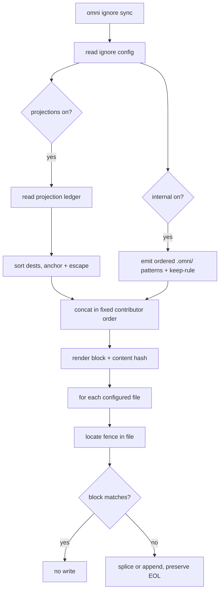
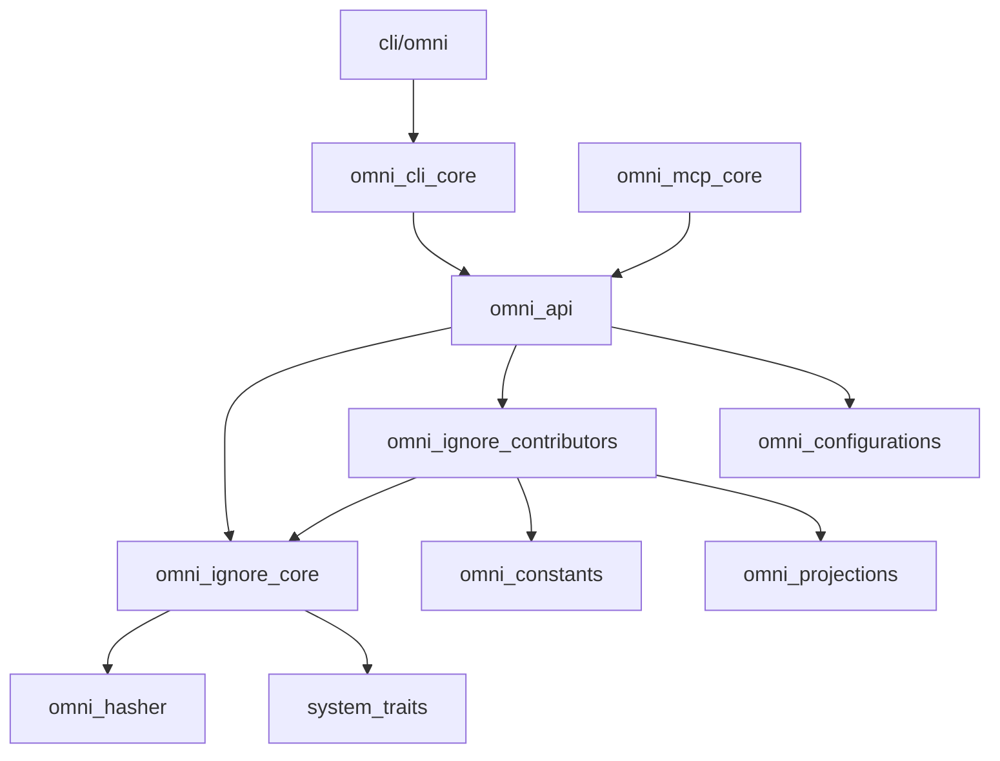

# RFC 0012: Managed ignore sync (`omni ignore sync`)

- **Status:** Implemented <!-- Draft | Accepted | Implemented | Superseded -->
- **Owner:** TBD
- **Date:** 2026-09-11
- **Affected crates/files:** `omni_ignore_core` (new), `omni_ignore_contributors` (new), `omni_configurations`, `omni_api`, `omni_cli_core`, `omni_mcp_core`, `omni_constants`, `omni-oss/json-schemas`
- **Prior art referenced:** Ansible `blockinfile`, Conda init, DVC, git-lfs, Cargo, gitignore.io

## 1. Summary

omni writes files into the workspace that should not be committed: the projection
links from RFC 0001/0010, and its own state under `.omni/`. Today keeping
`.gitignore` in step with all of that is the user's job, done by hand, and it
drifts the moment a projection is added, renamed, or a meta bundle grows a member.
This RFC proposes a small subsystem, `omni ignore sync`, that patches one
fenced, omni-owned block into each configured ignore file. The block lists every
path omni manages. The target files and what feeds the block are both configured
in `workspace.omni.yaml`:

```yaml
ignore:
    files: # absent or empty defaults to .gitignore, .ignore, .omniignore
        - .gitignore
        - .ignore
        - .omniignore
    sources:
        internal: true # omni's own .omni/ state
        projections: true # every dest recorded in the projection ledger
```

The projections contributor reads the ledger, so the ignored set always matches
what sync actually linked, with no second source of truth to drift. Writing the
same block to `.gitignore`, `.ignore`, and `.omniignore` covers every audience at
once: git hides the paths from `git status`, and `.ignore`/`.omniignore` hide them
from ripgrep and from omni's own discovery walker. All three use gitignore
syntax; git honors only `.gitignore`, so one rendered block is valid in every
target.

## 2. Motivation / Problem

RFC 0010 made it one line for a consumer to pull in a whole bundle of
projections. That is the problem here: one `skills` bundle expands into 16
symlinks under `.agents/skills/`, and every one of them shows up in
`git status`. The consumer never listed those paths, the bundle did, so there is
nothing sensible for them to paste into `.gitignore` by hand. When the bundle
grows a member upstream, their `.gitignore` is silently wrong again.

The projection ledger already records the exact `dest` of every link it created.
omni knows precisely what it put on disk. It just never tells git. On top of the
projection links, omni also scatters state under `.omni/` (the projection ledger
itself, git checkouts of sources, vendored bridge scripts, trace logs, generator
sessions), all of which is machine-local and should never be committed.

Desired outcome: one command, `omni ignore sync`, keeps a managed block in every
configured ignore file correct. Re-running it after any projection change is
enough. A `--check` mode lets CI fail when the block is stale.

## 3. Goals / Non-goals

### Goals

- Maintain one fenced, omni-owned region in each configured ignore file (default
  `.gitignore`, `.ignore`, and `.omniignore`, all at the workspace root) that
  lists every path omni manages.
- Feed that region from named contributors, toggled in `workspace.omni.yaml`
  under `ignore.sources`. Ship two contributors: `projections` (reads the ledger)
  and `internal` (omni's own `.omni/` state).
- Let the target files be configured under `ignore.files`, defaulting to
  `.gitignore`, `.ignore`, and `.omniignore` when absent or empty.
- Rewrite only the fenced region on every run, preserving all hand-written lines
  before and after it verbatim.
- Be idempotent and deterministic: identical inputs produce a byte-identical
  block, so re-running never churns the diff.
- Offer `--dry-run` (show the block) and `--check` (exit non-zero when stale, for
  CI) alongside the default apply.
- Offer a clean teardown that removes the block entirely, leaving the rest of the
  file untouched.
- Keep the generic block-patching logic in a subsystem-agnostic crate
  (`omni_ignore_core`) so a future contributor (generators, tools, cache) plugs
  in without touching the parser.

### Non-goals

- No automatic invocation from `projection sync`. `omni ignore sync` is run
  explicitly. Coupling the two is deferred to future work.
- No per-directory ignore files and no `.git/info/exclude` mode in v1. Every
  configured file is at the workspace root. Both alternatives are considered in
  §6.6.
- No per-subsystem `ignore.sources` toggles in v1. `internal` is one coarse
  toggle covering all of omni's `.omni/` state; splitting it per subsystem is
  deferred.
- No contributor for generators, tools, or the cache in v1. The seam is built for
  them; the contributors are not.
- No rewriting or reordering of the user's own ignore rules. omni owns exactly one
  block per file and nothing else in it.

## 4. Background: current mechanisms

### 4.1 omni reads ignore files, never writes them

Discovery walks the tree with the `ignore` crate. `omni_constants::OMNI_IGNORE`
is `.omniignore`, wired in as a custom ignore filename in
`omni_cli_core/src/utils/dir_walker.rs`, `omni_context/src/project_discovery.rs`,
and `omni_generator/src/discover.rs`. `.gitignore` is honored through the crate's
standard filters. Nothing in the workspace writes an ignore file. So this is a
genuinely new capability, not an extension of an existing writer.

### 4.2 The projection ledger already knows every managed dest

`omni_projections::LedgerLink` records, per link:

```rust
pub struct LedgerLink {
    pub source_id: String,   // composed id, e.g. "skills::mattpocock-skills"
    pub dest: String,        // workspace-relative destination
    pub target: String,
    pub kind: ResolvedKind,  // Symlink | Copy
    pub source_pin: String,
    pub backup: Option<String>,
}
```

The ledger lives at `ctx.omni_dir().join("sources/projection/links.json")`
(`ledger_path` in `omni_api/src/operations/projection.rs`). `dest` is exactly the
path that needs ignoring, already workspace-relative. The `projections`
contributor is therefore a ledger read and a projection of `dest`, no config
resolution, no network, no filesystem walk.

### 4.3 omni state lives under `.omni/`, but not all of it is disposable

`ctx.omni_dir()` is the workspace-local `.omni/`. Under it: source checkouts
(`.omni/sources/<subsystem>/...`), the per-source lockfiles
(`.omni/sources/<subsystem>/lock.json`), the projection ledger
(`.omni/sources/projection/links.json`), the cache (`.omni/cache/...`), trace
logs (`.omni/trace/...`), and more. The current checked-in `.gitignore` already
ignores this surgically rather than wholesale:

```gitignore
**/.omni/cache/**
**/.omni/scratch/**
**/.omni/trace/**
**/.omni/locks/**
**/.omni/remote-cache.omni.*
**/.omni/sources/*/**
**/.omni/remote_cache/**
!**/.omni/sources/*/lock.json
```

Two facts the design must respect. First, `lock.json` is committed on purpose (a
fresh clone recovers its links by re-running sync, per RFC 0010), so the negation
`!.../lock.json` re-includes it and must survive. Second, `.omni` only ever
appears at the workspace root, so the `**/` prefix on those patterns is
unnecessary. The `internal` contributor therefore emits a surgical, ordered set
with the keep-rule after its base pattern, not a single `/.omni/` line.

### 4.4 Config shape and the CLI/API/MCP layering to mirror

`WorkspaceConfiguration` (in `omni_configurations`) carries `projections`,
`generators`, `tools`, `env`, `capabilities`, each `#[serde(default)]`. An
`ignore` field is added the same way. The command path to mirror is:

- `omni_cli_core/src/commands/projection.rs` defines the `clap` command and
  renders output; `CliSubcommands::Projection` in `commands/mod.rs` wires it.
- `omni_api/src/operations/projection.rs` holds `handle_projection_sync` etc.,
  called from `omni_api/src/api.rs`.
- `omni_mcp_core/src/{model,tools}/projection.rs` expose the MCP tool.

`ignore` follows the same three-layer shape.

## 5. Proposed design

### 5.1 The managed block

One fenced region, appended once to each configured ignore file:

```gitignore
# @@omni-managed:begin (managed by `omni ignore sync`; do not edit by hand)
/.omni/cache/**
/.omni/locks/**
/.omni/remote-cache.omni.*
/.omni/remote_cache/**
/.omni/scratch/**
/.omni/sources/*/**
!/.omni/sources/*/lock.json
/.omni/trace/**
/.agents/skills/blast-radius
/.agents/skills/bro
/.agents/skills/grill-me
/.agents/skills/unslop
# @@omni-managed:end 3f9a1c8e
```

Rules for the block:

- Both fence lines match `^# @@omni-managed:(begin|end)\b`, so the parser finds
  the region with one regex and never confuses it with a user comment.
- Line order is significant, so there is no global sort. A negation like
  `!/.omni/sources/*/lock.json` only works if it comes after the
  `/.omni/sources/*/**` it re-includes, and a lexicographic sort would float `!`
  (0x21) above `.` (0x2E) and silently stop protecting the lockfile. Determinism
  instead comes from a fixed contributor order plus each contributor emitting in
  its own deterministic order: `internal` is a fixed authored sequence with the
  keep-rule in place, `projections` sorts its own (negation-free) paths.
- A concrete workspace-relative path is anchored with a leading `/` so it matches
  only at the workspace root, not a same-named file in a subdirectory. `.omni`
  only ever exists at the root, so its patterns are `/`-anchored too, with no
  `**/` prefix.
- The end fence carries a short hex content hash of the rendered lines (via
  `omni_hasher`). `--check` recomputes it, and a mismatch on apply reveals that
  someone hand-edited inside the fence.
- Special characters in a concrete path (`#`, `!`, trailing spaces, `[`) are
  escaped so a literal path never reads as a comment, a negation, or a character
  class. Raw patterns from the `internal` contributor are authored correct and
  pass through verbatim.

Since a symlink is one filesystem entry regardless of what it points at, a
projection `dest` is emitted as a single anchored path with no trailing slash;
there is no directory-vs-file distinction to carry, and `internal` uses explicit
`/**` suffixes where it wants a subtree.

### 5.2 Configuration

Two new workspace-only config types in `omni_configurations`:

```rust
#[derive(Serialize, Deserialize, JsonSchema, Debug, Clone, Default, PartialEq)]
#[serde(rename_all = "kebab-case")]
pub struct IgnoreConfig {
    /// Files to patch. Absent or empty resolves to `.gitignore`, `.ignore`,
    /// and `.omniignore`, all at the workspace root.
    #[serde(default)]
    pub files: Vec<String>,

    #[serde(default)]
    pub sources: IgnoreSourcesConfig,
}

#[derive(Serialize, Deserialize, JsonSchema, Debug, Clone, PartialEq)]
#[serde(rename_all = "kebab-case")]
pub struct IgnoreSourcesConfig {
    #[serde(default = "default_true")]
    pub internal: bool,
    #[serde(default = "default_true")]
    pub projections: bool,
}
```

Added to `WorkspaceConfiguration` as `#[serde(default)] pub ignore: IgnoreConfig`.
An empty or absent `files` resolves to the three defaults at use time, not through
a serde default, so "no `files` key" and "an explicit empty list" both mean "use
the defaults" rather than "patch nothing". Configuring zero files is meaningless,
so there is no need to distinguish the two.

Both contributors default to on: `omni ignore sync` is only ever run because the
user asked for it, so producing a useful block by default is the right call. An
absent `ignore:` key behaves as `{ files: [.gitignore, .ignore, .omniignore],
sources: { internal: true, projections: true } }`.

Each `sources` key is a bare bool in v1. `internal` is deliberately one coarse
toggle rather than a per-subsystem map: users think in terms of "manage omni's
noise," not "ignore cache state but keep trace state," and a coarse toggle keeps
the schema stable as subsystems come and go. If finer control is ever needed, a
bool can grow into a bool-or-map with a custom deserializer, the same pattern
`enable_experimental` already uses.

### 5.3 The contributor trait and crate split

The engine and the contributors live in two crates. `omni_ignore_core` is the
subsystem-agnostic engine: it owns the data boundary, the renderer, the fence
parser, the per-file patch, and the contract a contributor implements.
`omni_ignore_contributors` holds the concrete impls.

```rust
// omni_ignore_core

/// One rendered gitignore line: already anchored, escaped, and (for a keep-rule)
/// negation-prefixed. The core never rewrites a pattern, only orders and joins.
pub struct IgnorePattern(String);

impl IgnorePattern {
    /// A concrete workspace-relative path: anchored with `/` and escaped.
    pub fn path(rel: &Path) -> Self;
    /// A raw authored line (globs, `**`, a leading `!`), validated as a single
    /// non-fence line.
    pub fn raw(line: &str) -> Result<Self, IgnoreError>;
}

/// One named source's patterns, emitted in significant order.
pub struct Contribution {
    pub name: &'static str,   // "projections", "internal"
    pub patterns: Vec<IgnorePattern>,
}

#[async_trait]
#[cfg_attr(test, mockall::automock)]
pub trait IgnoreContributor: Send + Sync {
    fn name(&self) -> &'static str;
    async fn patterns(&self) -> eyre::Result<Vec<IgnorePattern>>;
}

/// Concatenate contributions in the given order; within each, keep the
/// contributor's order. No global sort (negations are order-sensitive).
pub fn render_block(contributions: &[Contribution]) -> String;
```

`patterns` is async because gathering can need IO: the projections contributor
reads the ledger. The trait follows the codebase's established `#[async_trait]` +
`#[cfg_attr(test, mockall::automock)]` pattern (the same shape as `Service`,
`Transport`, and `Handler` in `bridge_rpc_core`), so a test can stand in a fake
contributor with no ledger and no filesystem. The trait stays object-safe: each
impl captures what it needs at construction (a `sys` clone, the ledger path), so
`IgnoreContributor` is non-generic and the enabled contributors can be held as
`Vec<Box<dyn IgnoreContributor>>`.

The impls live in `omni_ignore_contributors`:

```rust
// omni_ignore_contributors
struct ProjectionsContributor<S> { sys: S, ledger_path: PathBuf }
struct InternalContributor;

#[async_trait]
impl<S: FsReadAsync + Send + Sync + 'static> IgnoreContributor
    for ProjectionsContributor<S>
{
    fn name(&self) -> &'static str { "projections" }
    async fn patterns(&self) -> eyre::Result<Vec<IgnorePattern>> {
        let ledger = omni_projections::load(&self.sys, &self.ledger_path).await;
        let mut dests: Vec<_> =
            ledger.links().iter().map(|l| l.dest.clone()).collect();
        dests.sort();
        Ok(dests.iter().map(|d| IgnorePattern::path(Path::new(d))).collect())
    }
}
```

`InternalContributor::patterns` is not IO-bound: it builds a fixed, ordered list
of `IgnorePattern::raw` lines (with the `!.../lock.json` keep-rule after its base)
from path segments defined in `omni_constants`. Those same segments are what the
subsystems use to build the paths they write, so a rename of `.omni/cache` (say)
changes one constant and moves both the writer and the ignore pattern together.
Adding a brand-new `.omni/` subdir is the one thing constants cannot catch; a
coverage test is the backstop for that (§6.3).

`omni_ignore_contributors` depends on `omni_ignore_core`, `omni_constants`, and
`omni_projections` (for the ledger read). It deliberately does not depend on
`omni_cache`, `omni_generator`, or the other subsystem crates: colocating the
pattern list in each subsystem crate would only move the strings, not enforce
their upkeep, so the enforcement is the shared constants plus the coverage test
instead (see the decision log).

### 5.4 The patch algorithm

The entry set is computed once, then every configured file is parsed and
validated before any is written, so a malformed fence in one file never leaves
another half-patched:

```
collect patterns = concat(enabled contributors, in fixed order)
render block (fixed contributor order, escaped, hashed; no global sort)

# pass 1: read and locate, abort the whole run on any malformed fence
for each file in resolved_files (config, or [.gitignore, .ignore, .omniignore]):
    read file (empty if absent)
    detect line ending (CRLF if the file uses it, else LF)
    find the fenced region by regex:
      0 matches  -> plan: append a blank line + block at EOF
      1 begin + 1 end, begin before end -> plan: splice block over [begin..=end]
      anything else (stray/duplicate/crossed fences) -> hard error, touch nothing

# pass 2: write only the files whose block actually changed
for each planned file:
    if rendered block == existing block -> no write (idempotent)
    else write file with original line ending
```

The "anything else" case is deliberate. If the fences are duplicated or crossed,
omni refuses to guess which region is its own rather than risk eating user lines,
and it fails the whole run in pass 1 before writing anything.

### 5.5 CLI / API / MCP surface

```
omni ignore sync              # patch the block, print what changed
omni ignore sync --dry-run    # print the block that would be written, no write
omni ignore sync --check      # exit 1 if the block is missing or stale, no write
omni ignore clean             # remove the block entirely, leave the rest intact
```

`--check` is the CI hook: a stale ignore file fails the build the same way a
stale lockfile would. It is stale if any configured file is missing the block or
carries an out-of-date one. `clean` is the teardown, symmetric with `projection
unlink`, and removes the block from every configured file.

MCP exposes `ignore_sync` with `{ dry_run, check }` and `ignore_clean`, mirroring
`projection_sync`'s tool shape.

### 5.6 Data flow



## 6. Mandatory analysis

### 6.1 Existing mechanisms (reuse vs. extend vs. add)

Nothing writes an ignore file today, so there is no writer to extend. What is
reused is substantial, though: the projection ledger is the entire data source
for the projections contributor, so this adds no new tracking and no new place
for those paths to drift. `omni_hasher` is reused for the fence hash, and the
`internal` contributor's paths are built from the same `omni_constants` segments
the subsystems already use to write those dirs. The CLI/API/MCP layering copies
the projection subsystem's shape. The genuinely new pieces are `omni_ignore_core`
(fence parser, renderer, patch, the `IgnoreContributor` trait) and
`omni_ignore_contributors` (the two impls). They are new because block-editing of
a foreign file is a concern none of the existing crates own.

### 6.2 Maintenance cost

Two new crates (`omni_ignore_core`, `omni_ignore_contributors`), one new config
type and its schema, one new CLI command, one new API operation, one new MCP
tool. The recurring obligation is keeping the `internal` set honest as omni's
`.omni/` layout changes. Two mechanisms carry that, because colocating a pattern
list next to each subsystem would only move the strings, not enforce their
upkeep:

- Shared segment constants in `omni_constants`, used by both the code that writes
  a `.omni/` dir and the `internal` contributor that ignores it. A rename or
  typo cannot drift, because there is one constant.
- A coverage test (§6.3) that runs representative work and asserts every path
  created under `.omni/` is matched by the `internal` set, minus the keep-list.
  This is what catches a brand-new subdir nobody wired in: CI goes red.

The projections contributor needs neither; it reads the ledger, which is already
the authoritative record. Adding a whole new contributor (a future generators or
cache source) still means implementing the trait, adding a `bool`, and pushing it
into the one assembly block in `handle_ignore_sync`; that assembly is not
compiler-checked, so it is kept to one short, obvious block. All of this is small
and easy to find, and strictly better than the status quo, where the same
knowledge lives only in each user's hand-edited `.gitignore`. gitignore's own
escaping and anchoring rules are fiddly, so they get written once and covered by
tests.

### 6.3 Testability

The hard parts are pure and unit-testable in `omni_ignore_core` with string
fixtures:

- Fence parser: absent block appends; present block splices; duplicated or crossed
  fences error and write nothing; content before and after the fence is byte-for-
  byte preserved; CRLF and LF are each round-tripped; missing trailing newline is
  handled.
- Renderer: contributions concatenate in the given order and patterns keep the
  contributor's order (a negation stays after its base); a concrete path is
  anchored with `/` and `#`, `!`, `[`, and trailing spaces are escaped; identical
  inputs render byte-identically (the determinism guarantee).
- Contributors: `ProjectionsContributor` is tested against a synthetic `Ledger`,
  asserting one sorted, anchored pattern per link `dest`. Because
  `IgnoreContributor` carries `#[cfg_attr(test, mockall::automock)]`, the
  assembly-and-render path in `handle_ignore_sync` is testable with a
  `MockIgnoreContributor` returning canned patterns, so the wiring is covered
  without a real ledger or filesystem.
- Internal-set coverage (the drift guard): a fixture runs projection sync, a
  cached task, and a generator run, then walks everything created under `.omni/`
  and asserts each entry is matched by the `internal` set except the `lock.json`
  keep-list. This fails when a subsystem starts writing a `.omni/` path the set
  does not cover. Its limit is that it only sees paths a test actually exercises.

End-to-end, in the `omni-oss/omni-tests` package: a fixture with a couple of
projections runs `omni ignore sync`, and the test asserts the resulting block in
`.gitignore`, `.ignore`, and `.omniignore`; a second run asserts no change
(idempotency); `--check` returns 0 when fresh and non-zero after a projection is
added; `clean` removes the block from every file and leaves surrounding lines
intact. A configured non-default `files` list is exercised to confirm the target
set is honored. Hardest to cover is cross-platform line-ending behavior, addressed
by asserting the written bytes for both an LF and a CRLF seed file.

### 6.4 Integration points

Two new crates. Everything else is additions to existing crates, arranged to
respect the workspace dependency graph.

`omni_ignore_core` (new, `omni/crates/omni_ignore_core/`) is the
subsystem-agnostic engine, a leaf crate that knows nothing about projections or
the context. Split by concern:

| File             | Contents                                                                                             |
| ---------------- | ---------------------------------------------------------------------------------------------------- |
| `pattern.rs`     | `IgnorePattern` (a validated single line), `Contribution { name, patterns }`                         |
| `contributor.rs` | the `IgnoreContributor` trait (`#[async_trait]` + `#[cfg_attr(test, mockall::automock)]`)            |
| `render.rs`      | `render_block(&[Contribution])`: concat in contributor order, escape, append the content hash        |
| `fence.rs`       | fence parser: locate `@@omni-managed:begin/end`, classify absent / one region / malformed, splice    |
| `patch.rs`       | `sync_files` / `check_files` / `clean_files`: read, detect line ending, two-pass validate-then-write |
| `error.rs`       | `IgnoreError` (thiserror) for parse and patch failures                                               |
| `lib.rs`         | re-exports                                                                                           |

Its dependencies are `system_traits` (the `FsReadAsync`/`FsWriteAsync` bounds in
`patch.rs`), `omni_hasher` (the fence hash), `async_trait`, `regex`, `thiserror`,
and `mockall` as a dev-dependency. It deliberately does not depend on any omni
subsystem, so the whole crate is unit-testable with string fixtures.

`omni_ignore_contributors` (new, `omni/crates/omni_ignore_contributors/`) holds
the two concrete impls, `ProjectionsContributor<S>` and `InternalContributor`. It
depends on `omni_ignore_core` (the trait and `IgnorePattern`), `omni_constants`
(the `.omni/` path segments and the fence tokens), and `omni_projections` (the
ledger read). It does not depend on `omni_cache`, `omni_generator`, or the other
subsystem crates.

The existing crates that gain code:

- `omni_configurations`: `IgnoreConfig` and `IgnoreSourcesConfig` (likely a new
  `ignore.rs` module), the `WorkspaceConfiguration.ignore` field, and a
  regenerated workspace JSON schema. The config lives here rather than in a
  dedicated crate because it is two small structs; projections earned their own
  config crate only because of their size (source kinds, routing, id validation).
- `omni_api`: a new `operations/ignore.rs` with `handle_ignore_sync`,
  `handle_ignore_clean`, and `resolve_files` (the empty-to-defaults fallback);
  plus the `OmniApi` methods in `api.rs` that call them. It resolves `sys` and
  the ledger path from the context, constructs the contributors, gates on config,
  and calls the core. It is the one crate that joins the context to the engine.
- `omni_cli_core`: a new `commands/ignore.rs` (`IgnoreCommand`, an
  `IgnoreSubcommand { Sync, Clean }`, the `--dry-run` / `--check` args, output
  rendering), registered in `commands/mod.rs` and added as
  `CliSubcommands::Ignore`.
- `omni_mcp_core`: `model/ignore.rs` and `tools/ignore.rs` exposing `ignore_sync`
  and `ignore_clean`, mirroring `projection`.
- `omni_constants`: the fence tokens, the default file names (`.gitignore`,
  `.ignore`, `.omniignore`), and the `.omni/` path segments (`sources`, `cache`,
  `trace`, `lock.json`, ...) that both the subsystem writers and the `internal`
  contributor build their paths from.
- `cli/omni` (`src/lib.rs`): one dispatch arm,
  `CliSubcommands::Ignore(cmd) => commands::ignore::run(cmd, &context).await?`.

The crate graph keeps `omni_ignore_core` at the bottom and threads the
contributors through `omni_api`:



One detail to settle at implementation time: the `IgnoreContributor` trait returns
`eyre::Result` in the sketch, which would pull `eyre` into the leaf
`omni_ignore_core`. Cleaner is for the core's own functions (parse, render, patch)
to use its `thiserror` `IgnoreError`, and let the trait return `eyre::Result`
since its only implementors live above the leaf.

The contributors are wired in at exactly one place, `handle_ignore_sync`, which
constructs the enabled contributors behind their config toggles, collects them
through the trait, renders once, and patches every file:

```rust
pub async fn handle_ignore_sync<S>(ctx: Context<S>, req: IgnoreSyncRequest)
    -> eyre::Result<IgnoreSyncResponse>
{
    let sys = ctx.sys().clone();
    let workspace_root = ctx.root_dir().to_path_buf();
    let cfg = ctx.workspace_configuration().ignore.clone();

    let mut contributors: Vec<Box<dyn IgnoreContributor>> = Vec::new();
    if cfg.sources.projections {
        contributors.push(Box::new(ProjectionsContributor {
            sys: sys.clone(),
            ledger_path: ledger_path(&ctx),
        }));
    }
    if cfg.sources.internal {
        contributors.push(Box::new(InternalContributor));
    }

    let mut contributions = Vec::with_capacity(contributors.len());
    for c in &contributors {
        contributions.push(Contribution {
            name: c.name(),
            patterns: c.patterns().await?,
        });
    }

    let block = omni_ignore_core::render_block(&contributions);
    let files = resolve_files(&cfg); // config, or [.gitignore, .ignore, .omniignore]

    // pass 1 validates every file, pass 2 writes the changed ones
    omni_ignore_core::sync_files(&sys, &workspace_root, &files, &block, req.mode)
        .await
}
```

That assembly block is the whole integration: config decides which contributors
are constructed, each produces its own patterns, and the core only ever sees
`Contribution` values. Adding a contributor is: implement the trait in
`omni_ignore_contributors`, add its `bool` to `IgnoreSourcesConfig`, and push it
here under the toggle. This is not compiler-checked the way an exhaustive match
would be, so the assembly is deliberately kept to one short, obvious block.
`handle_ignore_clean` skips the whole collect step, since a teardown removes the
block regardless of what would have gone in it.

Ordering: the projections contributor must read the ledger as written by the last
`projection sync`. `ignore sync` reflects the ledger as it is on disk now; it does
not run a projection sync itself, so the two are independent and the user controls
the order.

### 6.5 Potential regressions

This writes a tracked file, so the risk profile is different from the rest of
omni, which mostly writes machine-local state.

- Eating user content. The whole design guards this: only the fenced span is ever
  rewritten, and malformed fences abort with no write. The one residual risk is a
  user who hand-writes the exact begin/end tokens; the "do not edit" text and the
  content hash are the mitigation, and the parser treats any unexpected fence
  layout as a hard error rather than a splice.
- Non-determinism churning diffs. If the block were re-ordered between runs, every
  teammate's sync would produce noise. Determinism comes from a fixed contributor
  order plus deterministic per-contributor emission (projections sort their
  paths). Note the block is deliberately not globally sorted, because a global
  sort would reorder the `internal` negation ahead of its base and break it, so
  the determinism test asserts stable output without assuming sorted output.
- gitignore semantics. An unanchored or unescaped entry can match more (or less)
  than intended, and a negation in the wrong place silently stops re-including its
  target. Leading `/` anchoring, escaping of concrete paths, and keeping the
  `!.../lock.json` keep-rule after its base pattern are the fixes, all tested.
  Because the block is appended last, its rules sit after any user negation
  (`!pattern`) lines; a user negation earlier in the file could be overridden by a
  broad omni ignore below it. In practice omni ignores specific dest paths and its
  own `.omni/` subpaths, so overlap with a user negation is unlikely, but it is a
  real ordering effect worth stating.
- Internal list drifting behind omni. If a subsystem starts writing a new `.omni/`
  path and nobody adds it to the `internal` set, that path silently shows up in
  `git status`. Shared segment constants prevent rename drift, and the `.omni/`
  coverage test (§6.3) is the backstop for additions, but the test only sees
  paths it exercises, so a rarely-hit code path writing under `.omni/` could still
  slip through until observed.
- Line endings. Rewriting an LF file with CRLF (or vice versa) would rewrite every
  line as a diff. The patch detects and preserves each file's existing ending
  independently, so a CRLF `.gitignore` and an LF `.ignore` are each kept as they
  were.
- Missing target file or missing `.git`. Sync creates the file regardless;
  writing ignore rules in a non-git dir is harmless.
- `.ignore` and `.omniignore` affect omni's own discovery. Unlike `.gitignore`,
  both are honored by the `ignore` crate that omni walks the tree with, so an
  entry there hides that path from project, projection, generator, and tool
  discovery too. For projection dests and `.omni/` this is the desired outcome
  (omni should not treat its own linked artifacts as discoverable sources), but it
  is a real behavioral coupling that `.gitignore`-only tools do not have, so a
  user who adds a surprising path to a contributor should know it also disappears
  from omni's own walks.
- Partial multi-file writes. With several target files, a malformed fence in the
  second file must not leave the first already rewritten. All files are parsed and
  validated before any is written, so the run either applies to every file or
  aborts having touched none.
- No cache or hashing interaction. `omni ignore sync` reads the ledger and writes
  ignore files; it is outside the task graph and does not feed omni's content
  hashing, so there is no stale-cache correctness risk here.

### 6.6 Pros and cons

| Option                                                                                                                             | Pros                                                                                                                                                    | Cons                                                                                                                                   | Verdict                 |
| ---------------------------------------------------------------------------------------------------------------------------------- | ------------------------------------------------------------------------------------------------------------------------------------------------------- | -------------------------------------------------------------------------------------------------------------------------------------- | ----------------------- |
| A. One fenced block per configured root file (default `.gitignore` + `.ignore` + `.omniignore`), fed by contributors (recommended) | Covers arbitrary dest paths; committed, so teammates benefit; one block serves git and ripgrep/omni discovery; idempotent; extensible; `--check` for CI | Must edit shared tracked files; gitignore escaping/anchoring to get right; `.ignore`/`.omniignore` couple to omni's own discovery      | Chosen                  |
| B. Dedicated `.gitignore` per target directory (Cargo `target/.gitignore` style)                                                   | No merging, trivial teardown                                                                                                                            | Projection dests are scattered, not one dir; many tiny files; does not cover `.omni/` cleanly; teardown must track every file it wrote |                         |
| C. Write to `.git/info/exclude` (`--local` mode)                                                                                   | Never touches a tracked file; no merge conflict                                                                                                         | Local-only, so teammates gain nothing; invisible; assumes git present; does not cover `.ignore`'s ripgrep/discovery audience           | Possible follow-up flag |
| D. Status quo, hand-maintained                                                                                                     | No new code                                                                                                                                             | Drifts on every projection/bundle change; the exact problem this solves                                                                |                         |

Option C is attractive enough to keep as a future `--local` flag on the same
command, since the block renderer is identical and only the target file differs.

### 6.7 Prior art and how omni improves on it

| Tool                  | Their approach                                                                                      | What to adopt                                             | What to change for omni                                                                         |
| --------------------- | --------------------------------------------------------------------------------------------------- | --------------------------------------------------------- | ----------------------------------------------------------------------------------------------- |
| Ansible `blockinfile` | Idempotent managed region between named `# BEGIN/END` markers; re-finds and rewrites only that span | The whole find-splice-preserve model and the named marker | Add a content hash on the end fence and hard-error on malformed fences instead of best-effort   |
| Conda init            | `>>> conda initialize >>>` markers in rc files with a human warning line                            | The inline "do not edit" warning on the fence             | Machine-checkable hash so `--check` is exact, not advisory                                      |
| DVC                   | Autonomously edits `.gitignore` on `dvc add`, line by line                                          | The idea that the tool owns its ignore entries            | Fence the region so removal and diffing are clean, which DVC's line-oriented edits make painful |
| git-lfs               | Edits `.gitattributes` via `track`                                                                  | Tool-owned entries in a shared file                       | Drive entries from a ledger, not from an imperative per-command mutation                        |
| Cargo                 | Writes `target/.gitignore` = `*`, a dedicated file                                                  | Zero-merge simplicity for a single owned dir              | omni's dests are scattered, so a single anchored block beats one file per dir                   |
| gitignore.io          | Section bracketed by begin/end comments, regenerated wholesale                                      | Regenerate-the-section model                              | Content is derived from the live ledger, not a static template                                  |

The improvement specific to omni is that the ignored set is a projection of the
ledger, so it is correct by construction and self-updating after any projection or
meta-bundle change. Every prior tool either edits imperatively (DVC, git-lfs) or
regenerates from a static template (gitignore.io); none tie the managed set to a
live record of what was actually written.

## 7. Open questions

None. The design tree has been fully worked; the following are deliberately
deferred to future work, not open:

- Auto-running `ignore sync` at the tail of `projection sync` (decided decoupled
  in v1; an opt-in `ignore.auto` can be added later without breaking anything).
- A `--local` flag targeting `.git/info/exclude` (the renderer supports it for
  free; only the target path changes, but it serves only the git audience).
- Per-subsystem `ignore.sources` toggles (kept coarse as `internal` for now; a
  bool can grow into a bool-or-map later).
- A migration note, not a question: adopting this means a repo deletes its
  hand-authored `#### omni ####` `.gitignore` lines and lets the managed fence own
  them. `ignore sync` only manages inside its fence, so it will not remove the old
  unfenced lines automatically.

## 8. Decision log

| #   | Decision                                                                                                                                            | Rationale                                                                                                                                                                                                          |
| --- | --------------------------------------------------------------------------------------------------------------------------------------------------- | ------------------------------------------------------------------------------------------------------------------------------------------------------------------------------------------------------------------ |
| 1   | One fenced block per configured root file, defaulting to `.gitignore`, `.ignore`, and `.omniignore`, not per-directory files or `.git/info/exclude` | Projection dests are scattered across the tree; one anchored block per file covers them all, and the three defaults serve git, ripgrep, and omni's own discovery at once                                           |
| 2   | Projections contributor reads the ledger, not the config                                                                                            | The ledger is the authoritative record of what was linked; reading config would reintroduce the drift this RFC removes                                                                                             |
| 3   | Fence tokens are `# @@omni-managed:begin` / `:end`                                                                                                  | A single regex with one capture group finds both fences; the `:end` line carries the content hash                                                                                                                  |
| 4   | No global sort; fixed contributor order plus deterministic per-contributor emission; concrete paths anchored with `/` and escaped, no `**/`         | A global sort would float the `!.../lock.json` negation above its base and silently break it; `.omni` is root-only so `/`-anchoring is correct and `**/` is unneeded                                               |
| 5   | Malformed/duplicate fences are a hard error, never a guess                                                                                          | Refusing to edit is the only safe response when omni cannot identify its own region                                                                                                                                |
| 6   | Both contributors default on                                                                                                                        | `omni ignore sync` is explicitly invoked, so a useful default block is expected                                                                                                                                    |
| 7   | Two crates: `omni_ignore_core` (engine + trait) and `omni_ignore_contributors` (the impls), the trait using `#[async_trait]` + `automock`           | Keeps the parser/renderer pure and unit-testable; the trait matches the codebase's async-trait pattern and mocks in tests; a dedicated contributors crate isolates subsystem knowledge without bloating `omni_api` |
| 8   | `ignore.files` is a flat list; empty resolves to the three defaults; the same block goes to every file                                              | One shared block keeps every target consistent, and a flat list is the simplest thing that works until a contributor needs per-file targeting                                                                      |
| 9   | All target files are validated before any is written                                                                                                | With several files, a malformed fence in a later file must not leave an earlier one half-patched                                                                                                                   |
| 10  | The `.omni/` contributor is named `internal` and is one coarse toggle, not per-subsystem                                                            | "internal" names omni's own working state better than "builtins"; users want "manage omni's noise," not per-subsystem control, and a coarse toggle keeps the schema stable as subsystems change                    |
| 11  | The `internal` set is kept honest by shared `omni_constants` path segments plus a `.omni/` coverage test, not by colocating a list per subsystem    | Colocation moves strings without enforcing upkeep; shared constants kill rename drift and the coverage test catches new subdirs in CI                                                                              |
| 12  | `ignore sync` stays decoupled from `projection sync`; `--local` (`.git/info/exclude`) and per-subsystem toggles are deferred                        | Decoupling is the minimal, reversible choice (an opt-in auto-run is easy to add later); the deferred items serve narrow audiences and can arrive without breaking the v1 surface                                   |
