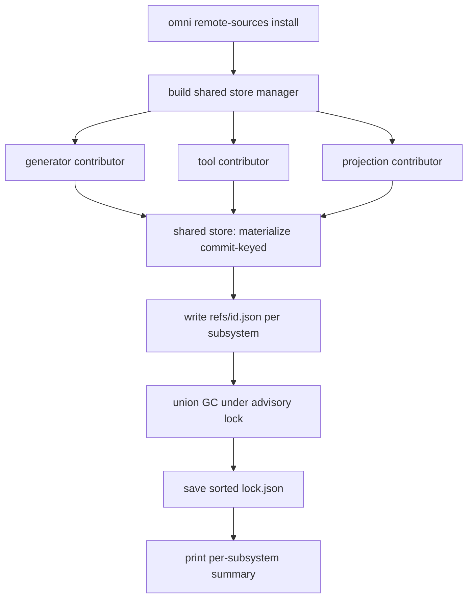

# RFC 0013: Prefetching remote sources (`omni remote-sources install`) over a shared content store

- **Status:** Implemented <!-- Draft | Accepted | Implemented | Superseded -->
- **Owner:** TBD
- **Date:** 2026-09-13
- **Affected crates/files:** `omni_remote_source`, `omni_remote_source_contributors` (**new** crate: the three concrete contributors), `omni_lockfile` (single shared lockfile + sorted save), `omni_ignore_contributors` (`internal.rs` ignore patterns), `omni_api` (`operations/{generator,projection,tool,remote_source}.rs`, `api.rs`; discovery/assembly of contributors), `omni_cli_core` (`commands/{mod,remote_source}.rs`, `commands/generator.rs`), `omni_constants`, `omni_meta` (reuse)
- **Prior art referenced:** Cargo (`cargo fetch` + global registry/git cache), Go modules (`go mod download` + module cache), pnpm (content-addressed store + `pnpm fetch`), Nix store, Bazel (`bazel fetch` / external repositories), Terraform (`terraform init`)

## 1. Summary

RFC 0001 (decision #27) reserved the verb `install` for "a future
subsystem-agnostic source-materialization (fetch + pin) command [that] warms the
source cache across generators/tools/projections without touching the working
tree." This RFC builds that command. `omni remote-sources install` prefetches
every remote source declared anywhere in the workspace.

It runs on a shared, content-addressed source store rather than today's
per-subsystem duplicated layout, and it treats that store as a prerequisite
rather than a later follow-up. The reason is centralization. Today each
subsystem constructs its own `RemoteSourceManager`, so the fetch/pin logic can
drift (tools already diverged, since they never fetch git), and a repo used by
two subsystems is cloned twice. `install` is the point to unify that. Because
omni is pre-release, there is no compatibility burden to defer for, so the clean
shared layout is adopted directly. The design lands the store first, then builds
`install`, the contributor trait, and the source-kind extension point on top.

The store is not only for `install`. Every subsystem calls it as the single
materialization path, on lazy runs (`omni gen`, `projection sync`, tool
discovery) as well as `install`. Routing every subsystem through one entry point
removes implementation drift and applies deduplication on every lazy path, not
only the explicit prefetch command.

## 2. Motivation / Problem

### 2.1 The lazy-only gap (the feature request)

The only way to materialize a remote source today is to trigger the subsystem
that consumes it:

- `omni_api::operations::generator::get_generators` (near-duplicated in
  `omni_cli_core::commands::generator::get_generators`) pulls git generator
  sources during discovery.
- `omni_api::operations::projection` pulls git sources during meta-expansion.
- `omni_api::operations::tool::get_tools` does not pull at all. Its git arm is
  an explicit no-op (`SourceConfig::Git(_) => {}`, "reserved for a later
  revision").

There is no "pull everything now" command for offline prep, CI warm-up, or
predictable first-run latency, and tool git sources are never fetched.

### 2.2 The duplication problem (why dedup is a prerequisite, not follow-up)

Each subsystem builds its **own** `RemoteSourceManager` scoped to a distinct
directory with its **own** lockfile:

- `.omni/sources/generator/{lock.json, git/<slug>/<rev>/}`
- `.omni/sources/projection/{lock.json, links.json, git/<slug>/<rev>/}`
- `.omni/sources/tool/…` (would be, once tools fetch)

Two consequences make the layout hard to change _after_ shipping `install`:

1. **Three subsystems, three implementations.** Each builds its own
   `RemoteSourceManager` (`get_generators` in two crates, projection
   `build_remote_manager`, and a tool path that does not fetch at all). The
   fetch/pin/GC logic is copied, so it can drift, and it already has, since
   tools never materialize git sources. A shared store behind one entry point is
   the only way to guarantee a single implementation across every subsystem.
2. **`install` makes duplication obvious.** The whole point of `install` is to
   reason about all remote sources at once. A repo referenced by two subsystems
   is cloned twice on disk and pinned in two lockfiles. A command whose job is
   to prefetch the union exposes that waste and forces the dedup change.

Desired outcome: a single shared content store (dedup within a workspace) with
one committed lockfile, an authoritative `omni remote-sources install` reconcile
command over it, and unchanged resolved commits so downstream hashes never move.

## 3. Goals / Non-goals

### Goals

- A shared, content-addressed source store under `.omni/sources/store/`, keyed
  by resolved commit, so a given `(uri, commit)` is materialized once regardless
  of how many subsystems reference it.
- A single committed pin lockfile `.omni/sources/lock.json`, serialized with
  sorted keys for stable diffs.
- `omni remote-sources install` as the authoritative fetch, pin, and GC
  reconcile command across generators, projections, tools, and future
  subsystems.
- A `RemoteSourceContributor` seam (mirroring `IgnoreContributor`) so each
  subsystem contributes its remote sources through one interface.
- A single centralized store façade that every subsystem calls to materialize
  sources, on both lazy runs and `install`, replacing today's three independent
  `RemoteSourceManager` constructions. Pin/dedup logic then cannot drift between
  subsystems, and dedup applies on every lazy run.
- Re-route both `get_generators` copies (`omni_api` and `omni_cli_core`) through
  the façade so they cannot diverge.
- Byte-identical resolved commits before and after the change, and between
  `install` and the lazy paths, so downstream hashes never move.
- A minimal engine-neutral `RemoteSource` seam leaving room for non-git kinds
  (only git implemented).
- `--update` (advance mutable refs) and subsystem-selection flags.

### Non-goals

- A **machine-global** cache (e.g. `~/.cache/omni`) shared across workspaces,
  like Cargo's registry cache or the Nix store. The store is per-workspace
  under `.omni/`. Cross-workspace dedup is future work.
- Implementing any non-git source kind (HTTP, OCI, mercurial, S3). Only the seam
  is defined; the git arm is the only implementation.
- Folding the projection `links.json` ledger into the store or lockfile.
  RFC 0001 decision #10 keeps placement state separate, and this RFC respects
  that.
- A full mechanical merge of the two `get_generators` copies into one function.
  Both are re-routed through the central façade (a goal above) so they cannot
  drift; collapsing them into a single function is recommended and natural once
  they share the façade, but can be staged as a later cleanup (§6.2).
- Machine-global concurrent-omni coordination beyond a workspace-local advisory
  lock on lockfile writes (§5.1.6).

## 4. Background: current mechanisms

### 4.1 The engine: `RemoteSourceManager`

`omni_remote_source` (lib `omni_remote_sources`) is the shared fetch/pin/GC
engine (`crates/omni_remote_source/src/manager/default_impl.rs`):

- `new(RemoteSourceConfig { lockfile_path, soure_dir_path }, sys)` loads/defaults
  an `omni_lockfile::Lockfile`.
- `pull_git_repo(uri, rev) -> PathBuf`: honors a locked commit if present,
  else resolves `rev`, clones into `<source_dir>/git/<slug>/<rev>/`
  (`<slug>` = `omni_git_utils::url_to_safe_dir_name`), and `lock_git_commit`.
- `retain_git_sources(&[(&Url, &str)])`: GC of lockfile entries and on-disk
  checkouts not in the retained set.
- `invalidate_git`, `locked_commit`, `lock()`.

`omni_git_utils::clone_repo(sys, uri, rev, dest) -> CloneInfo { commit }` returns
the resolved commit after cloning. That is what makes commit-keying (§5.1.2)
cheap.

The bound is `RemoteSourceSys` (`Clone + LockfileSys + FsCreateDirAllAsync +
FsRemoveDirAllAsync + 'static`).

### 4.2 The lockfile is git-shaped, versioned, and committed

`omni_lockfile::data::LockfileData` has one versioned variant `V1_0_0` whose
only namespace is `git: Map<Url, Map<String, GitRepoLockData>>`.
`maps::Map` is `indexmap::IndexMap`, which is insertion-ordered, so
serialization order depends on insertion order (a diff-noise hazard once one
lockfile aggregates all subsystems; see §5.1.3). `Lockfile.data` is a
`tokio::sync::Mutex`, so a single manager instance serializes its own writes.
Nothing coordinates writes across separate manager instances or processes.

RFC 0001 established two committed-artifact facts this RFC depends on:

- **Decision #30.** The committed sources of truth are `workspace.omni.yaml` and
  `lock.json`; from them alone a subsystem re-materializes every source at its
  pinned commit. Derived caches (`links.json`, checkouts) are not committed.
- **Decision #10.** `links.json` (placement) is kept separate from `lock.json`
  (pins) to avoid coupling a fetch-focused lockfile to placement state. A shared
  _pin_ lockfile across subsystems is therefore consistent with the intended
  split, because it is placement state, not pins, that must stay per subsystem.
- **Decision #27.** The `install` verb is reserved for this command.

### 4.3 Source configuration and per-subsystem wiring

`omni_configurations::SourceConfig<E>` is a `#[serde(tag="source")]`
`Local`/`Git` enum. Generators/tools use `SourceConfig<NoExtra>`; projections
use `SourceConfig<ProjectionExtra>`. Each subsystem builds a manager under
`.omni/sources/<id>/` (from `omni_constants::SOURCES_SEGMENT` +
`SOURCE_LOCKFILE_NAME`). Generators/tools iterate a flat list; projections
recurse via the generic `omni_meta` seam (`MetaExpand::classify` +
`omni_meta::expand`), where `ProjectionMetaExpand::classify` is the only
network-touching call.

### 4.4 The ignore rule that encodes the layout

`omni_ignore_contributors::internal::InternalContributor::lines()` emits, among
others:

```
/.omni/sources/*/**
!/.omni/sources/*/lock.json
```

so every per-subsystem checkout is ignored and every per-subsystem `lock.json`
is re-included (committed). Any layout change is a concrete edit here, and unit
tests in `internal.rs` assert the exact ordered pattern set
(`emits_the_expected_ordered_patterns`, `patterns_are_derived_from_constants`).

### 4.5 The contributor pattern to mirror (`omni ignore sync`)

`omni_ignore_core` defines an object-safe `IgnoreContributor` trait; concrete
impls live in `omni_ignore_contributors`, each capturing what it needs at
construction; `omni_api::operations::ignore::gather_contributions` assembles the
enabled ones into `Vec<Box<dyn IgnoreContributor>>`. This RFC adopts the same
shape.

## 5. Proposed design

### 5.0 Principle: one centralized materialization path

Every subsystem stops constructing its own `RemoteSourceManager`. Instead, a
single façade is opened one way and used by all of them:

```rust
// omni_remote_source (or a thin omni_api helper over it)
/// The one way to open the shared store for a workspace. Replaces the three
/// ad-hoc `RemoteSourceManager::new(...)` sites in get_generators (x2),
/// projection build_remote_manager, and the (missing) tool path.
pub async fn open_source_store<TSys: RemoteSourceSys>(
    ctx: &Context<TSys>, sys: &TSys,
) -> eyre::Result<RemoteSourceManager<TSys>>; // points at .omni/sources/ (store)
```

The engine exposes exactly two operations subsystems use:

- `store.materialize(&RemoteSource) -> MaterializedSource`, the single place
  clone/dedup/commit-keying/pinning happens (§5.1.2, §5.2).
- `store.record_refs(id, &[RemoteSourceRef])`, which records this subsystem's
  reference set for later union GC (§5.1.4).

Usage is uniform:

| Caller                   | Steps                                                                                                                                                          |
| ------------------------ | -------------------------------------------------------------------------------------------------------------------------------------------------------------- |
| `get_generators` (lazy)  | open, `materialize` per source, discover manifests in the returned dir, `record_refs("generator", …)`, `store.lock()` (save if a new pin was resolved). No GC. |
| `projection sync` (lazy) | open, `omni_meta::expand` whose classify calls `materialize`, plan/apply/ledger, `record_refs("projection", …)`, `lock()`. No GC.                              |
| tool discovery (lazy)    | same as generators, id `"tool"`.                                                                                                                               |
| `remote-sources install` | open, run every contributor (each calls `materialize`), `record_refs` per subsystem, union GC, `lock()`.                                                       |

The consequences:

- **No drift.** Clone, dedup, commit-keying, and pinning live in one
  `materialize` implementation, so there is no second copy to fall out of sync.
  The two `get_generators` sites and the projection path all call the same
  façade.
- **Dedup on every lazy run.** All callers share `store/git/<slug>/<commit>/`, so
  a source first materialized by, say, `projection sync` is a cache hit when
  `omni gen` later needs the same commit. The dedup logic runs on lazy installs,
  not only under `install`.
- **`install` is a superset of a lazy run.** It differs only by (a) enumerating
  all subsystems and (b) running union GC. The fetch itself is byte-for-byte the
  same code.

The subsections below specify the store this façade wraps.

### 5.1 The shared content store (the prerequisite)

#### 5.1.1 Layout

```
.omni/sources/
  lock.json                    # shared pin lockfile (COMMITTED, sorted)
  lock.json.lock               # advisory flock guarding load-modify-save (ignored)
  store/                       # store root, relocatable (see below)
    .pending/<tmp>/            # clone temp dirs, siblings of the store (ignored)
    git/<slug>/<commit>/       # content-addressed checkouts (ignored)
  refs/
    generator.json             # per-subsystem reference set (ignored, derived)
    tool.json
    projection.json
  projection/
    links.json                 # projection placement ledger (ignored), unchanged
```

Only `lock.json` moves and merges. `.omni/sources/projection/links.json` stays
exactly where RFC 0001 put it (it is placement state, decision #10, and is not
shared). `store/` and `refs/` are derived, machine-local, and ignored.

The store root is a relocatable, injected parameter, not a baked-in constant.
`open_source_store(ctx, sys)` (§5.0) resolves a store base path and hands it to
the manager. The content-addressed sub-layout (`<kind>/<key>/`, §5.2) is
byte-identical regardless of that root. The default and only implemented
placement is per-workspace `.omni/sources/store/`. Because commit-keying makes
checkouts immutable and content-addressed, the same layout can later point at a
machine-global cache (e.g. `~/.cache/omni/store/`, like Cargo's
`~/.cargo/registry` or the Nix store) shared across workspaces. That is future
work (Non-goals, §3), not built here. Keeping the root a parameter today makes
it a config change later rather than a rewrite.

Two constraints follow from relocatability and must hold now:

- **Pins stay per-workspace.** Even if the content store goes global, the
  lockfile (`.omni/sources/lock.json`) stays committed per-workspace, matching
  Cargo's split (`Cargo.lock` local, registry global). The pin is the
  workspace's source of truth; the store is a disposable cache of it.
- **The clone temp dir lives under the store root** (`store/.pending/<tmp>/`),
  never under the workspace. Atomic publish renames the temp dir to
  `<kind>/<key>/`, and `rename` is only atomic within one filesystem. Placing
  the temp under the store root guarantees the temp and the final key dir share
  a filesystem even when the root moves to a different mount.

#### 5.1.2 Commit-keyed checkouts with atomic publish

Checkouts are keyed by resolved commit, not by rev:
`store/git/<slug>/<commit>/`. Rationale:

- **Immutable and maximal dedup.** Two revs (e.g. `main` and `v1.2.3`) that
  resolve to the same commit share one directory. Advancing a mutable ref on
  `--update` produces a new commit directory, never an in-place mutation.
- **Path derivable from the committed lockfile.** The `(uri, rev)` to commit
  mapping is in `lock.json`, so the store path for a pinned source is known
  without touching the network.

Materialization (`materialize`, §5.2) uses clone-to-temp-then-publish:

1. If the commit is locked, compute the final path and return it if it already
   exists (idempotent, offline).
2. Otherwise clone into a temp dir under `store/.pending/`, read
   `CloneInfo.commit`, and atomically rename to `store/git/<slug>/<commit>/`. If
   the target already exists (a concurrent publish won), discard the temp.
   Record the pin via `lock_git_commit`.

This is the standard content-addressed publish pattern. On Windows, renaming
onto an existing directory fails, which is exactly the "someone else published
first" signal, so the temp is discarded in that case.

#### 5.1.3 Single committed lockfile, sorted on save

The three per-subsystem `lock.json` files collapse to one
`.omni/sources/lock.json`. Because `maps::Map` is insertion-ordered, the shared
lockfile is serialized with keys sorted (by URI, then rev), so a committed file
has stable, low-noise diffs regardless of which subsystem inserted a pin first.
This is a small change to the lockfile save path (sort a view before
`omni_file_data_serde::write_async`). There is no schema or version change: it
stays `V1_0_0` (git namespace only). Only the file's location and ordering
change.

#### 5.1.4 Reference-tracking GC, where `install` is the authoritative reconciler

A shared store cannot be GC'd by any single subsystem in isolation, because
deleting a checkout a sibling still needs would be data loss. GC therefore uses
a union of per-subsystem reference sets:

- After materializing its sources (transitive, for projections), a subsystem
  writes the set of commits it references to `.omni/sources/refs/<id>.json`.
- GC unions all `refs/*.json`, then deletes any `store/git/<slug>/<commit>/` not
  in the union and prunes unreferenced lockfile pins.

Only `omni remote-sources install` performs GC, and it re-runs every contributor
first so the union is complete and exact. Lazy subsystem runs (`omni gen`,
`projection sync`) only add to the store and refresh their own ref file. They
never delete shared content. This follows RFC 0001 decision #12, which keeps
reconciliation an explicit verb rather than taxing the frequently-run paths.
Consequences:

- Incremental runs are always safe (never under-retain). The store may grow
  until `install` reconciles it, an acceptable and bounded cost for a cache.
- A fresh checkout with no `refs/*.json` and no `store/` loses nothing. Pins are
  committed in `lock.json`, so any run re-materializes at the exact commit
  (RFC 0001 decision #30). This is why the store is safely disposable.
- This is a behavior change from today, where each lazy run calls
  `retain_git_sources` and self-cleans its own dir. That per-run GC is
  impossible and unsafe on a shared store, so deferring GC to `install` is the
  replacement (§6.5).

#### 5.1.5 Ignore-rule change (RFC 0012 integration)

`InternalContributor::lines()` changes from the per-subsystem form to:

```
/.omni/sources/**
!/.omni/sources/lock.json
```

i.e. ignore everything under `sources/` (the `store/`, `refs/`, and the
projection `links.json`, all already ignored today) except the single committed
`lock.json`. The `internal.rs` unit tests that assert the exact ordered pattern
set are updated in lockstep (the constants-derived pattern keeps the writer and
the ignore rule moving together, per RFC 0012).

#### 5.1.6 Concurrency and locking

- **Within `install`.** One shared `RemoteSourceManager` instance is used by all
  contributors. Its `Mutex<LockfileData>` serializes pin writes, and
  clone-to-temp-publish makes checkout creation race-safe. GC takes an exclusive
  workspace-local advisory lock (`.omni/sources/lock.json.lock`) so no
  concurrent lazy run is mid-materialize.
- **Across processes (two omni invocations).** Each loads, modifies, and saves
  the shared lockfile. Last-writer-wins could drop a just-added pin, and if that
  pin was a mutable ref it might later re-resolve to a different commit. That is
  a silent hash hazard, the severe and silent class omni cannot tolerate.
  Centralizing onto one shared `lock.json` concentrates all subsystems' pin
  writes onto a single file, which enlarges that window. The mitigation is
  committed, not deferred: a workspace-local advisory file lock
  (`.omni/sources/lock.json.lock`) guards the load-modify-save of the shared
  lockfile. The critical section is kept tiny. It wraps only the lockfile
  read/mutate/write (milliseconds), never the network fetch, which happens
  outside the lock into `store/.pending/`. That keeps the fix from introducing a
  new failure mode (spurious hangs while a peer clones). Stale-lock handling
  follows the standard advisory-flock pattern. Cargo's `.cargo-lock` around
  registry/lockfile mutation is the direct precedent, down to the "blocking
  waiting for file lock" wait behavior.

### 5.2 Engine-neutral source seam (axis 1: source kinds)

```rust
// omni_remote_source::source
pub enum RemoteSource {
    Git { uri: Url, rev: String },
    // future: Http { url, integrity }, Oci { reference }, ...
}
pub struct MaterializedSource { pub root: PathBuf, pub pin: Option<String> }
```

```rust
impl<TSys: RemoteSourceSys> RemoteSourceManager<TSys> {
    pub async fn materialize(&self, src: &RemoteSource)
        -> Result<MaterializedSource, Error>;          // git arm = §5.1.2 publish
    pub async fn retain(&self, keep: &[RemoteSourceRef]) // union-based GC (§5.1.4)
        -> Result<(), Error>;
}
```

The `Git` arm implements the commit-keyed publish. Other kinds return
`Error::custom("unsupported remote source kind: …")`. Adding a kind later means
one `RemoteSource` variant, one `materialize`/`retain` arm, one lockfile
namespace, and one `SourceConfig` variant, with no contributor changes. The
store manager points at the store root (§5.1.1) rather than a per-subsystem dir.

**Store-path contract.** The store generalizes to `store/<kind>/<key>/`, where
`<key>` is always an immutable, post-fetch content identifier. That is the same
property commit-keying gives git, and the invariant that makes the store safely
relocatable and shareable (§5.1.1). Each kind owns its own sub-layout under
`store/<kind>/`. Git uses `<slug>/<commit>`, a human-readable slug segment for
browsability plus the SHA that is the real key. A future `http` kind would key
on the content hash of the fetched bytes (`store/http/<sha256>/`), and `oci` on
the manifest digest (`store/oci/<sha256>/`). The manager does not force a single
flat key segment across kinds. It asks the kind where it lives, so a kind
without a natural slug is not forced to synthesize one. Only the git layout is
implemented here; the contract is recorded so the seam is not git-shaped.

### 5.3 The contributor trait (axis 2: subsystems)

```rust
// omni_remote_source::contributor
pub struct InstallOptions { pub update: bool }
pub struct RemoteSourceRef { pub source: RemoteSource, pub pin: Option<String> }

#[async_trait]
pub trait RemoteSourceContributor<TSys: RemoteSourceSys>: Send + Sync {
    /// Stable subsystem id; the `refs/<id>.json` this subsystem owns.
    fn id(&self) -> &'static str;

    /// Materialize every source this subsystem declares, recursively where
    /// applicable, into the shared `store`, returning the full reference set
    /// (for the driver's ref-file write and union GC).
    async fn contribute(
        &self,
        store: &RemoteSourceManager<TSys>,
        opts: &InstallOptions,
    ) -> eyre::Result<Vec<RemoteSourceRef>>;
}
```

Unlike `IgnoreContributor`, the trait is generic over `TSys` and receives the
shared manager, because a single shared lockfile forbids each contributor owning
an independent manager (concurrent load-modify-save would lose pins, §5.1.6).
`Box<dyn RemoteSourceContributor<TSys>>` is still object-safe (`TSys` is a trait
parameter, not a method generic), and `install` runs against one concrete
`TSys`. Contributors materialize and return refs only. The driver owns ref-file
writes, GC, and `lock()`, which centralizes the parts that must be uniform.

The method is imperative (materialize) rather than declarative (return a source
list) because projections cannot enumerate their transitive set without cloning
(decision #7).

### 5.4 Concrete contributors (the `omni_remote_source_contributors` crate)

The three concrete impls live in a dedicated crate,
`omni_remote_source_contributors`, mirroring the `omni_ignore_core` (trait) and
`omni_ignore_contributors` (impls) split. To keep the dependency arrow pointing
downward, the crate depends only on `omni_remote_source`, `omni_configurations`,
`omni_meta`, and the sys/context traits, never on `omni_api`. It performs no
discovery of its own. Each contributor is a thin, dependency-injected unit
constructed with its already-loaded inputs, and `contribute()` only materializes
and returns refs. This keeps the contributors easy to unit-test (construct from
a config fixture and a manager over a temp store, then assert the returned pins)
and avoids the layering inversion that would result from the crate reaching back
up for discovery.

- `GeneratorRemoteContributor` (id `"generator"`) holds the injected
  `generators` source list and runs a flat loop calling `store.materialize(Git{..})`.
- `ToolRemoteContributor` (id `"tool"`) holds the injected `tools` source list
  and runs an identical flat loop, materializing git tool sources at last
  (decision #6).
- `ProjectionRemoteContributor` (id `"projection"`) holds the injected
  projection roots and reuses `omni_meta::expand` with a materialize-only
  `MetaExpand` impl (leaf = `()`, ignoring routes/trust), so the transitive
  fetch path is the exact one projection sync uses.

`omni_api::operations::remote_sources` remains the assembler. It discovers the
subsystems (loading `WorkspaceConfiguration.{generators, tools, projections}`),
constructs the injected contributors, and drives them against the shared façade.
Discovery stays in `omni_api`; only the pure materialization units move down
into the new crate.

Per §5.0, the lazy paths (`get_generators` in both crates, projection sync, and
the new tool git support) are refactored to open the shared façade and call
`store.materialize` and `store.record_refs` instead of each constructing a
`RemoteSourceManager`. They do not GC (§5.1.4). The contributors used by
`install` and the materialization calls on the lazy paths are the same code: for
generators and tools a trivial per-source loop, for projections the shared
`omni_meta::expand` walk with a `materialize` callback. No subsystem reaches the
network or the lockfile except through this one façade.

### 5.5 Install operation and API

```rust
// omni_api::operations::remote_source
pub struct RemoteSourcesInstallRequest { pub update: bool, pub select: SubsystemSelection }
pub struct RemoteSourcesInstallResponse { pub subsystems: Vec<SubsystemReportView> }

pub async fn handle_remote_sources_install<TSys>(
    ctx: &Context<TSys>, sys: &TSys, req: RemoteSourcesInstallRequest,
) -> eyre::Result<RemoteSourcesInstallResponse>
where TSys: ContextSys + GeneratorSys + ToolSys + RemoteSourceSys
         + FsReadAsync + FsCanonicalizeAsync + Clone;
```

The driver builds one shared `RemoteSourceManager` over `.omni/sources/`, runs
each selected contributor's `contribute(&store, opts)` concurrently (the manager
is internally synchronized), writes each `refs/<id>.json`, runs union GC under
the advisory lock, and calls `store.lock()`. It is exposed as
`OmniApi::remote_sources_install`, mirroring `ignore_sync`.

### 5.6 CLI

```
omni remote-sources install [--update] [--generators] [--tools] [--projections]
```

With no subsystem flag, all subsystems run. `--update` advances mutable refs
(invalidate before materialize), the same semantics as `projection sync
--update`. The output is one summary line per subsystem (materialized, deduped,
and GC'd counts). It is registered as `RemoteSourcesCommand` in `CliSubcommands`.

### 5.7 Flow



### 5.8 Consistency invariant

`install` and the lazy paths produce identical resolved commits and share the
same store because they call the same `materialize` on the same façade, not
because two parallel implementations happen to agree. This is the difference
from today. Currently three subsystems each construct a manager and could drift
(different dirs, different retain/lock ordering, tools not fetching at all).
After this change there is one fetch path, so any subsystem run after `install`
is a cache hit by construction, and dedup runs on every lazy run. `install` adds
only all-subsystem enumeration and a union-GC step on top of that shared path.

## 6. Mandatory analysis

### 6.1 Existing mechanisms (reuse vs. extend vs. add)

- **Reuse.** `omni_git_utils::clone_repo` (returns the commit for keying),
  `omni_meta::expand`, `omni_constants` segments, and the `LockfileData` schema
  (unchanged, still `V1_0_0`).
- **Extend.** `RemoteSourceManager` gains commit-keyed `materialize`/`retain`
  over a shared store; `omni_lockfile` gains sorted-on-save and a single
  location; `InternalContributor` patterns change; tools' git arm is completed.
- **Add.** The `open_source_store` façade (the single construction site), the
  `RemoteSourceContributor` trait, a new `omni_remote_source_contributors` crate
  holding the three concrete contributors, the `remote_source` operation/API,
  the CLI command, and ref-file bookkeeping.
- **Remove.** The three ad-hoc `RemoteSourceManager::new(…)` sites
  (`get_generators` in two crates, projection `build_remote_manager`) and the
  tool no-op git arm, all replaced by façade calls, so drift is structurally
  impossible.
- **Rejected.** Keeping per-subsystem managers plus a parallel fetch stack for
  install duplicates the checkouts and lockfiles the install command exists to
  unify, and keeps the drift the user is trying to eliminate.

### 6.2 Maintenance cost

- **New deps.** None.
- **New config/schema surface.** None. There are no new config fields and the
  `LockfileData` version is unchanged. The cost is behavioral and layout, not
  schema.
- **Things to keep in sync.** The `RemoteSource` enum, lockfile namespaces, and
  `SourceConfig` variants must move together for a future kind. The
  `InternalContributor` ignore patterns must track the store layout (a
  constants-derived pattern plus a coverage test keep these aligned, per
  RFC 0012). A new subsystem's contributor must be registered in the gather list
  (a coverage test backstops it, §6.3).
- **Related debt, now largely paid.** The `get_generators` duplication between
  `omni_api` and `omni_cli_core` no longer risks fetch drift once both call the
  façade (§5.0). Fully collapsing them into one function is an optional later
  cleanup, not a correctness requirement.

### 6.3 Testability

- **Store unit tests (`InMemorySys`).** Commit-keyed publish is idempotent;
  concurrent publish of the same commit yields one dir and discards the loser's
  temp; a locked commit materializes offline with no clone.
- **GC union tests.** A checkout referenced by one `refs/*.json` survives a run
  that only refreshes another subsystem's refs; an unreferenced checkout is
  removed only by `install`.
- **Sorted-save test.** Two insertion orders serialize to identical bytes.
- **Consistency integration test (highest value).** A fixture with a local
  `file://` "remote" repo runs `install`, snapshots `lock.json` and `store/`,
  then runs `omni gen` and `projection sync` and asserts no new clone and an
  unchanged lockfile.
- **Coverage guard.** Every `WorkspaceConfiguration` source list has a
  registered contributor (CI fails if a new list is added without one).
- **Driver unit test.** `RemoteSourceContributor` carries
  `#[cfg_attr(test, mockall::automock)]`, so gather, GC, and aggregate are
  tested with mock contributors and no filesystem.
- **Hard to test.** Real network git and true multi-process races, covered with
  `file://` repos and a single-process concurrency test around the advisory
  lock.

### 6.4 Integration points

- `WorkspaceConfiguration.{generators,tools,projections}` feed the contributors.
- The shared `RemoteSourceManager` (over `.omni/sources/`) is the single
  fetch/GC/lock seam, and `omni_meta::expand` drives projections.
- `omni_lockfile` moves to a single location and gains sorted save.
- `omni_ignore_contributors::internal` carries the changed ignore patterns and
  its tests.
- `omni_constants` holds the store, ref, and lockfile path segments.
- `OmniApi` and `omni_cli_core::commands` hold the operation and command.
- **Ordering.** Within a subsystem, materialize all sources, then return refs.
  The driver then writes refs, runs union GC, and calls `lock()`. Across
  subsystems, order is irrelevant because the commit-keyed store is
  order-independent.

### 6.5 Potential regressions

- **Drift regressions are structurally prevented.** The three former
  manager-construction sites are deleted in favor of one façade, and a coverage
  test asserts no subsystem calls `RemoteSourceManager::new` directly (only
  `open_source_store` does). A future subsystem cannot silently reintroduce a
  divergent fetch path.
- **Hash movement.** Resolved commits do not move between `install` and the
  lazy paths, because both go through the same `materialize` over the same
  committed pins (§5.8). The only mover is `--update`, which is intended. This
  is the loudest correctness concern, and the consistency test guards it.
- **GC behavior change.** Lazy runs no longer self-clean (they cannot, on a
  shared store), so the store grows until `install`. `install` is the documented
  reconcile verb. `--prune`-on-run was considered and rejected (§7): union GC
  from a lazy run is unsound (only one subsystem's refs are known) and puts a
  destructive action on the hot path, which RFC 0001 decision #12 forbids.
  Growth is bounded (a content-addressed cache of distinct pinned commits) and
  reclaimed the next time `install` runs.
- **Cross-process lockfile race.** Slightly larger than today's per-subsystem
  race, and mitigated by the advisory lock (§5.1.6), which this RFC implements.
- **Cross-platform paths.** Commit-keyed dirs reuse `url_to_safe_dir_name` plus
  the `<commit>` (hex, path-safe). The clone-to-temp-rename publish must handle
  Windows' "rename over existing dir fails" as the race-lost signal.
- **Diff noise.** Sorted-on-save neutralizes the IndexMap insertion-order
  hazard for the now-aggregated committed lockfile.

### 6.6 Pros and cons

| Option                                                         | Pros                                                                                                                        | Cons                                                                                                                       | Verdict     |
| -------------------------------------------------------------- | --------------------------------------------------------------------------------------------------------------------------- | -------------------------------------------------------------------------------------------------------------------------- | ----------- |
| A (recommended): shared store + contributor trait              | Dedups on disk and in the lockfile; one committed pin file; `install` has a clear authoritative role; realizes RFC 0001 #27 | Biggest change surface; advisory-lock complexity; lazy runs stop self-GC'ing                                               | Recommended |
| B: ship `install` on today's per-subsystem layout, dedup later | Smallest first step                                                                                                         | Leaves the per-subsystem fetch drift and double clones the request wants gone; install advertises duplication it can't fix | Rejected    |
| C: shared store but keep per-subsystem lockfiles               | Slightly simpler store setup                                                                                                | Store dedup without pin dedup is half a solution; ambiguous which lockfile owns a shared pin; GC union still needed        | Rejected    |
| D: machine-global store (`~/.cache/omni`) keyed by commit      | Cross-workspace dedup                                                                                                       | Much larger scope (global GC, permissions, multi-workspace refs); not required for the feature; can layer on later         | Future      |

### 6.7 Prior art and how omni improves on it

| Tool       | Their approach                                                        | What to adopt                                    | What to change for omni                                                                                                                        |
| ---------- | --------------------------------------------------------------------- | ------------------------------------------------ | ---------------------------------------------------------------------------------------------------------------------------------------------- |
| Cargo      | Global registry/git cache + `Cargo.lock`; `cargo fetch` warms it      | Prefetch-from-lockfile model; content pinning    | omni's store is per-workspace under `.omni/` (committed lockfile travels with the repo) and spans multiple subsystems, not one dependency kind |
| pnpm       | Content-addressed store + `pnpm fetch` for CI warm-up                 | The CAS keying and explicit warm-up verb         | Key by git commit rather than a package tarball hash; keep it workspace-local, not a global store (deferred, option D)                         |
| Go modules | `GOPATH`/module cache keyed by version + `go mod download` + `go.sum` | Immutable version-keyed cache; explicit download | omni keys by resolved commit (handles mutable refs advancing under `--update`), and reconciles GC in `install`                                 |
| Nix store  | Immutable content-addressed store, GC by reachable roots              | GC-by-reference-union (roots) mental model       | omni's "roots" are per-subsystem `refs/*.json`; GC is workspace-local and confined to `install`, not a daemon                                  |
| Bazel      | External repos in an output base + `bazel fetch`                      | Fetch-only verb decoupled from build             | omni keeps one engine for fetch and consume, avoiding fetch/build divergence                                                                   |
| Terraform  | `terraform init` fetches providers/modules recursively                | Recursive fetch before use                       | omni reuses its `omni_meta` traversal for the recursive (projection) case instead of a bespoke walker                                          |

The common thread is to route prefetch through the same engine and traversal the
live paths use, which avoids fetch/consume drift, and to adopt content-addressed
storage and GC-by-roots from Nix and pnpm. Unlike them, omni keeps the store
workspace-local and confines GC to an explicit `install` reconcile rather than a
global daemon.

## 7. Open questions

All open questions from earlier drafts are resolved into the design above (see
the decision log). They are kept here, marked resolved, for traceability:

- **Commit- vs rev-keying.** Resolved: commit-keying (§5.1.2, decision #3).
  Rev-keying was rejected because it reintroduces the content-under-a-stable-name
  mutability the lockfile exists to eliminate, for a marginal pre-fetch-path win.
- **Advisory lock now or later.** Resolved: now (§5.1.6, decision #12). The
  mutable-ref silent-divergence case is the severe, silent class omni cannot
  tolerate, and the critical section is scoped to lockfile I/O only.
- **`--prune` on lazy runs.** Resolved: no (§5.1.4, decision #5). Union GC from a
  lazy run is unsound (only one subsystem's refs are known), and it puts a
  destructive action on the hot path. GC stays exclusively in `install`, and no
  separate `gc` verb is reserved.
- **Store-path generalization for future kinds.** Resolved: `store/<kind>/<key>/`
  with kind-owned sub-layouts (§5.2, decision #13). The key is always an
  immutable post-fetch content id, and git is the only implemented instance.
- **Contributor crate placement.** Resolved: extract
  `omni_remote_source_contributors` now, with thin dependency-injected
  contributors depending downward only, while `omni_api` retains
  discovery/assembly (§5.4, decision #10).

Remaining future work (explicit non-goals, not open questions):

- A machine-global or cross-workspace content store (`~/.cache/omni/store/`) and
  its cross-workspace GC (ref-counting across workspaces, or no automatic GC).
  The store root is already a relocatable injected parameter (§5.1.1), so this is
  a later config and GC change, not a rewrite.
- Non-git source kinds (HTTP, OCI, and others). The seam and store-path contract
  exist; only the git arm is implemented.

## 8. Decision log

| #   | Decision                                                                                                                                                                                                          | Rationale                                                                                                                                                                                                                                         |
| --- | ----------------------------------------------------------------------------------------------------------------------------------------------------------------------------------------------------------------- | ------------------------------------------------------------------------------------------------------------------------------------------------------------------------------------------------------------------------------------------------- |
| 1   | Realize RFC 0001 decision #27: `omni remote-sources install` is the subsystem-agnostic fetch, pin, and GC command                                                                                                 | The verb and role were already reserved; this fills them                                                                                                                                                                                          |
| 2   | Make the shared content store a **prerequisite**, landing before/with `install`, not deferred                                                                                                                     | Centralization removes fetch drift and dedup should be the foundation `install` builds on; omni is pre-release, so there is no compatibility cost that would justify shipping the duplicated layout first                                         |
| 3   | Key checkouts by resolved **commit** (`store/git/<slug>/<commit>/`), clone-to-temp-then-rename                                                                                                                    | Immutable, maximal dedup, path derivable from the committed lockfile; atomic publish is race-safe cross-platform                                                                                                                                  |
| 4   | Collapse to a **single committed lockfile** `.omni/sources/lock.json`, **sorted on save**                                                                                                                         | One pin source of truth consistent with RFC 0001 #10 (pins may be shared; only placement stays per-subsystem); sorting neutralizes IndexMap insertion-order diff noise                                                                            |
| 5   | GC via a **union of per-subsystem `refs/*.json`, performed only in `install`**; lazy runs add but never delete                                                                                                    | A shared store can't be self-GC'd by one subsystem; explicit reconcile matches RFC 0001 #12 (never make frequently-run paths implicitly destructive); committed pins make the store safely disposable (#30)                                       |
| 6   | Complete git **tool** sources so `install` covering tools is meaningful                                                                                                                                           | Clears the "reserved for a later revision" stub; avoids warming a cache nothing reads                                                                                                                                                             |
| 7   | Contributor trait is **generic over `TSys`, receives the shared manager**, imperative (`contribute`)                                                                                                              | A single shared lockfile forbids per-contributor managers (lost writes); projections' recursion can't be expressed declaratively; still object-safe as `Box<dyn …<TSys>>`                                                                         |
| 8   | Add an engine-neutral `RemoteSource` seam, git-only implementation                                                                                                                                                | Provides the "flexible for multiple remote sources" extension point with one switchpoint, without building unused kinds                                                                                                                           |
| 9   | Change `InternalContributor` patterns to `/.omni/sources/**` + `!/.omni/sources/lock.json`, update its tests                                                                                                      | The ignore rule encodes the layout; the constants-derived pattern + coverage test keep writer and rule aligned (RFC 0012)                                                                                                                         |
| 10  | Extract `omni_remote_source_contributors` now, with thin dependency-injected contributors depending downward only; `omni_api` retains discovery/assembly                                                          | Mirrors the `omni_ignore_core`/`omni_ignore_contributors` split the user asked for; option-1 layering keeps the arrow pointing down (no dep back on `omni_api`) and makes contributors pure and unit-testable                                     |
| 11  | **Centralize all materialization behind one `open_source_store` façade** used by every lazy path and `install`; delete the three ad-hoc manager constructions and the tool no-op                                  | The core requirement: one fetch/pin/dedup implementation means no drift between subsystems, and dedup is exercised on every lazy run, not just `install`; `install` becomes enumerate-all + union-GC layered on the shared path                   |
| 12  | Implement the **cross-process advisory flock** (`.omni/sources/lock.json.lock`) now, scoped to lockfile load-modify-save only                                                                                     | Dropping a mutable-ref pin under last-writer-wins is a silent hash-divergence hazard; centralizing onto one lockfile enlarges the window. Tiny critical section (fetches happen outside it) avoids a new spurious-hang failure mode               |
| 13  | Store generalizes to **`store/<kind>/<key>/` with kind-owned sub-layouts**; key is always an immutable post-fetch content id; git (`<slug>/<commit>`) is the only implemented instance                            | Records the multi-kind seam without git-shaping the store or building unused kinds; the immutable-key invariant is what makes the store relocatable/shareable                                                                                     |
| 14  | **Store root is a relocatable injected parameter** (default per-workspace `.omni/sources/store/`); temp lives under the store root; pins stay per-workspace; global/cross-workspace store + its GC is future work | Makes a later machine-global cache (like the Cargo registry or Nix store) a config and GC change, not a rewrite; temp-under-root keeps atomic rename same-filesystem; per-workspace pins match Cargo's `Cargo.lock`-local / registry-global split |
