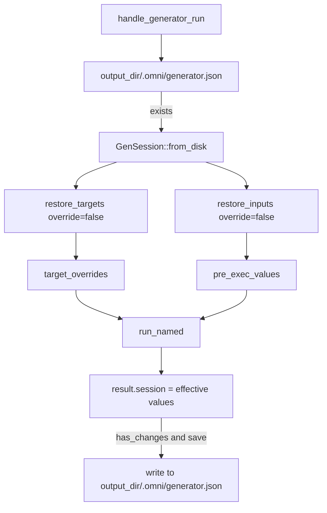
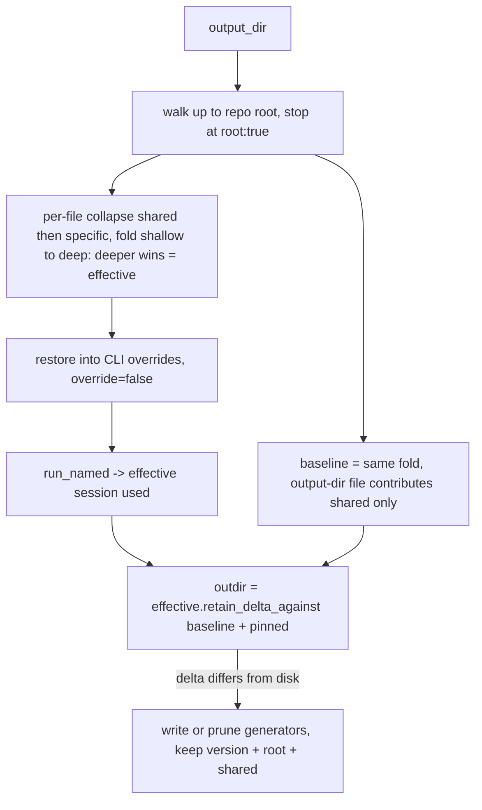

# RFC 0015: Hierarchical generator sessions (walk-up merge of `.omni/generator.json`)

- **Status:** Implemented <!-- Draft | Accepted | Implemented | Superseded -->
- **Owner:** TBD
- **Date:** 2026-09-25 (revised 2026-09-26)
- **Affected crates/files:** `omni_api` (`operations/generator.rs`), `omni_generator` (`gen_session.rs`), `omni_cli_core` and `omni_mcp_core` (the `inherit_session` flag), generator e2e tests
- **Prior art referenced:** ESLint (`root`/cascade), Prettier, EditorConfig, Git config, Nx generator defaults

> **Revision 2 (2026-09-26).** The first implementation shipped a session file
> whose top-level keys were the `root` marker plus each generator name, spliced
> together with `#[serde(flatten)]`. That made `root` a reserved key that
> collides with a generator literally named `root` (accepted at the time as a
> "documented edge"). This revision removes that collision class entirely by
> nesting generator entries under an explicit `generators` key, and folds a
> previously out-of-scope feature — **shared session data applied across all
> generators** — into the same envelope. The on-disk format is **redesigned, not
> extended**, and now carries an explicit `version` tag (mirroring
> `LockfileData`): legacy files lack the tag and therefore fail to deserialize
> with a natural error rather than being read or silently dropped (pre-release
> break; see §5.3 and REQ-29/REQ-30). Decisions 14–24 record the new choices;
> superseded decisions are struck through in the log.

## 1. Summary

When a generator runs, omni restores remembered inputs and target overrides from
exactly one session file, `output_dir/.omni/generator.json`. This RFC makes
session restoration hierarchical. omni walks directories upward from the output
directory, collects every `.omni/generator.json` along the way, and merges them
so deeper files (closer to the output dir) win over shallower ancestors.
Explicit CLI overrides still win over everything. Saving stays anchored to the
output dir but becomes hierarchy-aware, so inherited values are not silently
flattened into the child.

The session file carries two kinds of remembered data: **per-generator** entries
(as today) and a **shared** block that provides input/target defaults to _every_
generator run beneath it. Within one file a generator-specific value overrides
the shared value; across the tree the nearer file wins. Both live inside a
versioned envelope (`{ version, root, generators, shared }`) that keeps generator
names in their own `generators` namespace, so no generator name — including
`root` — can ever collide with a reserved key.

## 2. Motivation / Problem

Session files exist so a re-run of a generator in the same directory
"remembers" the inputs and targets the user last chose. Today that memory is
strictly per-directory: two sibling output directories share nothing, and there
is no way to establish shared defaults for a subtree.

Concretely, a monorepo often wants "everything generated under `packages/` uses
these input defaults" or "this whole area targets `src/` for its primary
target." With a flat, single-file model the only options are to re-type the
inputs every time, pass them on the CLI, or copy a `.omni/generator.json` into
every leaf directory (which then drifts).

The motivating use case is concrete. When a workspace is first generated, its
root `.omni/generator.json` is seeded with global values. For a JS repo that is
the package scope (`@acme/…`), license, and author. Users then hand-edit or
extend that root session over time. Every subsequent `omni gen` run anywhere in
the repo should inherit those global values automatically, while still letting a
subtree or leaf override them. The session file is therefore a first-class,
human-editable defaults file, not just a machine-written cache.

The desired outcome: a user can drop a `.omni/generator.json` higher in the tree
to provide defaults for everything beneath it, while a deeper file (or the
output dir's own file) overrides those defaults for its subtree. This is the
same cascade / nearest-wins model users already expect from ESLint, Prettier,
EditorConfig, and `.gitconfig`.

Two further problems motivate this revision:

1. **Global values are not generator-specific.** The motivating root-session
   values — JS package scope (`@acme/…`), license, author — are not owned by any
   one generator; they apply to _every_ generator run in the subtree. Storing
   them under a single generator entry means every other generator has to repeat
   or re-derive them. A first-class **shared** block, applied to all generators
   and overridable by a generator-specific entry, is the natural home for them.

2. **The `root` key collides with a generator named `root`.** The first cut of
   this RFC put the `root` marker and every generator name side by side at the
   top level via `#[serde(flatten)]`, then reserved `root` as a non-generator
   name. Reserving names is a smell: it is a latent collision that must be
   remembered forever, and the shared block would add a second one. Nesting
   generator entries under an explicit `generators` key removes the whole class
   of problem — any string, including `root`, `version`, or `shared`, is a legal
   generator name.

## 3. Goals / Non-goals

### Goals

- Restore inputs and target overrides for a run by merging every
  `.omni/generator.json` from the output dir up to (and including) the workspace
  (repo) root, with deeper files overriding shallower ones.
- Never ascend above the workspace root: the walk is bounded to the repo, so
  files outside the workspace can never influence a run.
- Support a user-editable `root: true` marker in a session file that stops the
  upward walk at that file (ESLint-style), for subtrees that want to seal off
  inheritance before the repo root.
- Preserve the existing precedence guarantee: explicit CLI `--input`/`--target`
  values always win over anything restored from sessions.
- Provide an opt-out flag that disables the walk-up entirely and reverts to
  today's exact single-file behavior (read and write only the output dir's own
  `.omni/generator.json`).
- Keep persistence anchored to the output dir and never persist the merged or
  inherited session. A save writes only the values specific to the output dir.
- Treat ancestor session files as read-only during a run; user-authored global
  defaults (e.g. the repo-root session) are never rewritten or clobbered.
- Provide a **shared** block in the session file whose input/target values seed
  every generator run in the subtree, overridable by a generator-specific entry
  in the same file and by any nearer file.
- Keep the shared block user-authored and stable: a run reads it and folds it
  into the inherited baseline, but never rewrites it and never copies a shared
  value down into a per-generator entry.
- Restructure the on-disk format into a versioned envelope
  (`{ version, root, generators, shared }`) that namespaces generator entries,
  so no generator name can collide with a reserved key. The reserved-name rule
  is removed.

### Non-goals

- No new config surface on `workspace.omni.yaml`/`project.omni.yaml`; this is
  purely about the existing session file.
- No hierarchical merge for anything other than generator sessions (env,
  projects, tasks are out of scope).
- No change to how a generator's own declared `inputs`/`targets`/defaults work;
  this only concerns the session layer that sits above them.
- No CLI/prompt surface for _writing_ shared values this run; the shared block is
  hand-authored (or seeded once at workspace generation). Machine-writing shared
  data is deferred.
- No migration of legacy session files. The format is redesigned and
  pre-release; a legacy file (no `version` tag) fails to deserialize with a
  natural error and must be removed or re-created. The `version` tag is added
  now (Decision 20) so later format changes can migrate rather than break.

## 4. Background: current mechanisms

The generator session lifecycle spans two crates.

### 4.1 Restore (read): `omni_api::operations::generator`

`handle_generator_run` computes a single fixed path and reads it if present
(`crates/omni_api/src/operations/generator.rs` L178-201):

```rust
const GEN_DIR: &str = ".omni";
const GEN_FILE: &str = ".omni/generator.json";
let gen_output_dir = output_dir.join(GEN_DIR);
let session_file = output_dir.join(GEN_FILE);
...
if !req.ignore_session.unwrap_or(false)
    && sys.fs_exists_no_err_async(&session_file).await
{
    let session = GenSession::from_disk(session_file.as_path(), &sys).await?;
    session.restore_targets(&name, &mut target_overrides, false).await;
    session.restore_inputs_as_value_bag(&name, &mut pre_exec_values, false).await;
}
```

Verified facts:

- **Single location.** The path is `output_dir.join(".omni/generator.json")`.
  No session-discovery walk over `path.ancestors()` exists in the generator
  crates; the ancestor walks used for directory/root discovery live in
  `env_loader`, `omni_context::get_root_dir`, and `omni_collector` (the few
  other `.ancestors()` uses, in `transform_commons` and `transaction_sys`, are
  unrelated to sessions).
- **Session fills, CLI wins.** Both `restore_targets` and
  `restore_inputs_as_value_bag` are called with `override_existing = false`
  (`gen_session.rs` L193-248): a restored key is written only if the CLI did not
  already supply it. So today's precedence is `CLI > output-dir session`.

### 4.2 Save (write): the flatten trap

The value that gets persisted is `result.session`, built in
`omni_generator::run::run_internal` (`crates/omni_generator/src/run.rs`
L255-373):

- `targets` = `config.target_overrides.clone()`, and the API pre-populated
  `target_overrides` with the restored session targets. So the saved targets are
  `CLI ∪ restored-session`.
- `inputs` = the collected `values`, filtered to `remember: true` inputs. Those
  values were seeded from `pre_exec_values`, which the API pre-populated from the
  restored session.

It is written back to the output dir (`operations/generator.rs` L259-278):

```rust
result.session.write_to_disk(session_file.as_path(), &sys).await?;
```

The consequence that matters for this RFC: the saved session already contains
the effective (post-restore) values. Today that is harmless because there is
only one file. Once ancestors contribute values, a naive implementation would
copy every inherited value down into the child's own `.omni/generator.json` on
the first save, permanently flattening the hierarchy and defeating the feature.

### 4.3 Merge primitive that already exists

`GenSession::merge` (`gen_session.rs` L180-191) already implements
"other-wins" per-key merge across generators:

```rust
data.targets.extend(other_data.targets.clone());
data.inputs.extend(other_data.inputs.clone());
```

`extend` on the map means the argument overwrites existing keys. That is exactly
the "deeper wins" primitive we need, provided we fold in the right order.

### 4.4 Flow today



## 5. Proposed design

The API layer works with two explicit sessions, which is the clean structural
answer to "never persist the merged session":

- **`effective`** is the walk-up merge of the whole chain (deeper wins). It only
  seeds the run (restore into CLI overrides / prompt defaults). It is never written.
- **`outdir`** is the values specific to the output dir. It is the only session
  ever written, and always only to `output_dir/.omni/generator.json`.

All changes are localized to `handle_generator_run`, plus small additions to
`GenSession` (a `root` flag and a delta helper).

### 5.1 Hierarchical restore (with `root: true` stop)

Walk upward from the output dir, bounded at the repo root, stopping early at the
first file that declares `root: true` (inclusive). For each file, collapse its
`shared` block and its `generators[name]` entry into one per-generator view
(specific overrides shared, _within the file_). Fold shallow to deep so the
deepest file's view wins, producing `effective`:

```rust
// output_dir first, repo root last; bounded to the workspace.
let mut chain: Vec<PathBuf> = vec![];
for p in output_dir.ancestors() {
    // Keep walking while `p` is still inside the workspace, inclusive of the
    // root itself. `starts_with_path(p, ws)` is `p.starts_with(ws)`, so the
    // walk stops at the first ancestor above the repo root.
    if !starts_with_path(p, &workspace_dir) {
        break;
    }
    let f = p.join(".omni/generator.json");
    if sys.fs_exists_no_err_async(&f).await {
        chain.push(f.clone());
        // `root: true` seals the cascade: this file is the topmost consulted.
        if GenSession::is_root_marked(&f, &sys).await? {
            break;
        }
    }
}

let effective = GenSession::new();
for path in chain.iter().rev() {                   // topmost -> output_dir
    let file = GenSession::from_disk(path, &sys).await?;
    // Per-file collapse for THIS run's generator: shared first, then the
    // generator-specific entry overrides it. Yields one `DataImpl`.
    let resolved = file.resolved_for(&name).await;
    // Deeper file overwrites shallower (nearest-wins across the tree).
    effective.overlay_generator(&name, resolved).await;
}

// Provenance for the delta (Decision 13): the keys the caller explicitly provided
// THIS run are output-dir-specific by the user's action. Snapshot them BEFORE
// restore merges the session in (and, in the real handler, before `req.target` /
// `req.input_values` are moved into `target_overrides` / `pre_exec_values`), so
// they are never mistaken for inherited.
let pinned_inputs: UnorderedSet<String> = req.input_values.keys().cloned().collect();
let pinned_targets: UnorderedSet<String> = req.target.keys().cloned().collect();

// CLI still wins.
effective.restore_targets(&name, &mut target_overrides, false).await;
effective.restore_inputs_as_value_bag(&name, &mut pre_exec_values, false).await;
```

Resulting precedence, highest first: CLI override; then, walking from the output
dir upward, each file's generator-specific value, then that file's shared value,
before moving to the next file up; up to the topmost non-`root` ancestor or the
`root: true` file; then the generator's own defaults.

This is **depth-major, specificity-minor** (Decision 14): the nearest file that
sets a key wins, and within a single file a generator-specific value beats the
shared value. A shared value in a nearer file therefore overrides a
generator-specific value in a farther ancestor — the nearest explicit statement
wins, matching the ESLint/EditorConfig cascade. The alternative
(specificity-major: generator-specific anywhere beats shared everywhere) is
rejected because it lets a distant ancestor silently override a leaf's explicit
shared default. Because the collapse is per-file, the two blocks cannot be folded
independently; see §5.5.

`had_existing_session` becomes "did the chain contain at least one file".

### 5.2 Two-session save (never persist the merged session)

> This answers open point (3): yes, the two-session split is the right home for
> this. The `outdir` session is the only thing written, so the merged
> `effective` session can never leak to disk. The one honest caveat: to know
> which effective values are specific to the output dir, we still need the
> inherited baseline, the merge of the chain excluding the output dir's own
> file, because the run's collected values carry no provenance. So the two
> sessions do not remove the delta computation; they give it a clear owner.

The run returns `result.session` (the effective values used). Derive the
`outdir` session to persist by dropping everything the inherited baseline
already provides, except keys the caller explicitly pinned this run:

```rust
// baseline = the same per-file collapse + shallow->deep fold as `effective`,
// EXCEPT the output-dir file contributes ONLY its `shared` block, never its
// own `generators[name]` entry. So the baseline is "everything already provided
// for `name` without the output dir's own per-generator override".
result.session
    .retain_delta_against(&inherited_baseline, &pinned_inputs, &pinned_targets)
    .await;
```

The subtlety introduced by the shared block: the baseline must include the
output-dir file's _own_ `shared` values, or a run whose result equals a value the
user hand-wrote in that file's `shared` block would be copied down into
`generators[name]` — an intra-file flatten (see §6.5). The baseline is built
by collapsing every file for `name` (`shared ⊕ generators[name]`, deeper wins),
but for the output-dir file only its `shared` block is folded in:

```rust
let baseline = GenSession::new();
for path in chain.iter().rev() {
    let file = GenSession::from_disk(path, &sys).await?;
    let contribution = if path == &session_file {
        file.shared_dataimpl().await          // outdir file: shared only
    } else {
        file.resolved_for(&name).await         // ancestors: shared + specific
    };
    baseline.overlay_generator(&name, contribution).await;
}
```

`retain_delta_against` drops any non-pinned `(generator, key)` whose value equals
the baseline's, and drops a generator entry that becomes empty. Then:

- A leaf run where every value is inherited (and nothing was pinned) writes
  nothing.
- Overriding one input writes a one-key entry under `generators[name]`.
- A value the caller explicitly passed (`-v`/`-t`) is persisted even if it
  equals the inherited value. See "Explicit-value pinning" below.
- Ancestors are never touched. A user-authored repo-root session (package scope,
  license, whether under `shared` or a generator entry) is preserved verbatim and
  keeps being inherited.
- The output-dir file's own `shared` block and `root` marker are preserved across
  the save (read from `existing`, re-emitted); the run only ever rewrites
  `generators[name]`.

**Explicit-value pinning (Decision 13).** A pure value-equality delta cannot
tell "user accepted the inherited default" from "user explicitly chose a value
that happens to equal it". Dropping the latter would silently make the leaf
track future ancestor changes against the user's intent. Provenance is available
for free at the API layer on the request path: `req.input_values` and
`req.target` exist before restore merges the session in (see §5.1's
`pinned_inputs`/`pinned_targets` snapshot). Those keys are output-dir-specific by
the user's action, so they are never dropped, even when equal to the baseline.
This is consistent with "never persist the merged session", because explicit
values are not inherited. Accepted residual: an interactive answer that merely
re-types the inherited prefill is indistinguishable from accepting it, so it
still collapses. Full resolution is the deferred provenance-tracked collection
(option E in §6.6).

**Delta equality (resolved Q1).** The per-`(generator, key)` comparison uses
plain `PartialEq` on `OmniPath`/`serde_json::Value`, with no normalization. An
inherited-unchanged value is a clone of the baseline value (restore fills from
the merged session with `override_existing=false`, and `result.session.targets =
target_overrides.clone()`), so it compares equal trivially and is dropped. A
value that is textually different is by definition not the inherited clone. It
was typed by the user or produced by a generator default, so keeping it is
correct, not redundant. Filesystem canonicalization is deliberately avoided:
targets are relative/root-anchored (validated non-absolute), resolving them
would need a `RootMap` and could conflate `@workspace/x` with `@project/x`, and
`OmniPath` equality already treats the root token as significant.

**Write gate & idempotency (resolved Q2).** The save decision diffs the computed
delta against the on-disk outdir file, not `is_empty(delta)`. The on-disk outdir
file is itself a delta from prior runs, so this is an apples-to-apples
delta-vs-delta comparison that is idempotent (an unchanged re-run rewrites
nothing). Using `is_empty` as the gate would be a correctness bug: if the outdir
file already holds an override and the user reverts to the inherited value, the
delta becomes empty and an `is_empty` gate would skip the write, leaving the
stale override on disk to be restored next run. Instead:

```rust
result.session
    .retain_delta_against(&baseline, &pinned_inputs, &pinned_targets)
    .await;                                       // delta, in place
let existing = SessionFile::load(&session_file, &sys).await?; // or default
if delta.generators != existing.generators {
    // Prune only when the file would carry nothing a user cares about:
    // no per-generator entries, no shared block, no root seal.
    if delta.generators.is_empty()
        && existing.shared.is_empty()
        && !existing.root
    {
        prune(&session_file);                 // drop stale overrides entirely
    } else {
        write(SessionFile::V1_0_0(SessionFileV1_0_0 {
            root: existing.root,              // keep the cascade seal
            generators: delta.generators,     // the only thing the run rewrites
            shared: existing.shared,          // keep the hand-authored shared block
        }));
    }
}
```

Pruning an emptied file is new behavior (today's code never deletes a session).
`dry_run` short-circuits before any write or prune. This replaces the current
`!result.session.is_empty() && (…has_changes…)` conjunction in
`operations/generator.rs` with the diff above.

The output dir's own `root: true` marker and its `shared` block, if present, are
preserved across the save (both read from `existing` and re-emitted), so
persisting a delta or pruning generators never strips a user's cascade seal or
global defaults.

### 5.3 `GenSession` / on-disk format changes

The on-disk format is **redesigned** into a versioned envelope. Generator entries
move under an explicit `generators` key, a sibling `shared` block holds the
cross-generator defaults, and an internally-tagged `version` discriminant wraps
the whole thing exactly as `LockfileData` does. `#[serde(flatten)]` is gone —
that, plus the `generators` key, is what removes the reserved-name collision.

```rust
#[derive(Serialize, Deserialize)]
#[serde(tag = "version", rename_all = "kebab-case")]
enum SessionFile {
    #[serde(rename = "1.0.0")]
    V1_0_0(SessionFileV1_0_0),
}

impl Default for SessionFile {
    fn default() -> Self { Self::V1_0_0(SessionFileV1_0_0::default()) }
}

#[derive(Serialize, Deserialize, Default, PartialEq)]
struct SessionFileV1_0_0 {
    #[serde(default, skip_serializing_if = "is_false")]
    root: bool,
    #[serde(default, skip_serializing_if = "UnorderedMap::is_empty")]
    generators: UnorderedMap<String, DataImpl>,
    #[serde(default, skip_serializing_if = "DataImpl::is_empty")]
    shared: DataImpl,
}

// unchanged
struct DataImpl {
    #[serde(default)] targets: UnorderedMap<String, OmniPath>,
    #[serde(default, alias = "prompts")] inputs: UnorderedMap<String, serde_json::Value>,
}
```

On disk:

```json
{
    "version": "1.0.0",
    "root": false,
    "generators": {
        "react-lib": { "inputs": { "name": "widgets" } }
    },
    "shared": {
        "inputs": { "scope": "@acme", "license": "MIT", "author": "Acme" }
    }
}
```

`version` is always written; `root` is emitted only when `true`; empty
`generators`/`shared` are skipped, so a delta save stays minimal (an empty
session is just `{ "version": "1.0.0" }`). Because generator names live under
`generators`, **any** string — `root`, `version`, `shared`, `generators` — is a
legal generator name. The reserved-name rule (old REQ-16) is removed.

**Breaking change (no back-compat, fails loud).** Legacy files — the pre-0015
bare map `{ "<gen>": {…} }` and the 0015-rev1 flattened
`{ "root": …, "<gen>": {…} }` — carry no `version` tag, so the internally-tagged
enum fails to deserialize with a natural serde error (missing field `version`),
which propagates like any other read error. This is deliberate (OQ-1, Decision
24): a legacy file is neither read nor silently dropped; the user removes or
rewrites it. Note this means one legacy file anywhere in the consulted ancestry
aborts the run until it is fixed — acceptable pre-release and a forcing function
for cleanup. No migration is provided (REQ-30). Adding the `version` tag now
(Decision 20) is what makes future format changes migratable instead of a second
hard break. One serde constraint: because the tag is the enum discriminant,
`#[serde(deny_unknown_fields)]` cannot be combined with it (serde forbids that
pairing), so unknown keys inside an otherwise valid `1.0.0` file are ignored
rather than rejected.

**Internal `GenSession` redesign.** The in-memory session grows a `shared` slot
alongside the per-generator map. `root` and `version` stay file-level concerns
handled by `SessionFile` at the load/save edges (as `root` was before);
`GenSession` carries neither:

```rust
pub struct GenSession {
    inner: Mutex<GenSessionData>,   // { generators: Map<String, DataImpl>, shared: DataImpl }
}
```

New/changed `GenSession` surface:

- per-generator accessors (`set_target`/`get_input`/…) operate on
  `inner.generators`, unchanged in signature;
- `shared_*` accessors for the shared block (`get_shared_input_raw`,
  `set_shared_target`, …) used by hand-authoring/tests and by `resolved_for`;
- `resolved_for(name) -> DataImpl`: collapse `shared` then `generators[name]`
  (specific overrides shared) into one `DataImpl` — the per-file view used by the
  cascade;
- `shared_dataimpl() -> DataImpl`: clone the shared block (used to build the
  baseline contribution of the output-dir file);
- `overlay_generator(name, DataImpl)`: fold a resolved `DataImpl` into
  `inner.generators[name]` with deeper-wins (`extend`) semantics — the fold step
  of the cascade;
- `is_root_marked(path, sys)`, a cheap check used to stop the walk (reads the
  envelope's `root`);
- `retain_delta_against(&self, baseline, pinned_inputs, pinned_targets)`, which
  mutates `inner.generators` in place: it removes keys equal to the baseline
  (plain `PartialEq`) unless the key is pinned, then drops emptied generators.

The old `merge` (independent per-map extend) is **replaced** in the cascade by
`resolved_for` + `overlay_generator`, because folding `generators` and `shared`
independently cannot express the depth-major/specificity-minor rule (§5.1,
§5.5). `from_disk`, `has_changes`, `write_delta_or_prune`, and
`delta_differs_from_disk` all read/write via the versioned `SessionFile` envelope
so the `version`/`root` keys are never misread as a generator. See §6.5.

`retain_delta_against` is a pure, in-memory map operation over `inner.generators`
(no filesystem access, `shared` untouched), which is what makes it trivially
unit-testable (§9.1):

```
fn retain_delta_against(self, baseline, pinned_inputs, pinned_targets):
    data = lock(self.inner.generators)   # mutable:   Map<gen, {targets, inputs}>
    base = lock(baseline.inner.generators) # read-only: same shape

    # Snapshot keys because we mutate `data` while iterating.
    for gen_name in snapshot(data.keys()):
        entry = data[gen_name]
        base_entry = base.get(gen_name)

        if base_entry is None:
            # Ancestors provide nothing for this generator: every key here is
            # output-dir-specific. Keep the whole entry untouched.
            continue

        # Subtract inherited targets (PartialEq, no normalization; Q1/Decision 11).
        # A pinned key is output-dir-specific by the caller's action (Decision 13),
        # so it survives even when equal to the baseline.
        for key in snapshot(entry.targets.keys()):
            if key not in pinned_targets
               and base_entry.targets.get(key) == Some(entry.targets[key]):
                entry.targets.remove(key)

        # Subtract inherited inputs (same pinned exemption).
        for key in snapshot(entry.inputs.keys()):
            if key not in pinned_inputs
               and base_entry.inputs.get(key) == Some(entry.inputs[key]):
                entry.inputs.remove(key)

        # Prune a generator entry that became fully inherited.
        if entry.targets.is_empty() and entry.inputs.is_empty():
            data.remove(gen_name)
```

Invariants: it is subtractive only (it never adds keys, since `self` is the
effective run result, so baseline-only keys are irrelevant); an equal-to-baseline
value is dropped unless pinned (a pinned key is an explicit caller choice and
always persists); a value that differs survives (a real override); an emptied
generator entry is removed so the file shrinks. Complexity is O(total keys in
`self`) with one `base` lookup per key. The write/prune decision and `root`
preservation live in the save gate (§5.2), not here.

### 5.4 Opt-out flag (`inherit_session`)

Hierarchical restore is on by default; a flag turns it off. When disabled the
run behaves as today's single-file model: the walk-up over ancestors is skipped
and restore consults only `output_dir/.omni/generator.json`. That file's own
`shared` block still applies to the run — `shared` is a _within-file_ concept,
not cross-directory inheritance — so the run still collapses `shared ⊕
generators[name]` for that one file, and the baseline is that file's `shared`
block only (§5.2). With no ancestors and no output-dir `shared`, the delta
collapses to "write everything", matching pre-shared behavior.

The flag is threaded through all three request surfaces, mirroring the existing
tri-state `save_session`/`ignore_session` plumbing:

- `GeneratorRunRequest` (`omni_api`): `pub inherit_session: Option<bool>`, where
  `None` means the default (enabled).
- `GeneratorRunArgs` (`omni_cli_core`): a clap arg with
  `default_missing_value = "true"`, so bare `--inherit-session` enables it and
  `--inherit-session=false` disables it, identical in shape to `--save-session`
  and `--ignore-session`. There is no `--no-inherit-session` spelling: clap does
  not auto-generate one, and an `alias` cannot invert a value, so a negative
  flag would require a separate `ArgAction::SetFalse` arg. To stay consistent
  with the existing two flags, the tri-state `Option<bool>` is the sole surface.
- `GeneratorRunParams` (`omni_mcp_core`): `pub inherit_session: bool` with a
  `#[serde(default)]` that defaults to `true`, plus a schema description.

It is distinct from `--ignore-session`, and the two compose:

| `ignore_session` | `inherit_session` | Restore behavior                                    |
| ---------------- | ----------------- | --------------------------------------------------- |
| false (default)  | true (default)    | Walk-up merge, deeper wins (this RFC)               |
| false            | false             | Read only the output-dir session (today's behavior) |
| true             | (any)             | No session read at all; `inherit_session` is moot   |

Disabling inheritance likewise reverts the save path to the single-file model,
so the flag cleanly separates "is this bug mine or the new hierarchy's?" for
debugging and gives users a hard escape hatch.



### 5.5 Shared session data

The `shared` block is a `DataImpl` (targets + inputs) that provides defaults
to every generator run in the subtree it governs. It is the natural home for the
motivating global values (package scope, license, author): they belong to the
tree, not to one generator.

**Composition rule (Decision 14): depth-major, specificity-minor.** Resolve each
file independently to a per-generator view (`shared ⊕ generators[name]`, the
generator-specific entry overriding shared), then fold those views shallow-to-
deep so the nearest file wins. Equivalently, for a single key the precedence is:

1. CLI `--input`/`--target`
2. nearest file's `generators[name]`
3. nearest file's `shared`
4. next file up: its `generators[name]`, then its `shared`
5. … up to the topmost consulted file (`root: true` or workspace root)
6. the generator's own declared default

Why depth-major and not specificity-major (generator-specific anywhere beats
shared everywhere): the latter lets a distant ancestor's per-generator value
silently override a `shared` default the user wrote _right next to_ the output
directory, breaking the nearest-wins expectation the whole cascade is built on.
Within a single file, specificity is the only sensible tiebreaker, and it
matches "a more specific setting overrides a general one."

This rule is why `generators` and `shared` cannot be folded independently across
the tree (§5.3): independent folds lose the per-file association and collapse to
specificity-major. The implementation therefore collapses per file
(`resolved_for`) before folding (`overlay_generator`).

**Saving never writes `shared`.** A run operates on one generator and only ever
rewrites `generators[name]`. The `shared` block is hand-authored (or seeded
once at workspace generation, out of scope here) and is preserved verbatim across
every save and prune (§5.2). Because the inherited baseline includes the output-
dir file's own `shared` block, a run value equal to a shared value is dropped
rather than duplicated into the per-generator entry — no intra-file flatten
(§6.5). A CLI/prompt surface for writing shared values is deferred (Non-goals).

## 6. Mandatory analysis

### 6.1 Existing mechanisms (reuse vs. extend vs. add)

Reuse-heavy. `GenSession::from_disk` provides load; the ancestor walk mirrors the
pattern in `omni_context::get_root_dir` and `env_loader` (both iterate
`path.ancestors()` and stop at the workspace/root file). The genuinely new code
is the two-session split, the redesigned versioned `SessionFile` envelope, the
`shared` block with its per-file collapse (`resolved_for` + `overlay_generator`,
which replace the old independent `merge` in the cascade), and the delta-on-save
helper. No parallel subsystem is introduced; the `version` discriminant reuses
the `LockfileData` internally-tagged-enum pattern directly.

### 6.2 Maintenance cost

Moderate. No new dependencies and no new config-file (`*.omni.yaml`) surface. The
on-disk session format is **redesigned** (breaking, pre-release): a versioned
internally-tagged envelope with explicit `generators` and `shared` keys, and
`#[serde(flatten)]` is dropped. Legacy files fail to deserialize loudly (no
`version` tag) rather than being migrated (REQ-30, Decision 24), so this must
land before any external adoption. The code additions are the walk loop, the
versioned envelope (de)serialization, the shared accessors +
`resolved_for`/`overlay_generator`/`shared_dataimpl`, `is_root_marked`, and
`retain_delta_against`, all unit-testable in the existing `gen_session` test
module. Invariants future contributors must preserve (assert all in tests):
saving persists the per-generator delta, never the effective values; a
`root: true` marker and the `shared` block both survive a delta save;
the write gate diffs the delta against the on-disk file (never `is_empty`), so a
revert-to-inherited prunes rather than leaving a stale override; the baseline
includes the output-dir file's own `shared` block so a run never flattens shared
into a per-generator entry. Versioning is now carried (not deferred), which is
the forward-compat obligation future format changes build on (Decision 20).

### 6.3 Testability

Because the delta approach carries an inherent baseline computation, correctness
rests on rigorous, enumerated coverage at three levels. All three must ship with
the feature.

**Unit tests for `GenSession`** (in `gen_session.rs`, using the `make_sys`
in-memory fixture):

- `resolved_for`: a file with only `shared` yields the shared values; a file
  with both yields `generators[name]` overriding `shared` per key; a file with
  neither for `name` yields empty.
- `overlay_generator` fold order: shallow to deep produces deeper-wins for
  overlapping keys; disjoint keys union; empty overlay is a no-op.
- cascade composition (depth-major, specificity-minor): a nearer file's `shared`
  value overrides a farther file's `generators[name]` value; within one file the
  generator-specific value wins.
- `retain_delta_against`:
    - key equal to baseline is dropped;
    - key absent from baseline is kept;
    - key present with a _different_ value is kept;
    - a generator whose every key is dropped is removed entirely;
    - independent generators are diffed independently;
    - targets and inputs are diffed independently;
    - the `shared` block is never touched by the delta.
- versioned `SessionFile` round-trip: envelope parses `{ version, root,
generators, shared }`; `version` always written; `root` omitted when false,
  emitted when true; empty `generators`/`shared` skipped on write; a legacy
  flat/bare-map file (no `version`) fails to deserialize with a natural error
  (not read, not empty).
- collision-freedom: a generator literally named `root` (also `version`,
  `shared`, `generators`) round-trips as an ordinary entry under `generators`.
- `is_root_marked` returns true/false correctly and does not error on a missing
  file (treated as absent).
- `root` and `shared` both survive a delta save: load a `root=true` file with a
  `shared` block, apply a per-generator delta, re-serialize, assert `root` and
  `shared` still present.

**Integration tests for restore/save precedence** (API-level, deterministic
fixtures):

A table-driven test over a synthetic tree `root/ a/ a/b/ a/b/c(=outdir)` asserting
the _effective_ restored values and the _persisted delta_ for each case:

| Scenario                                                                  | Expected effective                    | Expected written to outdir                                  |
| ------------------------------------------------------------------------- | ------------------------------------- | ----------------------------------------------------------- |
| only root sets `scope`                                                    | `scope` inherited                     | nothing                                                     |
| root sets `scope`, `c` overrides `scope`                                  | `c`'s `scope`                         | `{scope}` only                                              |
| mid `b` sets `x`, leaf adds `y`                                           | `x` inherited, `y` local              | `{y}` only                                                  |
| root `shared.scope`, leaf inherits it (no leaf entry)                     | shared `scope`                        | nothing                                                     |
| root `shared.scope`, leaf `generators[g].scope` overrides                 | leaf `scope`                          | `{scope}` under `generators[g]`                             |
| ancestor `generators[g].scope`, nearer file `shared.scope`                | nearer `shared.scope`                 | per leaf only (depth-major)                                 |
| leaf value equals its own file's `shared.scope`                           | shared `scope`                        | nothing (no intra-file flatten)                             |
| CLI `--input scope=z` over inherited `scope`                              | `z`                                   | `{scope: z}` (CLI is output-dir-specific)                   |
| CLI `--input scope=X` where inherited is also `X`                         | `X`                                   | `{scope: X}` (pinned: explicit value persists, Decision 13) |
| leaf value equals inherited value                                         | inherited                             | nothing (idempotent)                                        |
| leaf reverts a prior override to inherited (non-pinned, e.g. interactive) | inherited                             | outdir entry pruned; `shared`/`root` retained               |
| `b` marked `root:true`, root sets `scope`                                 | `scope` NOT inherited                 | per leaf only                                               |
| `--inherit-session=false`                                                 | only outdir file (incl. its `shared`) | full outdir per-generator delta                             |
| `--ignore-session`                                                        | nothing restored                      | fresh session                                               |
| no session files anywhere                                                 | generator defaults only               | per run result                                              |

**Idempotency and no-op guarantees** (explicit, because silent rewrites are the
risk):

- Re-running an unchanged leaf writes no file and does not touch ancestors
  (assert mtimes / write-count via the transaction sys).
- A run whose only values are inherited creates no outdir file.
- Reverting an override to the inherited value prunes the outdir file (or its
  generators) for the non-pinned (interactive) path; `dry_run` prunes nothing.
  A pinned `-v`/`-t` value instead persists (Decision 13).
- A `root:true`-only outdir file with an empty delta is left untouched.
- `has_changes`/`from_disk` parse a file with a top-level `root` key via the
  `SessionFile` envelope without misreading it as a generator.

**e2e** (`tests/omni-tests/src/generator.e2e.spec.ts`, per the omni-e2e-tests
skill):

- ancestor supplies a default a leaf inherits; leaf override wins; all-inherited
  leaf writes no file; CLI beats ancestor; `root:true` mid-tree seals
  inheritance above it; `--inherit-session=false` reverts to single-file
  read+write; `--ignore-session` reads nothing.
- PTY: interactive answers at the leaf persist only the delta.

**Cross-platform.** Run the precedence table on Windows CI to exercise
`starts_with_path` and the `.omni/generator.json` join on both path separators.

**Hard to test.** Interactive save-prompt combined with `had_existing_session`
interactions, covered by the existing PTY tests plus a CLI flag matrix.

### 6.4 Integration points

Entirely inside `handle_generator_run`
(`crates/omni_api/src/operations/generator.rs`): the restore block (L186-201)
and the save block (L259-278). `output_dir` and `workspace_dir` are already in
scope. `run_named`/`run_internal` are untouched. They still receive
`target_overrides`/`input_values` and still return the effective session; the
delta is applied at the API layer just before `write_to_disk`.

The opt-out flag touches three additional, mechanical seams that already carry
`save_session`/`ignore_session`: `GeneratorRunRequest` (`omni_api`),
`GeneratorRunArgs` (`omni_cli_core::commands::generator`, plus the
`GeneratorRunRequest { .. }` construction in `run_generator_run`), and
`GeneratorRunParams`/`tool_generator_run` (`omni_mcp_core`). No new plumbing
pattern is introduced.

### 6.5 Potential regressions

- **Flattening — across files (silent, severe).** Addressed by 5.2; without the
  delta step the feature copies inherited values down into the child on first
  save, corrupting the hierarchy. Must land together.
- **Flattening — within a file (silent).** New with the `shared` block: if the
  baseline excluded the whole output-dir file, a run value equal to that file's
  own `shared` value would be written into `generators[name]`, duplicating
  the shared default. The baseline must include the output-dir file's `shared`
  block (§5.2). Cover with the "leaf equals its own shared value writes nothing"
  test.
- **Cascade model inversion (silent).** Folding `generators` and `shared`
  independently across the tree collapses depth-major into specificity-major,
  silently letting a distant ancestor override a nearer `shared` default. The
  per-file collapse (`resolved_for`) before the fold prevents this; cover with
  the "nearer shared beats farther specific" test.
- **Precedence drift.** Fold order is load-bearing. Folding deep to shallow
  instead of shallow to deep silently inverts the cascade. Cover with an explicit
  order test.
- **Windows/path edges.** Reuse `starts_with_path` (already used by
  `omni_collector`) for the workspace-root bound rather than string compares.
- **Performance.** One extra `fs_exists` + read per ancestor level, bounded by
  workspace depth and run frequency (interactive, not hot-path). Negligible.
- **`--project` runs.** `output_dir` is the project dir; the walk stops at the
  workspace root, so a workspace-level `.omni/generator.json` (per-generator or
  `shared`) becomes a shared default for all projects. Desirable, but a behavior
  change worth documenting.
- **Format break (loud, by design).** The redesigned versioned envelope refuses
  legacy files: with no `version` tag the internally-tagged enum errors on
  deserialize, and that error propagates and aborts the run (OQ-1, Decision 24).
  This is intentional — no silent read, no silent drop — but note a single legacy
  file in the consulted ancestry fails every run beneath it until removed. Cover
  with a "legacy file errors, not empty" test so the failure is asserted, not a
  surprise. Generator names are no longer reserved — the `root`-named-generator
  edge is gone by construction.
- **`SessionFile` read path (parse regression).** `from_disk`, `has_changes`,
  `write_delta_or_prune`, and `delta_differs_from_disk` must all read/write via
  the versioned `SessionFile` envelope, or the `version`/`root` keys are
  misparsed. Covered by the round-trip and `has_changes`-with-envelope tests.
- **Stale-override revert (silent data bug).** The write gate must diff the delta
  against the on-disk file, not use `is_empty(delta)`. An `is_empty` gate would
  skip writing when a user reverts an override back to the inherited value,
  leaving the stale override on disk. Covered by an explicit "revert prunes the
  file" test.
- **Pruning.** Emptied outdir files are pruned only when they carry no `shared`
  block and no `root: true` seal (new behavior); ensure `dry_run` never prunes
  and that a `root:true`-only or `shared`-only file is retained.
- **Explicit value silently tracking ancestor (intent loss).** A pure
  value-equality delta would drop a caller-provided value that equals the
  inherited one, making the leaf follow later ancestor edits. The `pinned`
  exemption (Decision 13) keeps request-provided keys; covered by the
  "pinned value survives equality" test. Residual: interactive-typed-equal values
  still collapse (documented, deferred to option E in §6.6).
- **Determinism/caching.** Generator runs are not part of the task hash graph,
  so no cache-key impact.

### 6.6 Pros and cons

| Option                                                                                | Pros                                                                                                                     | Cons                                                                                                    | Verdict     |
| ------------------------------------------------------------------------------------- | ------------------------------------------------------------------------------------------------------------------------ | ------------------------------------------------------------------------------------------------------- | ----------- |
| A. Walk-up merge, deeper wins, two sessions + delta-on-save (recommended)             | Matches user request and familiar cascade model; DRY on disk; reuses the load/fold primitives                            | Save path needs the inherited baseline + delta step contributors must respect                           | ✅          |
| B. Walk-up merge, but save full effective values                                      | Trivial save path                                                                                                        | Flattens hierarchy on first save, defeating the feature                                                 | ❌          |
| C. Read-only cascade: merge on restore, never write to ancestors, save full leaf file | Simple                                                                                                                   | Leaf files accumulate inherited values, drift over time                                                 | ❌          |
| D. Nearest-file-wins (first match only, no merge)                                     | Simplest read                                                                                                            | No per-key inheritance; a deep file must repeat every inherited key                                     | ❌          |
| E. Provenance-tracked collection (populate `outdir` from user-supplied values only)   | Truly drops the baseline/delta; two sessions become independent                                                          | Threads provenance through `collect`/`run_internal`; changes `remember` path; larger regression surface | ⏸️ deferred |
| F. Shared block, depth-major (nearest file wins; specific beats shared within a file) | Matches nearest-wins cascade; a leaf `shared` default overrides distant ancestors as users expect                        | Needs per-file collapse before folding (cannot fold the two maps independently)                         | ✅          |
| G. Shared block, specificity-major (generator-specific anywhere beats shared)         | Folds `generators` and `shared` independently; trivial merge                                                             | A distant ancestor's specific value silently overrides a leaf's `shared` default; violates nearest-wins | ❌          |
| H. `$shared`/`$global` reserved key inside a flat generator map                       | No envelope nesting                                                                                                      | Reintroduces the reserved-name collision this revision exists to remove (a generator named `$shared`)   | ❌          |
| I. Versioned envelope `{ version, root, generators, shared }` (recommended)           | Namespaces generator entries so no name collides; explicit version enables real migration later; flat (no extra nesting) | Breaking format change (pre-release, acceptable); legacy files fail loud                                | ✅          |

### 6.7 Prior art and how omni improves on it

| Tool                  | Their approach                                                 | What to adopt                                                                   | What to change for omni                                                                                                                                                                                                            |
| --------------------- | -------------------------------------------------------------- | ------------------------------------------------------------------------------- | ---------------------------------------------------------------------------------------------------------------------------------------------------------------------------------------------------------------------------------- |
| ESLint (flat/legacy)  | Walk up, merge configs, nearest wins; `root:true` stops ascent | Directory cascade with nearest-wins per key **and** the `root:true` stop marker | Also bound at the repo root by default, so `root:true` is an optional seal, not the only stop; keep it a user-editable key in the existing JSON file                                                                               |
| EditorConfig          | Walk to `root=true`, deeper properties override                | Per-key override semantics                                                      | Reuse existing JSON session format rather than a new INI-like file                                                                                                                                                                 |
| Prettier              | Nearest config file wins (mostly whole-file)                   | Simple upward search                                                            | Do per-key merge, not whole-file replace, so partial ancestor defaults compose                                                                                                                                                     |
| Git config            | system, then global, then local layering, last wins            | Layered "deeper wins" fold                                                      | Layers are directory levels, not fixed scopes; anchor to output dir                                                                                                                                                                |
| Nx generator defaults | Central `nx.json` `generators` defaults                        | Idea of shared generator defaults                                               | The `shared` block realizes this directly — shared defaults for all generators — but keyed to the filesystem hierarchy (one `shared` per cascade level) instead of one central file, so defaults live next to the code they govern |

omni's improvement is combining the directory cascade (ESLint/EditorConfig) with
per-key merge over the already-existing session file, adding a `shared` block
(Nx-style shared defaults, but per cascade level) that all generators inherit,
and keeping the on-disk state minimal via delta-on-save so the hierarchy does not
drift out of sync. The versioned envelope keeps generator names in their own
namespace, avoiding the reserved-name pitfalls the config tools above accept.

## 7. Open questions

_None outstanding._ All prior questions are resolved:

- Delta granularity: plain `PartialEq`, no normalization (§5.2, Decision 11).
- `has_changes` semantics: diff the delta against the on-disk outdir file; do not
  gate on `is_empty` (§5.2, Decision 12).
- Cascade composition with `shared`: depth-major, specificity-minor (§5.5,
  Decision 14). The two models diverge only when a shallower file sets
  `generators[name].k` and a nearer file sets `shared.k`; nearest-wins is the
  premise of a directory cascade, so the nearer `shared` value wins.
- Envelope shape and reserved-name removal: flat
  `{ version, root, generators, shared }`, no `data` wrapper (§5.3,
  Decisions 15–17, OQ-2).
- `shared` carries both targets and inputs (full `DataImpl`), not inputs-only
  (Decision 21).
- The `effective`/`baseline` folds are computed for the run's single generator
  and collapse each file (`resolved_for`) before the shallow→deep overlay;
  folding `generators` and `shared` independently is forbidden (Decision 22).
- `--inherit-session=false` still honors the output-dir file's own `shared`
  block; the baseline is that file's `shared` only (§5.4, Decision 23).
- Format versioning: added now via an internally-tagged `version` enum mirroring
  `LockfileData` (§5.3, Decision 20).
- Legacy handling (OQ-1): no silent drop and no warning — a legacy file lacks the
  `version` tag and fails to deserialize with a natural error that propagates
  (§5.3, Decision 24).

## 8. Decision log

| #   | Decision                                                                                                                                                                                                                                                                 | Rationale                                                                                                                                                                                                                                   |
| --- | ------------------------------------------------------------------------------------------------------------------------------------------------------------------------------------------------------------------------------------------------------------------------ | ------------------------------------------------------------------------------------------------------------------------------------------------------------------------------------------------------------------------------------------- |
| 1   | Feature targets the existing session file `.omni/generator.json`, not a new defaults file                                                                                                                                                                                | Confirmed by owner: "it's the output of gen_session"                                                                                                                                                                                        |
| 2   | Walk up from `output_dir`, merge, deeper (more specific) wins                                                                                                                                                                                                            | Directly matches the request; mirrors ESLint/EditorConfig cascade                                                                                                                                                                           |
| 3   | CLI overrides still win over all session layers                                                                                                                                                                                                                          | Preserve current `override_existing = false` guarantee; least surprise                                                                                                                                                                      |
| 4   | On save, never persist the merged session; write only the output-dir-specific delta vs. the inherited baseline; ancestors are never rewritten                                                                                                                            | Owner: "on save it shouldn't persist the merged session"; preserves the DRY hierarchy and user-authored root defaults                                                                                                                       |
| 4a  | Repo-root session is a first-class, user-editable global-defaults file inherited by every run                                                                                                                                                                            | Owner use case: JS package scope etc. seeded at workspace generation and hand-edited thereafter                                                                                                                                             |
| 5   | Reuse `from_disk`; add `is_root_marked` + `retain_delta_against`; ~~reuse `GenSession::merge` (extend = deeper-wins)~~ **(superseded by 14/22: the cascade uses per-file `resolved_for` + `overlay_generator`, not raw `merge`)**                                        | Minimize new surface; ~~format change is additive only~~ **(superseded by 15/19: the format is redesigned and breaking)**                                                                                                                   |
| 6   | Bound the walk at the workspace (repo) root; never ascend above it                                                                                                                                                                                                       | Confirmed by owner ("respect the repo root"); consistent with `get_root_dir`/`env_loader`; keeps runs reproducible and blocks out-of-repo files                                                                                             |
| 7   | Add an opt-out flag `inherit_session` (default on) that reverts to single-file read+write; distinct from `--ignore-session`. CLI surface is the tri-state `Option<bool>` (`--inherit-session[=false]`) matching `--save-session`/`--ignore-session`; no `--no-` spelling | Owner: "add a flag to disable this behavior" + "go with A"; clap can't auto-negate and an alias can't invert, so a `--no-` form would need a separate `SetFalse` arg, rejected for consistency                                              |
| 8   | Model the API layer as two sessions, `effective` (merged, seeds the run) and `outdir` (delta, the only thing written), as a clarity/ownership device, not a mechanical simplification                                                                                    | Owner suggestion, then confirmed: two sessions do not remove the baseline/delta computation (the run carries no provenance); they only make the "never persist merged" invariant obvious and let `has_changes` compare in-memory            |
| 9   | Add a user-editable `root: true` marker (whole-file seal) that stops the upward walk; carried through load/write via ~~an additive `SessionFile` envelope~~ **the redesigned versioned `SessionFile` envelope (superseded by 15)**                                       | Owner: "root: true is good, user editable option"; whole-file scope confirmed by owner; matches ESLint/EditorConfig; preserved across delta saves                                                                                           |
| 10  | Keep the delta approach; defer provenance-tracked collection                                                                                                                                                                                                             | Owner: "delta approach with rigorous testing"; the delta is contained entirely in the API layer with no `omni_generator` core changes, at the cost of an inherent baseline computation covered by tests                                     |
| 11  | Delta equality is plain `PartialEq` on `OmniPath`/`serde_json::Value`; no normalization or path canonicalization                                                                                                                                                         | Inherited-unchanged values are clones, so they compare equal trivially; textually-different values are genuinely output-dir-specific and should persist; FS canonicalization would need a `RootMap` and could conflate distinct roots       |
| 12  | Write gate diffs the delta against the on-disk outdir file (delta-vs-delta), not `is_empty`; empty deltas prune the file; `root` is preserved; `from_disk`/`has_changes` read via `SessionFile`                                                                          | Gives idempotency; prevents the silent stale-override-on-revert bug; prevents the top-level-`root` parse regression                                                                                                                         |
| 13  | `retain_delta_against` never drops a key the caller explicitly provided this run (`req.input_values`/`req.target`), even if equal to baseline (explicit-value pinning); interactive-typed-equal values still collapse                                                    | Owner: "go with C"; provenance is free at the API layer for the request path; prevents an explicit value from silently tracking future ancestor edits; full interactive provenance deferred to option E in §6.6                             |
| 14  | Add a `shared` block that seeds every generator run in the subtree; compose depth-major, specificity-minor (nearest file wins; within a file a generator-specific value overrides shared)                                                                                | Owner: "new feature in scope (shared generator session)"; nearest-wins matches the rest of the cascade; specificity-major would let a distant ancestor silently override a leaf `shared` default (option G, §6.6)                           |
| 15  | Redesign the on-disk format to a flat versioned envelope `{ version, root, generators, shared }`; drop `#[serde(flatten)]`; generator entries live under `generators`. No `data` wrapper (OQ-2)                                                                          | Owner: "redesign the internal generator session data" + "remove the data wrapper"; namespacing generator entries under `generators` removes the reserved-name collision by construction; the flat shape drops cleanly into the version enum |
| 16  | Remove the reserved-name rule (old REQ-16); any string, including `root`/`version`/`shared`, is a legal generator name                                                                                                                                                   | Owner: "what if a generator is named root?"; the envelope makes generator names collision-proof, so no name needs reserving                                                                                                                 |
| 17  | Reject the `$shared`/`$global` special-key alternative (option H, §6.6)                                                                                                                                                                                                  | Owner asked whether a special name is better; it reintroduces the exact reserved-name collision class this revision removes (a generator named `$shared`), so structural separation wins                                                    |
| 18  | The `shared` block is read-only during a run: a run rewrites only `generators[name]`; `shared` (and `root`) are preserved verbatim across save/prune; the inherited baseline includes the output-dir file's own `shared` block                                           | Owner: "generator specific data still takes precedence" and shared is "mostly for user configurable data"; preserving shared and baselining against it prevents an intra-file flatten; machine-writing shared is deferred (Non-goals)       |
| 19  | Break the existing format with no backward compatibility and no migration                                                                                                                                                                                                | Owner: "okay to break the existing ones … since this is pre-release"; a migrationless break is cheapest pre-adoption                                                                                                                        |
| 20  | Add an explicit `version` tag now via an internally-tagged enum (`#[serde(tag = "version", rename_all = "kebab-case")]`, `1.0.0`), mirroring `LockfileData`                                                                                                              | Owner: "version should be added now"; carrying the tag from the start makes future format changes migratable instead of a second hard break; the tag also turns legacy files (no `version`) into a natural deserialize error                |
| 21  | The `shared` block carries both targets and inputs (a full `DataImpl`), not inputs-only                                                                                                                                                                                  | Inputs are the common case, but inputs-only is an arbitrary asymmetry and more code; shared targets apply by target-key name where generators declare matching keys                                                                         |
| 22  | The `effective` and `baseline` sessions are built for the run's single generator by collapsing each file (`resolved_for` = shared then generator-specific) before the shallow→deep overlay; folding `generators` and `shared` independently is forbidden                 | Only per-file collapse preserves depth-major (Decision 14); independent folds lose the per-file association and silently degrade to specificity-major                                                                                       |
| 23  | `--inherit-session=false` consults only the output-dir file but still collapses that file's own `shared` block; the baseline is that file's `shared` only                                                                                                                | `shared` is a within-file concept, not cross-directory inheritance; honoring it keeps single-file mode consistent with the new format instead of silently ignoring a hand-authored shared block                                             |
| 24  | Legacy files (no `version` tag) fail to deserialize with a natural error that propagates; no silent drop, no warning (OQ-1). One legacy file in the consulted ancestry aborts runs beneath it until removed                                                              | Owner: "should return whatever error happens by default, no warning, no silent drop"; the `version` discriminant produces the error for free; failing loud is consistent with the RFC's anti-silent-failure stance                          |

## 9. Illustrative test sketches

Concrete examples of the coverage in §6.3, written in the project's existing
styles. Rust unit tests use the `InMemorySys` + `make_sys` fixture already in
`gen_session.rs`; e2e tests use the `makeWorkspace`/`runOmni`/`parseSession`
harness already in `tests/omni-tests/src/generator.e2e.spec.ts`. These are
sketches to illustrate intent, not final code.

> **Revision 2 note.** The sketches below predate the envelope redesign
> (Decision 15), the `shared` block (Decision 14), and the `version` tag
> (Decision 20). Their _intent_ still holds, but the on-disk shapes must be
> updated: `SessionFile` is now the internally-tagged versioned envelope
> `{ version, root, generators, shared }` (no `data` wrapper),
> `retain_delta_against`
> operates on `inner.generators`, `merge` in the cascade is replaced by
> `resolved_for` + `overlay_generator`, and §9.2's "legacy bare-map parses" case
> is inverted to "legacy file (no `version`) fails to deserialize with an error".
> The authoritative, up-to-date test list is §6.3, which adds the
> `shared`/collapse/collision-free cases.

### 9.1 Unit test: `retain_delta_against` (the delta core)

```rust
// `empty()` = no pinned keys, for brevity in the sketches below.
fn empty() -> UnorderedSet<String> { UnorderedSet::default() }

#[tokio::test]
async fn delta_drops_inherited_keeps_local_prunes_emptied() {
    // baseline = what ancestors provide.
    let baseline = GenSession::new();
    baseline.set_input("scaffold", "scope", &json!("@acme")).await.unwrap();

    // effective = run result: same `scope` (inherited) + a local `name`.
    let effective = GenSession::new();
    effective.set_input("scaffold", "scope", &json!("@acme")).await.unwrap(); // clone of inherited
    effective.set_input("scaffold", "name",  &json!("foo")).await.unwrap();

    effective.retain_delta_against(&baseline, &empty(), &empty()).await;

    // `scope` equals baseline & not pinned -> dropped; `name` is local -> kept.
    assert_eq!(effective.get_input_raw("scaffold", "scope").await, None);
    assert_eq!(effective.get_input_raw("scaffold", "name").await, Some(json!("foo")));
}

#[tokio::test]
async fn delta_pins_explicit_value_even_when_equal_to_baseline() {
    // Decision 13: `scope` equals the inherited value BUT was explicitly
    // provided this run, so it must survive (else it would silently track
    // future ancestor edits).
    let baseline = GenSession::new();
    baseline.set_input("scaffold", "scope", &json!("@acme")).await.unwrap();
    let effective = GenSession::new();
    effective.set_input("scaffold", "scope", &json!("@acme")).await.unwrap();

    let pinned_inputs = UnorderedSet::from_iter(["scope".to_string()]);
    effective.retain_delta_against(&baseline, &pinned_inputs, &empty()).await;

    assert_eq!(effective.get_input_raw("scaffold", "scope").await, Some(json!("@acme")));
}

#[tokio::test]
async fn delta_removes_generator_when_all_keys_inherited() {
    let baseline = GenSession::new();
    baseline.set_input("scaffold", "scope", &json!("@acme")).await.unwrap();
    let effective = GenSession::new();
    effective.set_input("scaffold", "scope", &json!("@acme")).await.unwrap();

    effective.retain_delta_against(&baseline, &empty(), &empty()).await;

    assert!(effective.is_empty().await); // whole `scaffold` entry pruned
}

#[tokio::test]
async fn delta_keeps_value_that_differs_even_if_textually_close() {
    // Q1: no normalization; `src` vs `./src` are different, so kept.
    let baseline = GenSession::new();
    baseline.set_target("g", "dest", OmniPath::new("src")).await;
    let effective = GenSession::new();
    effective.set_target("g", "dest", OmniPath::new("./src")).await;

    effective.retain_delta_against(&baseline, &empty(), &empty()).await;

    assert_eq!(effective.get_target("g", "dest").await, Some(OmniPath::new("./src")));
}
```

### 9.2 Unit test: `SessionFile` format compatibility and `root`

```rust
#[tokio::test]
async fn legacy_bare_map_parses_with_root_false() {
    let (sys, path) = make_sys();
    // A pre-feature file: bare `{ generator: { inputs, targets } }`.
    sys.fs_write(path, br#"{"scaffold":{"inputs":{"scope":"@acme"},"targets":{}}}"#).unwrap();

    let sf = SessionFile::load(path, &sys).await.unwrap();
    assert!(!sf.root);
    assert_eq!(sf.generators["scaffold"].inputs["scope"], json!("@acme"));
}

#[tokio::test]
async fn root_is_omitted_when_false_and_emitted_when_true() {
    assert!(!serde_json::to_string(&SessionFile::default()).unwrap().contains("root"));
    let sealed = SessionFile { root: true, ..Default::default() };
    assert!(serde_json::to_string(&sealed).unwrap().contains("\"root\":true"));
}

#[tokio::test]
async fn has_changes_reads_file_with_top_level_root_key() {
    let (sys, path) = make_sys();
    sys.fs_write(path, br#"{"root":true,"scaffold":{"inputs":{},"targets":{}}}"#).unwrap();
    // Must not error interpreting `root` as a generator.
    let session = GenSession::from_disk(path, &sys).await.unwrap();
    assert!(!session.has_changes(path, &sys).await.unwrap());
}
```

### 9.3 e2e: inheritance, override, precedence

The scaffold fixture's `subject` input is `remember: true` with default `world`
and renders `greeting.txt` as `Hello <subject>!`. Seed ancestor sessions with
`ws.write` and run the generator in a nested output dir.

```ts
it("a leaf run inherits an ancestor session value", async () => {
    const ws = makeWorkspace(scaffoldGeneratorSpec());
    // Repo-root global default (as if seeded at workspace generation).
    ws.write(".omni/generator.json", {
        scaffold: { inputs: { subject: "Alice" }, targets: {} },
    });

    const result = await runOmni(
        [
            "generator",
            "run",
            "-n",
            "scaffold",
            "-o",
            "packages/app",
            "--use-defaults",
        ],
        { cwd: ws.cwd },
    );

    expect(result).toHaveSucceeded();
    // Inherited `Alice`, not the generator default `world`.
    expect(ws.read("packages/app/src/greeting.txt")).toBe("Hello Alice!");
    // Delta is empty (value equals inherited) -> no leaf session written.
    expect(ws.exists("packages/app/.omni/generator.json")).toBe(false);
});

it("a leaf override wins and persists only the delta", async () => {
    const ws = makeWorkspace(scaffoldGeneratorSpec());
    ws.write(".omni/generator.json", {
        scaffold: { inputs: { subject: "Alice" }, targets: {} },
    });

    const result = await runOmni(
        [
            "generator",
            "run",
            "-n",
            "scaffold",
            "-o",
            "packages/app",
            "-v",
            "subject=Bob",
            "--use-defaults",
            "--save-session",
        ],
        { cwd: ws.cwd },
    );

    expect(result).toHaveSucceeded();
    expect(ws.read("packages/app/src/greeting.txt")).toBe("Hello Bob!");
    // Only the overridden key lands in the leaf file; root session untouched.
    const leaf = parseSession(ws.read("packages/app/.omni/generator.json"));
    expect(leaf.scaffold.inputs.subject).toBe("Bob");
    expect(
        parseSession(ws.read(".omni/generator.json")).scaffold.inputs.subject,
    ).toBe("Alice");
});
```

### 9.4 e2e: revert prunes, `root: true` seals, opt-out

```ts
it("an explicit -v value equal to the inherited value is pinned (persisted), not pruned", async () => {
    // Decision 13: `-v` marks the key output-dir-specific. Even though `Alice`
    // equals the inherited value, it is written to the leaf so the choice does
    // not silently track future ancestor edits. (The leaf previously held `Bob`.)
    const ws = makeWorkspace(scaffoldGeneratorSpec());
    ws.write(".omni/generator.json", {
        scaffold: { inputs: { subject: "Alice" }, targets: {} },
    });
    ws.write("packages/app/.omni/generator.json", {
        scaffold: { inputs: { subject: "Bob" }, targets: {} },
    });

    const result = await runOmni(
        [
            "generator",
            "run",
            "-n",
            "scaffold",
            "-o",
            "packages/app",
            "-v",
            "subject=Alice",
            "--use-defaults",
            "--save-session",
        ],
        { cwd: ws.cwd },
    );

    expect(result).toHaveSucceeded();
    expect(ws.read("packages/app/src/greeting.txt")).toBe("Hello Alice!");
    // Pinned: leaf file keeps `subject` (now `Alice`), it is NOT pruned.
    const leaf = parseSession(ws.read("packages/app/.omni/generator.json"));
    expect(leaf.scaffold.inputs.subject).toBe("Alice");
});

// NOTE: the genuine "revert-to-inherited prunes the file" case (Decision 12) is
// the NON-pinned path, e.g. an interactive answer that re-types the inherited
// value at a prompt pre-filled with the stale leaf override. That belongs in the
// PTY suite (`spawnOmniPty`), because any non-interactive `-v` pins the key and
// suppresses the prune. Sketch:
//
//   const pty = spawnOmniPty(["generator","run","-n","scaffold","-o","packages/app"], { cwd });
//   await pty.waitFor(/subject/i);   // prompt pre-filled with the leaf's "Bob"
//   pty.type("Alice"); pty.press("enter");   // revert to the inherited value
//   // ... confirm save ...
//   expect(ws.exists("packages/app/.omni/generator.json")).toBe(false); // pruned

it("`root: true` seals inheritance above the marked file", async () => {
    const ws = makeWorkspace(scaffoldGeneratorSpec());
    ws.write(".omni/generator.json", {
        scaffold: { inputs: { subject: "Alice" }, targets: {} },
    });
    // Mid-tree seal with no value of its own.
    ws.write("packages/.omni/generator.json", { root: true });

    const result = await runOmni(
        [
            "generator",
            "run",
            "-n",
            "scaffold",
            "-o",
            "packages/app",
            "--use-defaults",
        ],
        { cwd: ws.cwd },
    );

    expect(result).toHaveSucceeded();
    // `Alice` is above the seal -> NOT inherited -> generator default `world`.
    expect(ws.read("packages/app/src/greeting.txt")).toBe("Hello world!");
});

it("--inherit-session=false ignores ancestors (today's behavior)", async () => {
    const ws = makeWorkspace(scaffoldGeneratorSpec());
    ws.write(".omni/generator.json", {
        scaffold: { inputs: { subject: "Alice" }, targets: {} },
    });

    const result = await runOmni(
        [
            "generator",
            "run",
            "-n",
            "scaffold",
            "-o",
            "packages/app",
            "--use-defaults",
            "--inherit-session=false",
        ],
        { cwd: ws.cwd },
    );

    expect(result).toHaveSucceeded();
    expect(ws.read("packages/app/src/greeting.txt")).toBe("Hello world!");
});
```

### 9.5 What each sketch pins

| Sketch                             | Guards against                                                  |
| ---------------------------------- | --------------------------------------------------------------- |
| 9.1 delta drops/keeps/prunes       | flattening; wrong precedence; Q1 no-normalization               |
| 9.2 `SessionFile` compat           | legacy-file breakage; top-level-`root` parse regression         |
| 9.3 inherit / override             | the core cascade + "persist only delta"                         |
| 9.4 revert prune                   | the silent stale-override bug (Q2); non-pinned/interactive path |
| 9.4 pinned `-v` equal to inherited | explicit-value pinning (Decision 13)                            |
| 9.4 `root:true` seal               | Decision 9 stop-marker semantics                                |
| 9.4 `--inherit-session=false`      | Decision 7 opt-out equals today's behavior                      |
