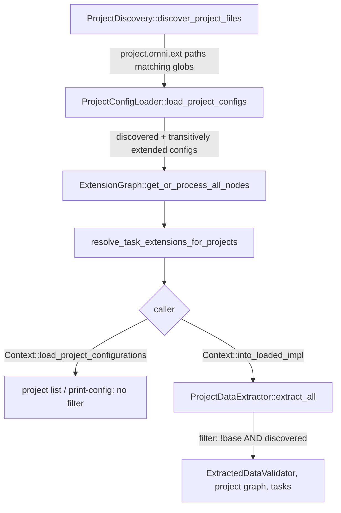
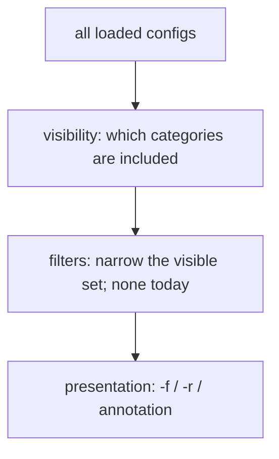

# RFC 0016: `project list` filtering and `print-config` selection

- **Status:** Implemented <!-- Draft | Accepted | Implemented | Superseded -->
- **Owner:** TBD
- **Date:** 2026-10-15
- **Affected crates/files:** `omni_context` (`context.rs`, `project_data_extractor.rs`, `project_config_loader.rs`), `omni_api` (`operations/project.rs`, `api.rs`), `omni_cli_core` (`commands/project.rs`), `omni_mcp_core` (`model/project.rs`, `tools/project.rs`, `tools/mod.rs`, `server.rs`), `tests/omni-tests`, `apps/site` command reference
- **Prior art referenced:** Lerna (`lerna list`), Nx (`nx show projects`), Turborepo (`turbo ls`), Cargo (`cargo metadata`), pnpm (`pnpm ls -r`)

## 1. Summary

`omni project list` currently prints every project configuration omni loads. That
includes templates marked `base: true` and files pulled in only because another
project `extends` them. Neither of those is a project you can run tasks against.
This RFC makes `project list` apply the same filter the task pipeline uses: only
non-base configs found by workspace discovery are listed by default. Two opt-in
flags, `--include-base` and `--include-extended`, add the hidden categories back,
and `--all` lists every loaded config. When any of these is passed, each entry is
annotated with its `base` / `discovered` attributes and its path. The MCP
`project_list` tool gets the same options. `project print-config` stays
unfiltered so it can still be used to debug inheritance. Two things change there:
a name matching more than one config is resolved deterministically (the runnable
project wins, and two runnable projects with the same name are an error), and a
new `--path` option selects a config by file path.

## 2. Motivation / Problem

`project list` and the task pipeline disagree about what a "project" is.

Reproduced against `target/debug/omni` with this layout:

```text
workspace.omni.yaml           projects: [child/**, apps/**, libs/**]
base.omni.yaml                name: base, base: true          (extended by child)
child/project.omni.yaml       name: child, extends ../base.omni.yaml
apps/app/project.omni.yaml    name: app, extends ../../templates/tpl.omni.yaml
templates/tpl.omni.yaml       name: tpl                        (outside globs)
libs/shared/project.omni.yaml name: shared-base, base: true
apps/svc/project.omni.yaml    name: svc, extends ../../libs/shared/project.omni.yaml
```

```text
$ omni project list -r -f json
["shared-base", "child", "base", "svc", "app", "tpl"]
```

Only `child`, `svc`, and `app` are real projects: they show up in `omni run`, can
be targeted with `-p`, and take part in the project graph. `base`, `shared-base`,
and `tpl` are inheritance sources. Listing them causes the following problems:

- Scripts that feed `project list` into other commands (`for p in $(omni project
  list -r); do omni run build -p "$p"; done`) hit names that don't resolve.
- The MCP `project_list` tool gives agents names that `task_run` / `hash_project`
  then reject, which wastes tool calls.
- Users can't tell from the output which names are templates.

Seeing templates is still useful when auditing inheritance, so they should be
hidden by default but still available on request.

## 3. Goals / Non-goals

### Goals

- By default, `project list` (CLI and MCP) returns exactly the set of projects the
  task pipeline considers runnable.
- `--include-base` adds every config marked `base: true`.
- `--include-extended` adds every config that was loaded only because something
  `extends` it and that workspace discovery did not find.
- `--all` lists every loaded config.
- When any of these flags is given, the output shows each entry's `base` and
  `discovered` attributes and its workspace-relative path.
- The default output format (plain names / JSON string array / TOML `projects`
  key) stays byte-for-byte compatible apart from which names appear and their
  order.
- The CLI listing and the task pipeline share one "is runnable" rule, so the two
  cannot drift again.
- When a name matches several configs, `project print-config <name>` picks the
  runnable project, and fails if two runnable projects share that name.
- `project print-config --path <PATH>` (and MCP `project_config` with `path`)
  selects any loaded config by its file, including configs a name can't reach.

### Non-goals

- Filtering `project print-config`. It keeps resolving any loaded config, by name
  or by path, including base and extended configs, so inheritance can be
  debugged.
- Running `ExtractedDataValidator` in `project list` (see decision 12).
- Narrowing filters (by tag, by task, by glob, affected-only). The composition
  model in §5.4 leaves room for them, but none are added here.
- Changing discovery or merge semantics. `extends` resolution changes in one way
  only: targets must stay inside the workspace root (§5.8).
- Changing `print-config`'s exit code for errors. It currently logs errors such as
  an unknown name and exits 0; the new duplicate-name error follows the same path.

## 4. Background: current mechanisms



Key facts the design relies on (verified in source and with the repro above):

- **Discovery only matches `project.omni.{ext}`.** `ProjectDiscovery`
  (`crates/omni_context/src/project_discovery.rs`) builds `CONFIG_FILES` from
  `constants::PROJECT_OMNI`. A file named `base.omni.yaml` can never be
  discovered; it is loaded only through `extends`.
- **The loader follows `extends` transitively.** In
  `ProjectConfigLoader::load_project_configs`
  (`crates/omni_context/src/project_config_loader.rs`), every `extends` target
  that has not been loaded yet is pushed onto `to_process`. Every loaded config is
  pushed into the result, whether or not it was discovered. Each file is loaded
  exactly once (see §6.5.3).
- **The graph returns every node.** `ExtensionGraph::get_or_process_all_nodes`
  (`crates/omni_core/src/extension_graph.rs:66`) returns all nodes in graph
  order. The node id is `ProjectConfiguration::file`
  (`crates/omni_configurations/src/project_configuration.rs:70`).
- **`project list` doesn't filter.** `handle_project_list`
  (`crates/omni_api/src/operations/project.rs:7`) maps
  `Context::load_project_configurations` (`crates/omni_context/src/context.rs:203`)
  straight to names. `handle_project_config` uses the same unfiltered source and
  returns the first name match (`Iterator::find`) in graph order.
- **The task pipeline does filter.** `ProjectDataExtractor::extract_all`
  (`crates/omni_context/src/project_data_extractor.rs:95`) keeps a config only if
  `!config.base && project_paths.contains(config.file.path())`, where
  `project_paths` are the discovered `DiscoveredPath::Real` files.
- **`base` doesn't inherit.** `ProjectConfiguration::base` uses
  `config_utils::replace` and is documented as "a non-inheritable structural
  marker" (`project_configuration.rs:30-38`). A project that extends a base config
  is therefore not itself base.
- **Duplicate-name validation only covers runnable projects, and only in the
  task pipeline.** `ExtractedDataValidator::validate_duplicate_project_names`
  runs over the extractor's filtered output inside `into_loaded_impl`. A base or
  extended config may legally share a name with a runnable project, and neither
  `project list` nor `print-config` runs the validator.
- **Callers.** `load_project_configurations` is called only by
  `handle_project_list` and `handle_project_config`. `OmniApi::project_list` is
  called by the CLI (`commands/project.rs:118`), the MCP tool
  (`omni_mcp_core/src/tools/project.rs:23`), and `omni_api/tests/integration.rs`.
- **Ordering is not guaranteed today.** `tests/omni-tests/src/project.e2e.spec.ts`
  compares sorted sets for this reason.

## 5. Proposed design

### 5.1 Classification

Every loaded config has two independent attributes:

| Attribute | Source |
|-----------|--------|
| `base` | `ProjectConfiguration::base` |
| `discovered` | `config.file` is one of the discovery results |

A config is **runnable** iff `discovered && !base`. This is the rule
`ProjectDataExtractor` already uses. The four combinations:

| `base` | `discovered` | Example | Runnable |
|--------|--------------|---------|----------|
| false | true | `child/project.omni.yaml` | yes |
| true | true | `libs/shared/project.omni.yaml` with `base: true` | no |
| true | false | `base.omni.yaml` | no |
| false | false | `templates/tpl.omni.yaml` | no |

Both attributes are exposed as they are, with no combined `kind`, so no
information is lost (decision 11).

### 5.2 One shared rule in `omni_context`

To keep the listing and the task pipeline from drifting, the rule lives in one
place:

```rust
// crates/omni_context/src/project_config_entry.rs (new, small)
pub struct ProjectConfigEntry {
    pub config: ProjectConfiguration,
    pub discovered: bool,
}

impl ProjectConfigEntry {
    pub fn is_runnable(&self) -> bool {
        self.discovered && !self.config.base
    }
}

pub(crate) fn is_runnable_project(
    config: &ProjectConfiguration,
    discovered: &UnorderedSet<&Path>,
) -> bool {
    !config.base
        && discovered.contains(config.file.path().expect("path should be resolved"))
}
```

- `ProjectDataExtractor::extract_all` replaces its inline closure with
  `is_runnable_project`. Behavior is unchanged.
- `Context` gets `load_project_config_entries() -> Vec<ProjectConfigEntry>`,
  which runs the existing discovery → load → graph → task-extension pipeline and
  tags each config with `discovered`.
- `Context::load_project_configurations()` stays as a thin wrapper
  (`entries.into_iter().map(|e| e.config)`).
- The discovery → load → graph → `resolve_task_extensions_for_projects` sequence
  is currently duplicated between `load_project_configurations` and
  `into_loaded_impl`. It moves into one private helper that returns
  `(Vec<ProjectConfiguration>, Vec<PathBuf> /* discovered */, ExtensionGraph)`,
  so both paths load configs identically. This refactor is small and is what
  actually prevents drift.

### 5.3 `omni_api`

```rust
#[derive(Debug, Clone, Default)]
pub struct ProjectListRequest {
    pub include_base: bool,
    pub include_extended: bool,
    pub all: bool,
}

#[derive(Debug, Clone, Serialize, Deserialize, JsonSchema)]
pub struct ProjectListEntry {
    pub name: String,
    /// Workspace-relative, `/`-separated path to the config file.
    pub path: String,
    pub base: bool,
    pub discovered: bool,
}

impl OmniApi<..> {
    pub async fn project_list(
        &self,
        req: ProjectListRequest,
    ) -> eyre::Result<Vec<ProjectListEntry>>;
}
```

- `handle_project_list` calls `load_project_config_entries`, applies §5.4, maps
  each entry to `ProjectListEntry`, and sorts by `(name, path)`.
- `path` is `config.file` relative to the workspace root and normalized to `/`,
  so output is the same on Windows and Unix. It is the config file path rather
  than the directory, because extended configs are often plain files such as
  `base.omni.yaml` that share a directory with other configs.
- `handle_project_config` switches to `load_project_config_entries` for
  disambiguation (§5.6) but still searches every config.

### 5.4 Flag composition

The flags fall into three groups, and each group combines in one fixed way:



1. **Visibility** flags only *add* categories, so they combine with OR:

   ```text
   visible(entry) =
          all
       || runnable(entry)
       || (include_base     && entry.base)
       || (include_extended && !entry.discovered)
   ```

   - `--all` is defined as "every loaded config", not as a shorthand for the
     current list of `--include-*` flags. If a new hidden category is ever added,
     `--all` covers it automatically and its meaning stays the same.
   - `--all` combined with `--include-*` is allowed and simply redundant: no
     clap conflict, no warning. Scripts can add `--all` without first removing
     other flags.
   - There are deliberately no `--exclude-*` visibility flags. Allowing visibility
     flags to both add and remove would make the result depend on flag order.
     Anything that removes entries belongs to the filter stage.
2. **Filters** (none in this RFC; future examples `--with-task build`,
   `--tag web`) narrow the visible set and combine with AND, both with each other
   and with visibility. So `--all --with-task build` means "every loaded config
   that has a `build` task".
3. **Presentation** (`-f`, `-r`) is independent of both. Annotation is switched on
   by *any* visibility flag (`--include-base`, `--include-extended`, `--all`), so
   the output shape depends on the flags, never on the data (decision 6).

A base config outside the globs (`base.omni.yaml`) appears under
`--include-base`, `--include-extended`, or `--all`.

### 5.5 CLI

```text
omni project list [-r] [-f json|yaml|toml] [--include-base] [--include-extended] [--all]
```

| Flags | text | json / yaml | toml |
|-------|------|-------------|------|
| none | `name` per line (unchanged) | array of names (unchanged) | `projects = [..]` (unchanged) |
| any visibility flag | `name  tags  path`, columns aligned | array of `{name, path, base, discovered}` | `[[projects]]` tables |

In text mode, `tags` is a readable rendering of the two booleans: `project` when
runnable; otherwise a comma-separated list built from `base` (if `base`) and
`extended` (if `!discovered`).

`--all` on the §2 layout:

```text
app          project        apps/app/project.omni.yaml
base         base,extended  base.omni.yaml
child        project        child/project.omni.yaml
shared-base  base           libs/shared/project.omni.yaml
svc          project        apps/svc/project.omni.yaml
tpl          extended       templates/tpl.omni.yaml
```

### 5.6 `print-config` disambiguation

`print-config` still searches every loaded config. When more than one config has
the requested name:

1. **Two or more runnable projects match:** `print-config` fails with a
   `duplicate project name` error listing every matching path and suggesting
   `--path` (§5.6.1), and prints no config. This mirrors
   `ExtractedDataValidator`'s duplicate check, so
   `print-config` never silently picks one of two projects that `omni run` would
   reject. The check covers only the requested name; duplicates elsewhere in the
   workspace do not affect `print-config <name>`. It reuses the existing
   "no project named … found" error path, so the exit-code behavior is the same
   as for an unknown name.
2. **Exactly one runnable project matches:** it is printed. Any base or extended
   configs with the same name are ignored without a warning, because the runnable
   project is clearly the one users mean.
3. **No runnable project matches:** the base/extended candidates are sorted by
   `path` and the first is printed. If there is more than one, a warning lists the
   other matching paths and suggests `--path` (§5.6.1) for selecting one.

The full `ExtractedDataValidator` does not run here (decision 12). Only this
targeted duplicate check does, because it needs nothing beyond the
already-loaded configs.

### 5.6.1 Selecting a config by path

Ranking by name can't tell apart two same-named templates, and a runnable
project always hides a same-named template. So `print-config` also accepts an
explicit path:

```text
omni project print-config <NAME>
omni project print-config --path <PATH>
```

- Exactly one of `<NAME>` and `--path` is required. Clap enforces this with a
  required `ArgGroup`, so passing both or neither is a usage error (exit code 2).
- `--path` is an explicit flag rather than a guess based on the shape of the
  positional argument. Project names may legitimately contain `/` (for example
  `@scope/pkg`), so any heuristic would misread some names.
- On the CLI, a relative `--path` is resolved against the **current directory**,
  as with any other shell path, so tab completion works. Absolute paths are
  accepted. Run from the workspace root, the `path` column printed by
  `project list` can be passed unchanged.
- The resolved path is lexically normalized (`path_clean::clean`, the same
  normalization the loader applies to `extends` targets) and matched against the
  `file` of every loaded config, whether discovered or extended.
- A path that is not one of the loaded configs is an error ("no loaded project
  configuration at …"), even if the file exists. A file outside the loaded set
  has no merged form, so printing it would be misleading.
- A path identifies exactly one config, so the duplicate rules above do not
  apply.

`omni_api` models this as a selector:

```rust
pub enum ProjectSelector {
    Name(String),
    /// Absolute; callers resolve relative input before building the request.
    Path(PathBuf),
}

pub async fn project_config(
    &self,
    selector: ProjectSelector,
) -> eyre::Result<ProjectConfiguration>;
```

### 5.7 MCP

- `project_list` switches from `tool_noargs` to
  `tool_typed::<ProjectListParams>`, dispatched with `call1`.
- `ProjectListParams { include_base, include_extended, all }`, all `bool` with
  `#[serde(default)]`. This follows the param pattern in `model/ignore.rs`, so
  calling with no arguments keeps working.
- `ProjectListResult` keeps `projects: Vec<String>` (names, now filtered) and adds
  `entries: Vec<ProjectListEntry>`. The schema is additive and the same
  regardless of params. MCP clients rely on a fixed output schema, so the CLI's
  flag-dependent shape is deliberately not copied here.
- The tool description becomes "List runnable projects in the workspace;
  optionally include base templates and extends-only configs".
- `project_config` gains an optional `path` next to `name`, and exactly one of
  the two is required (otherwise `invalid params`). MCP has no shell working
  directory, so a relative `path` is resolved against the **workspace root**.
  That matches the workspace-relative `path` in `project_list` entries, so an
  agent can pass an entry's path straight through. Both params become optional
  in the schema, so existing name-only calls keep working.

### 5.8 `extends` containment

`extends` targets were never checked against the workspace root. A project
could extend `../../../shared/base.omni.yaml`, and that file loaded and merged
normally; this was verified against `target/debug/omni`. Such a config has no
workspace-relative `path` to list, and pulling configuration from outside the
workspace also undermines the workspace being self-contained.

`ProjectConfigLoader::load_project_configs` now rejects any `extends` target
whose resolved, lexically normalized path is not inside the workspace root. The
error names both the extending file and the target. This applies equally to
relative targets and to rooted (`@workspace/…`, `@project/…`) ones, since both
are resolved and cleaned before the check. As a result, every loaded config is
inside the root, and `ProjectListEntry::path` is always a plain
workspace-relative path.

The check is lexical, matching how the loader already resolves `extends`. A
symlink inside the workspace that points outside it is not detected.

## 6. Mandatory analysis

### 6.1 Existing mechanisms (reuse vs. extend vs. add)

- **Runnable rule:** `ProjectDataExtractor` already has it. It is moved into a
  named function and reused, not rewritten. The obvious alternative, building a
  full `LoadedContext` for `project list`, would apply the filter "for free", but
  it also runs env loading, extraction, and validation (§6.6 option B).
- **Discovery result:** already computed in `load_project_configurations` and
  then thrown away after loading. The design keeps it.
- **Request/response pattern:** `ProjectListRequest` follows the existing
  `EnvRequest` / `GeneratorRunRequest` request structs in `omni_api`.
- **MCP typed params:** follows `tool_typed` + `call1` with `#[serde(default)]`
  fields, as used by `ignore_sync`.
- **Nothing new is added alongside an existing mechanism.** The one new type,
  `ProjectConfigEntry`, is a pair of an existing config and a bool.

### 6.2 Maintenance cost

- No new dependencies and no config/schema changes (`workspace.omni.yaml` and
  `project.omni.yaml` are untouched).
- New public surface: three `project list` flags, a `print-config --path` option,
  three `project_list` MCP params, an optional `path` param on `project_config`,
  an `entries` result field, and `ProjectListRequest` / `ProjectListEntry` /
  `ProjectSelector` in `omni_api`.
- One more place has to keep up with the runnable rule if it ever changes (for
  example, if a project `enabled: false` flag is added). The shared
  `is_runnable_project` keeps that to a single edit.
- Adding a new hidden category later means adding its `--include-*` flag; `--all`
  needs no change because it is defined as "everything loaded".
- The `apps/site` command reference pages for `project list` and
  `project print-config` are generated (`gen:refdocs` from `omni declspec dump`)
  and must be regenerated after the CLI changes.

### 6.3 Testability

- **Unit (`omni_context`):** a table test for `ProjectConfigEntry::is_runnable`
  over all four `(base, discovered)` combinations. A context test using the
  temp-dir fixtures already used in `context.rs` (as in
  `test_task_extends_parent_inherited_base_task`) asserts that
  `load_project_config_entries` tags `discovered` correctly for each row of the
  §5.1 table.
- **Unit (`omni_api`):** `handle_project_list` filter and sort for each flag
  combination, including:
  - a base config outside the globs appearing under each of the three flags
  - `--all` combined with `--include-*` giving the same result as `--all` alone

  The existing `project_list_contains_alpha` integration test is updated to the
  new signature. `handle_project_config` tests cover:
  - runnable preferred over a same-named template, with no warning
  - two runnable projects with the requested name → `duplicate project name`
    error listing both paths, and no config printed
  - a duplicate elsewhere in the workspace not affecting an unrelated name
  - a warning when two templates share a name and no runnable project matches
  - `--path` selecting each of two same-named templates, and a template hidden
    behind a same-named runnable project
  - `--path` to an existing file that is not a loaded config → error
  - `--path` with `..` / `.` segments matching after normalization
- **Regression guard:** a test asserting that the names from
  `project_list(ProjectListRequest::default())` equal the project names in
  `LoadedContext` for the same fixture. This pins "same rule as the task
  pipeline" directly.
- **Loader:** `test_discovered_extendee_is_loaded_once` in `context.rs` (already
  added; see §6.5.3).
- **e2e (`tests/omni-tests`):** in `project.e2e.spec.ts`, using `extendsSpec()`
  (which already has a base `base.omni.yaml` plus `child`):
  - the default list is `["child"]`
  - `base` appears under each of `--include-base`, `--include-extended`, and
    `--all`
  - each format with a flag set has the object/table shape
  - output without flags is unchanged for `projectsWorkspace()`

  In `mcp.e2e.spec.ts`: no-arg call is filtered, params are honored, and
  `entries` is present. `project_config` resolves a workspace-relative `path`
  taken from a `project_list` entry, and rejects calls with both or neither of
  `name` / `path`.

  In `project.e2e.spec.ts` for `print-config`: `--path` resolves relative to the
  current directory when run from a subdirectory; passing both `<NAME>` and
  `--path` (or neither) exits with code 2.
- **Nothing hard to test.** Path normalization is the only platform-sensitive
  part and is covered by asserting `/` separators.

### 6.4 Integration points

- `omni_context::Context`: new `load_project_config_entries`, the shared loading
  helper, and `load_project_configurations` as a wrapper.
- `omni_context::ProjectDataExtractor::extract_all`: the filter closure becomes
  `is_runnable_project`. Ordering doesn't change: discovery still runs before
  loading, and the discovered set is still built from `DiscoveredPath::Real`.
- `omni_api::OmniApi::project_list`: signature change (takes a request, returns
  entries). It is crate-public, and all three callers are in this repo.
- `omni_api::operations::project::handle_project_config`: takes a
  `ProjectSelector`; ranked selection and the duplicate-runnable check for names,
  normalized file match for paths (§5.6, §5.6.1).
- `omni_cli_core::commands::project::PrintConfigArgs`: `project_name` becomes
  optional, a `--path` option is added, and both go in a required `ArgGroup`.
  The CLI resolves relative paths against the current directory before calling
  the API.
- `omni_cli_core::commands::project::ListArgs`: three `ArgAction::SetTrue` flags
  plus formatting.
- `omni_mcp_core`: tool registration in `tools/mod.rs`, dispatch in `server.rs`,
  and the model/handler in `model/project.rs` / `tools/project.rs`.
- **No hashing, caching, or execution involvement.** The listing is read-only and
  never touches the hasher or cache stores.

### 6.5 Potential regressions

1. **Visible behavior change (intentional).** Anyone relying on `project list`
   to enumerate templates will lose those names unless they add a flag. That is
   the point of this change, but it should go in the changelog as a behavior
   change. The repo's own e2e tests only use plain-project workspaces with
   `project list`, so none of them depend on base configs being listed.
2. **Ordering change.** Output becomes sorted by `(name, path)`. Order was never
   guaranteed and the tests already compare sets, so the risk is low. Sorting
   makes the output deterministic, which also helps diffs in CI.
3. **Duplicate-load bug — fixed.** If a *discovered* `project.omni.yaml` was
   `extends`-ed by another discovered project whose path sorts after it, the
   loader loaded it twice and the extension graph failed with `Node already
   exists`. This broke both `omni project list` and `omni run`. Cause:
   `to_process` is seeded with every discovered path, and an extendee was pushed
   again while its own seeded entry was still pending; nothing de-duplicated at
   pop time. Fixed in `ProjectConfigLoader::load_project_configs` by skipping a
   popped entry whose file is already loaded. Regression test:
   `context::tests::test_discovered_extendee_is_loaded_once`. The `discovered`
   tagging in this RFC relies on this one-config-per-file guarantee.
4. **Silent drift between listing and execution.** This is mitigated by the
   shared predicate, the shared loading helper, and the parity test in §6.3.
5. **Performance.** Building the discovered-path set costs one extra hash-set
   construction, O(n) in the number of discovered files. This is negligible next
   to config parsing on large monorepos.
6. **Duplicate names in listing.** With visibility flags on, a base or extended
   config and a real project can share a name, and both are listed. The path and
   attributes tell them apart. Without flags, only runnable projects are listed.
   Duplicate runnable names are still rejected by `omni run`; `project list` shows
   both rather than failing (decision 12).
7. **`print-config` selection change.** Previously the first match in graph order
   was printed, which could be a template that shadowed a real project, or one of
   two duplicate runnable projects. Now the runnable project wins, and duplicate
   runnable names are an error. Only workspaces with name collisions are
   affected; for those, the old result depended on load order. Workspaces with
   duplicate runnable names already fail `omni run`, so the new error surfaces a
   problem that was already there.
8. **Windows paths.** These are handled by `/` normalization of the relative
   path. Absolute paths are never printed. For `--path` input, both separators
   are accepted, because the path is built with `PathBuf` and matched after
   lexical normalization.
9. **`--path` and symlinks.** Matching is lexical, like the loader's own
   `extends` resolution. A path that reaches a config through a symlinked
   directory doesn't match the loader's recorded path and reports "no loaded
   project configuration". This fails loudly, not silently. Canonicalizing both
   sides would fix it, but it would change how the loader records paths and is
   out of scope.
10. **CLI and MCP resolve relative paths differently** (current directory vs.
    workspace root). Each matches its caller's natural frame of reference, and
    the two are the same when the CLI is run from the workspace root. Both
    behaviors are documented in the help text and the MCP schema description.
11. **Caching/determinism.** Not applicable: nothing here feeds a hash.

### 6.6 Pros and cons

| Option | Pros | Cons | Verdict |
|--------|------|------|---------|
| A. Shared predicate + `discovered` tagging in `Context`, filter in `omni_api` (recommended) | Same rule as the task pipeline; cheap (no env/extraction); `print-config` stays unfiltered; small diff | New small type; `OmniApi::project_list` signature changes | ✅ |
| B. List from `LoadedContext` (`into_loaded`) | Filter is automatic; validates duplicates/deps too | Loads env files and extracts every project just to print names; a broken env file breaks `project list`; can't show base/extended without going back to the raw configs anyway | |
| C. Filter only `base` in `handle_project_list` | Smallest diff | Still lists extends-only non-base configs such as `tpl`; duplicates the rule instead of sharing it | |
| D. Keep listing everything, only annotate | No behavior change | Doesn't solve the scripting/MCP problem in §2 | |

Flag naming:

| Option | Pros | Cons | Verdict |
|--------|------|------|---------|
| `--include-base` / `--include-extended` | Says what it does: adds categories to the result set; matches the MCP `include_*` params | Slightly longer | ✅ |
| `--show-base` / `--show-extended` | Short | "Show" suggests display detail rather than set membership | |

`--all` semantics:

| Option | Pros | Cons | Verdict |
|--------|------|------|---------|
| "Every loaded config" | Meaning never changes; covers future categories automatically | Output can grow when a new category is introduced | ✅ |
| Shorthand for today's `--include-*` flags | Output fixed forever | Silently stops meaning "all" once a category is added | |
| Mutually exclusive with `--include-*` | Prevents redundant input | Rejects harmless input; makes it harder to build commands in scripts | |

Entry attributes:

| Option | Pros | Cons | Verdict |
|--------|------|------|---------|
| `base` + `discovered` booleans | Lossless; maps directly onto the classification rule | Slightly less readable in JSON than one enum | ✅ |
| Single `kind` enum with precedence | One readable field | Loses that a base template is also extends-only | |

`print-config` path selection:

| Option | Pros | Cons | Verdict |
|--------|------|------|---------|
| Explicit `--path <PATH>`, with exactly one of name/path required | Unambiguous; no name can be misread | One more flag | ✅ |
| Positional arg treated as a path when it contains `/` or ends in `.omni.<ext>` | No new flag | Misreads names such as `@scope/pkg`; the behavior is hard to explain | |
| `path:` prefix on the positional arg | No new flag | Unusual syntax; clashes with names that start with `path:` | |

CLI `--path` base directory:

| Option | Pros | Cons | Verdict |
|--------|------|------|---------|
| Current directory | Shell-native; tab completion works | From a subdirectory, `project list` paths need adjusting | ✅ |
| Workspace root | `project list` paths always paste unchanged | Breaks tab completion and the expectations of every other path argument | |

### 6.7 Prior art and how omni improves on it

| Tool | Their approach | What to adopt | What to change for omni |
|------|----------------|---------------|-------------------------|
| Lerna `lerna list` | Hides `private` packages by default; `--all` shows them; `--long` adds version/path; `--json` | Hide non-actionable entries by default; an `--all` escape hatch | Separate category flags as well as `--all`, since omni has two independent reasons to hide a config; annotations turn on automatically with any visibility flag instead of needing `--long` |
| Nx `nx show projects` | Lists only real projects; narrows by `--type`, `--with-target`, pattern; `--json` | Default set = what the task runner can target; narrowing filters combined with AND | Nx has no template concept; omni separates visibility (adds) from filters (narrows) explicitly |
| Turborepo `turbo ls` | Lists workspace packages; `--output json` gives name and path | Including `path` in structured output | Also include `base` / `discovered`, since omni has non-package configs in the loaded set |
| Cargo `cargo metadata` | Separates `workspace_members` from all `packages` (deps included) | The idea that "loaded" ≠ "member" | Same split here (`discovered && !base` = member), exposed through flags instead of always returning both lists |
| pnpm `pnpm ls -r` | Lists workspace packages and their deps | Not much: a dependency tree is a different concern | Not applicable beyond confirming "members by default" |

What omni does differently from all of these: the default listing uses the
**same predicate as the executor**, so "listed" and "runnable" can't diverge.
Most of the tools above keep separate listing logic.

## 7. Open questions

None.

## 8. Decision log

| # | Decision | Rationale |
|---|----------|-----------|
| 1 | By default, list only `discovered && !base` configs | Matches `ProjectDataExtractor`, so listed names are exactly the names `run`/MCP accept |
| 2 | Keep `print-config` unfiltered | It is a debugging tool for inheritance; templates must remain inspectable |
| 3 | `--include-extended` means "configs reached only via `extends` and not discovered" | Requested semantics; the alternative ("show each project's extends chain") is a different feature |
| 4 | Visibility flags are additive ("either flag"); a base config outside the globs appears under either flag | Each flag answers a separate question ("show templates", "show non-discovered files") without requiring both |
| 5 | Name the flags `--include-base` / `--include-extended` (MCP: `include_base` / `include_extended`) | They change set membership, not display; names match across CLI and MCP |
| 6 | Annotate only when a visibility flag is passed; output shape depends on flags, not data | Keeps default output byte-compatible for scripts; output shape is predictable |
| 7 | MCP keeps `projects: Vec<String>` and always adds `entries` | Fixed, additive output schema for MCP clients |
| 8 | Sort output by `(name, path)` | Order was never guaranteed; deterministic output helps diffs and tests |
| 9 | Share the runnable rule and the loading pipeline between listing and execution | Prevents the drift that caused this issue |
| 10 | Fix the duplicate-load bug separately, first | Unrelated root cause; `discovered` tagging assumes one config per file. Done: `ProjectConfigLoader` skips already-loaded files at pop time |
| 11 | Entries carry `base` and `discovered` booleans, not a `kind` enum | Lossless; the text output derives readable tags from them |
| 12 | `project list` does not run `ExtractedDataValidator` | The validator needs full extraction (env files, cache info), so `project list` would fail on unrelated env errors; listing is most useful as a diagnostic precisely when a workspace is broken; `omni run` already reports these errors |
| 13 | Add `--all`, defined as "every loaded config"; redundant with `--include-*` and allowed alongside them | Stable meaning as categories are added; harmless combinations should not error |
| 14 | Flags fall into visibility (OR, add only), filters (AND, narrow only), and presentation; no `--exclude-*` visibility flags | Keeps results independent of flag order and leaves room for future filters |
| 15 | On a name collision, `print-config` prefers the runnable project; with no runnable match it picks the first by path and warns if there are several | Duplicate validation does not cover templates vs. projects; users mean the real project |
| 16 | `print-config` errors when two or more runnable projects share the requested name; the check covers only that name and uses the existing error path | Matches what `omni run` already rejects instead of silently picking one; checking only the requested name keeps it cheap and keeps unrelated duplicates from blocking debugging |
| 17 | `print-config` gains `--path <PATH>`; exactly one of `<NAME>` / `--path` is required | Lets users reach every loaded config, including same-named templates and templates hidden behind a runnable project; an explicit flag avoids misreading names that contain `/` |
| 18 | CLI resolves a relative `--path` against the current directory; MCP resolves `path` against the workspace root | Each matches its caller's frame of reference: shell users and tab completion on the CLI, `project_list` entry paths for MCP clients |
| 19 | A `--path` must match a loaded config (discovered or extended) after lexical normalization; anything else is an error | Only loaded configs have a merged form to print; lexical matching is the same rule the loader uses for `extends` |
| 20 | `extends` targets outside the workspace root are rejected (§5.8) | They were silently accepted; rejecting them keeps workspaces self-contained and guarantees every listed path is workspace-relative |
| 21 | `project_config` returns `ProjectConfigResponse { config, warnings }`; the CLI prints warnings to stderr, and MCP `ProjectConfigResult` gains `warnings` | Follows the existing `warnings: Vec<String>` response pattern (projection); keeps stdout clean for the printed config |
| 22 | Site reference pages are regenerated with `gen:refdocs` rather than edited by hand | They are generated from `omni declspec dump` |
