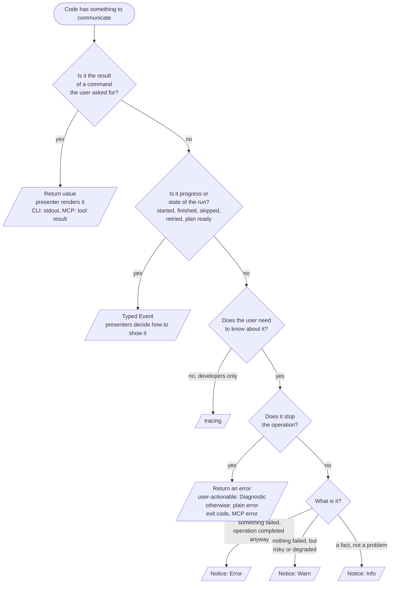

# RFC 0023: Events, diagnostics, notices, output and tracing

- **Status:** Draft <!-- Draft | Accepted | Implemented | Superseded -->
- **Owner:** TBD
- **Date:** 2026-11-03
- **Base branch:** `main`
- **Affected crates/files:** `omni_messages` (`notice.rs`, `publish.rs`: `NoticeEvent` built from a `Notice`, `notice!` and `diagnostic_notice!`; `channel.rs`, `tracing_impl.rs`; events extended); new `omni_codes` (canonical code registry, `explain`), `omni_notice` and `omni_notice_derive` (`Notice` trait and derive), `omni_derive_support` (shared derive logic); `omni_diagnostic` and `omni_diagnostic_derive` (register into `omni_codes`; the `Diagnostic` trait itself is unchanged); `omni_tracing_subscriber` (`LogFilter` and stdout layer removed); `crates/trace` removed and its ~177 call sites and ~40 `enable-tracing` features migrated to `tracing`; `omni_cli_core` (`subscriber.rs` (`CliSubscriber`) acts as the CLI presenter, `commands/*`, global flags); `cli/omni` (`lib.rs` tracing setup); `omni_mcp_core` (`subscriber.rs`, `model/*`, `tools/*`, `server.rs`); notice call sites in `omni_task_executor`, `omni_generator`, `bridge_rpc_runner`, `omni_execution_plan`; every crate that calls `log::*`; `clippy.toml`; `generators/crate` (`generator.omni.yaml`, `templates/Cargo.toml.tpl`, `templates/project.omni.yaml.tpl`, `templates/src/main.rs.tpl`); `services/omni_bridge_test_service`; `tests/omni-tests`
- **Follows:** RFC 0021 (structured diagnostics), whose 4.5 it resolves without changing it; RFC 0022 (redaction); PR #45 (notices); issue omni-oss/omni#47

## 1. Summary

omni has four overlapping ways to say something: `log::*`, `tracing::*`,
notices (`NoticeEvent`), and diagnostics (`omni_diagnostic`). None has a
written job, so the same kind of message goes through different channels
depending on who wrote it, and what a user sees depends on a log level rather
than on what they asked for. MCP clients see only errors.

This RFC gives each concern one owner and keeps them separate:

| Concern | Question it answers | Owner | Audience |
| --- | --- | --- | --- |
| **Events** | What happened? | Typed events in `omni_messages` | Presenters |
| **Diagnostics** | Why did the operation stop? | `omni_diagnostic` (RFC 0021). Fatal errors only | The user or agent |
| **Notices** | What should the user know, though the operation completed? | `omni_messages::notice`. Its own small model | The user or agent |
| **Output** | Where and how is it shown? | A presenter per surface | The user or agent |
| **Tracing** | Why did omni behave that way internally? | `tracing` | omni developers, bug reports |

- **Diagnostics are fatal errors and nothing else.** No severity, no info, no
  warnings. A diagnostic is returned, stops the operation, and is never
  downgraded. RFC 0021 is unchanged.
- **Notices are their own, simpler model**: a `Notice` type, derived, with a
  mandatory stable code, a fixed level, a message and typed fields. They are
  the one channel for everything non-fatal, delivered on CLI and MCP.
- **A notice can describe a diagnostic.** A `diagnostic_notice!` macro
  attaches a diagnostic's details and hints to a notice, so a condition is not
  described twice (4.3).
- **One canonical code list.** Diagnostics and notices register into a common
  `omni_codes` registry. Codes are unique across the whole application, and
  `omni explain` (CLI and MCP) and agent matching all use it (4.3).
- **`log` is retired as an API.** omni code uses `tracing` only, for developer
  output. Tracing is never user output.

## 2. Motivation / Problem

### 2.1 What each channel does today

| Channel | Volume | Actual use |
| --- | --- | --- |
| `log::*` | 193 calls (66 debug, 51 trace, 29 info, 24 warn, 24 error) | User output in the CLI, warnings from libraries, swallowed errors, developer detail |
| `tracing::*` | ~59 `instrument`, 3 event macros | Spans for developers |
| Notices | 11 sites | A few security warnings, plus run narration |
| Diagnostics | RFC 0021 errors | Fatal errors with codes, on CLI and MCP |

The tracing subscriber (`omni_tracing_subscriber`) writes to stdout at `info`
by default and uses `LogFilter`, which passes an event only if it came from
the `log` crate unless `--stdout-show-traces` is set. So today:

- "came from `log`" means "user output",
- "came from `tracing`" means "developer output",
- `CliSubscriber` prints notices with `log::*`, so they are just more `log`
  lines,
- `McpSubscriber::wants_notices` is `false`, so MCP sees no notices at all,
- and the user's verbosity switch is `-l/--stdout-log-level`.

### 2.2 Problems

1. **The crate you import decides the audience.** A contributor choosing
   between `log::warn!` and `tracing::warn!` is unknowingly choosing whether a
   user sees it.
2. **Results go to a logger.** `omni cache stats`, `omni init`, generator
   progress and task status are printed with `log::info!`. They pick up log
   formatting, are suppressed by `-l off`, and share stdout with whatever else
   is logged at `info`.
3. **Warnings depend on log level.** "OS sandbox is DISABLED" is a notice,
   rendered as `log::warn!`, so it disappears with `-l error`.
4. **MCP sees nothing non-fatal.** An agent cannot learn that a capability
   policy was ignored or that redaction is off.
5. **Notices have no contract and no identity.** `NoticeEvent` is documented
   as a replacement for `log::*`/`println!`, which invites narration. With no
   stable identity a user cannot ask what one means, and an agent cannot match
   one without parsing prose.
6. **Swallowed errors are invisible or noisy.** `log::error!` in a library
   that then continues (`omni_hasher`, `omni_cache`, `omni_setup`) prints a red
   line, or nothing, depending on level, and never reaches MCP.

## 3. Goals / Non-goals

**Goals**

- One rule per message kind that a contributor can apply without asking.
- Library crates never decide how something is displayed.
- The same information reaches CLI and MCP, in the form each surface needs.
- Notices are visible by default, independent of tracing configuration, and
  identified by a stable code that anyone can look up.
- Keep notices cheap to emit: a derived type of a few lines.
- Developer telemetry is complete, structured, and off the terminal by
  default.
- RFC 0022 redaction applies at every user-facing exit, in one place per
  surface.

**Non-goals**

- Changing RFC 0021 or the `Diagnostic` trait.
- Changing what a task process prints (task output is passed through).
- Source-span rendering (RFC 0021 4.6).
- OpenTelemetry export. It becomes easy (4.6) but is not proposed.
- Localisation. Messages are English. Stable codes and typed fields keep a
  later presenter-side translation possible; messages are whole templates, not
  concatenated fragments, so nothing blocks it.

## 4. Design

### 4.1 Where each kind of information goes



| Kind of information | Channel | CLI | MCP |
| --- | --- | --- | --- |
| Command result | Return value | stdout | Tool result |
| Fatal problem | Returned error; a Diagnostic when user-actionable | stderr, exit code from audience | JSON-RPC error with envelope |
| Non-fatal problem, risk, or fact | Notice | stderr, `error`/`warning`/`note` | `notices` array on the result, or `data.notices` on failure |
| Progress, run state | Event | stderr, rendered by presenter | Summarised into the result |
| Developer detail | `tracing` | Off by default, `--trace` to stderr, trace file | Never |

Rules:

- **Library crates contain no user-facing text sinks.** No `println!`,
  `eprintln!`, `log::*`, or terminal colors outside presenters. The only ways
  out to a user are a return value, an event, a returned error, or a notice.
- **Presenters contain no business logic.** They render values they are given.
- **Diagnostics are fatal; notices are not.** The two never mix:
  - A diagnostic is never reported through the notice channel as itself, and
    a fatal error is never downgraded. No flag or call site can turn a
    returned error into a notice.
  - If a user option makes a condition tolerable (`--meta-on-error exclude`),
    the run proceeds and a notice describes what happened. The notice has its
    own level and code and is not the fatal diagnostic.
- Notices reported before a later, unrelated fatal error are delivered
  alongside it (4.5), because they remain true about the run.
- Anything that does not need a message to the user is an event field or
  `tracing`, not a notice (the tests in 4.3).

### 4.2 Events

The existing `omni_messages` subscriber traits stay and become the only
progress channel. Events are data, not strings.

- `ExecutionPlanReadyEvent` gains `dry_run`, `remote_cache` and
  `redact_mode`, so "Dry run mode enabled" and "Remote caching enabled" are
  rendered by the presenter from state rather than logged.
- `TaskStartedEvent` gains `command: Option<String>`, set in dry runs
  (already redacted, RFC 0022). The CLI prints the familiar
  `Executing task '<id>': <command>` line from it; MCP returns it in
  `TaskExecutionSummary.command`.
- `TaskRetryingEvent` gains `delay`, replacing the retry-wait notice.
- Generator, `init`, cache and source operations get start/finish events
  where they currently log progress.

### 4.3 Notices and the code registry

#### Contract

> A **notice** is a message about *this run* that the person or agent who
> started it may want to know even though the operation completed, and that
> no event or result already carries.

A message earns a notice only if:

1. **Omitting it on one surface would mislead the user.** Otherwise it is
   `tracing`.
2. **It is conditional on something about this run** (a flag, config, env var,
   detected state). Unconditional narration is not a notice.
3. **No event, result field or returned error already carries it.**
4. **It can be given a code.** If it is not worth naming, it is an event field
   or `tracing`.

#### Levels

`NoticeLevel` is `Info | Warn | Error`. The level says how serious the message
is. It does not say whether the operation stopped: a notice never means that.

- `Error`: something failed, but the operation still completed (a cache entry
  could not be written, a hash file was recomputed, projects were excluded
  because their meta filter failed).
- `Warn`: nothing failed, but something is risky or degraded (security
  downgrade, ignored configuration, experimental feature in use).
- `Info`: a fact that is not a problem (a source was resolved from a fallback,
  or `notices.truncated`, which reports that notices were omitted). Rare.

The level is fixed by the notice type, so one code is never `Warn` in one place
and `Error` in another. A notice at any level never aborts the run and never
changes the exit status: it is reported and execution continues. (Failing a run
on chosen notices is deferred, section 9.)

#### The `Notice` trait and derive

A notice is a small derived type. Diagnostics stay as in RFC 0021.

```rust
pub trait Notice: fmt::Display + Send + Sync + 'static {
    fn code(&self) -> &'static str;
    fn level(&self) -> NoticeLevel;
    fn essential(&self) -> bool { false }
    fn fields(&self) -> BTreeMap<String, serde_json::Value>;   // from struct fields
}

/// OS-level sandbox is disabled.
///
/// The OS sandbox could not be enabled, so tasks run without kernel-level
/// isolation. Capability policies are still checked where possible.
///
/// Fix: run on a supported kernel, or set `sandbox.os: false` to acknowledge it.
#[derive(Notice)]
#[notice(code = "sandbox.os_disabled", level = warn, essential,
         message = "OS-level sandbox is DISABLED for this run")]
struct SandboxOsDisabled;

/// Could not write a cache entry. The task result is unaffected.
#[derive(Notice, Serialize)]
#[notice(code = "cache.write_skipped", level = error,
         message = "could not write cache entry for '{entry}'",
         related = "cache.write_failed")]
struct CacheWriteSkipped { entry: String }
```

The derive generates `Display` from `message`, `fields()` from the struct's
fields, and a registration into `omni_codes`. It rejects a code that is not
lowercase `snake_case` segments separated by dots (at least two), a missing
`level`, and a missing doc summary. A type implementing `Notice` does not
implement `Error`, and nothing converts between the two.

- `message` is one line, no ANSI, no trailing newline, a whole template (no
  concatenated fragments), so it can be translated later.
- Typed fields give machine-readable values (the import-scan note, the runtime
  name) without hand-built maps. Keys are `snake_case`.
- The derive adds no `target` field. The macro records the emitting module
  for the `tracing` mirror, not sent to MCP.

`NoticeEvent` stays the plain data that travels to subscribers. Presenters
decide quiet-mode filtering and the MCP bound from the event's own
`level` and `essential` fields, never by looking the code up in the registry, so the value
the emitter set cannot be overridden. `CodeInfo.essential` must equal
`Notice::essential()`; the derive generates both from the same attribute, and
a registry test fails if they differ.

`Notice` is **sealed**: it cannot be implemented by hand. The derive emits a
hidden marker impl the trait requires, so every `Notice` is a derived type,
is registered in `omni_codes`, and has its `code`, `level` and `essential`
generated from one attribute. A hand-written impl that reports a different
`code`, `level` or `essential` than the registry is therefore not
expressible, and the registry test covers every `Notice` type in the
workspace.

```rust
pub struct NoticeEvent {
    level: NoticeLevel,
    code: &'static str,                           // always present
    essential: bool,                              // from Notice::essential(); presenters read this
    message: String,
    fields: BTreeMap<String, serde_json::Value>,
    target: &'static str,
}

impl NoticeEvent {
    pub fn from_notice<N: Notice>(n: &N, target: &'static str) -> Self { .. }
    // read-only accessors for each field
}
```

The fields are private and `from_notice` is the only constructor, so an event
whose `(code, essential)` pair disagrees with its `Notice` cannot be built
(for example `sandbox.os_disabled` with `essential = false`). `notice!`,
`diagnostic_notice!` and the `Vec<NoticeEvent>` batch path all go through it.

#### Emitting

```rust
notice!(sub, SandboxOsDisabled);
notice!(sub, CacheWriteSkipped { entry: id.clone() });
diagnostic_notice!(sub, MetaFilterExcluded { count }, &meta_filter_error);
```

- `notice!` builds the event only when `wants_notices()` is true, so disabled
  surfaces pay nothing, including the construction of the value.
  `wants_notices()` reflects whether any consumer needs notices *collected*:
  a presenter or the `tracing` mirror. It is not a rendering decision.
  `-q/--quiet` (4.5) only changes what the presenter prints, so
  `wants_notices()` stays `true` in quiet mode and the trace mirror keeps
  working.
- `diagnostic_notice!(sub, notice, &diagnostic)` publishes `notice` and adds
  the diagnostic's `details()` and `hints()` to its `fields` under `details`
  and `hints`. The code, level and message come from the notice type; it never
  borrows the diagnostic's code. This is the only bridge between the two
  models, and it is one way: it does not convert a returned error into a
  notice, and a notice never becomes a diagnostic.
- It exists so a rich description (RFC 0020's meta filter error, with counts
  and samples) is built once. A call site that returns an error does not also
  report it.
- A site that returns notices to a caller for batch publishing
  (`capability_plan.rs`, `script_runner.rs`) returns `Vec<NoticeEvent>`.
- Every published notice is mirrored as a `tracing` event at the matching
  level, with its code, so trace files stay complete.

#### One canonical code registry

A new crate `omni_codes` holds the only list of codes. It has no dependency
on `eyre`, `omni_messages` or either derive.

```rust
pub enum CodeKind { Error, Notice }

pub struct CodeInfo {
    pub code: &'static str,
    pub kind: CodeKind,
    pub summary: &'static str,          // first doc line
    pub explanation: &'static str,      // rest of the doc comment
    pub related: &'static [&'static str],
    pub level: Option<NoticeLevel>,     // notices
    pub essential: bool,                // notices
    pub audience: Option<Audience>,     // errors
    pub deprecated: bool,
}
```

- `omni_diagnostic` keeps its registry API, `Diagnostic` trait and
  `find_in_error`. Its derive additionally registers each type into
  `omni_codes` with `kind = Error`. The `Diagnostic` trait does not change.
- `omni_notice`'s derive registers with `kind = Notice`.
- **The registry owns its metadata types.** `NoticeLevel` and `Audience` are
  defined in `omni_codes` (so the dependency points one way: `omni_diagnostic`
  and `omni_messages` depend on `omni_codes`, never the reverse) and
  re-exported from their current paths (`omni_messages::NoticeLevel`,
  `omni_diagnostic::Audience`), so existing imports keep working.
- **`NoticeLevel` serialises lowercase** (`#[serde(rename_all = "lowercase")]`:
  `"info"`, `"warn"`, `"error"`). This is the wire format used by MCP and
  `--format json` output, pinned by a test. The type is not serialised
  anywhere today, so there is no existing consumer to break.
- Registration uses the mechanism `omni_diagnostic` uses today, moved into
  `omni_codes`.
- `omni_derive_support` is a plain library (a proc-macro crate cannot export
  non-macro items) holding what both derives share: code format validation,
  `message` template to `Display`, doc-comment extraction, registration
  emission, and `related`. `omni_diagnostic_derive` and `omni_notice_derive`
  are thin wrappers.

**Codes are unique across the whole application, regardless of subsystem.**
`omni explain`, docs and agent matching take a bare code with no subsystem
context, and a code is a public contract.

- The first dotted segment names the owning subsystem (`cache.*`, `sandbox.*`,
  `meta.*`, `capabilities.*`). A crate declares the prefixes it owns, and the
  registry test fails if a code uses a prefix its crate does not own.
- A code appears once, as `Error` or `Notice`. A duplicate fails the registry
  test in CI and panics at startup in debug builds. `omni explain` therefore
  never has to choose between two entries.
- A condition that exists as both an error and a notice gets two codes with
  `related` links (`meta.filter_failed` and `meta.filter_excluded`). The test
  checks that each `related` target exists.
- Codes are permanent. Renaming or removing one is breaking. A retired code is
  marked `deprecated` and never reused for a different meaning, so an old
  reference in a script, doc or an agent's notes cannot silently match
  something new.

**Documentation lives in the registry entry, not on the traits.** The derives
read the `///` doc comments on the type: the first line is `summary`, the rest
is `explanation`. A long explanation can use
`#[notice(explain = include_str!(..))]` (or the diagnostic equivalent), which
takes precedence. A missing summary is a compile error. `omni explain <code>`
and the generated docs page read the registry, and the same text appears in
rustdoc.

`omni explain <code>` prints kind, summary, explanation, level or audience,
`essential`, and `related` codes (for example `omni explain
meta.filter_failed` points to `meta.filter_excluded`). `--format json` prints
the same fields. An unknown code is an error that lists close matches. It is
also available to agents over MCP (4.5). `omni explain` works for error codes
and notice codes alike.

#### Essential notices

- An `essential` notice is never hidden by `-q` (which otherwise hides `warn`
  and `info` notices) and is always delivered over MCP (exempt from the
  bound): `sandbox.os_disabled`, `redact.disabled`. This
  follows from RFC 0022's rule that loosening protections must stay visible.
- **Essential notices are static.** The derive rejects `essential` on a type
  that has fields or a `message` with placeholders, so every emission of an
  essential code is identical. That is what lets MCP deduplicate essential
  notices by code alone without discarding data.
- Per-code allow/deny of notices, and failing a run on a notice, are not part
  of this RFC (section 9, deferred).

### 4.4 Audit of current sites

Each surviving site becomes a derived `Notice` type named after its code
(`redact.disabled` is `RedactDisabled`, and so on).

| Site | Now | After |
| --- | --- | --- |
| `executor.rs`: redaction disabled | notice Warn | Notice Warn `redact.disabled`, essential |
| `executor.rs`: dry run enabled | notice Info | Event field (`ExecutionPlanReadyEvent.dry_run`) |
| `batch_executor.rs`: `Executing task '<id>': <command>` | notice Info | Event field (`TaskStartedEvent.command`) |
| `batch_executor.rs`: `Executing task '<id>'` | notice Info | Removed (narration) |
| `batch_executor.rs`: waiting before retry | notice Warn | Event field (`TaskRetryingEvent.delay`) |
| `capability_plan.rs`: OS sandbox disabled | notice Warn | Notice Warn `sandbox.os_disabled`, essential |
| `capability_plan.rs`: policy not fully enforced | notice Warn | Notice Warn `capabilities.not_enforced` |
| `capability_plan.rs`: no un-bypassable floor | notice Warn | Notice Warn `capabilities.no_floor` |
| `script_runner.rs`: policy declared but feature off | notice Warn | Notice Warn `capabilities.ignored` |
| `script_runner.rs`: import-scan note | notice Warn | Notice Warn `capabilities.import_scan`, note in `fields` |
| `run_javascript.rs`: experimental runtime | notice Warn | Notice Warn `runtime.experimental` |

From the `log` triage (4.7):

| Site | Now | After |
| --- | --- | --- |
| `execution_plan_provider.rs`: tolerated meta filter errors | `log::warn!` | `diagnostic_notice!` with Error notice `meta.filter_excluded`, carrying the RFC 0020 details. The fatal `meta.filter_failed` is unchanged and `related` |
| `omni_projections/ledger.rs` | `log::warn!` | Notice Warn `projections.*` |
| `commands/env.rs`: missing variable | `log::warn!` | Notice Warn `env.var_missing` |
| `omni_cache`, `omni_hasher` recovered errors | `log::error!` | Notice Error (for example `cache.write_skipped`) when the user's result is affected; otherwise `tracing` |

### 4.5 Output: presenters

Each surface has one presenter that owns all user-visible text. "Presenter"
is a role, not a new type or trait: it is the existing subscriber type for
that surface (`CliSubscriber`, `McpSubscriber`), which already implements
`NoticeSubscriber`, `ExecutionEventSubscriber` and `GeneratorEventSubscriber`.
The types keep their names. It is unrelated to `MuxOutputPresenter` and
`TuiPresenter` in `omni_term_ui`, which render task output inside the TUI and
are unchanged.

#### CLI

| Stream | Content |
| --- | --- |
| stdout | Command results and passed-through task output, nothing else |
| stderr | Status lines rendered from events, the `indicatif` bar and generator spinners, notices, the final error, developer traces when enabled |

The alternate-screen TUI is the exception: it owns the whole terminal on
stdout. What each `--ui` mode draws, and where omni's own lines go:

| `--ui` | Draws | Task output | omni's own lines and notices |
| --- | --- | --- | --- |
| `stream` | nothing | live on stdout | written directly to stderr |
| `progress` | `indicatif` bar on stderr | captured, replayed per `--output-logs` | printed through the bar (`suspend`/`println`) |
| `tui` | alternate screen on stdout | per-task screens | buffered (`emit_buffer`) and flushed after teardown |
| `auto` | resolved at plan time | | `tui` for interactive or persistent tasks on a TTY, `progress` on a TTY otherwise, `stream` when not a TTY |

Notices follow the same per-mode routing as lifecycle lines. Today
`on_notice` writes straight to the terminal in `tui` mode while lifecycle
lines are buffered, which can corrupt the alternate screen; the presenter
routes both the same way.

- `CliSubscriber` writes directly to the terminal (through the existing
  mux/progress handling), not through `log`.
- Commands (`cache`, `init`, `project`, `env`, `generator`) return data; the
  command layer renders it on stdout.
- Notices print as

  ```text
  warning[sandbox.os_disabled]: OS-level sandbox is DISABLED for this run
    = run `omni explain sandbox.os_disabled` for details
  error[cache.write_skipped]: could not write cache entry for 'app#build'
  note[source.fallback]: resolved 'templates' from the fallback source
  ```

  A returned diagnostic keeps the RFC 0021 layout.
- **Processing order (CLI).** For each notice: redact (RFC 0022), then
  apply quiet filtering, then collapse repeats, then render.
  - Redaction happens first, so grouping keys on the redacted message and two
    notices that differ only in a secret collapse into one.
  - Repeats are identical `(code, message)` after redaction among notices
    that are still to be shown. Groups keep first-occurrence order (no
    sorting) and print once, with the count appended as ` (xN)`, for example
    `warning[cache.write_skipped]: could not write cache entry for 'app#build' (x3)`.
    A group of one has no suffix.
- **`-q/--quiet` replaces the log-level flags for user output.** It hides
  omni's own narration, and never what the user asked for, what failed,
  what needs a response, or a safety signal. For any line: if hiding it would
  lose a result, a failure, a decision or a safety signal, `-q` shows it.
  Invariants:
  1. Rendering only. Events and notices are still emitted and collected; exit
     status, MCP, the tracing mirror and `--trace` are unaffected.
  2. It is a presenter setting (a field on `CliSubscriber` passed through
     `resolve_subscriber`). Subsystems never see it, and MCP has no
     equivalent.
  3. It never rewrites another flag. `--output-logs` is untouched, an
     explicit `--ui` is respected, and only `auto` resolves differently.
  4. The summary-table gate that today reads `log::log_enabled!` becomes an
     explicit read of this setting.

  | Text | Under `-q` |
  | --- | --- |
  | Command results, dry-run command lines | Shown |
  | Task stdout/stderr, including cached replay | Shown, governed by `--output-logs` |
  | Final error, failed-task output | Shown |
  | Prompts | Shown |
  | Notices that are `essential` or level `error` | Shown |
  | Notices at level `warn` or `info` | Hidden |
  | Lifecycle lines (plan header, task started or finished, generator action lines) | Hidden |
  | Spinner and progress bar | Not drawn |
  | Summary table | Shown only if a task failed |
  | Interactive and persistent task UI | Shown |

  | `--ui` | Under `-q` |
  | --- | --- |
  | `stream` | Task output, failures, and `essential` or `error` notices only |
  | `progress` (explicit) | Capture and replay kept, so output timing is unchanged, but no bar or spinner is drawn |
  | `tui` (explicit) | Unchanged |
  | `auto` | `stream`, or `tui` when interactive tasks exist, never `progress` |

  There is no separate `--no-progress`: `--ui stream` and `-q` cover it.
- **Tracing while a TUI or bar is live.** `--trace` writes to stderr, which
  would corrupt the bar or the alternate screen. While either is live,
  stderr traces are buffered and flushed after teardown (or suppressed);
  `--trace-file` is the supported route for traces during such a run.
- **Generators.** `generator run` always uses the stream subscriber, so
  `--ui` does not apply. Spinners are drawn on stderr (probed with
  `ProgressDrawTarget::stderr`) and only for depth-0 actions. The non-TTY
  fallback that is `log::info!` today becomes status lines written to stderr
  by the presenter. Notices during a live spinner print through
  `multi.suspend`/`println`, and notices from sub-generators still print.
  Under `-q` there are no spinners or action lines, while failed actions, the
  final error and `essential` or `error` notices still show. Prompts
  (`requestty`) are never suppressed.
- Redaction (RFC 0022) is applied once, in the presenter, to every string it
  writes that came from a notice, event or diagnostic.

#### MCP

- `McpSubscriber` returns `true` from `wants_notices()`. It
  processes each notice in a fixed order: **redact, then deduplicate, then
  bound**. Redaction (RFC 0022) comes first, so two same-code messages that
  differ only in a secret deduplicate into one entry and use one slot of the
  bound. It collects notices per
  request (non-essential bounded at 50, deduplicated by
  `(code, message, fields)`, redacted) next to the per-task log capture. `essential`
  notices are **exempt from the bound** and are deduplicated by `code` alone
  (every emission of an essential code is identical, because the derive
  requires a fixed message and no fields, so nothing is lost), so each
  essential code appears at most once and the number of essential entries is
  fixed by the registry. An
  essential notice arriving after the cap is reached is still delivered and
  never evicted. The maximum `notices` length is therefore 50 plus the number
  of essential codes, plus one truncation entry. When the bound is hit, the
  presenter appends one final entry reporting how many were dropped. It is a
  derived notice (`NoticesTruncated { dropped }`, declared `code =
  "notices.truncated", level = info`, not `essential`, since it carries a
  field), emitted at most once per request, after the 50 retained ones, and
  exempt from the bound, so an agent is never handed a capped array without
  being told. `dropped` counts unique `(code, message, fields)`
  notices omitted *after* deduplication, so repeats of an already retained
  notice collapse first and do not count. The key uses the canonical
  redacted form of `fields`: object keys are sorted recursively at every
  nesting depth, arrays keep their order (it is meaningful), and the result
  is serialised compactly, so two notices with the same
  message but different field values both reach the agent:

  ```json
  { "level": "info", "code": "notices.truncated",
    "message": "12 further notices were omitted", "fields": { "dropped": 12 } }
  ```
- Every tool result that runs engine code gains

  ```json
  "notices": [
    { "level": "warn", "code": "capabilities.ignored",
      "message": "...", "fields": { } }
  ]
  ```

  omitted when empty. `target` is not sent. Agents match on `code`.
- On failure, the RFC 0021 error payload carries notices collected before the
  failure under `data.notices`.
- `ToolRunResult.result` is the tool's own return value and stays untouched;
  `notices` is a sibling field.
- The notice payload and its codes are a documented, versioned part of the
  MCP interface. Adding fields is non-breaking; renaming a code or removing a
  field is breaking.
- **Explanation on demand.** An `explain` MCP tool takes a code and returns
  the same fields as `omni explain --format json`, for error and notice codes
  alike, and the catalog is also exposed as the resource
  `omni://codes/<code>`. An agent reads an explanation when it needs one
  instead of receiving it in every response.
- Events stay internal to MCP and are summarized into results
  (`TaskExecutionSummary`, `GeneratorRunResult`). Streaming notices or events
  as MCP notifications is a later, additive change.
- MCP never receives tracing output. Because stdout carries JSON-RPC, `omni
  mcp` **rejects at startup** a `--trace-file` that resolves to stdout
  (`/dev/stdout`, `/dev/fd/1`, `/proc/self/fd/1`, or the inherited stdout
  device) with an error, and its stdout trace layer stays off. The CLI keeps
  `/dev/stdout` as the user's explicit choice (4.6); MCP does not.

### 4.6 Tracing

`tracing` is developer telemetry: spans for structure and timing, events for
detail. It is never the way a user is told something.

- **One API.** omni crates use `tracing::{trace,debug,info,warn,error}!` and
  `#[instrument]`. All `log::*` calls are migrated. A `clippy.toml`
  `disallowed_macros` entry for `log::*` and for `println!`/`eprintln!`
  outside the crates that act as presenters (`omni_cli_core`, `omni_mcp_core`,
  `omni_term_ui`) keeps it that way.
- **The `trace` wrapper crate is retired.** It was meant to compile tracing
  out of a build, and it does not do that:
  - `default = ["enabled"]` is on for every crate, nothing sets
    `default-features = false`, and the ~40 `enable-tracing` features only
    enable what is already on.
  - Building it with `--no-default-features` fails (`tracing` is an optional
    dependency but `_trace_impl`, `Level` and `instrument` are unconditional
    re-exports). The disabled `event_enabled!` and `span_enabled!` lack `=>`,
    the disabled `enabled!` calls `tracing`, and the disabled `if_enabled!`
    does not accept the `;`-separated statements its callers use.
  - `#[instrument]` is re-exported ungated, so spans were never compiled out.
  - `if_enabled!` is a compile-time feature gate, not a runtime check, and
    leaks its `let` bindings into the surrounding scope.

  `tracing` already provides both halves: disabled callsites cost one cached
  atomic check, and `tracing`'s `max_level_*` / `release_max_level_*` features
  cap levels at compile time for events and spans alike. So omni code uses
  `tracing::*` directly, `crates/trace` and the `enable-tracing` features are
  removed, and a release level cap, if wanted, is one workspace-level
  `tracing` feature. The four `if_enabled!` sites change:
  - `bridge_rpc_core/bridge/bridge_impl.rs` (two): use
    `.instrument(tracing::info_span!(..))` unconditionally.
  - `omni_term_ui/mux_output_presenter/tui_presenter.rs` (two): create and
    enter the span unconditionally.
  - Where a value is costly to compute only for tracing, use
    `tracing::enabled!` (a runtime check) instead.
  If a size-constrained or wasm target needs tracing absent, `tracing`'s
  `max_level_off` provides it.
- **The crate generator is updated** so new crates start in the new shape
  (`generators/crate`):
  - `Cargo.toml.tpl`: with `use_tracing`, depend on `tracing = { workspace = true }`
    only. Drop `trace`, the optional `tracing`, the `[features]` block with
    `enable-tracing`, and `log`.
  - `project.omni.yaml.tpl`: drop the `dependencies: - trace` entry.
  - `generator.omni.yaml`: the `use_tracing` prompt stays but now only adds
    the `tracing` dependency (and the dev-dependencies already gated on it).
  - `templates/src/main.rs.tpl`: the `println!` in the sample binary is
    allowed (a bin crate's own output), or replaced by a result printed in the
    `main` function, so the generated crate passes the new lint.
  - A generated crate must build and pass clippy with the new lints; the
    generator's own tests (or a CI step that generates and checks one) cover
    it.
- **No omni crate depends on `log` directly.** `tracing-log` (kept) bridges
  `log` records from third-party crates into `tracing`, so they appear only
  under `--trace` or in the trace file. `log` stays in the build tree
  transitively through that bridge, and omni code never imports it.
- **Levels mean developer importance**: `error` (an unexpected failure omni
  recovered from), `warn` (suspicious but handled), `info` (major lifecycle
  points), `debug`, `trace`. A user is not expected to read any of them; if
  they should, it is a notice.
- **Sinks**:
  - stdout: **removed**. stdout belongs to results, and traces there are the
    wrong place for three reasons: piped output (`omni ... | jq`) would be
    corrupted; the MCP stdio transport uses stdout for JSON-RPC, so a trace
    line would break the protocol; and today's `-t/--stdout-show-traces`
    exists only because `LogFilter` mixed user output and traces on one
    stream. Users who want traces in the same stream use `2>&1`, or
    `--trace-file /dev/stdout`, which is an ordinary path and a deliberate
    choice. No `--trace-stdout` flag is added.
  - stderr: off by default; `--trace <filter>` (env `OMNI_TRACE`) enables it
    with `EnvFilter` directives (`--trace omni_cache=debug`).
  - file: unchanged in behavior, renamed `--trace-file` /
    `--trace-file-level`; shared MCP mode keeps its current rules, plus the
    stdout-path rejection in 4.5.
  - custom outputs: unchanged.
- **`LogFilter` and `--*-show-traces` are removed.**
- **Redaction**: values governed by RFC 0022 must not go into tracing fields.
  The optional `omni_redact` tracing layer (RFC 0022 4.3) becomes the backstop
  for the stderr and file sinks.

### 4.7 What each old thing becomes

| Today | After |
| --- | --- |
| `notice!(.., Warn, "..")` | `notice!(sub, SomeNotice)`, a derived type with a code |
| `notice!(.., Info, ..)` narration | Event field, or deleted |
| `notice_event!` | Builds a `NoticeEvent` from a `Notice` |
| `log::info!` in `omni_cli_core` | Presenter output |
| `log::warn!`/`error!` in libraries, user-relevant | A `Notice` type at `Warn` or `Error` |
| `log::warn!`/`error!` in libraries, not user-relevant | `tracing::warn!`/`error!` |
| `log::debug!`/`trace!` | `tracing::debug!`/`trace!` |
| `trace::*` (wrapper crate), `trace::if_enabled!`, `enable-tracing` features | `tracing::*` directly; gating removed |
| `-l/--stdout-log-level` | `-q/--quiet` (omni's own lines always print by default, as with the current `info` default) |
| `--stderr-log-level`, `--*-show-traces` | `--trace <filter>` |
| `-f/--file-trace-level`, `--file-trace-output` | `--trace-file-level`, `--trace-file` |

The 117 `debug`/`trace` calls are a mechanical rename, as are the ~177 `trace::` references. The 77
`info`/`warn`/`error` calls are triaged with 4.1 and 4.3, and the triage list
is committed with the first implementation PR so reviewers can check each
decision. Expected buckets:

- **Presenter output**: mostly `omni_cli_core/commands/*` and `subscriber.rs`.
- **Notices**: the cases in 4.4.
- **Developer**: `omni_term_ui` ANSI parser warnings, `omni_process` wait
  errors, TUI exit errors, fallback store save errors, remote cache service
  internals.

## 5. Testing

- `omni_notice_derive`: compile-fail tests for a bad code format, missing
  level, missing doc summary, and a type that also implements `Error`;
  generated `Display`, `fields()` and registration.
- `omni_messages`: `notice!` builds the event only when `wants_notices` is
  true; `diagnostic_notice!` takes code, level and message from the notice and
  adds the diagnostic's details and hints.
- `omni_codes`: error and notice codes share one namespace with no
  duplicates; prefix ownership is enforced; every `related` target exists; a
  retired code is never reused; every `essential` code is listed; `omni
  explain` works for both kinds, shows `related`, lists close matches for an
  unknown code, and its JSON output matches the MCP `explain` tool.
- Presenter unit tests: `error`/`warning`/`note` prefixes with codes,
  collapsing of repeats (first-occurrence order, ` (xN)` suffix, grouping on
  the redacted message), redaction, `-q` hides `warn` and `info` notices but
  not `error` or `essential` ones, and `essential` is read from the event and matches the
  registry.
- CLI e2e:
  - stdout of `omni cache stats` and `omni project list` contains only
    results, with and without `--trace debug`.
  - A warning appears on stderr by default, does not change the exit status,
    and `-q` hides a `warn` notice unless it is essential.
  - `omni explain <code>` prints the entry for an error code and a notice
    code.
  - `--meta-on-error fail` returns the fatal diagnostic and
    `--meta-on-error exclude` reports the notice, with different codes.
  - Dry-run command lines are unchanged; the dry-run header is gone.
  - No tracing layer writes to stdout at any setting. An explicit user-chosen
    `--trace-file /dev/stdout` is excluded; it is an ordinary file path.
- MCP: `notices` present for a run with a capability warning, absent
  otherwise; carried in `data.notices` on failure; per-call isolation under
  concurrency; cap and dedup; an `essential` notice emitted after the cap is
  reached still appears in `notices`, and essential notices deduplicate by
  code alone; the truncation entry (with a `message`, not `essential`) is
  appended after exactly 50 retained entries, is not itself counted against
  the bound, and reports the dropped count of unique notices after
  deduplication (duplicates overflowing the cap do not inflate it); the wire
  format of each `level` is exactly `"info"`, `"warn"`, `"error"`; two
  same-code notices differing only in a declared secret deduplicate into one
  entry and one slot; two same-code, same-message notices with different
  `fields` stay separate, and notices whose `fields` differ only in nested
  object key order deduplicate into one entry (arrays in a different order
  stay separate); `command` returned in dry runs; the `explain` tool and
  `omni://codes/<code>` return the registry entry.
- MCP with `--trace-file /dev/stdout` (and `/dev/fd/1`) fails at startup and never writes trace lines into the JSON-RPC stream; a regular file path still works.
- Derive: `essential` on a type with fields or a templated message fails to compile.
- Sealing: a hand-written `impl Notice` does not compile (compile-fail test).
- Quiet mode: with `-q`, `warn` and `info` notices are not printed but the
  trace mirror still records them. Per `--ui` mode: `stream` prints task
  output only; explicit `progress` keeps capture and replay without a bar;
  `auto` never resolves to `progress`; the summary table appears only on
  failure; failed-task output and the final error always show.
- TUI and progress: a notice published while the TUI is live is buffered and
  flushed after teardown, and one published during `progress` prints through
  the bar. `--trace` during `progress` or `tui` does not corrupt the display.
- Lint: CI fails on `log::*` or `println!` in non-presenter omni crates, and on any use of the removed `trace` crate.
- Generator: `omni generate crate` output compiles, passes clippy, contains no `trace`, `log` or `enable-tracing`.
- Build: the workspace builds with the optional `tracing` release level cap set, and the four former `if_enabled!` sites behave identically at default settings.
- Redaction: a declared secret in a notice's message or fields never appears
  on stderr, stdout, MCP, or the trace file.

## 6. Compatibility

- **CLI flags change, with no compatibility shim.** omni is pre-release, so
  the old log and trace flags and env vars (4.7) are removed outright, not
  deprecated. Passing one is an unknown-argument error. Docs and e2e tests
  are updated in the same change.
- **CLI output changes.** User output no longer has log formatting; notices
  move to stderr with codes; the dry-run header is gone. Scripts parsing stdout
  for results get cleaner output; scripts parsing log lines break.
- **MCP is additive.** `notices` and `command` are optional fields.
- **Rust API.** `NoticeEvent` changes shape: it gains a required `code` and
  `essential`, `target` becomes `&'static str`, its fields become private, and
  `NoticeEvent::from_notice` is the only constructor. `notice!` takes a
  `Notice` value instead of a level and string; `Notice` (sealed),
  `diagnostic_notice!` and four crates are new. Internal to the workspace.
- **RFC 0021 is unchanged.** The `Diagnostic` trait and its registry API are
  as before; its derive additionally registers into `omni_codes`. Its 4.5
  ("non-fatal reports, out of scope") is answered by notices, not by extending
  diagnostics.
- **Codes are a contract.** Once released, a code is never renamed or reused.
- No change to execution, caching or hashing.

## 7. Rollout

Each step leaves the tree working.

1. **Registry and notices.** Add `omni_codes` and move the registry there;
   make `omni_diagnostic` register into it (deduplicating across kinds); add
   `omni_derive_support`, `omni_notice`, `omni_notice_derive`; give
   `NoticeEvent` the new shape (required `code` and `essential`, static
   `target`, private fields, `from_notice`); migrate the sites that build or
   read it directly: the `notice_event!` struct literal in `publish.rs`, the
   test literal in `tracing_impl.rs`, and the direct field reads in
   `log_notice`, which move to `from_notice` and the accessors; add
   `diagnostic_notice!`; rewrite the `omni_messages` docs. Define notice types for the surviving sites in 4.4.
2. **Events.** Add the fields in 4.2 and render dry-run, retry and plan state
   from them. Delete the narrating notices.
3. **Meta filter.** Split `meta.filter_failed` (fatal, unchanged) from
   `meta.filter_excluded` (notice via `diagnostic_notice!`).
4. **MCP presenter.** Collect and return `notices`; add `command`; attach
   notices to error payloads.
5. **CLI presenter.** Move `omni_cli_core` output off `log`; print notices on
   stderr; add `-q`, and `omni explain` backed by `omni_codes`.
   Add the MCP `explain` tool and `omni://codes/<code>` resource.
6. **Tracing.** Remove `crates/trace` and the `enable-tracing` features (migrate to `tracing::*`, rewrite the four `if_enabled!` sites, update the crate generator). Migrate `log::*` to `tracing::*` with the triage, drop the
   stdout layer and `LogFilter`, add `--trace` and `--trace-file*`, remove the old flags
   and env vars, add the lint.
7. **Docs.** Contributor guide page with the 4.1 flowchart; user page for
   flags and the generated code catalog.

## 8. Open questions

- **Release level cap.** Whether release builds set `release_max_level_*`, and at which level.
- **Crate count.** Four new crates. `omni_notice` could live in
  `omni_messages` if the trait stays free of event dependencies.
- **Code stability tiers.** Whether every code is covered by the MCP stability
  promise, or only those marked stable in the registry.
- **Prefix declaration.** `omni_codes::prefix!("cache")` per crate versus a
  list in the registry.
- **Flag names.** `--trace` versus `--debug-log`. `-v` stays free for `-v/--value` (#51).
- **Recovered cache/hash errors.** `Error` notice or developer-only tracing?
  Decided per site in the triage.

## 9. Deferred, can be explored later

Notices carry stable codes and live in one registry, so per-code control can
be added later without breaking changes. It is deferred because omni has few
notices (about seven) and the cost is real: precedence and ordering rules on
both CLI and MCP. Ideas for later, if users ask:

- **Silence an accepted warning.** `--allow-notice <code>` and
  `notices.allow` in `workspace.omni.yaml`. `essential` codes stay
  un-silenceable, and a code that is an error is rejected with a pointer to
  its `related` notice. Name the flag for what it controls, since a bare
  `--allow` suggests it can also silence fatal errors, which are never
  downgraded.
- **Fail a run on a notice.** `--deny-warnings`, and perhaps
  `--deny-notice <code>`, evaluated after the run completes, so no result type
  needs to carry a notice error up the call stack. Failing early would need
  a cancellation path and is not proposed.
- **MCP.** Server-side allow and deny configuration, never as tool
  parameters, so an agent cannot suppress a notice or change what fails a run.
- **Validation.** Unknown codes are an error, so a typo cannot silently do
  nothing.
